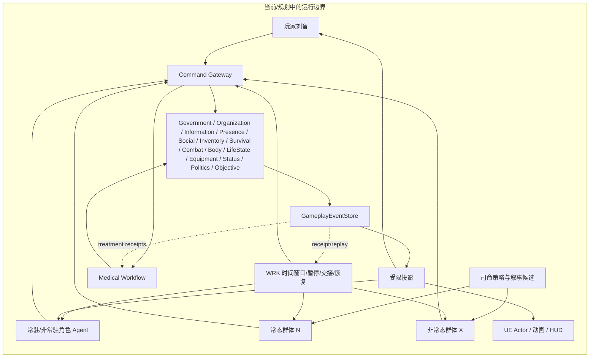
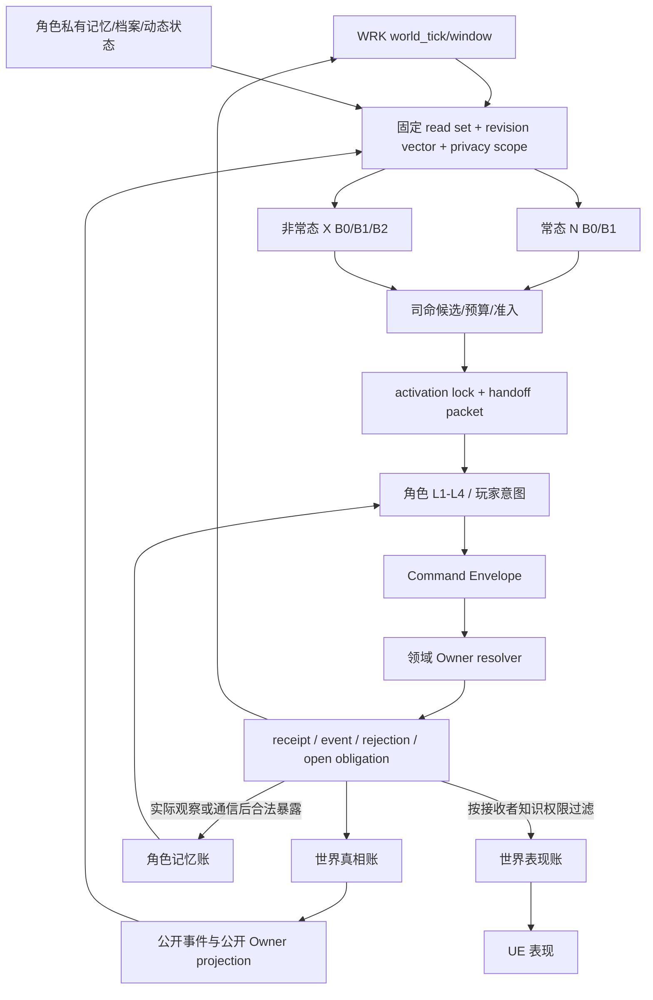
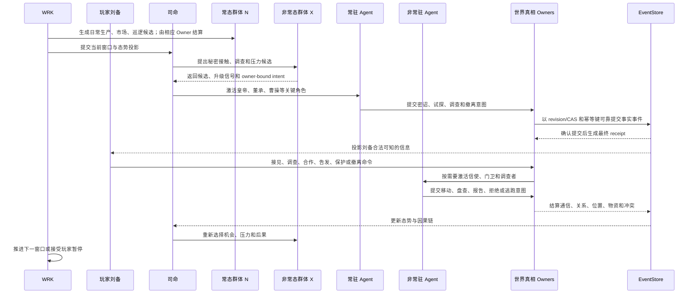

# 衣带诏刘备时序案例

- 版本：1.0（职责拆分版）
- 更新日期：2026-10-30
- 评审状态：设计案例；未作产品/技术验收
- 实现状态：设计/计划；本次未核验代码或UE运行，不代表已实现
- 来源：原04完整时序案例；示例权威缩写按正式规则标注纠偏

> 本文为未实现的设计案例，不是县城Demo范围、历史史实考证、运行日志或验收证据。所有run_id、时间节奏、置信度、物资数值、事件与日志均为说明用示例。完整叙事与分支保留，不以整理日期宣称批准或接入。

## 正式规则引用与示例纠偏

- Owner与基础协作者区分：[01-Owner注册表](../../../architecture/03-Owner领域/01-Owner注册表.md)；WRK/EventStore/医疗Workflow不是新增领域Owner。
- 权威/查询/三本账：[README](../../../architecture/README.md)；私有信念/情绪/解释归角色心智，不归公共Information/Social。
- `[SOC] trust/suspicion`与`[INFO] cao_cao_private_belief`是旧案例的心智简写，若公开关系事实需另有Social/Information合法来源；不能照抄成公共写权。
- `[SURV] horse_feed`是消费情境简称，草料库存与扣量归Inventory；Survival只处理自身领域后果。
- 暂停中“调整亲卫等待位置”只能编辑待发送草案；实际移动/等待到市场高峰必须恢复后发生。
- “WRK唯一推进world_tick”表示逻辑时间权威，不表示所有域只能由UE宿主或某一个进程结算。
- 常态6小时/日、危机1小时等示例节奏以及两匹马、四日口粮、三日草料只属于本案例，不是召陵县配置。

## 1. 案例目的

本案例验证：

1. 玩家扮演刘备时能通过真实行动改变世界；
2. 角色 Agent 根据静态档案、动态状态、私有记忆和有限信息判断；
3. 司命只铺设压力、机会和后果，不替 Owner 宣布事实；
4. 常态与非常态群体模拟分别维持日常世界和秘密危机；
5. 常驻和非常驻角色共享身份连续性且不会双写；
6. 世界真相层 Owner 按时间、权限、位置、信息和资源确认事实；
7. 暂停真正时停，旧命令和旧候选被拒绝；
8. 衣带诏成为可分叉的玩家主导事件，而不是固定任务。

本案例采用一条示例分支：刘备发现衣带诏后，没有立即告发，也没有立即起兵，而是秘密合作、保护关键人员，最终在曹操公开搜捕前离开许都。

## 2. 运行口径

```text
run_id = run:guoshang:yidai-edict:0001
scenario = yidai_edict
world_mode = ordinary_peace
world_mode_revision = 12
start_world_tick = 100000
time_scale = 1 world_day = 24 simulation_hours
pause_policy = full_stop
```

`world_tick` 只由 WRK 推进。角色、群体批次、命令、Owner 事件和 UE 表现都携带当前时间或来源窗口；暂停时不产生新的世界事实。

### 2.1 两组群体模拟

本案例把“非常和平常”解释为“非常态与常态”。

| 群体组 | 对象 | 正常节奏 | 危机节奏 | 可产生 | 不可直接产生 |
|---|---|---|---|---|---|
| 常态 N | 官署、市场、居民、普通守军、商户 | 6 小时或 1 天 | 维持背景生活 | 状态 delta、公开传闻候选、行为种子、升级信号 | 密谋事实、个人重大记忆、Owner 结果 |
| 非常态 X | 信使、调查者、宫廷网络、监视者、搜捕队、逃亡者 | 事件触发后启用 | 1 小时或事件级 | 传递候选、激活候选、owner-bound intent、路线压力 | 诏书成立、关系成立、抓捕成功、政治胜负 |

常态群体让世界保持日常生活，非常态群体让秘密活动承担路线、时间、观察、风险和资源成本。两组都必须经过 Owner receipt 才能进入世界真相账。

### 2.2 两组角色激活

| 角色组 | 典型角色 | 默认精度 | 激活条件 | 释放条件 |
|---|---|---|---|---|
| 常驻激活 | 刘备、曹操、董承、汉献帝 | C3 | 持续参与衣带诏危机或被玩家直接控制 | 案例结束、离开当前世界段或长期休眠 |
| 非常驻激活 | 信使、宫门卫、秦庆童、调查者、管家、目击者 | C0/B0/B1 | 携带秘密、被接触、目击关键事实、盘查、追捕或战斗 | 完成事件、无待决义务并完成 handoff release |

非常驻角色升级时沿用同一个 `character_id`、记忆游标、承诺和状态 revision，不能临时生成剧情替身。

### 2.3 主要角色

| 角色 | 初始状态 | 认知/表现 |
|---|---|---|
| 刘备 | 玩家控制，暂居许都 | 常驻 C3；Agent 提供建议和私有记忆，不替玩家做重大选择 |
| 曹操 | 掌握军政、宫门和监察网络 | 常驻 C3；依据报告、观察和公开行为形成假设 |
| 董承 | 持有密诏，寻找盟友 | 常驻 C3；决定试探、透露、转移和求援 |
| 汉献帝 | 受控制，试图恢复皇权 | 宫廷窗口常驻 C3 |
| 秦庆童 | 董府侍从，只知道传话 | 非常驻；携带秘密时 C2/C3 |
| 曹操探子 | 接受调查任务，不知完整目标 | 非常驻；直接调查时 C3 |
| 宫门守卫 | 执行公开门禁和上级命令 | 普通时 B1，盘查时 C2/C3 |

### 2.4 案例协作者（非 Owner 注册表）

```text
WRK        世界时间、窗口、预算、暂停、唯一推进权、handoff、cursor、恢复
Government 政令、宫禁/通行/搜查政策和行政命令
Politics   公开政治立场、政治承诺与合法性事实
Organization 岗位、军政权限、调查权、秘密网络和指挥关系
Information 谁知道什么、观察、传闻、报告、知识截止点
Presence   位置、路线、占用、到达、阻挡、绕行和逃亡
Social     公共关系证据、非政治承诺和关系退出；私有信任/怀疑留在角色心智账
Inventory  衣带诏、印信、马匹、粮秣、文书和物品保管
Survival   饥饿、疲劳等生存指标
Combat     抓捕冲突、命中、格挡和伤害评估
Body       生命、体力、伤势和身体能力约束
LifeState  存活、倒地、濒死与死亡状态迁移
Equipment  装备防护与耐久
Status     流血等状态效果生命周期
Medical Workflow  治疗步骤和回执编排
Organization/Prisoner 俘获后的拘押关系与脱身状态
Objective  衣带诏目标、政治危机、阶段成功与失败
EventStore 事件顺序、stream revision、幂等、outbox、回放和 checkpoint
```

Owner 之间不共享可写内部对象，只通过 Command、revision pin、已授权 fragment、事件和 receipt 协作。

## 3. 三本账和总体时序

```text
世界真相账：Owner 已承认的密诏、位置、关系、政令、资源和政治事实
角色记忆账：某个角色实际看见、听见、理解、相信或误解的内容
世界表现账：UE Actor、动画、音频、HUD、地图标记和镜头的受限投影
```

### 3.1 案例架构图



图中 `WRK`、`Command Gateway`、`GameplayEventStore` 和 Owner 是基建边界；常态/非常态群体、司命和角色 Agent 是候选与意图生产者；图中 UE 节点仅表示表现与执行端，不代表 UE 只能承载投影。领域 Owner 可以按 Manifest 部署在 UE 或 Paralls；政治结果仍只由登记的 Politics Owner 提交，不能由画面或角色对白宣布。

### 3.2 数据流图



候选结果经 Owner 校验并可靠提交事件后才生成最终 receipt；拒绝回执不表示发生了领域事实变化。正式事件可以进入世界真相账，但不自动进入所有角色记忆或玩家地图；后两者还须经过实际感知、通信和权限过滤。



## 4. 完整时序示意日志（未执行）

### T-10：叙事种子准备

```text
[WRK-100000]
window: 100000 -> 100216
mode = ordinary_peace
budget = normal
pause = false

[N-BATCH-001]
grain_price = 1.0
horse_feed = stable
palace_guard_rotation = normal
public_rumor = low
city_gate_control = normal

[SIMING-CANDIDATE-001]
type = court_secret_resistance
pressure = emperor_under_control
opportunity = dong_cheng_can_contact_trusted_official
target_roles = emperor, dong_cheng, trusted_officials
player_visibility = none
world_truth_mutation = none
```

司命只提出候选，不能直接创建衣带诏事实。若剧本种子获准，后续由 Government、Inventory 和 Information Owner 逐项结算。

### T-5：皇帝决定秘密求助

```text
[AGENT-EMPEROR-001]
intent = seek_secret_restoration_support
target = dong_cheng
secrecy = maximum

[AGENT-DONG-001]
emperor_request = credible
available_network = small
exposure_risk = high
intent = accept_secret_decree

[GOV-100010] create_secret_imperial_decree = admitted
[INV-100011] item_created = item:imperial-decree:0001
[INFO-100012] visibility = restricted; scope = court-secret
```

### T-4：密诏交给董承

```text
[PRES-100020]
palace-inner-court -> palace-side-hall
guards = 2
visibility = partial
result = reachable

[INV-100022]
transfer custody: emperor -> dong_cheng
item = item:imperial-decree:0001
result = committed
revision = 2

[AGENT-DONG-002]
candidate = liu_bei
intent = locate_trusted_anti_cao_contact
confidence = 0.61
```

附近守卫最多知道“皇帝与董承会面”，不知道会面内容。

### T-3：常态世界继续运转

```text
[N-BATCH-003]
grain_price = 1.02
horse_feed = stable
public_rumor = low

[X-BATCH-003]
unusual_visitors_at_dong_cheng_house = 1
messenger_candidate = available
palace_servant_suspicion = +1
cao_cao_investigation = not_started

[POPULATION-003]
activation_candidate = qin_qingtong
presentation_seed = dong_cheng_household_activity
owner_bound_intent = none
```

### T-2：信使出发

董承让秦庆童传达“请求私下会面”，不让他知道诏书内容。

```text
[ORG-100030]
role = household_servant
formal_authority = none
informal_delivery = valid

[CMD-100031]
dispatch_private_message
sender = dong_cheng
carrier = qin_qingtong
recipient = liu_bei
content_scope = incomplete
expires_at = 100072

[HANDOFF-100033]
qin_qingtong: C0 -> C2
reason = carries_sensitive_message
lease = acquired

[AGENT-QIN-001]
knows = "董公有话转达"
does_not_know = decree_content
intent = complete_delivery
```

### T-1：玩家第一次获得线索

刘备可见投影：

```text
[PROJECTION-100040]
visible = visitor_from_dong_cheng_house, private_request, nervous_behavior
hidden = decree_exists, emperor_involvement, cao_cao_awareness

[PLAYER-INPUT]
action = accept_private_visitor

[CMD-100041]
command = allow_private_meeting
principal = liu_bei
target = qin_qingtong
result = admitted

[PRES-100042]
qin_qingtong_arrived = true
meeting_location = liu_bei_private_room
guards_nearby = 2
```

### T-1：玩家暂停

```text
[WRK-100050]
pause_requested = true
reason = player_planning
world_tick = frozen at 100048
owner_settlement = frozen
agent_reasoning = frozen
population_cadence = frozen
siming_generation = frozen
transport = frozen
animation = frozen
handoff = frozen
```

玩家只能查看已知信息、编辑未发出命令、调整亲卫待命位置；不能让秦庆童继续移动、读取曹操记忆或获得密诏内容。玩家准备“接收消息但先试探信使”后恢复：

```text
[WRK-100051]
resume = true
control_epoch = 8
world_tick = 100048
revision_check = valid
```

### T0：秦庆童递话

```text
[AGENT-QIN-002]
disclose = "董公想请将军私下见面"
conceal = decree_content, emperor_involvement
confidence = 0.73

[SOC-100060]
trust_delta = +2
suspicion_delta = +1

[INFO-100061]
liu_bei_received = dong_cheng_requests_private_meeting

[CMD-100062]
command = arrange_private_meeting
result = admitted

[AGENT-DONG-004]
trust_in_liu_bei = 0.52
exposure_risk = 0.68
intent = test_liu_bei_before_full_disclosure
```

### T+1：常态与非常态同步推进

```text
[N-BATCH-004]
grain_merchant_complaint = +1
palace_guard_rotation = tightened_by_one_unit
public_rumor = "曹公近日加强宫门巡逻"
rumor_certainty = low

[X-BATCH-004]
qin_contact_confirmed = true
dong_cheng_activity = +1
palace_guard_tightening = observed
cao_cao_investigation = not_started

[SIMING-CANDIDATE-003]
candidate = private_meeting_under_pressure
possible_outcomes = test, reject, conditional_accept, report
constraint = no_full_decree_reveal_without_character_action
```

### T+2：刘备与董承会面

```text
[PLAYER-INPUT]
action = travel_to_dong_cheng_residence

[PRES-100080]
route = east_private_lane
road_status = clear
escort = 2 guards
arrival = committed

[SURV-100081]
liu_bei_fatigue += 3
horse_feed -= 1
```

董承先谈汉室与曹操擅权，再问：“若有人欲匡扶汉室，将军会如何自处？”刘备回答：“汉室若有诏命，自当奉诏；但行事不能轻举妄动。”

```text
[SOC-100082]
trust_delta = +4
political_alignment_signal = +2

[ORG-100084]
relation = confidential_political_contact
authority = none
commitment = provisional

[AGENT-DONG-007]
intent = disclose_secret_decree

[GOV-100085]
disclosure_authority = valid

[INV-100087]
item = item:imperial-decree:0001
custody = dong_cheng
inspection = temporary

[INFO-100086]
liu_bei_knows = emperor_secretly_seeks_resistance
```

刘备只看到董承展示密封物，不知道其他知情者，也不知道曹操是否有线索。

### T+2：玩家决定秘密合作

```text
[PLAYER-INPUT]
action = accept_secret_cooperation_conditionally
conditions = no_immediate_revolt, protect_information, identify_contacts, prepare_escape

[CMD-100090]
command = form_confidential_cooperation
result = admitted

[SOC-100091]
trust = 0.64
commitment = conditional
betrayal_risk = medium

[ORG-100092]
network_id = network:anti_cao:0001
members = liu_bei, dong_cheng
command_authority = none

[OBJ-100093]
objective = preserve_secret_decree
status = open

[EV-100094] information.decree_revealed_to_liu_bei
[EV-100095] social.confidential_cooperation_formed
[EV-100096] objective.secret_decree_preservation_opened
```

### T+3：刘备建立小型行动网络

```text
[PLAYER-INPUT]
actions = increase_private_security, ask_safe_route, reserve_horse_feed

[ORG-100101]
player_authority_over_guard_captain = valid

[PRES-100102]
main_gate_guard = 2
rear_lane_guard = 1

[INFO-100104]
rear_lane_route = known
unreliable_gatekeeper = known

[INV-100106]
horse_feed -= 5
reserve_container = liu_bei_private_store

[INFO-100107]
public_observation = "刘备府上增加了守卫"
rumor_certainty = low
```

### T+4：司命开始铺设压力

```text
[X-BATCH-005]
liu_bei_security_activity = elevated
qin_contact = confirmed
dong_cheng_activity = elevated
palace_guard_tightening = true

[SIMING-CANDIDATE-004]
A = cao_cao_private_summons
B = qin_qingtong_questioned
C = dong_cheng_requests_contact
selected_for_evaluation = A

[AGENT-CAO-001]
direct_evidence = absent
intent = summon_liu_bei_for_private_conversation

[GOV-100120]
issue_private_summons = admitted
```

### T+5：曹操召见刘备

玩家赴约，并派亲卫观察路线。

```text
[PRES-100130]
route = liu_bei_residence -> cao_cao_office
observer_guard = assigned

[AGENT-CAO-002]
plan = discuss_military_affairs, mention_palace_security, observe_response

[PLAYER-INPUT]
reply = "承蒙丞相照拂，一切如常。"

[SOC-100131]
cao_cao_impression = cautious
suspicion_delta = -1
respect_delta = +1

[INFO-100132]
cao_cao_learns = liu_bei_response_calm
cao_cao_does_not_learn = decree_content, network_members
```

### T+6：过时命令被拒绝

玩家准备让亲卫向董承示警，但确认命令延迟：

```text
[CMD-100141]
command = send_warning_to_dong_cheng
expected_world_tick = 100520
current_world_tick = 100568
status = stale
reason = expected_world_tick_expired
result = rejected

[CMD-100142]
command = send_warning_to_dong_cheng
expected_revisions = liu_bei_command:9, dong_cheng_presence:8
result = admitted
```

### T+7：秘密警告传递

```text
[HANDOFF-100150]
actor = guard_messenger_liu
C0 -> C3
reason = carries_politically_sensitive_warning

[AGENT-MESSENGER-001]
knows = "提醒董公提高警惕"
does_not_know = decree_content
intent = move_to_dong_cheng

[PRES-100151]
route = rear_lane
obstacle = city_patrol
decision = wait

[PRES-100153]
patrol_moves_away = true
messenger_resumes = true
arrival = committed

[CMD-100154]
event = warning_delivered
understanding = partial
result = committed
```

### T+8：董承调整计划

```text
[AGENT-DONG-010]
reduce_open_contacts = true
move_decree_custody = true
delay_new_recruitment = true

[INV-100160]
from = dong_cheng_private_room
to = trusted_hidden_container
result = committed

[ORG-100161]
contact_frequency = reduced
new_membership = frozen

[SIMING-CANDIDATE-006]
candidate = create_escape_window
options = horse_route, official_travel_assignment, wait, partial_exposure
```

### T+9：公开管控影响常态生活

```text
[GOV-100170]
command = tighten_palace_gate_control
public_reason = security_review
result = committed

[N-BATCH-006]
market_delivery_delay = +4%
palace_workers_wait_time = +12%
public_rumor = medium

[X-BATCH-006]
secret_route_risk = increased
messenger_cost = increased
information_leak_risk = increased

[INFO-100171]
public_rumor = "宫门盘查变严"
certainty = medium
```

刘备知道宫门更严，但不知道这是针对衣带诏。

### T+10：第一名参与者被怀疑

```text
[AGENT-CAO-011]
qin_contacted_liu_bei = confirmed
liu_bei_security = elevated
palace_gate_control = elevated
direct_link = unproven

H1 = unrelated_security       confidence=0.34
H2 = liu_bei_dong_cheng_contact confidence=0.41
H3 = palace_resistance_network confidence=0.25

[HANDOFF-100180]
actor = cao_cao_observer
C0 -> C3
reason = direct_interrogation

[AGENT-OBSERVER-001]
goal = determine_qin_knowledge
constraints = preserve_cover, no_unauthorized_torture

[AGENT-QIN-003]
admits = delivered_request_for_private_meeting
denies = knowledge_of_decree

[INFO-100182]
cao_cao_learns = qin_contacted_liu_bei
decree_knowledge = unknown
```

### T+11：刘备保护秦庆童

玩家从亲卫回报得知秦庆童被问话，尝试秘密转移。

```text
[ORG-100190]
liu_bei_can_protect_external_servant = not_authorized
informal_influence = available

[SOC-100191]
request = persuade_dong_cheng_to_move_servant
result = accepted

[AGENT-DONG-012]
move_qin = yes
reason = servant_is_exposed

[AGENT-QIN-004]
accept_escape = true
fear_of_arrest = high
```

### T+12：运输路线受阻并绕行

```text
[X-BATCH-007]
patrol_route_shifted = true

[PRES-100200]
qin_route = blocked
options = wait, reroute, abandon

[AGENT-DONG-013]
decision = reroute_through_market

[N-BATCH-007]
market_density = high
route_cover = high
collision_risk = medium

[PRES-100201]
route_changed = market_lane
reroute_revision = 3

[PRES-100203]
qin_arrival = relative_storehouse
status = committed
```

### T+13：曹操得到危险但不完整的推断

```text
[INFO-100210]
cao_cao_private_belief:
  liu_bei_dong_cheng_connection = 0.63
  secret_decree_exists = 0.48
  direct_proof = absent

[SIMING-CANDIDATE-009]
candidate = cao_cao_invites_liu_bei_to_public_feast
purpose = controlled_observation
constraint = no_direct_accusation_without_evidence
```

### T+14：刘备准备撤离

玩家储备马匹、粮食和公开出行理由，但保留密诏由董承保管。

```text
[INV-100220]
horses = 2
food = 4 days
feed = 3 days

[ORG-100222]
public_military_assignment_authority = insufficient
official_order = required
```

### T+15：刘备参加曹操宴席

曹操公开问英雄与汉室，玩家回答：“能守本分、安天下者，方可称英雄。”

```text
[AGENT-CAO-015]
strategy = observe_reactions, discuss_han_loyalty, create_social_pressure

[SOC-100230]
cao_cao_impression = cautious
suspicion_delta = +1
respect_delta = +1

[INFO-100231]
other_officials_receive = public_conversation_only
private_memories = not_exposed
```

### T+16：世界模式切换为政治紧张

```text
[WRK-100240]
from = ordinary_peace
to = political_tension
reason = accumulated_secret_network_signals
mode_revision = 13

[N-BATCH-008]
official_inspections = +10%
gate_delay = +8%
market_rumor = medium
ordinary_work_efficiency = -2%

[X-BATCH-008]
cadence = hourly
active_cohorts = dong_cheng_network, liu_bei_household, palace_gate_watch, cao_cao_observers
```

### T+17：曹操开始秘密调查

```text
[AGENT-CAO-016]
intent = discreet_investigation
target = dong_cheng
secondary_target = liu_bei

[ORG-100250]
private_investigation_authority = valid
public_arrest_authority = not_yet_activated
result = investigation_admitted

[PRES-100251]
observer_positions = dong_cheng_house_gate, liu_bei_residence_lane, palace_side_route

[PLAYER-VIEW]
visible = someone_repeatedly_passes_liu_bei_residence
hidden = full_investigation_order
```

### T+18：董承要求刘备表态

```text
[AGENT-DONG-017]
decree_exposure = rising
intent = ask_liu_bei_for_immediate_commitment

[PLAYER-INPUT]
action = prepare_exit_and_preserve_network

[ORG-100260]
plan = escape_window
revolt = not_authorized

[OBJ-100261]
preserve_decree = active
preserve_network = active
immediate_revolt = not_selected
```

### T+19：公开出城申请被拒绝

```text
[CMD-100270]
command = request_official_departure
reason = inspect_local_military_supply

[GOV-100271]
result = rejected
reason = insufficient_official_basis
```

玩家看到：“你的出城请求暂未获准，官署要求补充正式军务凭据。”

### T+20：玩家改走秘密路线

```text
[CMD-100280]
command = initiate_secret_departure
targets = liu_bei, two_guards, two_horses, four_days_food
expected_revisions = government_mode:13, liu_bei_presence:24, inventory:19
result = admitted

[PRES-100281]
route_candidates = north_gate, east_lane, rear_market_gate
selected = rear_market_gate
reason = occupancy_and_observation_pattern

[INV-100282]
horse_01 = mounted
horse_02 = mounted
food -= 1
feed -= 1

[SURV-100283]
liu_bei_fatigue = +4
combat_readiness = adequate
```

### T+20：曹操探子发现出城迹象

```text
[X-BATCH-009]
liu_bei_household_activity = unusual
horse_preparation = confirmed
departure_time = uncertain

[AGENT-CAO-021]
liu_bei_may_leave = 0.72
liu_bei_has_decree = 0.39
decision = observe_and_follow

[ORG-100290]
observer_follow = accepted

[PRES-100291]
follow_mode = distant
visibility_to_liu_bei = not_detected
```

### T+21：玩家暂停规划，恢复后等待市场高峰

```text
[WRK-100300]
pause = true
world_tick = frozen
```

秦庆童、曹操探子、市场人群和路线占用全部冻结。玩家选择等待市场高峰后恢复。

```text
[N-BATCH-010]
market_density = high
guard_visibility = reduced
cover_quality = high

[X-BATCH-010]
departure_window = favorable
patrol_intersection = low
```

### T+21：宫门守卫盘查

```text
[AGENT-GUARD-001]
liu_bei_identity = recognized
official_document = absent
intent = request_reason

[GOV-100310]
gate_pass = false
guard_can_delay = true
guard_can_arrest = false

[ORG-100312]
rank_respect = sufficient
mission_proof = insufficient

[GOV-100313]
delay = one_minute
full_arrest = false
allow_passage = conditional
```

玩家声称奉命巡视军马，获得条件放行，不是因为剧情强制，而是因为身份、权限和门禁规则共同产生结果。

### T+21：曹操探子暴露

```text
[PRES-100320]
observer_detected = true
detection_basis = guard_visual_observation

[LIU-ADVISORY]
continue_without_conflict
enter_crowded_area
send_guard_to_confirm
change_route
```

玩家选择改变路线：

```text
[PRES-100321]
old_route = rear_market_gate
new_route = western_freight_lane
reason = observer_detected

[SOC-100323]
caravan_cover = conditionally_accepted
cost = one_horse_feed_bundle

[INV-100324]
horse_feed -= 1
```

### T+22：曹操不公开封锁，董承网络出现分歧

```text
[AGENT-CAO-022]
liu_bei_departure = probable
decree_possession = unproven
decision = tighten_selected_gates_and_follow

[GOV-100330]
command = tighten_city_gates
public_reason = anti_bandit_security
scope = selected_gates

[AGENT-OFFICIAL-X-001]
decision = leave_network
reason = personal_safety_priority

[ORG-100341]
official_x = withdrawn_candidate
network_strength -= 1
```

董承知道有人退出，刘备不知道具体是谁。

### T+23：刘备离开许都外围

```text
[PRES-100350]
crossed = western_freight_gate
status = outside_primary_control_zone
pursuit = possible

[GOV-100351]
departure_formally_confirmed = false
pursuit_order = not_issued

[SURV-100352]
liu_bei_fatigue = high
hunger = moderate
combat_readiness = reduced

[OBJ-100353]
preserve_decree = still_open
player_escape = partial_success
network_survival = uncertain
```

### T+24：董承最后一次回报

```text
[HANDOFF-100360]
actor = dong_cheng_messenger_02
C0 -> C3
reason = high_value_message

[AGENT-MESSENGER-002]
knows = liu_bei_has_left, dong_cheng_wants_contact
does_not_know = full_network

[INFO-100361]
liu_bei_receives = dong_cheng_remains_in_xuchang, decree_not_yet_exposed, no_more_public_contact
```

### T+25：曹操确认刘备离开

```text
[AGENT-CAO-025]
liu_bei_left_xuchang = confirmed
decree_found = false
dong_cheng_network = suspicious
decision = open_discreet_search

[GOV-100370]
command = discreet_search_dong_cheng_network
scope = restricted
result = committed

[OBJ-100372]
liu_bei_route = escaped
political_conflict = active
yidai_edict = unresolved
```

### T+26：常态与非常态世界分裂

```text
[N-BATCH-012]
official_story = liu_bei_left_for_military_reason
public_rumor = mixed
market = continues
grain_supply = stable
ordinary_life = mostly_normal

[X-BATCH-012]
dong_cheng_household_risk = high
court_network = under_observation
messengers = suspended
private_contacts = fragmented
escape_routes = changing
```

### T+27：窗口关闭与检查点

```text
[WRK-100380]
window_close = 100000 -> 100864
confirmed_cursor = 100864
recovery_tasks = none
open_obligations = dong_cheng_network_survival, decree_custody, cao_cao_investigation, liu_bei_external_alliance

[REPLAY-CHECKPOINT-001]
checkpoint = checkpoint:world:100864
streams = government, organization, information, presence, social, inventory, survival, objective, character_core
```

## 5. 三本账最终状态

### 5.1 世界真相账

```text
密诏确实存在
密诏曾由董承保管
刘备已经知道密诏
刘备与董承形成临时秘密合作
曹操已经开始秘密调查
刘备成功离开许都外围
曹操尚未取得密诏直接证据
衣带诏政治危机仍未结束
```

### 5.2 刘备记忆账

```text
董承向自己透露了皇帝反曹的秘密
密诏没有交给自己保管
曹操曾试探自己
有人跟踪自己
自己已经离开许都
董承仍处于危险中
```

刘备不知道曹操是否看过密诏、其他参与者是谁、哪名官员退出、董承下一步做什么。

### 5.3 世界表现账

```text
刘备已骑马离开许都
城门加强巡逻
董承府邸附近出现守卫
市场仍在运转
城内出现少量紧张传闻
```

## 6. 分叉结果

以下分支都使用同一套 Owner，不建立另一套剧情系统。

### A：刘备加入并组织力量

```text
player_choice = accept_and_recruit
possible = secret_alliance, external_contact, resource_preparation, witness_protection
risk = exposure, internal_withdrawal, intercepted_messenger, early_blockade
```

“加入”本身不是成功；Objective Owner 必须确认密诏未暴露、网络仍存并完成后续目标。

### B：刘备拒绝但保密

```text
player_choice = refuse_but_keep_secret
possible = dong_cheng_recruits_others, liu_bei_short_term_safety, later_entanglement
```

### C：刘备告发

```text
player_choice = report_to_cao_cao
possible = cao_believes, cao_partially_believes, cao_monitors_liu_bei
effects = han_support_down, cao_trust_changed, network_relocated_or_exposed
```

告发结果取决于证据质量、刘备可信度、曹操目标和政治环境，不是固定奖励。

### D：刘备假意合作后出逃

```text
player_choice = feign_cooperation_then_escape
owner_chain = Social -> Information -> Organization -> Presence -> Combat -> Equipment -> Body -> Status -> Objective
failures = exposed, route_blocked, guard_injured, decree_lost, player_captured
```

### E：密谋提前暴露

```text
trigger = cao_cao_obtains_sufficient_evidence
world_mode = political_tension -> pursuit_or_crackdown
normal_population = curfew, inspection, market_restriction, fear
abnormal_population = search, escort, flight, pursuit, defection
activation = key_roles_to_C3; ordinary_members_by_contact_scope
siming_candidates = escape, countermeasure, rescue, evidence_transfer
```

## 7. 边界审计

| 审计项 | 案例处理 |
|---|---|
| 玩家是否全知 | 否，只消费刘备实际观察、对话、报告和传闻 |
| 司命是否强行写剧情 | 否，只提出候选并受事实、政策、预算约束 |
| 群体模拟是否直接写事实 | 否，只输出候选、升级信号或 owner-bound intent |
| Agent 是否替玩家选择 | 否，刘备 Agent 提供建议，玩家拥有重大选择权 |
| 角色能否不服从 | 能，角色可拒绝、拖延、误解或改写执行方式，但结果仍由 Owner 结算 |
| 是否双写角色 | 否，同一角色同一窗口只有一个推进者和一个 activation lock |
| 动画是否代表事实 | 否，Owner receipt 才代表到达、转移、抓捕或政治结果成立 |
| 暂停是否真暂停 | 是，world tick、模拟、Agent、Owner 提交、动画和 handoff 全部冻结 |
| 旧命令能否穿越时间 | 不能，stale revision、旧 epoch 和旧 lease 必须拒绝 |
| 是否有第二份世界真相 | 没有，EventStore 与领域 Owner 维护唯一事实链 |

## 8. 案例验收标准

1. 刘备在不知道密诏全貌时，通过接触、试探和关系行动逐步获得信息。
2. 董承、曹操、秦庆童和信使在有限信息下做出不同判断，不被统一脚本替代。
3. 常态群体持续推进市场、官署、守卫和居民；非常态群体只在事件范围内高频推进。
4. 常驻角色保持连续身份和记忆；非常驻角色能从 B0/B1 升级到 C2/C3 后释放。
5. 司命能提出会面、宴席、调查和逃亡窗口，但不能直接宣布成功、失败或抓捕。
6. 玩家暂停时所有世界推进停止；恢复后从相同 `world_tick` 继续。
7. 过时命令、路线阻挡、权限不足、信息缺失和 Owner 拒绝形成可解释日志。
8. 同一事件账能分叉出秘密合作、告发、拒绝、逃亡和提前暴露五种结果。
9. checkpoint 和事件流能重建 T+27 的世界真相、刘备记忆和世界表现投影。
10. 日志能回答“谁在什么时候知道了什么、提出了什么、哪个 Owner 承认了什么、玩家看到了什么”。

## 9. 结论

衣带诏同时需要有限信息、角色自主判断、秘密通信、组织权限、关系变化、路线风险、资源消耗、玩家暂停、司命铺垫、常态背景生活和非常态高压推进，适合作为最新世界架构的完整案例。

本案例不是复刻固定史书结果，而是把衣带诏作为受约束的历史压力源。刘备每次选择都通过时间、通信、位置、关系、资源和权限改变后续世界；角色 Agent 可以自作主张但不能越过 Owner；司命可以安排机会但不能宣布结果；最终事实必须回到 Owner receipt、EventStore、checkpoint 和三本账。
