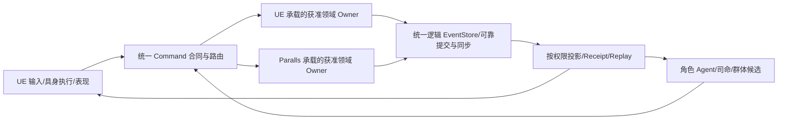

# 《国殇：汉末》五阶段战争世界设计大纲

**状态：** `awaiting-user-review`

**版本：** v0.2 工作稿（基础设施边界同步）

**日期：** 2026-10-30

**适用范围：** UE 客户端、Paralls 角色智能体/司命/群体模拟接入，以及从县城到十三州的连续战争世界。

**前置约束：** 本文保留五阶段总体体验方向；当前交付以县城守城 Demo 的 05 执行路线为准，骑将冲阵作为其骑战/传令子切片。基础设施按[08 建设总计划](玩法系统/08-基础设施与Owner建设总计划.md)在第一阶段建设完整 23 Owner 及五阶段合同；县城之外的内容不因此自动纳入本轮。

**第一阶段 Demo 执行基线：** 县城守城 Demo 的基础设施拆解、执行阶段门和验收矩阵见[《第一阶段县城守城 Demo 设计与执行路线》](玩法系统/05-第一阶段县城守城Demo设计与执行路线.md)。

## 1. 核心决定

本项目是一个完整、连续、可持续运行的战争与政治经营游戏。第一阶段不是多个独立小游戏的集合，也不是只验证骑战或围城的短关卡。

骑战、战术指挥、城池经营、后勤、通商、细作、群体生活和政治行动都发生在同一世界、同一时间线、同一存档和同一套权威事实中。

```text
个人行动 / 战术指挥 / 城池经营 / 区域政治
                  │
                  v
        同一世界状态与连续时间
                  │
                  v
   人口、组织、资源、关系、战斗和政治后果
```

第一阶段与后续阶段的主要区别是世界范围和组织层级逐步扩大，不是每个阶段重新制作一套互不相容的玩法。

## 2. 五阶段路线

| 阶段 | 世界范围 | 核心体验 | 主要扩展 |
|---|---|---|---|
| 第一阶段 | 一座县城、周边村落、野战区、攻方营地和粮道 | 县城攻守、出城野战、坚壁清野、断粮、细作、投毒、伤病、军心与士气 | 完整 UE-Paralls 接入、人口/职业、战斗/指挥、资源/后勤和城池持续运行 |
| 第二阶段 | 一个郡内的多座县城、村落、商路和关隘 | 打下城池后守住并经营，维持通商和生产 | 占领治理、县令任命、税粮、商路、运输网络和经济战 |
| 第三阶段 | 多郡、多个势力和多条战线 | 多郡持续战争与政治经营 | 联盟、背叛、投降、郡守体系、地方派系、跨郡兵源和粮道 |
| 第四阶段 | 州域级的郡县、州府、关隘和军团 | 州域战争、战略纵深和政治整合 | 州级税粮、军团、州府、战略仓储和合法性 |
| 第五阶段 | 东汉十三州及主要势力 | 十三州争霸、割据、统一或重建秩序 | 州际战争、全国人口与资源网络、势力联盟、历史分岔和长期秩序 |

阶段是世界扩展路线，不是菜单中的五个模式。玩家在第一阶段建立的角色、关系、资产、伤病、声望、组织和战争事实应能继续进入后续阶段。

## 3. 第一阶段定位：完整县城战争沙盒

### 3.1 体验目标

第一阶段应让玩家感受到：一座县城不是一张战斗地图，而是一个依靠人口、生产、贸易、命令和关系维持的活的战争社会。

玩家可以亲自骑马或步战，也可以通过将领、军需官、工匠、村民、商人和细作影响战局。玩家的个人战斗不能替代组织、后勤和政治；组织行动也不能剥离个人位置、信息和风险。

### 3.2 地理范围

第一阶段建议包含以下连续区域，具体尺寸待评审：

- 一座中小型县城；
- 城门、城墙、城内街区、粮仓、水井、工坊、医舍、民居和指挥所；
- 城外两个或三个村落；
- 农田、林地、道路、桥梁或浅河；
- 攻方营地、器械工地和攻方粮站；
- 一条可被护送、袭击或切断的主要粮道；
- 可发生伏击、追击、突围和援军接战的野战区。

城内、村落、道路、粮道和野战区共享人口、库存、设施、占领和时间状态。玩家离开其中一个区域时，其他区域继续推进。

### 3.3 第一阶段的连续循环

```text
日常治理与人物关系
  -> 侦察敌情、商路和粮道
  -> 坚壁清野、征召、训练、修城和配给
  -> 攻方建立营地、运输线和器械工地
  -> 出城野战、护送、伏击或闭城
  -> 围城、断粮、缺水、疾病、投毒、细作和城墙攻防
  -> 突围、援军、投降、破城或攻方撤围
  -> 伤亡、人口迁移、库存、设施、关系和政治后果
  -> 战后恢复、重建和下一轮冲突
```

上述循环不跳转到独立小游戏。不同玩法是同一状态下的行动方式和决策视角。

### 3.4 同一游戏中的行动层

| 行动层 | 玩家行为 | 对同一世界的影响 |
|---|---|---|
| 个人行动 | 骑马、步战、侦察、护送、谈判、追捕、审问、突袭 | 个人生命、位置、关系、情报和局部战斗事实 |
| 战术指挥 | 编队、阵型、目标、路线、任务、传令和临时改令 | 队伍位置、执行、损耗、阵型、士气和命令状态 |
| 城内经营 | 配给、征召、轮换、修城、治安、医疗、生产和贸易 | 人口需求、劳力、库存、设施、民心和军心 |
| 战区调度 | 粮道、商路、运输队、村落防护、援军和撤退 | 资源抵达、战线持续时间、兵力覆盖和战略压力 |

玩家可以在行动层之间切换，切换工作层、镜头或地图不会暂停，也不会重置世界。玩家主动触发单人暂停时，世界时钟、命令传递、Agent、群体模拟、运输、生产、动画和 Owner 提交全部冻结；恢复后重新校验命令、revision、epoch 和 lease。命令的可达性、信息时效、人物权限和实际通信条件始终有效。

## 4. 战争能力方向与第一阶段内容选择

下列条目是统一规则可组合的战争方向，不要求 Demo 逐项制作独立场景。第一阶段内容、胜负和可选行动以 05 为准；基础设施不得借内容裁剪省略 08 的完整 Owner 建设。

### 4.1 城外战争

- 平原会战、村落争夺和桥口争夺；
- 粮车护送、粮道截击和运输队救援；
- 侦察、伏击、反伏击和追击；
- 夜袭营地、破坏器械工地和袭击粮站；
- 高地、道路、林地、浅河等地形带来的位置与运输差异；
- 援军接战、败军撤退和小股骑兵袭扰；
- 村民迁移、护送、征发和难民流动。

### 4.2 城池攻防

- 正门强攻、冲车破门和云梯登城；
- 城墙局部突破、城门内外争夺和街巷战；
- 投射器或远程器械压制；
- 守军反冲锋、夜间偷袭、佯攻和假撤退；
- 内应开门、俘虏招降、守军哗变和指挥继任；
- 守方突围、援军解围、攻方撤围和开门投降；
- 破城后的追击、收容、治安和设施损毁。

这些能力由同一套单位、地形、资源、命令、关系和权威结算规则组合产生，不为每种情况制作独立小游戏或独立事实系统。

### 4.3 城内战争与社会行动

- 坚壁清野、粮水转移、牲畜收容和村落撤离；
- 征召民夫、改派工种、训练新兵和安排轮休；
- 私藏粮食、黑市、秘密运输和配给冲突；
- 细作接触、收买、伪装、传递假消息和破坏供应；
- 粮水投毒、污染发现、隔离、救治和追查；
- 俘虏收押、招降、交换和编入组织；
- 民众暴动、豪强倒戈、商人转向和守军哗变；
- 将领失能、继任、权限重交和队伍重新规划。

## 5. 人口、兵种和职业

兵种和工种是角色当前职业，不是固定种族或永久单位类别。角色的社会身份、技能、家庭、关系、伤病、记忆和经历在职业变化后保留。

```text
村民
  -> 征召民夫
  -> 搬运工
  -> 接受长枪训练
  -> 守城枪兵
  -> 受伤
  -> 医舍休养
  -> 返回木工或家庭岗位
```

第一阶段至少需要以下战斗职业：

- 刀盾兵；
- 长枪兵；
- 弓手；
- 弩手；
- 骑兵与轻骑斥候；
- 亲卫；
- 攻城器械操作人员。

第一阶段至少需要以下辅兵和民间工种：

- 搬运与运输；
- 木工；
- 土石工；
- 炊事与供水；
- 医护与担架；
- 军械维护；
- 畜养与车马照料；
- 斥候与信使；
- 商人和行脚运输；
- 细作与情报中间人。

职业变更需要时间、装备、技能、岗位交接和组织许可。调派可能因疲劳、伤病、家庭责任、待遇、权限或恐惧而被拒绝或延迟。

## 6. 统一资源与状态链

第一阶段的后勤和战斗共享同一状态链：

```text
生产 / 掠夺 / 交易
  -> 仓储
  -> 装车与运输
  -> 粮道或商路
  -> 实际抵达
  -> 配给与消费
  -> 生命、健康、疲劳、军心、士气和战力
  -> 阵型、执行、伤亡、撤退和政治后果
```

首批资源类型：粮食、水、盐、药材、木材、石料、铁料、箭矢、马匹、驮畜、工具和现金/贸易物资。

核心状态至少区分：

- 生命与伤势；
- 饥饿、口渴、疲劳、疾病和中毒；
- 个人意愿、恐惧、信任和服役态度；
- 队伍军心与战斗士气；
- 阵型、训练、装备和可用兵力；
- 城内民心、治安和生产能力；
- 粮道、商路、运输和库存；
- 设施完整度和城池控制权。

缺粮、缺水、缺盐或缺药不能直接变成一个隐藏的全局惩罚。状态必须通过消费、劳动、健康、命令、战斗和关系产生可追溯的后果。

## 7. Paralls 与 UE 的统一责任边界

第一阶段即完整接入 Paralls，不采用先做本地小游戏、后续再替换的路线。



同一 scope/epoch 只有一个 canonical writer。UE 本地权威事件可靠落地后异步同步，后端不重算同一伤害；逻辑账本统一不等于每次命中必须跨进程等待。全量节奏与宿主登记见[08 第 11.2 节](玩法系统/08-基础设施与Owner建设总计划.md#112-全量-owner-的-ue-协作与节奏矩阵)，ESM 选择性复用见[01 第 9 节](玩法系统/01-Paralls现有Owner与接入分析.md#9-esm-复用边界与迁移检查)。

### 7.1 UE 负责

- 玩家输入、角色控制、骑乘、移动、碰撞和导航；
- 近场战斗、空间交互和战场表现；
- 动画、声音、镜头、UI 和人口可视化；
- 接收结构化意图并进行能力、距离、权限、目标、导航和时效校验；
- 把执行事实、观察事实和本地预测结果上报；
- Paralls 不可用时，仅在仍有效的意图/执行许可和已登记本地事实权威范围内继续当前计划或获准预案；过期/冲突请求须拒绝或重校验，未授权范围保持 pending/安全中断，不自动接管意图或写权。

### 7.2 Paralls 负责

- 角色感知、记忆、目标、计划和语义行动意图；
- 司命对公开世界态势的判断和高层催化；
- 人口、家庭、职业、生产、消费、迁移、劳动和群体趋势候选；公共事实由对应领域 Owner 结算；
- 已登记领域的权威结算、事件历史、回执、投影、回放和恢复；
- 跨域事件的因果、相关、版本、幂等和来源信息。

### 7.3 越权禁止

角色智能体、司命和群体规划器不能直接写入 UE 位置、骨骼、动画、伤害、库存、生命、城池控制或最终胜负。所有最终事实必须经过相应 Authority。

## 8. 五阶段的技术连续性

表中后续阶段表示内容、配置与容量扩展；23 个领域的完整基础能力在第一阶段按 08 建成，不把 Ownership、Economy、Politics 等推迟到下一阶段才实现。

| 技术能力 | 第一阶段 | 第二阶段 | 第三阶段 | 第四阶段 | 第五阶段 |
|---|---|---|---|---|---|
| UE-Paralls 适配 | 建立正式适配和恢复链 | 复用 | 复用 | 复用 | 复用 |
| CharacterAgent | 关键将领、军需、商人、村民和细作 | 扩展县令、官吏和商队人物 | 扩展郡守、派系和外交人物 | 扩展州级将领和官员 | 扩展州牧、势力首领和关键政治人物 |
| Population | 县城、村落和攻方营地 | 郡内多县人口网络 | 多郡人口与迁移 | 州域人口聚合与展开 | 十三州人口与资源网络 |
| Siming | 粮荒、民怨、兵变、援军和围城态势 | 城际风险和经济战 | 多郡战线与政治催化 | 州域战略趋势 | 十三州势力变化与历史分岔 |
| Authority | 完整 23 Owner，使用召陵县内容及跨阶段 fixture 验证 | 扩展贸易、占领和治理内容 | 扩展跨郡战争与政治内容 | 扩展州域规模 | 扩展全国战争与秩序规模 |

## 9. 第一阶段验收条件

以下是长期连续世界验收方向；第一阶段的正式完成条件以 05、基础设施门以 08 为准。攻城方可玩性、完整战后经营和全部灾害情景不由本列表额外加入当前 Demo：

1. 玩家可以在同一存档中治理、备战、出城、守城、围城和战后恢复。
2. 城内、村落、攻方营地、粮道和野战区在同一时间线上持续运行。
3. 玩家可以亲自行动，也可以通过命令、组织和人物代理行动。
4. 兵种和工种可以在规则允许的条件下转换，人物连续性不丢失。
5. 攻守结果由位置、地形、训练、装备、命令、后勤、生命、军心、士气和关系共同产生。
6. 断粮、缺水、疾病、投毒、细作和商路变化能够形成可观察的连续后果。
7. Paralls 的角色智能体、司命和群体模拟消费同一份公开/受限世界投影。
8. Authority 产生正式 receipt、revision、因果链和可回放事件。
9. Paralls 断线时已获准的本地执行可以继续并恢复同步；过期/冲突请求按合同拒绝或重校验，不自动扩大执行权或领域写权。
10. 战争结束后人口、设施、库存、关系、伤病和政治状态保留，世界不会重置为战前状态。

## 10. 待与用户继续确定的第一阶段问题

以下问题会直接改变第一阶段的地图、人口和系统优先级，当前不擅自定稿：

1. **已确定：** 第一阶段 Demo 玩家是该县最高统治者，军政一体，负责县城行政和军事防务。
2. **已确定：** 第一阶段 Demo 固定守城方视角；攻城方可玩性留到后续阶段评估。
3. **已确定：** Demo 支持跨多日保存、暂停和恢复；核心围城窗口约 30 个世界日，真实分钟数由时间倍率和试玩校准决定。
4. 第一阶段是否需要在首个可玩版本中同时支持水攻、火攻和地道，还是作为同一规则底座上的后续内容？
5. 玩家是否可以在战争结束后继续经营这座县城，并把结果带入第二阶段？

地图、资源流程、角色接入和验收已分别纳入玩法系统 05—08 及 Owner 体系专题；继续讨论只补充尚未确定的内容与数值，不另起一份竞争执行路线。
