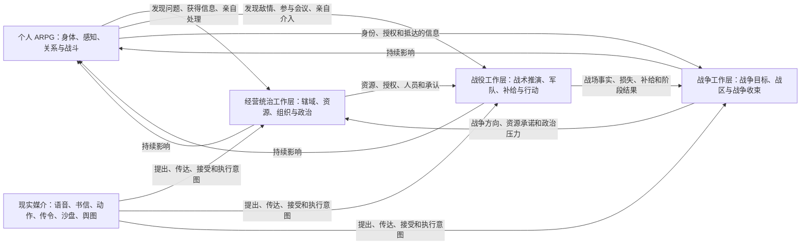

# 《烽火王座：汉末群雄》玩法策划案

> 文档版本：v1.1
> 创建日期：2026-10-23
> 最近更新：2026-10-30
> 策划负责人：
> 文档状态：草案
> 来源：通用策划模板副本；参考《烽火王座：汉末群雄》总策划案当前 v1.2，以及对话 `codex://threads/01a1668c-10fb-7463-aa2e-f123d1d70efe`

## 使用说明

本文件定义《烽火王座：汉末群雄》的完整游戏玩法范围，说明玩家在连续世界中如何行动、指挥组织、管理资源、处理关系并承担长期后果。当前第一阶段交付为召陵县守城 Demo，《骑将冲阵》是其中的骑战/传令子切片，已拆为独立文档：[《骑将冲阵垂直切片策划案》](烽火王座：汉末群雄_骑将冲阵垂直切片策划案_v0.1.md)，其中的短时长、特定场景、有限单位、演示步骤和切片验收门槛不构成本文件的全游戏范围。

当前 Demo 的目标与完成条件见[05 执行路线](玩法系统/05-第一阶段县城守城Demo设计与执行路线.md)，完整五阶段基础设施、23 Owner 与并行 A—F/V0—V5 路线见[08 建设总计划](玩法系统/08-基础设施与Owner建设总计划.md)。后续章节的产品方向不构成另一份实施排期。

总策划案提供世界、叙事和系统方向；本文件聚焦玩家玩法和规则。现有资料尚未决定的设计字段保持空白，需统一确认的问题列于文末。

---

## 1. 游戏概述

### 1.1 基本信息

| 项目 | 内容 |
|---|---|
| 游戏名称 | 《烽火王座：汉末群雄》 |
| 游戏类型 | PC 单机为主的实时持续世界 ARPG；以具身个人行动为底座，叠加经营统治与战争/战役指挥 |
| 游戏题材 | 汉末乱世、群雄割据、战争与政治；允许历史分岔 |
| 目标平台 | Windows PC；Unreal Engine 5.8 |
| 目标玩家 | 偏好历史战争、策略模拟、角色扮演与组织经营的 PC 玩家 |
| 游戏模式 | 个人 ARPG 体验为常态底座；可激活经营统治；可激活策略指挥战争（战役层、战争层）；三者可共存，委派代理；工作层切换不暂停，单人主动暂停为全世界时停 |
| 商业模式 |  |
| 目标时长 | 完整游戏的单次会话、主线时长和长期游玩目标  |
| 开发团队 |  |
| 预计周期 |  |

### 1.2 一句话介绍

> 玩家以一个受身份、身体、权限、势力范围和通信覆盖约束的汉末人物，在真实持续的历史世界中生活、行动、交往和战斗；他可以亲自处理眼前的事，也可以在合适的地点、借助合适的人与物，激活经营、战役或战争指挥，让意图通过真实的传达与执行改变世界。

### 1.3 游戏简介

本作首先是一款以“人在历史世界中生活”为核心的实时持续 ARPG。玩家始终以一个有身体、有位置、有感知范围和社会关系的人存在于世界中，可以移动、骑乘、战斗、交涉、宴饮、休整、享受亲密关系、履行职责、调查传闻、拜访人物和处理眼前的现实事务。玩家可以主动发起战斗，也可能因为感知到敌意、伏击、追捕或其他直接威胁而被动进入战斗状态；战斗不是脱离世界的独立小游戏，而是个人行动在敌意条件下的即时升级。

经营统治与策略指挥战争不是取代个人体验的平行游戏，而是玩家在具身世界中有条件激活的工作层。玩家可以通过 UI 打开策略经营统治面板、战役面板或战争面板，也可以在世界里通过语音、书信、手势、口令、传令人员、会议、沙盘、舆图和其他现实存在的交互方式提出目标、传递信息和组织执行。UI 只是提高整理、查看和下达意图的效率，不会绕过势力范围、通信覆盖、权限、传达、接受和执行。

个人体验与经营、战役、战争工作层可以同时存在。例如玩家站在自己的营地沙盘前，与将领共同推演战术，接收已经抵达的斥候战报，修改战役方案，再让传令人员把命令带到队伍；此时玩家仍在 ARPG 世界中，周围人物、时间、身体和其他战线不会因为打开面板而停止。玩家也可以不激活任何工作层，只在势力范围内生活、社交和处理个人事务，或离开势力范围去冒险、游历、调查和战斗。

玩家对自身势力的实质管理需要满足两个条件：拥有相应身份/权限，并处在势力范围或有效通信覆盖内。超出范围后，玩家不能把 UI 操作直接写入远方世界，只能通过可用的信使、书信、口信、旗语、约定或代理关系传达；命令可能延迟、失真、拒绝、过期或无法抵达。没有有效通信时，组织依据已知预案、职责和本地判断继续行动。

### 1.4 核心体验陈述

> 玩家在游戏中感受到自己就是历史世界中的一个真实人物：先以身体和感知面对眼前的世界，再依靠身份、势力范围、通信、人际关系和手边的物件，把个人意图逐步变成他人能够理解、接受并执行的行动；玩家可以在同一场实时生活中亲自战斗、享受关系、处理事务、推演战术、治理势力或推动战争，但永远不能凭空成为全知、全能、无延迟的上帝视角。

这种体验由以下内容支撑：

1. 玩家以 ARPG 形式持续生活在世界里；移动、观察、社交、亲密关系、履职、冒险和战斗共享同一角色、身体、时间和位置，敌意可在任何个人场景中自然升级为战斗。
2. 经营、战役和战争指挥可以通过 UI 或世界内的语音、书信、动作、人物会议、沙盘与舆图等道具激活；激活工作层不会离开世界，也不会停止个人行动和其他世界事务。
3. 所有命令都必须经过势力范围、通信覆盖、权限、传达、接受和执行；系统明确反馈“意图提出—信息传达—对象理解—命令接受—实际执行—结果获知”的差异。
4. 玩家可以在沙盘、舆图和将领会议中共同推演，并用已经抵达的斥候战报更新判断；推演结果先是计划或命令意图，只有经现实传达和组织执行才成为世界事实。
5. 预案、代理人、训练、补给、关系、授权和继任让玩家离场后世界继续运行；失败留下可追溯的损失和后续约束。

### 1.5 目标玩家

| 维度 | 描述 | 对设计的影响 |
|---|---|---|
| 玩家类型 | 偏好历史战争、策略模拟、角色扮演、组织经营和系统性叙事的 PC 玩家 | 在经营管理、战争指挥和具身个人行动之间共享同一世界状态；默认信息克制，细节可展开 |
| 游玩动机 | 指挥取胜、建立组织、塑造角色、争取职位、改写历史、理解因果 | 所有动机必须改变同一世界状态，避免割裂成独立小游戏 |
| 游戏经验 | 预期包含策略模拟和动作骑战经验玩家；具体新手比例  | 教学围绕角色行动、命令通信、组织协作和离场自治逐步展开 |
| 游玩场景 | 允许长时间战役会话；体验节奏与新手引导需兼顾长线内容 | 支持摘要、预案和代理；工作层切换不暂停，单人主动暂停冻结全部世界推进 |
| 内容边界 | 战争、伤亡、囚禁、政治斗争和角色死亡；不以血腥细节或成人内容作为核心卖点 | 以战场结果和政治后果表达冲突；最终年龄分级  |

### 1.6 设计目标与范围

- 完整游戏目标：让玩家在连续运行的汉末世界中，以具身角色生活、行动和战斗；在有条件时激活经营统治、战役与战争工作层，通过真实可达的传达与执行建立组织、统筹战争、配置资源和经营关系，并面对承认、继承和历史变化带来的长期后果。
- 玩法结构：个人 ARPG 是持续存在的体验底座；经营统治和策略指挥战争（战役层、战争层）是可激活、可叠加的工作层。三者共享角色、组织、资源、权限、情报、通信和世界事实，不是三个需要依次进入的独立模式。
- 玩法范围：以 ARPG 形式进行的个人生活、社交、关系、移动、骑战和战斗；可激活的领地治理、经营统治、战役推演、战争指挥；军队编制和自治、命令与通信、阵型和士气、补给与资源网络、人物关系与政治、代理委派、继任及历史分岔。
- 设计边界：各系统共享可追溯的世界事实和权责边界；不以全知即时控制、无成本委派或隐藏全局数值替代玩家决策。
- 当前资料尚未确定完整游戏的内容规模、章节数量、最终胜负目标、运营方式和发行范围，留待确认。

### 1.7 参考游戏

| 作品 | 参考内容 | 本作的不同之处 | 借鉴时需避免的问题 |
|---|---|---|---|
| 《燕云十六声》 | 具身开放世界叙事、角色/地区故事、身份关系事件与探索线 | 借鉴个人行动、区域事件、角色关系和剧情线在世界中的自然触发方式；将其改写为受势力、通信和历史事实约束的汉末叙事 | 个人剧情线与组织/战争后果脱节；开放世界事件只做一次性内容；直接复制武侠题材表达 |
| 《黑神话：悟空》 | 章节推进、角色冲突、神话叙事、环境叙事与演出结合 | 借鉴章节节奏、角色动机、环境线索和战斗前后叙事承接；让剧情结果继续影响关系、组织和战争事实 | 线性章节遮蔽玩家选择；演出替代可交互因果；直接复制神话角色、剧情或美术表达 |
| 《荣耀战魂》 | 近身冷兵器对抗、方向防守/攻击、姿态承诺与战斗可读性；战斗维度竞品 | 借鉴接触距离、攻击方向、格挡/闪避反馈、受击承诺和小规模战斗的清晰度；将战斗接入骑乘、地形、体力、士气、援军和命令链，使结果回写持续世界，而不是独立竞技场；具体判定与动作集待定 | 英雄技能和竞技场规则替代真实组织战；战斗被复位成独立回合；视觉反馈遮挡军旗、阵型和命令 |
| 《艾尔登法环》 | 开放世界探索、环境风险、构筑选择与非线性发现 | 把探索发现转化为可验证的情报、关系和通信机会，并让不同身份与组织能力改变可行方案 | 信息过度隐晦；成长构筑或单一强力策略压过组织协同和真实代价 |
| 《天国：拯救 II》 | 历史环境中的具身生活、社会身份、任务因果和现实约束 | 将身份、位置、声望和现实交互扩展到军制、传令、治理和战役自治，保持玩家始终是世界中的人 | 生活模拟与战争系统分离；任务结果只影响剧情文本，不改变持续世界事实 |
| 《全面战争：三国》 | 战役决策与即时战斗的接合、势力经营 | 玩家以同一具身角色进入战场；命令受权限、距离、通信和组织自治影响 | 战场和战略层割裂；用单位规模替代有意义的组织决策 |
| 《骑马与砍杀 II：霸主》 | 具身骑战、部队跟随、个人从属关系 | 将命令链、继任、预案、物流、政治承认和长期组织事实接入同一世界 | 个人战斗能力压过补给、阵型和组织；长线管理退化为重复菜单 |
| 《十字军之王 III》 | 人物关系、继承和统治合法性 | 把具身行动与即时战场接入人物政治；命令和信息有真实抵达路径 | 用不可读的隐藏关系值惩罚玩家；继承只转移一组数值 |
| 《文明》系列（重点参考《文明 VII》） | 城市与科技发展、外交、资源分配、时代推进和长期取舍 | 将宏观决策落实为具身人物、责任人、资源网络和可延迟的命令；取消回合制全知下令，改为实时持续世界 | 宏观抽象掩盖个体与执行过程；单位被简化为可瞬时移动的数值；时代推进与个人经历脱节 |

### 1.8 市场竞品分析

目前没有发现与本作完整结构一对一对应的成熟竞品。本作把个人 ARPG、历史具身生活、经营统治、战役/战争指挥和受通信约束的实时持续世界组合在一起；下表中的作品只覆盖其中一个或几个体验面，分别作为体验维度竞品、相邻品类竞品或远端策略参照，不代表它们可以整体替代本作。

| 作品 | 相似体验面与竞争关系 | 目标玩家与定位 | 可借鉴点 | 本作差异化 | 需要避免的问题 |
|---|---|---|---|---|---|
| 《燕云十六声》 | 个人 ARPG、开放世界叙事和身份/关系事件；剧情与具身体验维度竞品 | 近年开放世界动作 RPG 玩家 | 区域故事、角色关系、探索触发和个人剧情线 | 个人剧情线与治理、通信、战役和战争事实互相回写；玩家可以用现实交互推进或错过剧情 | 玩家只追求个人战力；剧情线成为与组织无关的支线菜单；事件缺乏长期后果 |
| 《黑神话：悟空》 | 章节叙事、角色冲突、环境线索和演出节奏；剧情维度竞品 | 重视角色叙事、章节推进和世界观表达的动作 RPG 玩家 | 章节结构、角色动机、环境叙事和战斗前后承接 | 剧情结果由玩家行动、关系、命令和世界事实共同生成，章节不会覆盖实时世界 | 线性演出替代玩家选择；故事结果不回写组织、关系和战争；直接复制 IP 表达 |
| 《荣耀战魂》 | 近身冷兵器对抗、方向防守/攻击和战斗可读性；战斗维度竞品 | 重视近战操作、对抗博弈和战斗反馈的玩家 | 攻击方向、格挡/闪避、距离、承诺感和受击反馈 | 将战斗接入骑战、军阵、地形、士气、援军和命令链；具体动作规则待定 | 竞技场化、英雄技能化或单挑最优解；战斗与持续世界事实脱节 |
| 《艾尔登法环》 | 开放世界探索、环境风险和构筑选择；探索维度竞品 | 追求探索、挑战和构筑自由的开放世界动作 RPG 玩家 | 非线性路线、环境叙事、风险与奖励 | 探索获得的是有来源和时效的情报、关系与通信机会，能改变组织行动和战争准备 | 隐藏规则过多导致失败不可解释；单一构筑成为支配策略 |
| 《天国：拯救 II》 | 历史具身生活、社会身份和现实因果；历史沉浸维度竞品 | 偏好历史沉浸、现实身份和社会因果的 RPG 玩家 | 身份约束、现实交互、声望与任务后果 | 将个人行为与军制、治理、传令和战役事实统一到同一实时世界 | 个人生活、任务和战争被拆成互不回写的内容模块 |
| 《全面战争：三国》 | 战争/战役层、势力经营和即时战斗；相邻策略竞品 | 历史战争与势力经营玩家 | 战役目标、军队编制、实时战斗节奏 | 以角色位置和通信约束命令，战场事实延续到关系、授权和组织 | 规模感掩盖玩家无法理解的因果 |
| 《骑马与砍杀 II：霸主》 | 个人骑战、部队跟随和个人从属关系；局部最接近的相邻竞品 | 具身战斗和部队成长玩家 | 骑战、部曲、个人风险 | 骑战只是改变局部接触，不能替代组织、通信和补给 | 单骑反复冲锋成为稳定最优解 |
| 《十字军之王 III》 | 人物政治、继承和统治合法性；政治模拟维度竞品 | 人物政治、继承和叙事模拟玩家 | 人物关系、身份变化、继承压力 | 关系和权力必须通过具身行动、命令和领域结算落地 | 隐藏数值过多、玩家无法复盘结果 |
| 《文明》系列（重点参考《文明 VII》） | 城市/资源/科技/外交和时代推进；宏观策略远端竞品 | 4X、宏观经营与历史演进玩家 | 长期权衡、资源分配和时代结构 | 把宏观选择落到真实人物、责任人、资源运输和可追踪执行链；战争与治理不会因回合切换瞬时完成 | 只比较数值产出；忽视通信、执行、地方反应和个人行动成本 |

参考游戏只用于提炼体验结构、叙事组织和交互原则，不复制其角色、剧情、关卡、技能、UI 或美术资产。

## 2. 核心玩法设计

### 2.1 三大玩法模式

三种模式不是互斥职业、不同存档或彼此独立的子游戏，而是同一个实时持续世界中的不同体验状态与工作层。**个人 ARPG 模式始终是基础体验**：玩家以身体和感知进入世界，能够自然触发或被动进入战斗；经营统治、战役和战争是玩家在满足权限、位置、势力范围、通信覆盖和可用媒介后激活的工作层。工作层可以通过 UI 激活，也可以通过世界内的会议、语音、书信、动作、沙盘和舆图等现实交互激活，并可与个人行动共存。

玩家在任一层采取行动时，世界共用同一时钟和权威事实；激活或关闭工作层只改变玩家能整理、观察和提交的内容，不重置时间、暂停其他事务或直接结算结果。即时个人行动/战斗、命令传达、短周期市场/运输/角色决策、日级消费/补给、旬季级税粮/征募/训练/政治承认按各自节奏持续推进。玩家身份、权限、部属、资源和所在位置由世界事实决定。

| 体验层/工作层 | 激活方式与主要尺度 | 玩家主要行为 | 主要决策 | 主要系统 |
|---|---|---|---|---|
| 个人 ARPG 底座 | 始终存在；玩家角色所在的真实地点和感知范围 | 移动、骑乘、观察、社交、亲密关系、交涉、调查、履职、休整、冒险和战斗 | 眼前该做什么、是否接近风险、是否主动攻击/防守/撤退、是否寻找人物或媒介扩大影响 | 角色身体、关系、交互、骑战、战斗、伤势、信息、敌意感知 |
| 经营统治工作层 | 在势力范围或有效通信覆盖内，通过 UI 或治理会议/文书/口头传达激活 | 查看辖域与资源、设定政策/预算、任命授权、监督代理、处理异常和关系 | 当前亲自处理还是委派、资源投向、授权范围、等待执行还是介入 | 治理、经济、资源网络、组织、关系、政治、情报、代理 |
| 策略指挥战争工作层 | 在有权力和信息媒介的范围内，通过 UI、沙盘、舆图、战报会或书信/传令激活 | 战争层确定冲突方向；战役层推演方案、调动军队、配置补给、下达命令 | 目标优先级、时机、路线、兵力/补给、亲自到场还是依赖传达和自治 | 战争、战役、军队、命令链、通信、补给、情报、预案、阵型/士气 |

#### 2.1.1 经营统治模式

经营统治不是脱离角色的后台菜单，而是玩家在自己能实际影响的势力范围或通信覆盖内，组织人、物、资源和信息的持续工作。玩家可以打开经营统治面板，也可以在府署、营地、厅堂、市场、书房或会议中通过语音、书信、手势和人物互动提出治理意图。UI 能整理复杂信息和批量提交合法请求，但每一项治理仍需责任人、资源、通信和执行过程。

玩家围绕辖域与组织的持续运作作出决策：设定治理目标、预算、政策、责任人和检查条件；管理生产、储存、运输、市场、税赋和军需；通过任命、授权、谈判、分权和制衡建立可执行的统治。玩家可以亲自处理关键事项，也可以交给代理人持续办理。代理人受权限、资源、能力、关系和自身意图约束，委派不保证成功。玩家离开势力范围或通信覆盖后，无法继续进行无延迟的实质统治，只能依赖可用的传达手段或预先建立的代理关系。

- 核心循环：观察辖域与资源/政治态势 → 确定治理目标和资源分配 → 任命授权、执行或委派 → 持续核查异常与后果 → 调整治理安排。
- 核心取舍：短期征取与长期稳定、军事投入与民生/生产、集中控制与分权委派；资源承诺会影响其他模式的可选行动。
- 体验重点：通过制度、资源和人的协作维持统治，让成果及其持续成本可观察；玩家亲战或指挥期间，辖域和代理仍按已生效安排运行。

模式内具体治理操作、玩家直接控制边界、代理汇报频率及时间推进规则：

#### 2.1.2 策略指挥战争模式

策略指挥战争分为两个关联层级，但两层都是在个人 ARPG 世界中激活的工作层。玩家可以通过战争/战役 UI 快速整理和提交计划，也可以面对沙盘和舆图与将领共同推演，依据已经抵达的斥候战报更新判断，再让书信、口令、旗语、亲卫或传令人员把意图送到执行者。战争层管理一段持续冲突的整体目标、投入和结束条件；战役层围绕特定时间、地域、参战组织和阶段目标组织连续行动。战役目标应服务或重新塑造战争目标；战场结果、伤亡、补给消耗、俘虏、指挥关系和政治后果回写到战争与世界状态。

战争/战役工作层提供“计划和发起”的能力，不提供跨越距离、势力范围和通信覆盖的即时控制。玩家可以在远方查看已抵达的战报并提出意图，但只有传达抵达、对象理解并接受，相关组织才会开始执行。

| 层级 | 关注范围 | 玩家决策 | 结算与反馈 |
|---|---|---|---|
| 战争层 | 持续敌对关系、战略目标、战区态势、战争资源承诺、盟友/敌对势力关系 | 选择或调整战争目标，决定投入、优先方向、联盟与谈判、升级/收束战争 | 目标进展、战区变化、资源消耗、政治承认、战争状态与持续代价 |
| 战役层 | 一场具体战役的地域、时间窗口、参战军队、阶段目标和补给安排 | 选择行动方向、目标顺序、军队分工、预案、补给路线、指挥授权，以及亲自介入或委派 | 具体战斗、调动、命令、战役目标、损失与补给结果，并影响战争层 |

战争与战役的准确边界、状态机、地图尺度、玩家可直接下达的命令、AI/代理权限和结束条件：

- 战争层核心循环：观察持续冲突态势 → 确定战争目标与投入方向 → 委托或组织战役 → 跟踪战区变化、资源和政治代价 → 调整目标、投入或谈判方向。
- 战役层核心循环：读取已知敌情与补给 → 配置阶段目标、军队、路线和预案 → 传令并持续执行 → 根据新情报调整或亲自介入 → 承接损失、控制和补给后果。
- 核心取舍：战争目标与可承担代价、集中兵力与多线防御、时机与情报、亲自指挥与授权自治。战争和战役并行推进，局部目标达成不等于战争自动获胜。

#### 2.1.3 个人模式（包括战斗）

个人模式是全游戏的基础体验，不是和其他模式并列后再单独进入的房间。整个世界首先以 ARPG 形式呈现：玩家有一个具体身体，位于一个具体地点，只能感知附近的人、物、声音、敌意和已经抵达的信息。自建角色可以作为玩家进入这个世界的角色来源；无论是自建角色还是预设角色，都必须通过实际身份、关系、权限、位置和通信去影响其他人。

| 设计维度 | 已明确的方向 | 具体规则 |
|---|---|---|
| 玩法表达 | 全部个人行动以 ARPG 式即时具身操作为基础；战斗可主动或被敌意被动触发 |  |
| 角色创建 | 可由玩家自建角色，也可存在预设角色方案 | 角色背景、初始身份与主线关系待定 |
| 与工作层关系 | 个人体验始终存在；经营、战役、战争可在世界中激活并与个人行动并行 | 激活媒介、权限和并行交互范围见 2.1.4 |

个人模式以玩家角色在当前地点的可感知信息和可执行行动为中心，覆盖移动、骑乘、交互、交涉、调查、履职、休整、社交、亲密关系及其他日常行动。玩家可以主动寻找冲突，也可能因为感知到敌意、伏击、追捕或攻击而被动激活战斗；战斗在同一地点和同一时间中发生，不能通过切换界面取消已经发生的危险。玩家可移动、选择目标、攻击、防守、撤退或保护他人，并承担伤势、暴露、时间和位置风险。个人行动改变角色及其接触到的局部事实；部队整体胜负、战役目标和战争结果仍由相应组织/战争层规则结算。

个人模式与战斗的视角、暂停/慢速、操控方式、可介入边界及战斗结束后的返回层级：

- 核心循环：观察当前场景、身体与人际条件 → 决定个人目标与行动 → 即时操控或交互执行 → 承担身体、位置、关系与时间后果 → 调整行动或关注层级。
- 战斗内循环：辨认局部威胁与目标 → 选择接近、攻击、防守、保护或撤退 → 即时接触与反馈 → 根据自身及周围战场状态重新判断；具体动作和资源规则待定。
- 核心取舍：个人机会与身体风险、亲自办理与委派、局部行动与全局责任。角色身处战斗时，后方治理、运输、命令和其他战线仍持续推进。

#### 2.1.4 模式激活、共存与状态承接

**共同决策循环：**以个人 ARPG 体验观察和行动 → 在现实范围内发现需要组织处理的问题 → 通过 UI 或世界内媒介激活经营/战役/战争工作层 → 提出意图并经传达、接受、执行 → 回到个人行动或继续主持工作层 → 承接已经发生的后果。三种体验可以同时存在，玩家不需要依次走完经营、战争、个人才推进世界。



个人 ARPG 体验共享世界时钟、角色身份、权限、资源、组织关系、情报与事实记录；经营统治、战役和战争工作层是挂接在这个底座上的不同工具与注意力层。打开或关闭工作层不会把玩家传送到另一张地图，也不会让个人行动、战斗、市场、运输、代理、战役和战争结算停止。不同层级通过关注尺度、信息精度、直接操控程度、可用媒介和决策周期形成差异。

| 体验层/工作层 | 激活与共存条件 | 玩家关注 | 主要反馈节奏 |
|---|---|---|---|
| 个人 ARPG 底座 | 始终存在；由角色位置、感知和身体状态决定 | 当前地点、附近人物、敌意、可交互对象、身体和已抵达信息 | 输入即时响应；关系、伤势、位置和行动结果持久承接 |
| 经营统治工作层 | 有权限且在势力范围/通信覆盖内；可用治理 UI 或府署、会议、文书、口头交互激活 | 辖域、资源、责任人、组织、市场和政治承认 | 请求即时确认；执行和政策后果按传达、生产、运输、消费与政治周期反馈 |
| 战役工作层 | 有战役权限和足够地图/战报/媒介；可用战役 UI 或沙盘、舆图、将领会议激活 | 战术目标、军队、补给、路线、预案和阶段结果 | 推演即时更新计划；命令需传达和接受，战场事实持续反馈 |
| 战争工作层 | 有战争层权限和可用战略情报/媒介；可用战争 UI 或战争会议、文书、使者激活 | 战争目标、战区、投入、同盟、谈判和战争代价 | 提案即时记录；战争态势、政治承认和资源代价按事实持续更新 |

**统一体验约束：**

1. 同一角色、组织和资源跨层保持一致。例如已拨出的军粮不能同时留作另一项支出；具体资源占用与冲突规则待定。
2. UI 面板是现实行动的组织工具，不是上帝视角。面板操作必须生成可追踪的意图、文书、口令、传令任务或会议决定，不能直接写入远方最终事实。
3. 反馈区分“意图提出”“信息/命令传达中”“对象已理解”“对象已接受”“执行中”“结果已发生”和“玩家已获知”。即时响应不代表远方事务即时完成，也不代表玩家即时获知所有结果。
4. 势力范围决定可直接组织的对象和资源；通信覆盖决定意图能否在合理时效内抵达。超出二者时，玩家只能依赖信使、书信、口信、旗语、代理或预案，且可能延迟、失真、拒绝、过期或无法抵达。
5. 沙盘、舆图、战报和将领会议提供共同推演空间，但推演结果先是计划；只有形成命令并经现实传达、接受和执行，才改变部队或战役事实。斥候战报只有抵达后才能被更新到地图或推演中。
6. 个人 ARPG 行动始终可继续；工作层可在适合的地点、人物和道具条件下与个人行动共存。敌意、伏击、追捕或攻击可在任何工作层交互中打断玩家并被动激活战斗。
7. 已授权的代理、预案与其他角色持续行动。已发生结果不会因玩家进入另一个工作层而撤销；控制权变化依授权和继任规则处理。

具体时间倍率、信息摘要频率、界面切换条件与成本、失能/离场后的控制权：

工作层、镜头或地图切换不暂停世界；单人主动暂停是全世界时停，冻结 `world_tick`、命令传递、Agent、群体模拟、运输、生产、动画、物理和 Owner 提交。恢复后重新校验 epoch、revision、lease 和异步证据，暂停不能刷新未知信息或跳过执行成本。

### 2.2 玩家目标与胜负规则

个人 ARPG 体验没有“进入后才开始”的阶段目标，而是持续承载玩家当前的生活、关系、行动与战斗。经营统治、战役和战争工作层各自有阶段目标，其结果持续影响个人体验；治理达成、局部战斗胜利、战役目标和战争收束不等同于整局通关。

| 模式 | 阶段目标 | 受挫或失败后果 | 与其他模式的联系 |
|---|---|---|---|
| 经营统治工作层 | 在势力范围或通信覆盖内维持辖域、资源和组织运作，争取政治承认 | 资源缺口、执行失效、关系或统治承认受损 | 限制战争投入、补给、个人职责与行动条件 |
| 战役工作层 | 推演并组织具体地域、时间窗口和阶段目标的行动 | 损失、补给中断、阵地/目标变化、命令失效或战役受挫 | 改变战争态势、辖域资源、组织控制和角色风险 |
| 战争工作层 | 争取持续冲突目标，调整投入、同盟、谈判和战争收束 | 战区恶化、持续代价、政治承认受损或战争目标失败 | 改变治理压力、战役方向、资源配置和个人行动机会 |
| 个人 ARPG 底座 | 在真实地点生活、行动、社交、履职、冒险和战斗并承担风险 | 伤势、失能、位置/时间损失、关系变化、敌意升级 | 改变局部战场、信息、治理执行、命令传达与继任条件 |

以上为目标方向，具体任务成功/失败阈值与终局规则：

| 项目 | 规则说明 | 玩家如何获知 |
|---|---|---|
| 游戏目标 | 在持续世界中建立并维持个人、组织和事实统治；具体主线目标与通关定义待确认 | 目标/任务记录、组织与领地状态、历史与关系反馈 |
| 成功条件 | 由玩家选择的长期目标、关键战役、政治承认和世界状态共同判定；正式结局条件待确认 | 目标进展、事实记录、结局触发说明 |
| 失败条件 | 角色死亡、组织瓦解、失去关键承认或其他条件是否导致终局，待确认；失败应保留可理解的世界后果 | 失败来源、继任/继续选项和因果摘要 |
| 平局或特殊结局 | 撤退、僵持、割据、拥立或历史分岔等结果由具体战役和主线规则定义，待确认 | 战报、政治承认和世界状态 |
| 继续与继任 | 角色失能或死亡后的继续方式依继承、指挥权和存档规则处理；不默认无后果重置 | 继任者、承接权限、损失和可恢复项 |

### 2.3 核心操作

核心操作按三种玩法模式区分。下表描述玩家意图与世界结果，不代表最终键位绑定；输入设备和快捷键仍待确认。任一模式中的操作都会提交到持续运行的同一世界。

#### 经营统治

| 玩家动作 | 输入方式 | 作用对象 | 操作结果 | 反馈 | 限制或失败情况 |
|---|---|---|---|---|---|
| 激活经营统治工作层 | 治理 UI，或在府署/营地/会议中使用语音、书信、手势和人物交互；具体绑定待定 | 当前势力范围/通信覆盖内的辖域、组织和资源 | 打开可用治理信息与操作入口，不自动改变世界事实 | 当前权限、覆盖范围、可用媒介和可操作对象 | 超出势力范围、通信中断或无有效身份时，只能使用可达的传达方式 |
| 查看辖域与态势 | 统治/世界界面或现实观察/汇报；具体交互方式待定 | 辖域、组织、资源网络、市场、政治关系 | 查看玩家已观察或已收到的状态、来源、时效与可信度 | 资源流、责任人、异常和历史事实摘要 | 不提供未获得的全知信息 |
| 设定政策、预算与目标 | 界面提交，或口头/书信/手势向责任人表达；具体输入待定 | 有权限的辖域、机构、资源或组织 | 创建治理/配置请求，交由相应责任人和领域规则处理 | 意图记录、传达状态、接受、待执行、拒绝、部分完成及原因 | 权限、距离、通信、预算/库存、目标冲突或信息过期 |
| 任命、授权或委派 | 组织/角色操作、文书、口令或会议决定；具体输入待定 | 代理人、官员、指挥节点和部属组织 | 建立责任范围、权限和执行条件 | 授权范围、传达/接受状态、期限、代理状态与汇报 | 代理能力、意图、关系、通信或权限不匹配时可能拒绝/失效 |
| 处理异常或进行交涉 | 个人行动、治理操作或人物会议；具体输入待定 | 事件、人物、市场或组织冲突 | 介入并产生跨周期的资源、关系或承认变化 | 对方响应、事实记录及后续影响 | 时间、位置、身份、谈判条件和已发生事实构成限制 |
| 核查与调整安排 | 世界/组织界面；具体输入待定 | 政策、代理执行、库存、运输和辖域事实 | 复核结果并调整目标或责任安排 | 计划与实际差异、来源、延误和下一决策点 | 只可基于已抵达情报判断 |

#### 策略指挥战争（战争层与战役层）

| 玩家动作 | 输入方式 | 作用对象 | 操作结果 | 反馈 | 限制或失败情况 |
|---|---|---|---|---|---|
| 激活战争/战役工作层 | 战争/战役 UI，或在沙盘、舆图、将领会议、战报会中激活；具体输入待定 | 可用权限、地图、将领、斥候战报和通信媒介 | 打开相应层级的推演、计划、命令和战况信息 | 当前层级、参与者、已抵达情报、可用媒介和权限 | 无权、无可用信息/媒介、超出势力或通信覆盖时不能进行实质指挥 |
| 设定战争目标与投入方向 | 战争态势/外交指挥界面，或战争会议、文书、使者传达；具体输入待定 | 敌对关系、战区、盟友、战争资源 | 更新持续冲突的目标、优先方向和资源承诺 | 提案、传达/接受状态、战争目标、投入、态势变化和持续代价 | 权力、关系、资源、通信与情报约束；战争层具体规则待定 |
| 规划战役行动 | 战役/地图界面，或沙盘/舆图/将领会议；具体输入待定 | 地域、时间窗口、军队、补给和阶段目标 | 形成行动计划、任务分工、预案及授权 | 推演方案、斥候战报、行动目标、参与组织、补给与命令状态 | 地理、时机、补给、权限、通信和情报时效 |
| 调动、分工与传令 | 地图/组织/命令链操作，或口令、书信、旗语、传令人员；具体输入待定 | 军队、指挥节点和目标组织 | 生成经过权限、通信和组织规则校验的命令 | 路径、传达、抵达、理解、接受/拒绝、执行及战场状态 | 距离、通信、命令有效期、目标变化或下级自主判断 |
| 亲自介入或委派执行 | 进入个人行动/战斗，或授权代理与预案 | 当前战场、战役行动和自治部队 | 个人局部行动或组织级执行持续推进 | 战斗接触、战役目标、损失、补给和政治结果 | 亲战风险、组织控制范围、授权及部队自治规则 |
| 调整或收束战争/战役 | 战争/战役态势操作；具体输入待定 | 战争目标、行动阶段和交战组织 | 改令、谈判、撤退、改变优先级或结束条件 | 已承认的控制、损失、关系和后续状态 | 已提交命令、通信延迟及不可逆世界事实 |

#### 个人（含战斗）

| 玩家动作 | 输入方式 | 作用对象 | 操作结果 | 反馈 | 限制或失败情况 |
|---|---|---|---|---|---|
| 移动、骑乘与观察 | WASD 移动、鼠标控制朝向；其他键位待定 | 玩家角色、坐骑与当前地点 | 改变位置、速度、观察范围、暴露与通信可达性 | 角色/坐骑动作、方向、速度、可见目标、敌意和危险提示 | 地形、碰撞、身体状态及所在场景约束 |
| 切换观察视角 | 第一人称、第三人称、俯视关注；按键待定 | 玩家角色的观察呈现 | 改变观察范围和信息组织，不改变玩家实体或世界时间 | 镜头过渡、视角标识与可见信息边界 | 视角可用条件和具体控制方式待定 |
| 交互、交涉、调查与履职 | 近场交互/对话/行动界面；具体输入待定 | 人物、场景、职责、事件和可用物件 | 发起个人行动，由身份、能力、关系和事实条件校验 | 对方响应、行动进展、结果与持久后果 | 位置、时间、身份、权限和情报限制 |
| 攻击、防守、保护或撤退 | ARPG 式即时操作；具体键位与动作集待定 | 对手、目标、同伴及玩家自身 | 主动攻击或在感知到敌意后被动进入战斗接触，改变危险、目标压力和角色状态 | 动作、敌意识别、命中/受击、预警、伤势及战场状态变化 | 暴露、敌方响应、地形、身体/装备状态及组织脱节风险 |
| 以现实媒介传达意图 | 语音、书信、动作、口令、旗语、传令人员；具体识别和输入待定 | 附近人物、代理、军队和组织节点 | 创建需要理解、接受和执行的意图/命令 | 传达路径、抵达、理解、接受/拒绝、执行和回报 | 语言、距离、视线、信使、时间、权限和通信覆盖 |
| 休整、恢复或处理伤势 | 个人行动/场景交互；具体输入待定 | 玩家身体、坐骑和随身资源 | 消耗世界时间与资源以恢复或改变身体状态 | 疲劳/伤势、时间消耗和风险变化 | 安全地点、资源、照护条件及周边世界持续运行 |

### 2.4 玩法选择与策略

| 模式 | 情境与选择 | 收益与代价 | 持续影响 |
|---|---|---|---|
| 经营统治 | 军事投入、稳定供给或长期生产 | 战争窗口、当前库存/现金、平民与军队需求及未来产出之间取舍 | 影响补给、身体/劳力、组织合作与统治承认 |
| 经营统治 | 亲自处理异常或委派代理；集中管理或分权 | 亲自处理占用角色时间与位置；委派扩大覆盖但受能力、意图、预算和权限限制 | 产生部分成功、拒绝、延误、关系和授权后果 |
| 策略指挥战争：战争层 | 调整战争目标、扩大投入或谈判收束 | 战区收益、联盟关系、持续消耗和承认代价之间取舍 | 决定战役方向与治理/资源压力，不自动令一方获胜 |
| 策略指挥战争：战役层 | 集中兵力、分工协同或保留预案自治 | 时间窗口、兵力覆盖、补给、安全和精确控制之间取舍 | 改变阶段目标、损失和后续战争选择 |
| 策略指挥战争：跨层 | 断军用供应、干预城市市场或稳定供给 | 军事见效速度、平民代价、库存/现金与合法性风险之间取舍 | 经供应、消费、身体、劳力、组织与军事持续力逐层反馈 |
| 个人 | 亲战或保持安全/通信位置 | 亲战争取局部机会但承担伤势与暴露；留位支持信息和命令但让出个人介入窗口 | 改变个人状态、通信条件和局部目标，不保证单骑反复冲锋稳赢 |
| 个人 | 履职、交涉、调查、休整或承担战斗风险 | 当前职责、情报质量、关系、身体恢复与时间窗口之间取舍 | 世界继续推进，个人选择形成位置、关系、身体和职责后果 |
| 三模式共享 | 执行、在授权内改写或拒绝上级目标 | 信任/支持、局部机会、保全部队或个人与抗命风险之间取舍 | 目标、军纪、信任和后续权限分别承接 |

- 选项价值随局势变化：信息时效、玩家位置、资源、目标压力、权限、训练/士气和其他行动者共同改变代价与收益。
- 支配策略检查覆盖三模式：不能让单骑冲锋、单一经济操作或无成本委派成为处理所有问题的稳定最优解；通过对照情境验证，具体指标待定。
- 失败应可理解：重要结果保留来源、发生/获知时间、执行过程、损失和可恢复项；具体信息范围服从玩家已知条件。

### 2.5 教学与难度

| 模式 | 需要学会的判断与操作 | 难度来源 | 规则开放与辅助 |
|---|---|---|---|
| 经营统治 | 读懂资源流、职责、授权、政策和汇报；识别异常并介入 | 资源竞争、长期代价、代理意图、关系和信息时效 | 教学顺序、摘要、预警、委派辅助及难度参数待定 |
| 策略指挥战争 | 分清战争目标和战役任务，规划兵力/补给、下令、追踪和改令 | 多线冲突、地理、时机、通信、敌方响应、阵型/士气和组织自治 | 教学任务、命令反馈、预案辅助与开放节奏待定 |
| 个人 | 移动/骑乘、观察、交互/交涉、战斗与风险管理 | 操作、定位、敌方威胁、身体状态、身份和时间机会成本 | ARPG 操作教学、危险预警、具体辅助和难度曲线待定 |

三模式共用时间、来源、权限和执行状态等基础认知，再逐步展示不同层次的细节；具体首次体验顺序保持待定。辅助选项包括字幕与文本、键位重映射、镜头灵敏度及颜色之外的形状/图标编码；单人暂停已确定为完整时停：世界时钟、角色移动、物理、动画、Agent、群体模拟、命令传递、Owner 提交、语义交接与新信息暴露冻结。UI 可思考和编辑命令草稿，恢复后才传达并重新校验。慢速是另行讨论的扩展，不代替暂停。

## 3. 系统详细设计

本章先按三种玩法模式定义系统职责，再列出支撑战争/战役与个人战斗的详细规则。所有系统都服务于同一实时持续世界：玩家当前关注模式决定直接交互尺度，未被关注的系统仍按自身节奏推进，并通过已观察或已抵达的信息反馈给玩家。

### 3.1 经营统治模式系统

| 子系统 | 目的与玩家输入 | 持续结算 | 核心反馈与边界 |
|---|---|---|---|
| 辖域治理与政策 | 设定辖域目标、政策、预算、检查条件 | 按辖域权力、责任人、资源和时间周期执行 | 显示政策状态、执行差异、承认与后果；具体政策颗粒度待定 |
| 生产、库存与资源网络 | 调整生产、储存、运输、市场、税赋和军需安排 | 生产、运输、库存、成交和消费按各自周期持续结算 | 显示资源源头、路径、损耗、库存和时效；玩家不获知未观测库存 |
| 组织、任命与授权 | 任命责任人，设定权限、职责、预算与汇报条件 | 代理人按权限、能力、关系和自身意图持续执行或拒绝 | 显示授权范围、执行状态、原因、部分成果和汇报；委派不保证成功 |
| 人物关系、政治与承认 | 交涉、谈判、制衡、分权和处理异常 | 互动与政治事实跨时间累积，影响合作、权力和后续授权 | 反馈关系变化来源、承认状态和长期代价；详细规则待定 |
| 治理核查与介入 | 查阅合法可知情报、对异常直接介入或调整安排 | 已授权事务继续推进，玩家的核查不暂停其他系统 | 对照计划和实际事实，保留调查与汇报的时效差 |

#### 3.1.1 治理、经济与资源网络

| 项目 | 说明 |
|---|---|
| 系统目的 | 让玩家通过辖域治理与资源安排建立持续运作的组织能力，并承担资源竞争和长期政治后果 |
| 开放条件 | 玩家对相应辖域、资源、机构或交易具有有效身份/权限及可获得信息；具体身份门槛待定 |
| 玩家输入 | 查看资源流和异常，设定政策、预算、生产/运输/军需目标，指定责任人并核查执行；具体选项和颗粒度待定 |
| 规则流程 | 读取已知辖域/资源状态 → 提交目标、预算与执行条件 → 责任人及相应领域校验权限/资源 → 按生产、运输、交易、消费等周期持续执行 → 承认结果并经汇报进入玩家认知 |
| 状态变化 | 区分目标已提出、已受理、执行中、延误、部分完成、完成和拒绝等执行信息；正式状态机待定 |
| 消耗与收益 | 占用时间、库存/现金、劳力和组织执行能力；收益体现为供应、生产、组织合作与统治稳定，具体资源目录及数值待定 |
| 结果反馈 | 显示执行者、源头—仓储—运输—消费链的已知事实、计划与实际差异、异常来源及可介入窗口 |
| 异常与跨模式影响 | 权限变化、资源短缺、运输受阻或代理拒绝可能产生延误/部分成果；军需投入影响治理余量，战争损失影响后续生产与承认；界面切换不撤销已发生消费 |

#### 3.1.2 组织、政治与委派

| 项目 | 说明 |
|---|---|
| 系统目的 | 使统治依赖有效授权、人的合作和世界承认，允许玩家把日常事务交给代理并追踪其后果 |
| 玩家输入 | 任命、授权、预算、职责/检查条件、交涉、谈判和异常介入；具体可用权限及操作待定 |
| 规则流程 | 明确责任人与授权范围 → 校验资格、承认和资源 → 代理依职责、能力、关系与自身意图持续行动 → 按合法渠道汇报结果 → 玩家调整组织与政治安排 |
| 持续成本 | 维护合作、监督执行和争取承认占用时间、资源与关系；委派节省操作但不保证忠诚、精确或成功 |
| 结果与边界 | 责任、资源、关系、承认及权限变化需有来源；进入其他模式不自动取消责任或代理行动，指挥/政治继任见 3.4.1；具体继任与撤换规则待定 |

### 3.2 策略指挥战争模式系统

策略指挥战争模式由战争层与战役层组成：战争层处理持续冲突目标、战区态势、投入和政治收束；战役层把目标转为具体地域、时机、军队、补给、命令与战斗。二者持续同步共享资源、组织、情报和战场事实。

| 子系统 | 主要层级 | 目的与玩家输入 | 持续结算与反馈 |
|---|---|---|---|
| 战争目标与态势 | 战争层 | 选择目标、投入方向、盟友/敌对关系和升级或谈判方向 | 战区变化、目标进展、持续代价、资源消耗和政治承认；状态机待定 |
| 战役规划与行动 | 战役层 | 配置阶段目标、路线、参战组织、行动时机、预案与授权 | 调动、战斗、补给、损失和目标结果回写战争层；地图/时长尺度待定 |
| 命令链与传令 | 战役层为主，跨层接收授权 | 选择合法对象、目标和命令；命令经组织中继与指挥关系传递 | 状态可追踪至接受、拒绝、过期、执行和完成；详细规则见 3.2.1 |
| 军队自治与预案 | 战役层 | 设定职责、目标优先级、撤退条件、护卫对象和授权范围 | 玩家不在场或失联时队伍持续行动并给出触发原因；详细规则见 3.2.2 |
| 补给与战场状态 | 战争层/战役层 | 关注供应、训练、阵型、士气和关键目标，决定是否调度/介入 | 资源与组织事实持续影响战力；阵型、士气及目标规则见 3.2.3、3.2.4 |
| 战争收束与后果 | 战争层 | 调整目标、谈判、撤退或承认结果 | 依据已经承认的战役和政治事实更新战争状态，不因界面切换而提前结算 |

#### 3.2.1 命令链与传令

| 项目 | 说明 |
|---|---|
| 系统目的 | 把“玩家想让部队做什么”转化为经过权限、通信、组织和时间校验的命令过程 |
| 开放条件 | 玩家拥有相应身份/权限且目标在合法可联系范围内 |
| 玩家输入 | 发出授权范围内的语义命令，选择目标或保持预案  |
| 规则流程 | 创建命令请求 → 校验来源/权限/目标/有效期 → 通过组织中继与指挥层级分发 → 目标部队按预案、训练、士气和局势执行/拒绝 → 生成 receipt/战报 |
| 状态变化 | 草拟、已发出、传递中、已抵达、已接受、执行中、完成、拒绝、过期、取消 |
| 消耗与收益 | 消耗时间、通信机会、组织信用和可能的资源；收益是协调队伍、改变目标压力和形成可追溯组织事实 |
| 结果反馈 | 显示命令来源、下一节点、可达性、时效、接受者、拒绝原因和执行结果 |
| 异常情况 | 无权限、目标不可达、通信中断、revision 冲突、意图过期；不得提前显示为已完成 |
| 相关系统 | 直属部曲、权限、预案、阵型/士气、继任、Bridge 和本地战术脑 |
| 优先级与范围 | 完整游戏需支持可扩展的命令路由、状态、拒绝原因、授权凭据和情报可信度规则 |

| 情况 | 初始条件 | 玩家操作 | 规则判定 | 结果与反馈 |
|---|---|---|---|---|
| 正常传令 | 玩家拥有权限且组织中继节点可达 | 发送命令 | 依组织层级和有效期转发 | 显示每一传递节点和最终队伍状态 |
| 无权限 | 玩家不拥有队伍或目标权限 | 发送命令 | 拒绝入队列 | 明确显示权限来源缺失，不改变战场事实 |
| 命令过期 | 请求超过有效期或目标已变化 | 发送/继续等待 | 标记过期；队伍回到预案或执行替代策略 | 显示过期原因、时间和后续自治行为 |
| Bridge 中断 | 远端意图不可用 | 继续战斗 | UE 本地战术脑/预案接管 | 核心玩法继续；记录接管与回退原因 |

#### 3.2.2 军队自治与预案

| 项目 | 说明 |
|---|---|
| 系统目的 | 让玩家离开指挥范围、失能或通信中断后，部队仍按职责、预案、训练、士气和当前事实行动 |
| 开放条件 | 队伍已编入组织并拥有有效预案；预案规模、编辑能力与组织层级相匹配 |
| 玩家输入 | 选择/编辑预案的目标优先级、撤退条件、护卫对象和队伍职责  |
| 规则流程 | 读取队伍当前状态和最新合法事实 → 按预案优先级生成候选 → 校验权限/资源/可达性 → 执行本地战术行为或等待 → 输出状态和原因 |
| 状态变化 | 待命、执行命令、执行预案、重规划、撤退、失联、继任接管 |
| 消耗与收益 | 预案质量、训练和士气影响执行稳定性；自治节省玩家注意力但可能牺牲精确控制 |
| 结果反馈 | 显示当前预案、触发事实、执行动作、未执行原因和下一次决策窗口 |
| 异常情况 | 无目标、资源不足、权限变化、指挥头目失能、Bridge 失联；回退最近有效预案，不直接胜利 |
| 相关系统 | 命令链、训练、士气、补给、继任、角色代理、本地战术脑 |
| 优先级与范围 | 完整游戏需支持多层级组织、预案编辑和玩家离场后的持续自治 |

#### 3.2.3 阵型、士气与战场状态

| 项目 | 说明 |
|---|---|
| 系统目的 | 把冲锋、命令、目标压力、损失、训练和组织关系转化为玩家能读懂的战场状态 |
| 开放条件 | 进入战场并生成双方队伍 |
| 玩家输入 | 通过位置、冲锋、命令、护卫和目标选择间接影响；不直接拖动隐藏数值 |
| 规则流程 | 接收战场接触、命令、目标和队伍事实 → 由战场 Owner 更新阵型/士气 → 触发预案和队伍行为 → 生成状态反馈 |
| 状态变化 | 阵型保持、压缩、松散、重组、溃散；士气稳定、受压、动摇、崩溃、恢复；具体阈值  |
| 消耗与收益 | 位置、时间、人员、补给和组织信用；良好状态提高执行和目标争夺能力 |
| 结果反馈 | 形状/图标/文字/颜色组合、队伍动作、旗帜状态、声音和因果摘要 |
| 异常情况 | 多个事实同时到达、未知信息、状态冲突；按事件时间和 revision 处理并记录 |
| 相关系统 | 命令链、骑战、关键目标、补给、组织和战报 |
| 优先级与范围 | 阵型和士气需有清楚状态、阈值、来源和可辨反馈，并与伤害及其他战场状态协同 |

#### 3.2.4 关键目标与战场识别

| 项目 | 说明 |
|---|---|
| 系统目的 | 给短时遭遇一个可理解的方向，让玩家的个人行动和组织命令共同指向可观察结果 |
| 开放条件 | 战场依战役目标配置军旗、敌方将领、主战队或攻城器械等可交互目标 |
| 玩家输入 | 接近、攻击、护卫、发令、侦察或撤退 |
| 规则流程 | 目标拥有归属、状态、压力和有效性 → 队伍/玩家改变目标状态 → Owner 结算归属/破坏/失守/撤退 → 战报和后续预案更新 |
| 状态变化 | 未接触、可争夺、受压、控制、失守、破坏、撤退、失效 |
| 消耗与收益 | 争夺占用时间、队伍和暴露；收益是战场优势、士气变化、撤退窗口或后续授权/声望 |
| 结果反馈 | 轮廓、归属标记、状态条、旗帜/器械表现、队伍任务和因果摘要 |
| 异常情况 | 目标被摧毁、目标离场、目标信息过期；所有队伍重新评估目标，不静默结束 |
| 相关系统 | 骑战、命令链、阵型/士气、AI 预案、战后结算 |
| 优先级与范围 | 完整游戏需支持多目标争夺、目标失效和攻城目标树等战役规则 |

### 3.3 个人模式系统

个人模式不是需要额外加载的战斗关卡，而是玩家在世界中的默认 ARPG 体验。玩家始终有一个实际位置和身体状态；经营、战役和战争工作层在合适条件下覆盖或叠加在这套体验上。个人战斗可由玩家主动选择，也可由感知到敌意、伏击、追捕或攻击被动激活。

| 子系统 | 目的与玩家输入 | 持续结算 | 核心反馈与边界 |
|---|---|---|---|
| 角色创建与身份 | 可支持自建角色；创建内容、初始背景和身份绑定规则待定 | 身份、组织关系、权限与世界事实绑定，不由创建界面绕过规则 | 角色来源、能力、关系和可用权力清楚呈现 |
| 个人移动与具身行动 | 移动、骑乘、观察、交互、交涉、调查、履职、休整、社交和亲密关系 | 位置、时间、身体、关系及通信可达性持续更新 | 即时输入响应与后续世界结果分开反馈；受地形、身份、身体和事实条件约束 |
| 敌意感知与战斗激活 | 玩家主动攻击/接近风险，或感知到敌意、伏击、追捕、攻击等威胁 | 将个人交互即时升级为战斗接触；其他世界系统继续运行 | 敌意识别、危险预警、战斗开始原因和可撤退/求援路径；具体感知阈值待定 |
| ARPG 式即时战斗 | 即时移动、选敌、攻击、防守、保护和撤退等操作；完整动作集待定 | 战斗接触即时结算，伤势、坐骑、组织和战役后果持续保留 | 动作反馈、命中/受击、危险预警、目标/士气/阵型变化；玩家影响局部，不独占部队胜负 |
| 角色身体与成长 | 处理伤势、疲劳、能力、关系、装备和长期经验 | 行动、训练、休整和伤害依时间持续改变状态 | 状态变化有来源与后果；成长维度和数值待定 |
| 个人信息与关系 | 观察现场、对话、语音/书信、获得传闻、处理人际关系 | 信息按真实来源和传播路径进入角色认知，关系持续变化 | 区分亲见、传闻、推断和未知，不显示全局真相；个人关系可影响工作层激活和执行 |

个人战斗与战役层共用战场事实；角色接触、阵型、士气与目标变化依同一规则承接。以下保留骑乘接触的已知细则，其他个人行动的具体参数继续留空。

#### 3.3.1 骑将移动与战场接触

| 项目 | 说明 |
|---|---|
| 系统目的 | 让玩家以有身体和位置约束的角色直接改变局部战场，同时承担暴露和命令机会成本 |
| 开放条件 | 玩家进入战场并拥有骑乘单位时开放 |
| 玩家输入 | WASD 移动、鼠标控制朝向、骑乘/冲锋输入  |
| 规则流程 | 读取输入 → 计算骑将/马匹移动与碰撞 → 更新观察范围、通信可达性和接触候选 → 由战场 Owner 结算接触 → 生成可追溯反馈 |
| 状态变化 | 待机、移动、接近、冲锋接触、受击/失能、撤退；状态切换条件  |
| 消耗与收益 | 消耗时间、位置、暴露和可能的生命/马匹状态；收益是局部接触压力、目标推进或救援窗口 |
| 结果反馈 | 角色与马匹动作、命中/受击反馈、危险预警、目标和队伍状态变化、因果战报 |
| 异常情况 | 碰撞、目标消失、超出可达范围、玩家失能；保留事件和拒绝原因，不静默成功 |
| 相关系统 | 命令链、阵型/士气、关键目标、继任、信息界面、本地战术脑 |
| 优先级与范围 | 完整游戏需支持稳定的骑乘操控、可读的接触反馈、战斗招式和可解释的伤害规则 |

| 情况 | 初始条件 | 玩家操作 | 规则判定 | 结果与反馈 |
|---|---|---|---|---|
| 正常接近 | 玩家可移动，目标在可观察范围 | 移动/转向 | 更新位置、可达性和接触候选 | 目标距离、方向、危险和命令状态变化 |
| 冲锋接触 | 具备接触路径和目标有效 | 加速/冲锋  | 由战场 Owner 判定接触、风险和局部影响 | 阵型/士气/目标压力变化及来源 |
| 位置不利 | 地形、敌方威胁或命令距离不利 | 继续、撤退或改令 | 玩家可行动但承担更高风险或信息损失 | 预警、路径/暴露提示和后果 |

#### 3.3.2 日常行动、交互与角色持续状态

| 项目 | 说明 |
|---|---|
| 系统目的 | 让个人模式涵盖角色在世界中的生活、履职、交涉、调查、休整与战斗，并将个人遭遇接回组织和世界 |
| 开放条件 | 行动由当前地点、身份、能力、关系、身体状态和可交互对象决定；具体限制待定 |
| 玩家输入 | 移动/骑乘、观察、交互、对话、行动选择、攻击/防守、保护/撤退和休整；完整动作集与键位待定 |
| 规则流程 | 识别当前可知目标与风险 → 发起行动并反馈输入 → 由身体、身份/权限、现场条件和相关领域判定 → 消耗时间/资源并形成事实 → 更新角色、关系、职责和战场/治理状态 |
| 状态与代价 | 位置、伤势、失能、疲劳、关系及个人能力随行动和世界周期变化；战斗资源、成长公式、恢复条件及时间消耗待定 |
| 结果反馈 | 角色动作与危险预警、对话/交涉响应、调查所得信息、身体与关系变化来源、已抵达的组织和远方消息 |
| 异常与跨模式影响 | 目标变化、资格不足、伤势或资源不足可阻止/中断行动，具体规则待定；失能可能影响履职、发令和继任，治理或战争关注期间角色仍保留实际位置与身体状态 |

#### 3.3.3 自建角色与角色来源

可采用玩家自建角色的个人体验。自建角色与 ARPG 玩法可以组合，创建本身不自动授予领地、军队、身份或指挥权；起始能力、关系和权限须与世界事实一致。角色创建是进入持续体验前的配置环节，其与既有角色、主线和继任的关系尚待确认。

创建维度、可选背景、能力分配、初始身体/装备、初始身份与组织关系、预设角色范围，以及进入世界后的成长规则：

### 3.4 实时持续世界与模式激活系统

| 系统 | 统一规则 | 玩家可见反馈 |
|---|---|---|
| 世界时钟与周期 | 不采用模式间彼此隔离的回合结算；即时接触/命令、短周期市场/运输/角色决策、日级消费/补给、旬季级税粮/征募/训练/政治承认持续推进 | 当前时间、近期结算、下一周期事项和重要延误；具体显示与倍率待定 |
| 个人 ARPG 底座 | 角色始终处于真实地点并持续接收感知、敌意、交互和身体后果 | 当前地点、人物、敌意、可交互对象、身体状态和已抵达信息 |
| 工作层激活 | 经营、战役、战争是可叠加的观察/组织/计划尺度；激活需要权限、位置/通信和相应媒介 | 当前工作层、激活来源（UI/会议/沙盘/书信等）、参与者、可操作范围 |
| 关注层与操作权 | 切换关注不移动角色、不授予权限、不撤销已发生事实；关闭面板不取消已发出的命令 | 当前关注层标识、可操作范围、当前操作提交和持续执行状态 |
| 世界事实与领域结算 | 角色、组织、军队、市场、资源、辖域由各自授权 Owner 承认事实；操作意图不是已完成结果 | 请求、传递、承认、拒绝、部分完成和原因可区分 |
| 信息传播 | 玩家只获得亲自观察或由传令/情报合法抵达的信息，保留来源、时效和可信度 | 信息来源、抵达时间、可信度和过期提示 |
| 后台运行与提醒 | 当前未关注的个人事务、代理、市场/运输、战役和战争继续运行；只在玩家获知范围内呈现异常、风险和决策窗口 | 事件摘要、紧急程度、来源、抵达时间及可采取行动；通知频率待定 |
| 现实媒介与命令 | UI、语音、书信、动作、口令、旗语、传令、沙盘和舆图都只产生意图/信息/命令，不能绕过传达和执行 | 媒介、路径、对象、理解、接受/拒绝、执行和回报状态 |

#### 3.4.1 继任与离场

| 项目 | 说明 |
|---|---|
| 系统目的 | 让失能、死亡、离场或通信中断改变控制条件，但不让部队停止或无条件脚本胜利 |
| 开放条件 | 队伍拥有指挥头目和至少一条继任链 |
| 玩家输入 | 选择指挥位置、预案和授权；失能后由系统按继任链接管 |
| 规则流程 | 检测指挥头目失能/离场 → 按有效继任顺序校验候选资格 → 幂等地交接权限和预案 → 队伍继续执行/重规划 |
| 状态变化 | 正常指挥、失能待交接、继任中、已接管、无合格继任、自治降级 |
| 消耗与收益 | 继任可能损失执行质量、信任或授权；稳定继任保留组织连续性 |
| 结果反馈 | 继任者、资格来源、交接时间、保留/丢失的权限、队伍行为变化 |
| 异常情况 | 重复事件、revision 冲突、候选失能；交接必须幂等并可回放 |
| 相关系统 | 命令、预案、角色、组织、权限、战报 |
| 优先级与范围 | 完整游戏需支持指挥权交接与政治继承，并明确权限和组织后果 |

#### 3.4.2 跨模式系统关系

| 系统 | 交互对象 | 交互内容 | 对玩法的影响 |
|---|---|---|---|
| 骑将移动 | 命令链、战场接触、信息 | 玩家位置影响局部接触、观察和传令可达性 | 个人冲锋与指挥留位形成取舍 |
| 命令链 | 传令节点、指挥层级、部属单位和权限 | 请求、转发、接受、拒绝、执行和过期 | 玩家不能把意图直接写成世界事实 |
| 预案自治 | 命令、训练、士气、目标、继任 | 失去实时指挥后选择行为 | 世界持续运行，离场仍有后果 |
| 阵型/士气 | 接触、命令、补给、目标 | 状态转折和行为修正 | 让玩家理解协同与风险的价值 |
| 关键目标 | 队伍、骑将、战报 | 归属、压力、失守、破坏 | 给短时遭遇明确方向和结果 |
| 经营统治的资源网络 | 生产、运输、库存、消费、军需与个人身体 | 同一资源配置持续影响民生、军队供应与角色行动条件 | 治理资源选择改变战争投入与个人风险 |
| 经营统治的组织/政治 | 关系、承认、授权、指挥与继任 | 决定军队/代理是否接受命令，以及行动结果是否获得承认 | 治理与政治为战争、战役、个人履职提供权力和合作条件 |
| 战争/战役事实 | 军队、辖域、资源、个人角色与政治关系 | 损失、控制、俘虏、补给和目标事实持续回写 | 战争收益与代价进入治理和个人后续行动 |
| 个人日常与战斗 | 场景、人物、身体、情报、组织和关键目标 | 交涉/履职/调查/亲战产生局部事实与信息 | 个人遭遇可改变治理执行、组织合作和战役态势 |
| 统一时间与信息 | 三模式及其代理、预案、情报渠道 | 世界先发生事实，玩家经观察或通信获知；关注变化不重建事实 | 玩家理解并行事务及不同层级的反馈时延 |

## 4. 关卡与流程

### 4.1 三模式内容结构

个人 ARPG 是持续的世界体验底座；经营统治、战役和战争是可以在底座上激活的工作层。玩家选择当前的关注尺度，不是进入会暂停其余系统的独立关卡；已授权行动、战役、运输、市场、个人关系、战斗和角色状态按各自世界周期持续推进。三种体验层以共享角色、身份/权限、组织、资源、情报和事实相互作用。

#### 4.1.1 经营统治流程

在势力范围或有效通信覆盖内，打开治理 UI，或进入府署/营地/会议并使用语音、书信、手势和人物交互 → 读取已经观察或传达抵达的辖域、组织、资源和政治状态 → 选择政策/预算/目标 → 任命责任人或授权代理 → 让生产、运输、治理和交涉持续运行 → 根据抵达的汇报/异常核查结果 → 调整政策、资源与组织安排。玩家离开覆盖范围后，治理意图只能通过可用媒介继续传达，不能直接写入远方事实。

此流程是一个持续管理循环，不是每次打开治理界面才开始或提交的独立回合。完整治理界面、政策颗粒度、检查/汇报节奏和代理失败处理：

#### 4.1.2 战争与战役流程

在有权限、可用地图/战报和有效媒介的情况下，打开战争或战役 UI，或站在沙盘/舆图前与将领共同推演 → 用已经抵达的斥候战报更新判断 → 战争层持续确定冲突目标、投入和收束方向；战役层将其落实为具体阶段目标、参战组织、预案、补给和行动 → 形成命令并经语音、书信、口令、旗语、亲卫或传令人员传达 → 敌我单位及传令链持续执行 → 根据新情报和战场反馈调整部署或亲自介入 → 战斗、资源、损失和政治事实回写战役及战争状态。

战争、战役和局部战斗在世界时钟中保持联系；玩家关注战场时，其他战区、后勤与战争态势继续运行。战争层与战役层如何映射地图、时间倍率、命令排程和目标收束：

#### 4.1.3 个人行动与战斗流程

读取角色当前身份、位置、身体、人际关系和可获得信息 → 以 ARPG 形式移动、骑乘、交互、交涉、调查、履职、休整、社交或亲密互动 → 主动寻找风险，或在感知到敌意、伏击、追捕、攻击时被动激活战斗 → 由身份、能力、权限和现场事实校验并执行 → 即时呈现操作反馈，随后承接身体、位置、关系、战场和时间后果 → 继续个人行动，或在合适的地点、人物和媒介条件下激活工作层。

玩家在治理、战争或战役关注层时，个人角色仍处于世界中的实际位置并持续受时间、伤势、关系和世界事件影响。个人行动如何发起战斗、战斗如何承接战役命令、玩家失能/撤退/死亡后的控制与继任：

#### 4.1.4 模式间承接

工作层的激活或关闭不重置时间、权限、部队行为或局势，也不直接移动玩家角色。离开治理或战争界面后，已授权的代理和预案继续执行；关注个人场景期间，未处于该场景的战斗、行军、补给、市场和政治事件也继续推进。接收信息取决于观察、传令和情报是否抵达；世界已发生的结果与玩家得知结果是两件事。玩家可以在沙盘/舆图前同时保持个人 ARPG 位置、与将领推演、查看已抵达战报和提交新的命令意图，但周围人物和突发敌意仍可打断交互并激活战斗。

操作确认、执行状态、结果回执和信息抵达应分层呈现，使玩家知道世界在持续运行，但无需同时微操所有系统。暂停/慢速、关注层切换成本、事件摘要频率、远程操作和战斗退出后的控制权规则：

### 4.2 内容与任务结构

主线章节、支线任务、动态事件、战役类型、势力内容量和解锁顺序：

### 4.3 战役 / 任务设计规范

每项战役或任务需说明目标来源、参与组织、可用情报、玩家可亲自执行或委派的行动、资源和权限要求、失败/撤退条件、结算事实及持久后果。完整任务清单和首个正式任务：

### 4.4 节奏与内容分布

战斗、治理、外交、组织维护、角色发展和世界事件的长期节奏；阶段变化及玩家回归关键行动的触发方式：

## 5. 角色、敌人与道具(暂时只设计到demo级)

### 5.1 角色设计

| 角色 | 身份与作用 | 性格或背景 | 玩家关系 | 玩法功能 |
|---|---|---|---|---|
| 玩家骑将 | 具身玩家角色；局部战场行动和组织命令来源 |  | 玩家控制 | 骑乘、观察、发令、冲锋、选择风险 |
| 直属护卫 / 传令人员 | 玩家直属护卫或授权的命令中继 |  | 直属部曲/传令关系 | 传递命令、保护玩家、反馈通信状态 |
| 指挥官 / 指挥节点 | 组织命令承接和分发节点 |  | 组织授权关系 | 校验、转发和协调下属单位；失能时触发继任 |
| 军队 / 部属组织 | 执行命令或预案的自治单位 |  | 部属组织 | 按职责、语义命令和预案执行任务，影响阵型/士气/目标 |
| 敌方指挥头目 | 敌军协调与关键目标之一 |  | 对手 | 影响敌方队伍、军旗和目标压力 |
| 继任候选 | 指挥失能后的可接管角色 |  | 组织承接关系 | 接管权限和预案；具体候选身份  |
| 长线角色与代理 | 完整游戏中的组织、政治和资源行动者 |  | 关系、授权、记忆和利益 | 通过意图、预案和领域结算承接玩家委派 |

### 5.2 敌人 / 对手设计

| 类型 | 战斗或竞争定位 | 主要行为 | 弱点与应对 | 识别特征 |
|---|---|---|---|---|
| 敌方主战队 | 正面压力与阵型对抗 | 保持/推进阵线、接敌、响应敌方命令 | 侧翼、目标转移、士气压力和协同；具体弱点  | 队旗/编队标记/行动预警 |
| 敌方军旗队 | 士气和归属目标 | 保护军旗、维持战场组织 | 分割、突击或命令协同 | 明确旗帜轮廓和归属状态 |
| 敌方指挥头目 | 组织协调和高价值目标 | 发令、重规划、撤退或继任 | 切断中继、迫使其暴露、改变目标压力 | 角色轮廓、命令反馈、护卫关系 |
| 冲车/攻城器械 | 慢速高压力目标 | 沿路线推进、压迫阵地或目标 | 侧袭、破坏、引导队伍处理 | 轮廓、路线、状态和破坏反馈 |
| 敌方骑战单位 | 局部机动和追击 | 冲锋、拦截、追击、保护目标 | 保持队形、利用地形和集火 | 速度、方向和危险预警 |

### 5.3 道具与装备

| 名称 | 类型 | 获取方式 | 使用效果 | 使用限制 | 平衡目标 |
|---|---|---|---|---|---|
| 骑将武器 | 近战/骑战装备 |  | 改变个人接触方式和风险 | 角色能力、装备状态  | 个人冲击可改变局部，但不能替代组织 |
| 军旗 | 组织/目标道具 | 场景配置或组织持有 | 提供归属、士气和目标状态反馈 | 可被夺取、失守或破坏 | 让目标变化可见且与队伍状态关联 |
| 传令凭据 | 命令链道具 | 组织授权 | 证明命令来源或提高可达性 | 具体规则  | 复杂度和呈现方式待确认 |
| 补给与资源 | 长线资源 | 生产、运输、市场或库存 | 影响军队持续作战、身体和组织 | 经济战规则与战役系统共同设计 | 保留资源 Owner 与战场接口，避免隐藏全局惩罚 |

## 6. 剧情与世界观

### 6.1 世界设定

故事发生在汉末乱世。朝廷名分、地方势力、部曲组织、军队命令、资源运输和个人关系共同决定一个人能看到什么、能命令什么、谁愿意响应。世界使用连续时钟：战斗接触和命令是即时事实，市场/运输/角色决策按短周期推进，家庭消费和补给按日推进，税粮、征募、训练和政治承认按旬/季推进。玩家只能获得由本人观察、传令和情报实际抵达的信息；未知信息不能被 UI 直接显示为真相。

### 6.2 故事梗概

玩家从一个拥有有限身份和权限的汉末代理人开始，借助骑战、部曲、命令、资源和关系争取影响力。主线、角色姓名、历史压力点和结局范围  。

### 6.3 叙事呈现

- 叙事视角：以玩家具身视角和可获得情报为主；完整游戏的多视角范围  。
- 呈现方式：战场行动、命令/战报、角色对话、环境信息、关系和事实摘要；具体过场安排  。
- 玩家选择是否影响故事：会影响组织关系、授权、资源、继任、控制和历史分岔；具体主线节点  。
- 剧情与玩法的关系：剧情结果不能脱离玩法事实；命令、资源、战斗、角色承接和领域 Owner 结算形成可复盘的故事。

### 6.4 对话 / 文本规范

术语优先使用稳定的组织、权限、命令、队伍、阵型、士气、目标、来源、时效、可信度和结算词汇。战报应说明谁在何时、通过什么来源、以什么可信度告诉玩家什么；拒绝提示说明权限/距离/过期/资源/目标变化等具体原因。角色语气、文本长度、翻译、字幕和内容审核规范  。

## 7. 数值设计框架

### 7.1 核心属性与资源

| 属性 / 资源 | 初始范围 | 获取方式 | 消耗或变化 | 用途 |
|---|---|---|---|---|
| 玩家位置/速度 |  | WASD、地形、骑乘状态 | 移动时间、地形和碰撞 | 决定接触、观察和命令可达性 |
| 玩家生命/失能状态 |  | 角色与战斗事实 | 受击、恢复、救治  | 决定能否继续亲战和是否触发继任 |
| 命令状态 | 草拟、传递中、抵达、接受、执行、拒绝、过期 | 玩家发令、组织中继 | 时间、权限、通信和目标变化 | 让组织行动可追踪 |
| 队伍阵型 |  | 队伍训练、命令、接触和地形 | 接触、重组、损失、撤退 | 影响接敌效率、可读性和自治行为 |
| 队伍士气 |  | 训练、补给、命令、目标、损失和关系 | 战斗压力、失旗、胜负、恢复 | 影响执行、坚持、撤退和重规划 |
| 训练度 |  | 训练和组织投入 | 时间、资源、战损  | 影响预案执行稳定性 |
| 组织权限/授权 |  | 身份、任命、承认、关系和事实控制 | 抗命、失势、继任、政治变化 | 决定可命令对象和资源范围 |
| 补给/库存/现金 |  | 生产、运输、市场、掠夺或控制 | 消费、调运、战损和政策 | 长线影响军队、身体、劳力和组织 |

### 7.2 数值规则

```text
合法可知事实 + 玩家意图
→ 权限 / 通信 / 目标 / 资源校验
→ 队伍训练、士气、阵型、地形与接触修正
→ 领域 Owner 结算
→ 状态变化 + receipt/战报 + 后续预案
```

数值范围、上下限、随机因素、确定性种子和失败保护  。不允许通过一个隐藏的“混乱值”替代可解释的因果链。

### 7.3 成长与奖励

| 阶段 | 新能力 / 内容 | 奖励 | 新挑战 | 预期游玩时间 |
|---|---|---|---|---|
| 前期 | 角色行动、直属组织、命令、基础战场目标 | 即时反馈和可复盘的行动结果；长期成长奖励  | 通信、位置、阵型/士气和个人暴露 |  |
| 中期 | 预案编辑/版本、授权、继任、区域战役与资源网络 | 代理覆盖、组织能力、关系和资源选择 | 多线行动、补给和信息时效 |  |
| 后期 | 派系、经济战、政治、继承、历史分岔和更大规模组织 | 事实统治、路线选择、历史改变 | 多 Owner 约束、持续成本和承接风险 |  |

### 7.4 平衡验证

- 需要关注的强度或经济问题：单骑冲锋是否成为支配策略；命令是否因延迟而无意义；不同命令和组织职责是否有可辨差异；队伍离场后是否停止行动或自动胜利；士气/阵型是否被隐藏随机主导；经济和政治是否退化为单一数值。
- 验证方法：规则表与小规模模拟、命令路由自动测试、Bridge 关闭测试、PIE 观察、跨战役对照与长线试玩；具体测试任务、样本和周期  。
- 通过标准：玩家理解关键状态变化的来源和后果；单人行动和组织协同各有明确用途；具体指标阈值  。
- 发现问题后的调整方向：先调反馈、目标差异、通信提示、预案优先级和接触风险，再调整数值；若核心闭环失败，缩小内容而非增加单位。

## 8. 美术需求清单、动画与音频

### 8.1 整体风格

- 视觉风格：整体视觉风格为写实低魔的汉末战争表现；具体资产层级、灰盒验证方式与量产标准  。
- 色彩与氛围：敌我关系不能只依赖单一颜色；使用队旗、轮廓、形状、图标和状态组合表达归属、任务、士气和目标。
- 视角与镜头：第一人称、第三人称和俯视关注；镜头切换不复制玩家、不暂停或改写世界状态。
- 参考方向：参考历史战争、具身骑战和组织模拟的表达方法；不复制他人 IP、角色、剧情、UI 或美术资产。

### 8.2 美术需求清单

| 资源类别 | 内容与数量 | 优先级 | 规格或性能要求 | 状态 |
|---|---|---|---|---|
| 角色 | 玩家、直属部曲、军队指挥层级、部队、对手和政治/资源代理 | 高 | 近场角色与中远场队伍分预算；优先实例化、LOD、简化碰撞 | 待确认 |
| 场景 | 战场、聚落、道路、领地与其他世界区域；完整内容清单  | 高 | 支持战场可读性、世界尺度切换和性能预算 | 待确认 |
| UI 图像 | 命令路径、队伍编号/旗色、阵型、士气、目标归属、来源/时效/可信度、战报 | 高 | 形状、图标、文字和颜色组合；默认只显示关键异常 | 设计中 |
| 特效 | 冲锋、接触、受击、军旗状态、士气/阵型变化、命令传递 | 中 | 先用基础效果表达信息，避免噪声遮挡 | 占位/待制作 |

外部资源按 `docs/art_resources/` 登记来源、许可证、预算、目标 Actor、导入状态、PIE 可见验证和替换记录；未经验证的资源不覆盖正式资产。

### 8.3 动画与特效

| 触发条件 | 动作 / 特效 | 表现目的 | 优先级 |
|---|---|---|---|
| 玩家开始移动/冲锋 | 骑乘移动、加速、接触动作 | 传达速度、方向和承诺 | 高 |
| 命令发出/中继/抵达/拒绝 | 传令动作、路径/节点提示、状态变化 | 让命令过程可追踪 | 高 |
| 阵型变化 | 队伍重组、压缩、松散、溃散等表现 | 解释战术状态变化 | 高 |
| 士气变化 | 旗帜、队伍动作、图标、声音和状态提示 | 让压力、动摇和恢复可读 | 高 |
| 关键目标变化 | 旗帜、敌将或冲车的归属/损坏/状态效果 | 给出明确目标反馈 | 高 |
| 指挥失能/继任 | 失能、接管、队伍重规划反馈 | 解释控制权变化 | 中 |

### 8.4 音频需求

| 类型 | 使用场景 | 情绪或信息目的 | 优先级 |
|---|---|---|---|
| 音乐 | 战场进入、冲突升级、收尾 | 传达节奏和阶段 |  |
| 音效 | 移动、冲锋、命令、军旗、接触、受击、拒绝、继任 | 提供状态与危险提示，补充视觉信息 | 高 |
| 配音 | 传令、关键目标、战报、角色对话 | 提高命令和因果的可辨性 |  |

## 9. 用户界面与操作

### 9.1 界面清单

| 界面 | 打开条件 | 主要信息 | 可执行操作 | 退出方式 |
|---|---|---|---|---|
| 经营统治/世界界面 | 进入治理关注层或收到治理摘要 | 辖域、政策、责任人、组织、资源网络、市场、政治关系、信息来源与时效 | 设定目标/预算、授权委派、交涉、核查、调配资源 | 切换关注层；世界继续推进 |
| 战争层态势界面 | 关注持续战争 | 战争目标、战区、投入、盟友/敌对关系、已知情报、持续代价 | 调整目标/优先方向、投入、联盟或谈判方向 | 切换关注层；战争事实继续推进 |
| 战役规划界面 | 关注具体战役 | 地域、阶段目标、军队、路线、补给、预案、授权与命令状态 | 规划/调整行动、编组分工、授权、传令、查看执行 | 切换个人或治理关注；战役继续推进 |
| 个人行动/场景界面 | 角色处于可行动场景 | 角色位置、身体、身份、附近人物、交互对象、可获知情报 | 移动、骑乘、交互、交涉、调查、履职、休整 | 场景/关注层切换规则待定；世界继续推进 |
| 个人战斗 HUD | 角色进入战斗接触 | 玩家状态、视角、当前危险、附近目标、队伍可知状态、命令状态 | 移动、视角、攻击/防守、保护/撤退、可用命令与目标关注 | 退出战斗/切换关注层条件待定；战斗按规则继续 |
| 世界内传达/会议界面 | 与人物、信使、传令员或代理人面对面交互，或使用书信、口令、旗语等媒介 | 参与者身份与权限、媒介、距离、已抵达信息、理解状态、时效与可信度 | 口头传达、书写、手势/口令、旗语、委托传令、复述核对、查看回执 | 结束互动/离开现场；世界继续推进 |
| 沙盘/舆图推演界面 | 玩家与将领在可用沙盘、舆图或战报处共同推演 | 已知地域、兵力、路线、补给、已抵达斥候战报、信息来源与时效 | 标记目标、比较方案、推演行动、形成计划/命令意图、指定传达方式与执行者 | 结束会议/离开沙盘；推演不暂停现实，敌意可打断 |
| 命令链面板 | 发出或查看命令时 | 来源、下一节点、可达性、时效、接受/拒绝、执行结果 | 发送、取消、改令、查看原因 | 关闭面板/快捷键  |
| 队伍/预案面板 | 选中队伍或进入组织管理 | 队伍职责、训练、士气、预案、继任、最近事实 | 查看/编辑预案；编辑权限与范围  | 关闭面板 |
| 关键目标面板 | 关注军旗、敌将、冲车等 | 归属、状态、压力、路线和来源 | 设为目标、护卫、攻击、撤退 | 关闭面板 |
| 战况/战后摘要 | 收到战况、战斗收束或玩家离场 | 已知命令链、接触、损失、目标变化、继任、后续自治和信息抵达状态 | 查看因果与持续局势、继续个人生活、追加指挥/传达、追查原因或处理后续关系 | 关闭摘要/切换关注层；底层事务继续推进 |
| 统一事件/事实摘要 | 任一模式中有新的合法抵达信息或重要待处理窗口 | 来源、发生/获知时间、可信度、权限、执行状态和相关后果 | 查看、追踪、跳转至相关关注层或采取有权限的行动 | 关闭摘要；底层事务不停 |

### 9.2 操作方案

| 功能 | 键鼠 | 手柄 | 触屏 | 可重映射 |
|---|---|---|---|---|
| 经营统治：查看、选择辖域/组织、设定政策/目标、授权与核查 | 界面交互；具体键鼠绑定待定 |  |  |  |
| 战争层：查看态势、调整战争目标/投入、谈判方向 | 界面交互；具体键鼠绑定待定 |  |  |  |
| 战役层：地图规划、编组、目标/命令选择、预案和补给 | 界面交互；具体键鼠绑定待定 |  |  |  |
| 个人移动/骑乘 | WASD（已知方向）；其余待定 |  |  |  |
| 个人朝向/观察 | 鼠标控制朝向；其他待定 |  |  |  |
| 个人战斗操作 | ARPG 即时操作方向；攻击/防守/交互等键位待定 |  |  |  |
| 观察视角与模式关注层切换 | 视角已知有第一/第三/俯视；具体按键和模式切换方式待定 |  |  |  |
| 目标关注/面板与世界事件摘要 | 界面交互；快捷操作待定 |  |  |  |
| 暂停/慢速/时间倍率控制 | 单人主动暂停为全世界时停；慢速/加速必须遵循统一世界时钟规则 |  |  |  |

### 9.3 提示与无障碍

- 重要状态如何显示：命令用路径、节点、状态词和时效；队伍用编号、旗色、形状和编队；阵型/士气用图标、文字、动作、声音和颜色组合；目标用轮廓和归属标记。
- 字幕与文本选项：字幕开关、大小、背景、语言和文本速度  。
- 可调整设置：键位重映射、鼠标灵敏度、镜头距离、视角偏好、暂停/慢速、难度模式、颜色辅助和音量  。

## 10. 体验验证与核心指标定义

### 10.1 核心指标定义

| 目标 | 观察方式 | 判断标准 | 不达标时的调整方向 |
|---|---|---|---|
| 玩家理解具身行动与指挥权限的边界 | 首次体验记录玩家位置、发令、委派和口头复述 | 玩家能说明位置、权限和通信如何影响行动；具体比例  | 强化权限来源、传令路径和状态反馈 |
| 命令与组织分工可辨 | 自动测试命令路由；体验记录不同职责部队的响应 | 命令稳定指向授权对象，玩家能理解其职责差异；具体比例  | 调整命令语义、目标差异和组织反馈 |
| 个人行动与协同各有价值 | 比较玩家亲自介入与组织协同的战役结果 | 个人行动有局部影响，组织协同能处理更广泛目标；具体标准  | 检查代价、风险、协同收益和任务结构 |
| 离场自治可信且可读 | 玩家离开指挥范围或 Bridge 中断后观察组织决策和记录 | 组织按预案继续行动，玩家能说明触发原因 | 降低代理复杂度，改善预案和状态反馈 |
| 长期后果可解释 | 体验后要求玩家复述重要资源、关系、授权或继任变化 | 玩家能指出主要来源、代价和后续影响 | 补充事实来源、时效和长期摘要 |
| 体验节奏支持长线游玩 | 记录会话中战斗、治理、关系和事件的时间分配 | 节奏、暂停/慢速及摘要支持目标游玩场景；具体目标  | 调整时间推进、信息层级和委派操作 |
| 三模式共享事实且后果可承接 | 追踪资源、身份/权限、组织或情报在经营、战争/战役和个人行动中的同一事实 ID/来源 | 不出现相互矛盾的余额、授权或目标结果；玩家能识别同一后果跨层的来源；指标阈值待定 | 修复状态源、结算顺序、通知和跨模式引用 |
| 未关注层持续推进但不过载玩家 | 离开一种关注层后观察代理、补给/市场、战役和个人状态；核查其实际推进和抵达信息 | 世界按周期继续，玩家只收到已抵达的信息，且能处理重要风险；具体样本/阈值待定 | 调整周期、自治、摘要优先级和授权选项 |
| 三模式体验各自清晰又统一 | 首次体验后要求玩家分别说明治理、战争/战役、个人的目标、操作和反馈区别，以及其共享规则 | 玩家能分辨三种决策尺度，并解释至少一条跨模式后果；比例阈值待定 | 加强模式目标、信息层级、反馈语言和事实承接 |

### 10.2 测试记录

| 版本 / 日期 | 测试对象 | 测试任务 | 观察事实 | 玩家反馈 | 结论与后续 |
|---|---|---|---|---|---|
|  |  |  |  |  |  |

测试记录必须区分观察到的事实、原因推测和设计决定；日志、命令状态、战场事实和 PIE 结果优先于口头宣称。

## 11. MVP 与垂直切片

完整游戏的产品级 MVP、内容规模、可玩版本范围和阶段性发行条件尚待确认。第一阶段召陵县守城 Demo 的内容与验收已由 05 明确；骑战子切片《骑将冲阵》仅用于验证其中一组核心玩法假设，其场景、单位构成、体验流程、验收和待确认参数见[独立切片策划案](烽火王座：汉末群雄_骑将冲阵垂直切片策划案_v0.1.md)。不得将切片清单直接视为完整游戏 MVP。

## 12. 技术架构建议

### 12.1 技术选型

| 项目 | 选择 | 选择理由 | 风险或限制 |
|---|---|---|---|
| 引擎 / 框架 | Unreal Engine 5.8 | 满足 PC 近场骑乘、碰撞、战场表现和 PIE 验证 | UE/Interchange 状态和性能需以本机证据为准 |
| 数据与存档 | UE 本地状态 + 可回放的事件/命令事实；完整存档方案  | 需要保留稳定 ID、event time、因果/相关 ID、revision、幂等键、来源和回放 | 不能让 UI 或远端代理直接写世界真相 |
| 联机 / 服务 | PC 单机优先；核心循环不依赖联网；Paralls Bridge 为本地/可断开的协作边界 | Bridge 断开时仅在有效本地领域权威和意图/执行许可内继续；其余保持 pending/安全中断 | 多人和在线服务延期 |
| 内容管线 | 灰盒优先；外部资源按 `docs/art_resources/` 登记；分阶段替换 | 控制范围和性能，保留可回退资产 | 未验证资源、批量导入和高模膨胀风险 |
| Paralls 接合 | 复用现有 Gameplay EventStore、领域 Owner、receipt/replay、角色 L1-L4、Laya、Siming/PopulationPlanner 边界 | 不建立第二份事实或万能调度器 | 现有能力是窄实现；市场、军队自治和复合结算需增量 Owner |

23 Owner 的完整宿主与节奏以[08 第 11.2 节矩阵](玩法系统/08-基础设施与Owner建设总计划.md#112-全量-owner-的-ue-协作与节奏矩阵)为准，除移动/战斗/Body/LifeState 等实时协作外，弹药/药品即时库存及城门机械/完整度也须在 D/V2 正式接入。[ESM 迁移](玩法系统/01-Paralls现有Owner与接入分析.md#9-esm-复用边界与迁移检查)复用合同与证据语义，替换 Godot 执行器并迁移旧 Body 写入口，不能成为所有 Command 的必经总线。

### 12.2 技术边界

- 完整游戏需要支持：玩家输入、角色行动、骑战、命令与通信、组织自治、战场事实、阵型/士气、补给与资源、治理/政治状态、继任、可回放事件和本地自治回退。
- 多人、在线服务和完整 LLM 决策是否属于产品范围：
- 性能目标、目标硬件、世界规模、单位数量、加载时间和存档要求：
- 可测试性要求：权限与命令状态、过期和冲突、领域事实结算、继任、自治回退及跨系统事件需可验证并留有来源记录。

UE 负责具身操作、局部物理、即时反馈和获准的高频 Owner Runtime 执行；Paralls 按已定义边界参与角色意图、司命候选、群体模拟、跨域 Workflow 以及事件 receipt/replay。这里的“UE 承载 Owner Runtime”是执行位置选择，不是新增一套事实归属：每个领域仍只有一个 canonical writer，由对应领域 Owner 承担唯一最终写权，并将结果提交到同一个 canonical EventStore。

领域 Owner 的执行位置和提交边界必须显式登记：

- 近场移动、碰撞、命中和身体反馈可以在 UE Runtime 中执行，以保持高频响应；
- 预测结果、动画、Gameplay Effect 和本地 Actor 字段只能作为 pending/predicted 或 presentation，不得自行成为持久事实；
- UE-local authoritative 只有在 Owner Manifest 明确授权时成立，且必须使用与 Paralls 相同的 Command、Event、Receipt、revision、幂等和回放合同；
- 同一事实不能由 UE 和 Paralls 各自结算一次；Bridge 恢复时必须按 canonical EventStore、receipt 和 truth revision 去重、确认、回滚或修正；
- 远端代理、UI、角色 Agent、群体模拟和章节脚本不得绕过领域 Owner 直接写入位置、伤害、库存、城池控制、生命、士气或最终战果。

## 13. 开发里程碑与制作计划

### 13.1 版本范围

| 阶段 | 目标方向 | 交付范围 | 验收条件 |
|---|---|---|---|
| 当前 Demo 建设 | 完整五阶段基础设施与可玩闭环并行 | 按 08 的 A—F 与 V0—V5 接入；骑战为子切片 | 05 正式验收与 08 能力门 |
| 核心战场与组织 | 建立骑战、命令、自治和战场状态之间的稳定规则 | 完整游戏战场与军队系统边界、可复用玩法规则 |  |
| 战役与资源闭环 | 连接战场、补给/市场、治理和持续后果 | 具体区域、资源网络和持久状态  |  |
| 政治与角色长线 | 连接人物关系、权力承认、继任和历史变化 | 主线、派系和角色内容  |  |
| 内容扩展与发布准备 | 扩充完整游戏内容并确认产品发布条件 | 内容量、性能、发行与运营范围  |  |

阶段划分仅表示验证方向，不构成排期或交付承诺。

### 13.2 里程碑

| 阶段 | 交付物 | 负责人 | 预计时间 | 验收标准 |
|---|---|---|---|---|
| 规则与体验验证 | 核心规则、测试内容和验证记录 |  |  |  |
| 系统整合 | 骑战、军队、资源、关系的跨系统事实和交互 |  |  |  |
| 长线验证 | 战役、治理、政治与继承的可玩闭环 |  |  |  |
| 内容与发布准备 | 完整内容、性能、发行准备 |  |  |  |

人力、工期和发行周期未确定；本表为规划占位。

## 14. 风险评估

### 14.1 风险清单

| 风险 | 发生信号 | 影响 | 应对方案 | 决策时间 |
|---|---|---|---|---|
| 单骑冲锋成为支配策略 | 不发令也稳定赢下关键目标 | 组织和命令玩法失去意义 | 调整目标压力、接触风险、协同回报，保留个人局部影响 | 战场玩法验证 |
| 通信延迟不可理解 | 玩家把拒绝/过期当成系统失灵 | 放弃命令链或形成菜单操作负担 | 显示节点、距离、时效、来源和拒绝原因；提供预案缓冲 | 核心命令测试 |
| 组织职责差异不清 | 玩家无法分辨命令对象或行为 | 命令成为假选择 | 用队旗/编号/编队、目标差异和行为反馈强化辨识 | 命令与组织玩法验证 |
| 玩家离场或通信中断后自治停止 | 玩家离开后部队静止/瞬间完成目标 | 连续世界承诺被破坏 | 先实现稳定的预案和本地战术脑，记录触发原因 | 核心玩法验证阶段 |
| 状态反馈不足 | 玩家无法复盘阵型/士气/目标变化 | 失败显得随机、不公平 | 增加命令 receipt、目标状态、来源/时间和战报 | 每轮体验验证 |
| 信息过载 | HUD 同时显示所有资源和远方事件 | 玩家无法判断优先级 | 默认只显示关键状态和异常，细节按需展开 | UI 首轮评审 |
| Paralls 越权或双写事实 | 远端意图直接改战场最终状态 | 复现、回放和权限失效 | 领域 Owner、revision、幂等、receipt、Bridge 回退 | 技术边界评审 |
| 资源/经济战变成表格 | 玩家只处理报价和库存，没有行动感 | 长线玩法脱离人物和战争 | 关键政策/异常窗口介入，保留源头—运输—消费证据 | 长线原型 |
| 范围膨胀 | 未经验证地扩张地图、单位、政治和内容量 | 核心闭环延期 | 以验证目标和阶段范围控制内容，不以总案篇幅作为排期依据 | 每次版本评审 |
| 资产和性能超预算 | 高模、批量导入或复杂特效遮挡/降帧 | 正式内容不可玩或不可读 | 一次只改变一类资源，先小样本验证，保留可回退版本 | 资产变更前 |

## 15. 验收清单

- [x] 能说明完整游戏类型、玩家体验和长期玩法循环。
- [x] 主要玩法系统已描述规则目标、玩家输入、反馈和边界。
- [x] 战役、角色、数值、表现、UI、技术与制作计划保留完整游戏层级结构。
- [x] 首个垂直切片已从全游戏范围中拆出，文档互相引用。
- [x] 未决定或尚未验证的内容保持空白并集中列出。
- [ ] 完整游戏的目标、内容范围、团队、周期、商业模式、正式键位、剧情和最终数值已确认。

## 16. 版本历史

| 版本 | 日期 | 修改人 | 修改内容 |
|---|---|---|---|
| v0.1 | 2026-10-23 |  | 从通用经典策划模板建立玩法策划副本；依据总策划案 v1.1 和指定对话填充首章玩法、系统、MVP、验证与边界 |
| v0.2 | 2026-10-23 |  | 将首个垂直切片拆为独立文档，恢复全游戏玩法范围并移除切片专属流程、数值和验收门槛 |
| v0.3 | 2026-10-23 |  | 按经营统治、策略指挥战争（战争/战役）和个人（含战斗）三种模式重组玩法结构与模式间循环 |
| v0.4 | 2026-10-23 |  | 补充个人模式可采用 ARPG 玩法或自建角色体验；区分玩法类型与角色创建方式，具体组合及规则留空待确认 |
| v0.5 | 2026-10-23 |  | 按三种玩法模式重整核心循环、操作、系统与界面；明确同一实时持续世界、不同关注层级和模式间事实/时间承接，未定参数保留待确认 |
| v0.6 | 2026-10-24 |  | 以 ARPG 个人体验为全游戏底座，重整模式激活、现实媒介、通信覆盖、沙盘/舆图推演、主动/被动战斗和跨层共存规则；补充世界内传达与战况摘要界面 |
| v0.7 | 2026-10-24 |  | 更新参考游戏与市场竞品分析，加入《燕云十六声》、近年动作 RPG、《文明》系列，并区分具身体验、战斗表现、历史沉浸与宏观经营的借鉴边界 |
| v0.8 | 2026-10-24 |  | 修正市场竞品定位：明确目前没有覆盖本作完整结构的一对一竞品，将各作品改按体验维度竞品、相邻品类竞品和远端策略参照分类 |
| v0.9 | 2026-10-24 |  | 将《荣耀战魂》确定为战斗维度重点参照；将《燕云十六声》和《黑神话：悟空》的参考重点调整为剧情线、角色关系、章节推进与环境叙事；具体战斗规则继续留白 |
| v1.1 | 2026-10-30 |  | 对齐召陵县 Demo 与骑战子切片范围、完整时停、23 Owner 实时依赖、ESM 迁移和断线许可；统一引用 05/08 路线 |
| v1.0 | 2026-10-30 |  | 修正 UE/Paralls 技术边界：允许获准的 Owner Runtime 在 UE 执行，但明确 canonical writer、唯一 EventStore、Owner Manifest、语义提交点及 Bridge 恢复规则，禁止 UE 与 Paralls 双写事实 |

## 17. 待确认问题

以下问题针对完整游戏范围；当前 Demo 已定规则见 05/08；骑战子测试尚未决定的参数见独立切片策划案待确认问题。

1. 商业模式、目标平台范围和发行方式是什么？
2. 实际开发团队规模、角色分工和可投入时间是什么？
3. 完整游戏的单次会话长度、主线时长、内容规模和长期游玩目标是什么？
4. 完整游戏的核心目标、通关条件、失败边界和结局结构是什么？
5. 玩家角色的正式身份、背景、主线冲突和可选角色范围是什么？
6. 主线章节、历史压力点、主要势力、角色关系和历史分岔范围是什么？
7. 世界按多种事件周期持续推进已确定；各周期的具体时长/倍率、可选慢速、战役和区域地图尺度及任务结构是什么？单人完整暂停不再待定。
8. 完整军制、兵种目录、军队层级规模、可编辑预案和授权规则是什么？
9. 完整游戏的资源种类、供应链、市场、消耗和治理规则是什么？
10. 人物关系、政治承认、继承和权力转移的最终规则是什么？
11. 正式叙事视角、文本规范、年龄分级、字幕语言和配音范围是什么？
12. 正式美术风格、角色/场景/动画预算、音频优先级和现有可用资产清单是什么？
13. 完整键位、手柄支持、暂停键与可选慢速、难度和无障碍选项是什么？
14. 阵型、士气、接触、伤害、资源和关系系统的数值范围及随机规则是什么？
15. 性能目标、目标硬件、世界规模、同时单位数、存档和回放规格是什么？
16. 完整存档、回放、日志导出和 Paralls Bridge 的实际接入版本/接口范围是什么？
17. 自建角色与预设角色是否并存？角色创建维度、起始身份/背景、初始关系与权限，以及和既有角色、主线、继任的关系是什么？
18. 三模式关注层、观察视角和事件摘要如何切换？切换是否有条件/成本，哪些有权限的操作允许远程提交？
19. 语音、书信、手势、口令、旗语、传令、会议、沙盘和舆图分别采用什么输入与反馈形式？哪些媒介需要道具、角色能力、识字/语言或现场条件？
20. 势力范围、有效通信覆盖、传令路径、延迟、失真、拒绝、过期和代理转交的计算规则是什么？
21. 哪些经营、战役和战争面板可以在个人行动或战斗风险存在时并行打开？打开、阅读、推演和提交命令是否有身体/注意力/时间成本？
22. 敌意感知的来源、范围、预警强度和被动战斗触发条件是什么？伏击、追捕、攻击、误判和脱离接触如何处理？
23. 在完整时停已确定的前提下，非暂停时间倍率如何统一影响实时战斗、命令、市场/运输、角色行动和后台自治？
24. 各阶段负责人、时间、验收人和发布目标是什么？
