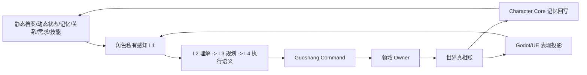
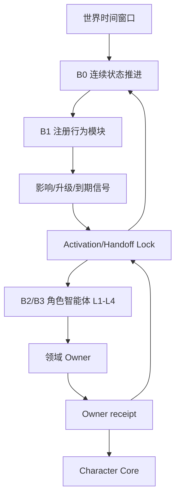

# Paralls 现有 Owner 与接入分析

> 文档状态：Guoshang 玩法系统架构基线
> 版本：v0.2；复核日期：2026-10-30
> 范围：记录 `paralls-phase-0-demo` 已有代码和正式规格中可复用的 Owner、运行链路与缺口
> 重要说明：`current` 只表示 Paralls 有代码、测试或正式运行时文档证据；`planned` 不得当作已经完成的城市系统。

本文件的 Owner 分类、角色字段和状态效果专题补充见[Owner 体系专题](Owner体系/README.md)。

## 1. 结论

Paralls 已经提供了 Guoshang 可以复用的底层结算脊柱，但没有提供完整的县城战争玩法。可复用的核心是：

```text
决策主体
  -> 结构化意图/命令
  -> 领域 Owner 准入与结算
  -> AtomicEventBatch
  -> GameplayEventStore
  -> receipt / revision / outbox / replay
  -> 受限投影
  -> 角色记忆与 Godot 表现
```

Paralls 的 Owner 判据是“对某一类事实拥有唯一最终写权”，不是“某个模块能产生一段数据”。角色智能体、群体模拟、司命、WRK 和引擎表现层都不能替代领域 Owner。逻辑写权与宿主分开：获准 Owner 可以由 UE 原生运行时承载，Godot/UE 的动画或 Actor 本身不因此取得写权。上图是 Paralls 现有链路，不代表 Guoshang 必须保留 Godot 执行器。

Guoshang 应在这条脊柱上增加统一 Command 层，让人类玩家、智能体玩家、角色智能体和群体模拟使用相同的请求合同；Command Gateway 负责治理和路由，具体事实仍由领域 Owner 结算。

## 2. 三本账与 Paralls Owner

### 2.1 世界真相账

记录世界正式承认的事实、事件、当前状态、`world_revision`、来源、作用范围和 receipt。

主要承担者：

- 各领域 Authority：判断请求是否合法并生成领域事件；
- `GameplayEventStore`：保存提交后的事件历史、流版本、幂等结果、committed outbox 和回放基础；
- Projection/Replay：从已提交事件重建受限查询视图。

它不记录角色“应该知道什么”。Godot/UE 动画完成本身不能确认世界事实；带许可、时间、revision 和来源的执行证据可交对应 Owner 校验，再决定是否提交。

### 2.2 角色记忆账

由 Character Core 和角色运行时维护，记录某个角色实际观察、收到、推断、相信、误解和记住的内容。

角色记忆有五个池：Event、Observation、Knowledge、Social、Higher-Order。世界事实只有经过实际暴露、合法传播或角色自身推理，才可进入相应记忆池。

### 2.3 世界表现账

Paralls 现有 Godot/BackendBridge、Guoshang 目标 UE 表现适配层分别维护局部场景、Actor、物理、音频、UI 和动画的可重建投影。表现层可以延迟、降精度或局部缺席，但不能反写真相。

三本账还必须分开记录：

```text
event_time      世界事实发生时间
known_time      角色得到信息的时间
presented_time  玩家看到表现的时间
```

## 3. Paralls 当前 Owner 基线

下表把事实 Owner、基础设施和消费者分开。`Owner` 列只表示最终写权，不表示所有代码都已覆盖 Guoshang 需要的全部业务。

| Paralls 能力 | 类型 | 当前责任 | 与角色智能体的连接 | 与群体模拟的连接 | Guoshang 可复用程度 |
|---|---|---|---|---|---|
| `GameplayEventStore` | 事实提交基础设施 | 原子事件、stream revision、幂等、outbox、replay/checkpoint | 接收 Owner 结果，不接收角色自由文本 | 接收群体候选经过 Owner 后的事件 | 高：作为唯一事件脊柱 |
| `SettlementPlan` / `OwnerAuthorizedFragment` | 组合基础设施 | 合并已经由各 Owner 授权的片段，不拥有事实 | 把角色意图拆成多个 Owner 请求 | 把批量候选按依赖提交 | 高：作为组合协议，不做万能 Owner |
| Character Core / `CharacterAgentRuntime` | 角色私有 Owner | 档案、五池记忆、动态状态、目标、连续性和决策回放 | L1-L4 产生结构化意图，消费过滤后的结果 | 接收 B0/B1 交接包，恢复同一角色 identity 和记忆游标 | 高：作为居民和指挥角色的心智底座 |
| ESM / embodied authority | 现有有界交互结算与编排模块，含待迁移写入口 | 结构化对象交互、语义/物理通道、执行许可和结果；不等于完整物理/身体权威 | L4 请求经相应合同路由，不是所有意图都经 ESM | B0/B1 产生候选后路由到对应领域 Owner；ESM 不是必经入口 | 合同逐项审计复用；Godot 执行器需替换，重叠写权需迁移，见第 9 节 |
| Body/Survival/Status/Ability | 领域 Owner | 身体、资源、状态标签、能力和动作门槛的窄纵切 | 角色读取能力/身体投影，动作失败回写 L1/L2 | 群体模拟可推进有限状态或生成升级信号 | 中高：需补齐伤病、疲劳和军需规则 |
| Inventory/Ownership/Economy | 领域 Owner | 容器、负重、装备、产权、账户、购买、赠与、债务等窄能力 | 角色通过能力和库存投影提出请求 | 群体候选不能直接改库存，必须进入 Owner | 中高：可作为城内物资账基础 |
| `ConstructionProductionAuthority` | 领域 Owner | 建造任务、设施状态、生产认证和产出事件的部分纵切 | 角色提出开工、参与、领取或检查意图 | B0/B1 可提出生产 due，产出由 Owner 认证 | 中：工艺、产能、配方需按 Guoshang 扩展 |
| `OrganizationAuthority` | 领域 Owner | 角色岗位、组织关系、运行窗口、工作贡献和部分组织流程 | 角色的岗位/权限作为受限投影，不能自行扩大授权 | 群体模拟按岗位、窗口生成工作候选 | 中高：适合县署、军队、工坊组织基础 |
| `GovernmentAuthority` | 领域 Owner | 许可、政策、通知、政府分支流程的部分纵切 | 角色可提出政令意图，政府 Owner 验证身份和范围 | 群体模拟消费政策投影，不直接写政策 | 中：需补县令政令、封锁、征发和赦免 |
| `InventoryConditionTransportAuthority` | 领域 Owner | 物品状态和运输批次的开始、抵达、损失、拒绝 | 角色/群体模拟提出运输请求，结果回写相关角色 | 群体模拟推进运输 due，拦截仍需新 Owner 规则 | 中高：可作为粮道和军需批次底座 |
| `SocialSpatialOwner` | 领域 Owner | 社交空间行动的接受记录，不移动 Actor | L4 的靠近、跟随、撤离等请求进入此处 | B1/B2 可生成空间候选 | 中：需与 UE Presence/Pathfinding 接通 |
| `ProfileActivationAuthority` | 激活/推进权治理（不是 LifeState） | 激活锁、待处理义务、释放、requeue 和身份版本 | 保证同一角色不会被两条心智链同时推进 | B0/B1 与 B2/B3 交接的唯一推进锁 | 高：必须保留 |
| Population Cadence / B0-B1 | 模拟处理器，不是事实 Owner | 低精度连续推进、due、影响和升级信号 | 通过 handoff package 交给角色智能体 | 推进全体登记角色的低成本状态 | 高：作为县城后台生活调度基础 |
| WRK | 规划中的组合内核，不是事实 Owner | 统一时间窗口、预算、依赖、交接和恢复 | 调度激活与关闭，不代替 L1-L4 | 批量推进 B0/B1，路由候选到 Owner | 需要增量建设 |
| Godot / BackendBridge | 表现账消费者 | 输入、局部空间、动画、音频、UI、预测和镜像 | 消费表现投影和执行计划，不能选定角色意图 | 消费群体模拟的局部投影，不承担后台事实 | 投影/连续性语义可参考；Godot 执行与桥接需 UE 原生实现 |

## 4. 与角色智能体的连接

角色智能体不是 Owner 调度器，也不是物理执行器。Paralls 的完整连接是：



### 4.1 角色可以做什么

- 读取经过隐私、空间、注意力和感官过滤的角色版世界；
- 根据人格、需求、关系、技能和动态状态形成主观解释；
- 生成结构化 `Intent`；
- 将 `Intent` 转换为 `Command`；
- 接收 Owner 的成功、拒绝、延迟、部分完成和恢复结果；
- 将实际暴露的结果写入自己的记忆账。

### 4.2 角色不能做什么

- 直接写库存、生命、位置、生产、士气、城池控制或胜负；
- 读取全局真相或其他角色私有记忆；
- 让动画完成替代物理/玩法结算；
- 把“我打算做”写成“事情已经完成”；
- 在控制权失效后继续提交旧 Command。

## 5. 与群体模拟的连接

群体模拟与角色智能体是同一角色的不同精度推进者，不是两套居民事实系统。



规则如下：

1. B0 只能推进注册的低精度字段，不直接制造个人重大事实、私人记忆或交易结果；
2. B1 可以产生结构化候选、影响信号和表现种子，但不能声明世界事实已经成立；
3. 高影响或需要主观判断的事件升级到 B2/B3；
4. 同一角色同一时间窗口只能有一个推进者；
5. 激活前固定来源 revision 和连续性游标，过期则 requeue；
6. 角色退出高精度后保留已确认结果、未决意图、义务、失败原因和记忆游标。

## 6. 当前连接状态与缺口

### 已有或有窄证据的连接

- Character Agent L1-L4 能接收私有感知、运行 L2/L3/L4 并生成结构化执行包；
- Activation Authority 已有锁、token、deadline、owner thread 和释放/requeue 机制；
- EventStore 已有原子 batch、revision/CAS、幂等、outbox、replay/checkpoint；
- 角色动作与 ESM/Gameplay Owner 已有若干窄纵切；
- Inventory、Production、Organization、Government、Transport、Social-Spatial 已存在部分 Owner 入口；
- Godot 侧已有过滤镜像和 commit 后投影模式。

### 尚不能宣称完成

- 全县城统一 WRK；
- 全 roster 的 B0-B1-B2-B3 统一交接；
- 完整居民、家庭、岗位、日程和影响力模型；
- 完整运输路线、占用、绕行、拦截和玩家干扰；
- 完整军队命令、阵型、士气、军旗和攻城器械 Owner；
- 三本账的全量同步合同与 `event_time/known_time/presented_time` 统一回放；
- 最终单一路径 `L4 -> UE Character Actor`。

## 7. 对 Guoshang 的接入原则

1. 保留 Paralls 的 EventStore、revision、幂等、receipt、outbox、replay 语义；
2. UE 输入/表现适配层发送结构化命令与证据；获准的 UE-hosted 领域 Owner 可按统一提交合同确认本域事实，Actor/动画不可旁路写入；
3. 新玩法 Owner 各自拥有事实流和规则，不向 WRK 或 Command Gateway 转移领域写权；
4. 人类玩家、智能体玩家、角色智能体和群体模拟全部通过统一 Command 层；
5. 角色记忆和表现投影必须在世界事件提交后按权限生成；
6. 所有新 Owner 先做成功、拒绝、幂等、revision 冲突、回放和投影验证，再接入第一阶段县城玩法。

## 8. Paralls 参考源

本文件依据以下本地材料和代码核对：

- `D:\Users\User\Documents\paralls-phase-0-demo\docs\10月中旬分析\群体模拟升级\规格\07-三本账与世界真相维护规格.md`
- `D:\Users\User\Documents\paralls-phase-0-demo\docs\10月中旬分析\群体模拟升级\规格\00-群体模拟升级总架构规格.md`
- `D:\Users\User\Documents\paralls-phase-0-demo\docs\10月中旬分析\群体模拟升级\规格\既有中旬规格\03-群体模拟B0-B1与角色智能体B2-B3交接规格.md`
- `D:\Users\User\Documents\paralls-phase-0-demo\docs\架构\运行时\模块\GameplayFoundation与领域结算.md`
- `D:\Users\User\Documents\paralls-phase-0-demo\docs\架构\运行时\模块\角色智能体.md`
- `D:\Users\User\Documents\paralls-phase-0-demo\backend\app\gameplay\event_store.py`
- `D:\Users\User\Documents\paralls-phase-0-demo\backend\app\gameplay\settlement_plan.py`
- `D:\Users\User\Documents\paralls-phase-0-demo\backend\app\population_continuity\activation.py`
- `D:\Users\User\Documents\paralls-phase-0-demo\backend\app\character_agent\runtime\runtime_loop.py`


## 9. ESM 复用边界与迁移检查

以下是 2026-10-30 的静态代码/规格核对，不是 UE 运行验收。ESM 已有语义编排与持久结果能力，并非空壳；它的范围与 Godot 依赖也不能推导成通用 UE 游戏底座。

| 层次 | 当前证据 | Guoshang 处理 |
|---|---|---|
| 结构化语义与结果 | `backend/app/services/esm_service.py` 含对象交互和 `gameplay.esm.object_settled` 事件；示例位置、对象与距离判据有硬编码 | 审核动作、目标、拒绝和结果合同；替换示例数据并将对象字段映射到正式事实域，不照搬世界坐标和判据 |
| 许可与证据 | `backend/app/models/embodied_interaction.py` 有 grant/epoch、revision、幂等、证据引用等；route/writer 枚举仍有现有实现假设 | 保留经审核的许可、attempt、evidence、outcome 语义；schema 版本化适配 UE，不冒充即插即用 |
| 物理通道 | `backend/app/services/physical_interaction_channel.py` 校验语义许可与观察，含 Godot/backend probe 来源 | 仅复用审核过的证据校验思想；它不是 UE 碰撞、寻路或刚体求解器 |
| 具身执行器 | `scripts/interaction/EmbodiedActionController.gd` 是 Godot Node，执行接近、对齐、准备、接触、观察、恢复等阶段 | 由 UE 原生移动、交互、动画和碰撞执行器实现相应阶段；不将 GDScript 当成 UE 依赖 |
| 旧身体结算 | `backend/app/services/embodied_authority_settlement_service.py` 有示例角色 hp/stamina 与结果持久化路径 | 生命/体力写权归 Body，不能与旧街区结算并行写同一角色；事件历史保留，迁移后旧入口由 epoch/路由失效 |
| 正式领域路由 | Paralls `docs/架构/运行时/模块/ESM与交互编排.md`、`GameplayFoundation与领域结算.md` | 请求按事实归属路由到 ESM 的有界合同或 Gameplay Owner，不新增万能 ESM→所有玩法入口 |

接入前按“可复用合同 / 需适配 schema / 需替换执行器 / 需迁移写入口”登记到建设总计划 A1—A5。门扇开闭/门闩/设施完整度归 Production / Facility，通行归 Presence，封城政令归 Government，控制归 Territory；装备关系/耐久归 Equipment，库存归 Inventory，身体归 Body。未映射的环境事实先冻结权威合同，不用 ESM 兜底。

允许直接采用统一 Command → 获准 UE 领域 Owner 的本地路径。只有需要已审核具身交互合同的动作才使用相应适配器；不使用 ESM 也须遵守同一授权、证据、提交、暂停和回放规则。23 个 Owner 的完整部署与更新分类以[建设总计划第 11.2 节](08-基础设施与Owner建设总计划.md#112-全量-owner-的-ue-协作与节奏矩阵)为准。
