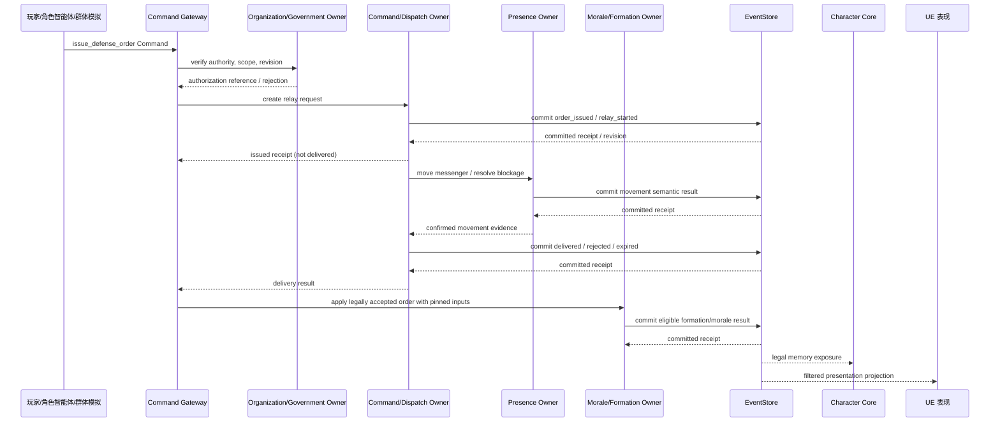

# Guoshang 新 Owner 需求与统一 Command 规范

> 文档状态：Guoshang 玩法系统需求草案
> 版本：v0.2；复核日期：2026-10-30
> 目标：在 Paralls 既有事件结算脊柱上，补齐县城战争玩法所需的领域 Owner 和统一 Command 层
> 设计口径：参考正常玩法系统的 `Static Data / Runtime State / Command / Rule-Resolver / Authority / Event-Result / Presentation / Query-Projection` 七部分，但不建立第二套事实账本。

Owner 的基础/原子/组合分类和角色静态/动态状态接入细则见[Owner 体系专题](Owner体系/README.md)。

## 1. 总体结构

Guoshang 的所有行动来源共用一个 Command 合同：

```text
人类玩家
智能体玩家
角色智能体
群体模拟
现场行为脚本
        ↓
Command Adapter
        ↓
Command Gateway
        ↓
权限 / 控制权 / 作用范围 / 时效 / revision / 幂等
        ↓
领域 Owner
        ↓
EventStore：world truth event + receipt
        ↓
角色记忆投影 + UE 表现投影 + 查询投影
```

### 1.1 Command 不是事实

必须区分三个对象：

```text
Intent   角色主观上想做什么
Command  请求系统执行什么
Event    Owner 已确认世界发生了什么
```

例如：

```text
“我想把命令送到东队”       = Intent
“向东队发送守城命令”         = Command
“东队已收到并接受命令”       = Event
```

动画播放、角色说出一句话或群体模拟生成候选，都不能直接产生 Event。

### 1.2 Command 来源

所有来源使用同一套领域命令，只由 `source_kind` 和授权上下文区分：

```text
human
player_agent
character_agent
population_sim
scene_script
```

任何来源都必须通过相同的 Owner 规则、revision、幂等和失败反馈。AI 不能因为是 AI 而获得绕过权限、视野、通信或资源的能力。

## 2. Command Gateway 需求

`CommandGateway` 是公共命令治理和路由层，不是万能事实 Owner。

### 2.1 统一命令信封

```text
command_id
command_type
command_version
source_kind
principal_ref
actor_ref
subject_ref
target_refs
control_mode
payload
expected_revisions
read_set_revisions
evidence_refs
priority
issued_at
expires_at
causation_id
correlation_id
```

### 2.2 生命周期

```text
received
  -> normalized
  -> admitted
  -> queued
  -> executing
  -> committed
```

失败路径必须显式记录：

```text
rejected / requeued / partial / cancelled / expired / superseded
```

### 2.3 Gateway 必须做什么

- 验证来源身份和控制模式；
- 校验命令结构、目标、作用范围、时效和优先级；
- 固定读集和预期 revision；
- 检查控制权是否仍属于该主体；
- 生成或复用幂等键；
- 路由到一个或多个指定 Owner；
- 保存命令审计和状态，不把命令本身伪装成世界事件；
- 接收 Owner receipt 并返回统一结果；
- 支持取消、过期、重排、恢复和查询。

### 2.4 Gateway 不得做什么

- 修改生命、库存、位置、士气、生产或关系事实；
- 替领域 Owner 计算业务结果；
- 保存第二份角色、人口或资源状态；
- 把玩家 UI 操作直接变成远方世界事实；
- 在一个 Owner 拒绝后静默改写另一个 Owner。

## 3. 新 Owner 统一需求模板

每个新 Owner 都必须提供以下七部分：

| 部分 | 必须定义 |
|---|---|
| Static Data | 规则版本、类型、配方、阈值、能力、状态转移、权限定义 |
| Runtime State | 本域唯一事实、状态机、revision、时间字段、来源和生命周期 |
| Command | 可接受的命令类型、输入、来源、证据、预期 revision |
| Rule/Resolver | 权限、前置条件、成本、冲突、效果、失败和部分完成计算 |
| Authority | 唯一写入入口、事件流、幂等、CAS、receipt、恢复和回放 |
| Event/Result | 成功、拒绝、延迟、部分完成、过期、损失和补偿事件 |
| Presentation/Query | 给 UE、角色智能体、群体模拟和 UI 的受限投影 |

Owner 之间的组合只能通过 `Command`、已授权 fragment、revision pin 和 receipt 完成，不共享可写内部对象。

### 3.1 领域模型依赖合同

七部分契约之外，每个 Owner 必须声明自己的模型依赖合同。模型只允许在所属领域内复用；同一领域可以通过不同 Numeric、Condition 和 Hybrid Model，以及不同 Static Data 参数和 Applicability Binding，支持同类玩法的差异化结算。

```text
Model Dependencies
  ├─ domain_owner_id
  ├─ allowed_model_types
  ├─ model_registry_scope
  ├─ applicability_binding_scope
  ├─ input_owner_refs
  ├─ output_effect_mapping
  ├─ evaluation_cadence
  ├─ conflict_policy
  ├─ version_pin_policy
  └─ migration / replay policy
```

模型本身只返回评估结果，不直接提交世界事实。Owner 必须负责解析模型绑定、固定输入 revision、执行模型、校验不变量并提交自己的事件。`Inventory` 可以使用食品变质、木材腐朽和铁料锈蚀等同领域模型，但这些模型不能跨领域写入 Body、Politics 或 Territory。完整规范见[领域模型注册、绑定与 Owner 评估架构](Owner体系/04-领域模型注册、绑定与Owner评估架构.md)。

## 4. Guoshang 新 Owner 清单

以下 P0/P1/P2 仅保留早期需求分组，不能当作串行建设顺序或冻结名单。最终 23 个逻辑 Owner、验收批次与全量 UE 协作节奏以[建设总计划第 5、11.2 节](08-基础设施与Owner建设总计划.md)为准，包含本节未单列展开的 Ownership、Economy、Territory、Politics、Campaign 等领域。Owner 与部署进程无关：获准 UE 实现可提交本域事实，Command/表现适配器不可写事实；ESM 仅是可选的已审核交互适配合同，Godot 执行器需替换。

### 4.1 第一阶段 P0：县城守城可玩闭环

#### A. Presence / Movement Owner

**唯一事实**：角色、队伍、传令批次和器械的实际位置、占用、到达、阻挡和脱离。

- Static Data：导航区域、道路、门、桥、地形代价、占用规则、可通行标签；
- Runtime State：当前位置、目标位置、移动阶段、占用者、路径 revision、阻挡原因；
- Command：`move`、`follow`、`hold_position`、`withdraw`、`reroute`；
- Resolver：速度、体力、地形、门禁、占用、碰撞、临时阻挡和可见证据；
- Event：`move_started`、`arrived`、`blocked`、`rerouted`、`intercepted`、`withdrawn`；
- 连接：角色 L4 和群体 B1 只能请求移动，UE 提供接触/占用证据；
- 投影：角色当前位置摘要、队伍位置、命令可达性和玩家可见路径。

这是事实 Owner；UE Navigation、动画和寻路库只是执行/表现工具。

#### B. Command / Dispatch Owner

**唯一事实**：命令的传达节点、抵达、理解、接受、拒绝、过期和执行跟踪；授权依据引用 Organization/Government/基础能力权威，不在 Dispatch 另造指挥权。

- Static Data：命令类型、有效期、可传达媒介、节点权限、优先级、失效条件；
- Runtime State：命令版本、传令批次、当前中继节点、目标接收者、状态和时间；
- Command：`issue_order`、`relay_order`、`ack_order`、`reject_order`、`cancel_order`、`expire_order`；
- Resolver：发令者身份、通信覆盖、传令路径、目标权限、内容完整性和时效；
- Event：`order_issued`、`messenger_departed`、`order_received`、`order_understood`、`order_accepted`、`order_rejected`、`order_expired`；
- 连接：县令、将领和角色智能体提出命令；群体模拟按职责和预案承接；
- 投影：玩家看到实际传达节点，角色只收到自己合法知道的命令信息。

它与 Presence/Transport 协作，但不拥有角色位置或物资库存。

#### C. Organization / Military Command Owner

**唯一事实**：岗位、军队层级、指挥权、授权范围、继任链、队伍编制和预案归属。

- Static Data：组织类型、军制层级、岗位资格、继任规则、命令覆盖范围、预案模板；
- Runtime State：当前任职、有效授权、队伍成员、指挥头目状态、继任待处理项；
- Command：`assign_role`、`grant_authority`、`issue_plan`、`handover_command`、`activate_contingency`；
- Resolver：身份、岗位、上级授权、失能状态、组织 revision、候选继任资格；
- Event：`role_assigned`、`authority_granted`、`plan_activated`、`command_handed_over`、`succession_committed`；
- 连接：角色设定提供身份与能力摘要，不能自行宣布有指挥权；B0/B1 读取预案，B2/B3 才可进行高影响判断；
- 投影：组织树、命令链、继任链、队伍任务和权限状态。

Paralls 的 `OrganizationAuthority` 可作为窄基础，但县城军政一体的军令、营队和继任需新增 Guoshang 规则。

#### D. Combat / Damage Owner

**唯一事实**：攻击尝试、命中、格挡、伤害评估和战斗接触结果。Combat 产出伤害评估，不直接拥有目标生命、伤势、护甲耐久或持续状态效果。

- Static Data：武器、兵种、攻击原语、伤害类型、命中/格挡规则；引用护甲和身体规则但不复制其权威配置；
- Runtime State：攻击姿态、冷却、接触和攻击执行阶段；
- Command：`attack`、`defend`、`charge`、`shoot`、`retreat`、`capture`；
- Resolver：距离、朝向、体力、技能、武器、地形、碰撞、目标状态和伤害评估规则；
- Event：`attack_started`、`hit_confirmed`、`damage_assessed`、`attack_resolved`；身体功能限制由 Body 确认，倒地/死亡等生命周期转换由 LifeState 确认，俘获后的拘押/编制关系由 Organization 的战俘子域确认；
- 连接：角色智能体提出战斗意图，UE 提供接触和命中证据，群体模拟只提交低精度战斗候选；
- 投影：战斗反馈、伤害评估及下游 Owner 确认的伤势、失能、死亡和队伍损失。

**关联 Owner**：Body 写生命、伤势、部位功能和身体失能；Equipment 写护甲耐久；Status 写流血等持续效果。UE 本地 Combat Domain Owner 可按第一阶段路线负责近场 Combat 事实的最终结算；若其结算涉及 Body/Equipment/Status，必须请求这些 Owner 的授权 fragment 并共同提交，不能把相关字段纳入 Combat 的私有写集。动画、未确认命中和角色自报伤害不能成为最终事实。

**Body / Resource Owner 合同**：唯一事实为生命、体力、身体部位、伤势、身体功能和由此产生的能力限制。接收 Combat 的伤害评估、Status 的持续效果 tick、医疗流程的治疗请求及动作资源成本，由 Body 生成自己授权的 fragment；按注册模型提交 `damage_applied`、`injury_changed`、身体功能与体力消耗/恢复事件。生命按事件结算，连续体力按模拟时间窗口积分，动作准入与成本扣除/预留不得并发超支。近场推荐在 UE runtime 内与 Combat 本地协作，不以 Agent 推理或后端逐次往返作为扣血/扣体力的必经路径；任一事实作用域同一时刻只有一个有效 `authority_epoch` 和 canonical writer。

**LifeState Owner 合同**：独立拥有存活、倒地、濒死、死亡等生命周期转换。Body 提供身体与阈值依据，Status 等域提供适用效果依据，LifeState 按自身版本化条件授权转换；`health == 0` 不自动等于 `dead`。近场支持与 Body 同步的 UE-local 实现；普通治疗必须校验生命周期，不能用延迟回血覆盖已确认死亡。该完整合同为 Guoshang 目标，不能把 Paralls 当前有界的初始 alive / confirmed case-death 支持称为完整生命周期状态机。

**近场协作与提交合同**：Combat、Body/Resource、Equipment、Status、LifeState 和战场 Morale 可共同部署在 UE，由本地路由和调用生成各域授权结果。静态资源定义、模型版本、适用绑定、更新节奏与延迟预算必须登记。本地计算完成不等于提交完成；可靠本地提交只有注册为该事实流唯一权威后才能产生最终 receipt，后端随后只同步投影；若只有后端 canonical store，则回执前保持 pending/predicted。详见[高频协作、节奏与权威提交](Owner体系/03-数值规则、状态效果与跨Owner结算.md#44-近场部署职责分域实时协作)。

**Equipment Owner 合同**：拥有护甲/装备耐久、防护状态、破损和装备关系；Combat 可以请求防护计算，不能写耐久。伤害批次需固定 Equipment revision，并与 Body 结果共同提交或记录待完成义务。

**Status / Effect Owner 合同**：拥有流血、中毒、燃烧、感染、眩晕等效果实例的来源、强度、层数、时限、tick、退出条件和 revision。按效果规则产生 Body 伤害/恢复请求；只提交效果实例事件，不直接修改生命值。UE VFX、AnimNotify 和 GameplayEffect 可作为呈现/触发适配，不是 canonical writer。

#### E. Morale / Formation Owner

**唯一事实**：按显式作用域注册的个人/队伍士气、阵型、纪律、溃退、重整和关键目标压力；角色主观情绪、信念与解释仍归 Character Agent。

- Static Data：兵种编组、阵型模板、训练度、士气阈值、指挥加成、溃退规则；
- Runtime State：士气、阵型、纪律、队伍压力、队伍任务、重整阶段；
- Command：`set_formation`、`advance`、`hold`、`rally`、`retreat`、`reform`；
- Resolver：命令是否抵达、队伍能力、地形、伤亡、粮水、指挥状态、敌我压力；
- Event：`formation_changed`、`morale_shifted`、`routed`、`rallied`、`reformed`、`objective_pressure_changed`；
- 连接：Organization 提供合法命令，Combat、Supply、Command 提供事实输入，B0/B1 生成低精度压力信号；
- 投影：队旗、阵型、士气等级、当前任务、拒绝/重规划原因。

它必须读取多个系统的已确认结果，但只写自己的士气和阵型事实。

近场战场士气须支持 UE 高频协作，推荐显式注册 UE-local 权威实现，按伤亡、军旗、鼓舞、指挥等事件加周期压力窗口评估，不要求每画面帧全量重算。个人所见、队伍汇报与全局事实须按输入合同区分，不能让未知伤亡直接成为角色认知。明确状态限制及时生效，Agent 结合士气、私有心智与命令自主判断；同一士气不必产生同一行为。切换群体模拟/Agent 或近远场不自动转移士气写权。

#### F. UE Presentation / Mirror Adapter

这不是世界事实 Owner，而是 Guoshang 的表现账适配器：

- 消费世界真相投影、角色执行计划和现场证据；
- 负责 Actor 激活、动画、音频、特效、UI 和局部回滚；
- 携带 `truth_revision`、`memory_revision`、`presented_time`；
- 绝不以动画完成、UI 显示或本地预测替代 Owner receipt。

### 4.2 第一阶段 P1：县城持续运转

#### G. Inventory / Resource Owner

**唯一事实**：资源批次、数量、质量、容器、预留、转移、消耗、损失和存储关系；装备关系/耐久归 Equipment，法律产权归 Ownership，容器空间位置引用 Presence。

- Static Data：粮、盐、水、草料、木材、石料、铁料、箭矢、油、金汁、檑木等物品定义、规格、堆叠、质量和保质规则；
- Runtime State：容器、数量、质量、污染、预留、损耗和存储容量；产权与装备状态仅保存外域引用，不复制写权；
- Command：`reserve`、`load`、`unload`、`consume`、`transfer`、`destroy`；`equip` 由 Equipment 或跨域 Workflow 承接，Inventory 只处理本域转移/预留；
- Resolver：权限、容量、重量、兼容性、污染、保质期和成本；
- Event：`reserved`、`loaded`、`delivered`、`consumed`、`spoiled`、`lost`、`transferred`；
- 连接：Production、Transport、Combat、Survival、Government 读取其投影，不直接写库存；
- 投影：县城库存、军需库存、个人背包、仓储容量和短缺预警。

Paralls 现有模块中的容器、负重、装备和运输片段须按目标写集拆分核验：容器/数量归 Inventory，装备归 Equipment，运输阶段归 Transport；再补多规格军需与围城消耗链。

#### H. Transport / Logistics Owner

**唯一事实**：运输批次、承运人、路线阶段、护送、抵达、损失、拦截和恢复。

- Static Data：载具、驮畜、道路容量、路线、运输速度、护送规则、拦截规则；
- Runtime State：批次、货物预留引用、Presence 位置引用、目标、护送、阶段与损失记录；实际货物增减由 Inventory 提交；
- Command：`create_shipment`、`dispatch`、`escort`、`reroute`、`intercept`、`recover`；
- Resolver：库存预留、Presence、路线、敌方控制、天气、护送和玩家干扰；
- Event：`shipment_created`、`departed`、`rerouted`、`intercepted`、`partially_lost`、`delivered`；
- 连接：Inventory 提供货物事实，Presence 提供空间事实，Command Owner 传递命令，群体模拟推进远处运输；
- 投影：粮道状态、预计抵达、实际损失、运输队位置和可干预窗口。

Paralls 的 TransportRecord 只是运输批次状态窄纵切，尚不等于完整寻路、拦截和绕行系统。

#### I. Production / Facility Owner

**唯一事实**：登记设施/设备的完整度、机械开闭/闩锁、工作状态、工艺、工单、工序、产出认证和故障。工单参与关系引用 Work 的劳力/班次及 Organization 的岗位授权，物资预留引用 Inventory，不取得这些领域的写权。

- Static Data：设施、工艺、配方、材料规格、工种、设备、产能、质量和失败规则；
- Runtime State：设施状态、工作班组、生产任务、输入预留、进度、产出和停工原因；
- Command：`open_facility`、`assign_work`、`start_production`、`pause_production`、`complete_production`、`repair_facility`；
- Resolver：设备、匠人、材料、岗位、工艺条件、时间、质量和安全；
- Event：`facility_opened`、`work_assigned`、`production_started`、`production_progressed`、`output_certified`、`production_failed`；
- 连接：Organization 提供岗位，Inventory 提供材料，Population/Work 提供劳力，Command/Character 提供请求；
- 投影：工坊状态、生产队列、材料短缺、预计产出和停工原因。

#### J. Population / Work Owner

**唯一事实**：居民登记、工作关系、工种、班次、家庭责任、劳力可用性和调派结果。

- Static Data：职业、技能门槛、工作条件、班次、家庭责任模板、训练路径；
- Runtime State：当前工种、岗位、班次、家庭义务、是否可调派；疲劳/伤病是 Survival/Body/Status 的只读投影，不作为 Work 的独立可写数值；
- Command：`assign_job`、`request_recruitment`、`train`、`rest`、`reassign`、`mobilize`；
- Resolver：技能、身体状态、组织许可、待遇、家庭责任、当前岗位和拒绝/延迟规则；
- Event：`job_assigned`、`assignment_delayed`、`training_started`、`mobilized`、`rest_started`、`work_refused`；
- 连接：B0/B1 负责低成本推进和候选，Character Agent 负责个体判断，Organization/Production 负责岗位和任务；
- 投影：居民工作表、岗位缺口、可用劳力、训练状态和调派原因。

它不替代 Character Core：工作事实属于公共世界账，角色是否愿意、理解和记住属于角色记忆账。

#### K. Survival Owner 与 Medical Workflow

**Survival Owner 唯一事实**：饥渴、疲劳等客观生存指标。生命/体力/伤势由 Body Owner 拥有；流血/感染等状态效果由 Status Owner 拥有；物资由 Inventory Owner 拥有。

- Static Data：生存指标消耗曲线、单位、边界、公式和条件阈值；
- Runtime State：饥渴、疲劳等生存指标；可以读取 Body/Status 投影，但不复制其权威状态；
- Command：`consume_supply`、`rest`；进食意图由角色 Agent 产生，组织配给可作为有来源的 Command；
- Resolver：环境、劳作、营养、休息和身体基线对生存指标的影响；
- Event：`need_increased`、`survival_metric_changed`、`rest_completed`；
- 连接：Inventory 提供已确认的消费结果与药材库存，Production 提供产出认证；角色 L1 接收 Survival/Body/Status 的受限身体投影；
- 投影：饥渴、疲劳等指标和生存条件。

Medical Workflow 是非领域 Owner 的流程组件：记录治疗请求、方案步骤、执行进度、依赖 receipts 和开放义务；发出 typed Command，编排 Inventory、Body、Status，并在所需 receipts 到齐后更新流程结果。它不提交生存指标、库存、生命、伤势或效果事实。药物不能由治疗动画直接扣除，补血不能由恢复组件旁路写入。UE 输入、治疗动作、进度、GAS 效果和反馈均可改造复用；若将身体/效果结算部署在 UE 内，须显式声明对应事实 Owner 的执行位置、唯一写入口及暂停/恢复策略。规则、部署和异常验收见[Owner 体系：数值规则与跨域结算](Owner体系/03-数值规则、状态效果与跨Owner结算.md#4-ueworkflow-与-wrk-边界)。

### 4.3 第一阶段 P2：社会、情报和后续战争扩展

#### L. Social / Influence Owner

**唯一事实**：公共关系事实、公开声望、非政治承诺、影响力变化和社会后果证据；个人私有态度归角色心智，派系公共政治承诺与政治立场归 Politics。

- Static Data：关系类型、社会身份、派系、声望规则、承诺模板和证据等级；
- Runtime State：可共享关系边、非政治承诺、声望、矛盾和暴露范围；私人信念不复制为本域可写事实；
- Command：`speak`、`negotiate`、`promise`、`threaten`、`recruit`、`betray`、`report`；
- Resolver：身份、关系、证据、场合、利益、传播范围和可信度；
- Event：`statement_made`、`promise_recorded`、`relationship_changed`、`influence_changed`；政治转向由 Politics 提交；
- 连接：角色智能体拥有主观 Social Memory，Owner 只确认社会事件和公开后果；群体模拟产生影响边候选；
- 投影：公开关系、声望趋势、承诺状态和可见社会证据。

#### M. Information / Intelligence Owner

**唯一事实**：情报来源、报告、可信度、传播路径、误报、泄露和已确认的知情范围。

- Static Data：信息类型、来源可信度、传播媒介、保密级别、识别规则和有效期；
- Runtime State：情报记录、来源、可信度、已知角色、传播节点、过期和冲突；
- Command：`observe`、`scout`、`report`、`relay_information`、`verify`、`suppress`、`leak`；
- Resolver：视野、距离、身份、传播媒介、来源关系和报告一致性；
- Event：`information_observed`、`report_submitted`、`report_received`、`report_verified`、`misinformation_spread`；
- 连接：角色只接收私有感知/合法收到的信息，群体模拟产生情报候选，Command Owner 传递实际报告；
- 投影：玩家掌握的情报、来源、可信度、时效和传播路径。

#### N. Government / Policy Owner

**唯一事实**：政令、许可、封锁、征发、配给、治安和制度窗口。

- Static Data：政策、权限、适用范围、例外、持续时间、惩罚和撤销规则；
- Runtime State：有效政令、政策 revision、辖域、执行状态、例外和申诉；
- Command：`issue_policy`、`order_gate_closure`、`requisition`、`ration`、`permit`、`revoke_policy`；
- Resolver：统治者身份、辖域、组织授权、资源、时间、冲突政策和执行能力；
- Event：`policy_issued`、`gate_closure_ordered`、`requisition_recorded`、`ration_changed`、`permit_granted`、`policy_revoked`；
- 连接：角色提出政令意图，Organization 验证职位，Command/Information 处理传达，Population/Inventory/Transport 执行后果；城门机械开闭/闩锁归 Facility，实际通行归 Presence，控制归 Territory，政令不能直接生成 `gate_closed` 机械事实；
- 投影：玩家可见政令、执行覆盖、例外、执行失败和民众知情范围。

## 5. Owner 协作与组合规则

### 5.1 典型“发布守城命令”流程



### 5.2 跨 Owner 原子性

- 如果多个 Owner 能在一次冻结 revision 下提交互不重叠的授权片段，可以合并为一个 `AtomicEventBatch`；
- 如果 Owner 需要按时间、空间或传达过程逐步执行，必须保留中间状态和每个 receipt；
- 一个 Owner 失败时，不得伪造全局回滚；后续进入 `partial / recovery / compensation / requeue`；
- 任何跨域流程都必须能指出：哪个 Owner 已提交、哪个 Owner 拒绝、当前 revision 和下一步恢复动作。

### 5.3 三本账回写

```text
Owner receipt
  -> 世界真相账：确认事件和 revision
  -> 角色记忆账：按实际暴露/合法传播写入记忆
  -> UE 表现账：生成带版本的局部投影
```

角色设定参与权限、感知、解释和候选排序；角色状态参与前置条件和行动效果；二者都不能直接写入世界真相。

## 6. 第一阶段实施优先级

建设按[统一总计划](08-基础设施与Owner建设总计划.md)的 A—F 批次与 V0—V5 切片并行推进，不按上文早期 P0/P1/P2 分组串行施工：

| 批次 | 首次可操作验证 | 主要交付 |
|---|---|---|
| A | 冻结合同与证据矩阵 | 23 Owner + 基础权威、领域模型、全量 UE 节奏、ESM 迁移与部署/提交边界 |
| B | V0 世界壳 | 正式事件、时间/暂停、命令、投影与模型参考链；资源域同步建设 |
| C | V1 传令与队伍响应 | Presence、Dispatch、Organization、Information、Agent/B0/B1 连续性和有限知情 |
| D | V2 可操作守城 | Combat、Body、Equipment、Status、LifeState、Morale、Territory；本地可靠提交，以及 Inventory/Facility 实时依赖子域 |
| E | V3 可完成 Alpha | Government、Objective、Campaign 与情报后果；求援、援军/敌退胜利及失败结局 |
| F | V4 资源社会完整；V5 整合 | 全量 Owner 完整包、资源社会链、未启用领域 fixture、保存/回放/性能与试玩 |

Information 和角色/群体交接从 C 接入，不是最后才添加的社会扩展。内容限制不缩减领域基础设施，尚未启用的五阶段内容以正式配置和 fixture 验证。

## 7. 每个新 Owner 的验收门槛

新 Owner 在接入玩法前必须证明：

1. 只有它能写入自己的事实流；
2. 命令来源、权限、能力和作用范围可审计；
3. 成功和拒绝都返回结构化 Result；
4. 旧 revision 的 Command 不会写入新状态；
5. 相同幂等键只产生一次事实事件；
6. 提交后可从事件重建状态；
7. 角色只能获得合法暴露的信息；
8. UE 表现可以从真相和行为结果重建；
9. 群体模拟只能提交被允许的低精度候选；
10. 失败、延迟、部分完成和恢复不会丢失世界时间或责任归属。

## 8. 非目标

- 不建立一个拥有所有事实的 `UniversalOwner`；
- 不让 Command Gateway 计算领域结果；
- 不让群体模拟直接改居民、库存、战斗或城池控制；
- 不让角色智能体读取全局真相；
- 不把 UI、动画或自由文本当作权威事件；
- 不因为第一阶段需要演示，就提前实现完整全国战争、完整经济或全量 LLM 居民。

