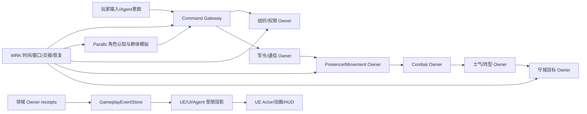
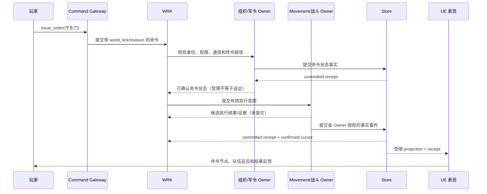

# 国殇：汉末：基建 Owner 传统方案与 Paralls 兼容方案

**状态：** PRD 基础设计，供第一阶段实现拆解使用  
**日期：** 2026-10-28  
**适用范围：** 五阶段长期世界基础、第一阶段县城守城 Demo  
**实现状态：** 本文是设计与盘点，不代表下列能力已经全部实现

**第一阶段执行基线：** 具体 Demo 目标、阶段门、验收矩阵和证据要求见[《第一阶段县城守城 Demo 设计与执行路线》](05-第一阶段县城守城Demo设计与执行路线.md)。

UE 高频 authority mode、领域公式、跨 Owner 事务以及 Workflow/WRK 边界的补充约束见[Owner 体系专题](Owner体系/README.md)。

## 1. 目的与判断

本文件回答一个基础问题：县城战争需要哪些长期 Owner，传统 Unreal 方案怎样实现，接入 Paralls 后哪些可以直接复用、哪些必须改造、哪些必须保留传统 UE 的即时能力。

项目最终要支持连续的战争世界、角色智能体、群体模拟、资源网络、政令和历史后果。第一阶段可以减少地图规模和内容数量，但不能把事实直接塞进 Actor 字段，不能建立一套以后必须推倒重来的临时世界真相。

最终边界如下：

```text
UE 传统层：输入、相机、角色、动画、局部移动、碰撞和即时反馈
Guoshang 战场 Owner：位置、战斗、军令、士气、阵型、运输、守城目标
Paralls：角色身份、记忆、人格、知识、判断、自主意图和群体连续性
GameplayEventStore：事件、revision、幂等、回放、投影检查点
WRK：世界时间、暂停、窗口、预算、唯一推进权、交接、回执和恢复
组合 Workflow：拆解跨域流程，等待各 Owner 回执，不拥有第二份事实
```

“兼容 Paralls”不是把传统系统和 Paralls 各做一套。传统方案保留交互手感和局部执行能力，Paralls 提供可复用的事实合同、角色认知和群体连续性，WRK 将两者放进同一个时间与回执模型。

## 2. 四种处理方式

| 方式 | 含义 | 适用范围 |
|---|---|---|
| 直接复用 | 直接使用 Paralls 已有实现或稳定合同，只做 Guoshang 适配 | EventStore、命令信封、库存/产权原语、角色 handoff、群体 cadence、检查点 |
| 改造复用 | 保留底层模型和边界，增加县城战争规则、适配器或新的 Owner 入口 | 组织、生产、运输、生存、政务、WRK、投影 |
| 传统兼容 | 保留 UE 的实时操控、寻路、碰撞、动画和反馈，由 Owner 确认事实 | 玩家移动、近场战斗、局部路径、动画表现、HUD |
| 新建 | 两边都没有可直接承担县城事实的实现 | 军令传递、军事组织、士气阵型、守城目标、军情报告、UE Presence 边界 |

## 3. 基础能力与部分领域的兼容对照

| Owner | 唯一事实 | 传统 UE 方案 | Paralls 兼容方案 | 处理方式 |
|---|---|---|---|---|
| World Time / WRK | 世界时间、时间窗口、暂停、预算、cursor、恢复任务 | `UWorldSubsystem`、Tick、Timer、GameMode 状态 | WRK 统一 `world_tick`、窗口、读集、handoff、receipt、checkpoint；获准 UE 本地执行消费同一时钟/窗口，表现读取时间投影；不得自行另推进世界时间 | 改造复用 |
| Event / Replay | 事件顺序、stream revision、幂等、outbox、回放 | GameInstance/SaveGame 自存事件 | 复用 `GameplayEventStore`、`AtomicEventBatch`、revision、replay、checkpoint | 直接复用 |
| Identity / Continuity | `character_id`、`unit_id`、`group_id`、编制归属、转层连续性 | Actor GUID、存档 ID、队伍数组 | 对接 Character Core、Population Continuity、Activation/Handoff；Actor 只持引用 | 改造复用 |
| Permission / Capability | 谁能发令、执行什么、作用范围和有效期 | PlayerController 或 Blueprint 判断 | 使用命令信封、权限、能力和 revision 校验；领域 Owner 最终拒绝或接受 | 改造复用 |
| Information / Knowledge | 谁知道什么、军情来源、报告和知识截止点 | HUD 或管理器直接显示全局变量 | 复用感知、记忆、受限 projection；不得把全局快照发给角色 | 改造复用 |
| Presence / Movement | 实际位置、占用、到达、阻挡、绕行、拦截和脱离 | `CharacterMovement`、NavMesh、EQS、AIController | UE 负责局部执行和接触证据，Presence Owner 承认位置事实并生成 receipt | 新建 + 传统兼容 |
| Command / Dispatch | 发令、传令批次、抵达、理解、接受、拒绝、过期 | PlayerController 直接调用队伍函数 | 统一 `GameplayCommandEnvelope`，新增军令传递与通信链 | 新建 |
| Organization / Military | 岗位、军制层级、指挥权、编制、预案、继任 | Actor 数组、枚举、Blueprint 编组 | 复用 Organization 原语，补县令、亲卫、营、队、传令和继任规则 | 改造复用 |
| Combat / Damage | 攻击尝试、命中、格挡、伤害评估和接触结果 | Trace、碰撞、Ability、AnimNotify 提供高频证据/即时反馈 | UE-local Combat Owner 可按 Demo 路线结算 Combat 事实；生命/伤势、护甲耐久、状态效果分别请求 Body/Equipment/Status Owner 授权提交 | 改造复用 + UE 高频兼容 |
| Body / Resource | 生命、体力、伤势、身体功能与能力限制 | GAS/AttributeSet、动作成本、本地资源积分 | 近场与 Combat 本地协作；领域模型/适用绑定和统一提交，后端不重复扣血/体力 | 改造复用 + UE 高频兼容 |
| LifeState | 存活、倒地、濒死、死亡等生命周期转换 | 本地规则及时中断动作和更新表现 | 基于 Body 等授权依据独立确认，生命归零不自动死亡；现有有界支持须扩展 | 改造复用 + UE 高频兼容 |
| Morale / Formation | 个人/队伍士气、阵型、纪律、溃退、重整、关键目标压力 | 队伍 Actor 保存 float/枚举，StateTree 切换 | 新建军事状态 Owner；近场支持 UE-local，按合法事件与周期压力评估；主观心智归 Agent | 新建 + UE 高频兼容 |
| Objective / Victory | 守城、援军抵达、敌军撤退、失守、投降、死亡、逃跑 | GameMode 直接判断胜负 | 新建 Objective Owner，读取各领域 receipt，写阶段胜负事件 | 新建 |
| Resource / Inventory | 粮、盐、水、木、石、铁、箭矢、武器和容器库存 | Actor/Component/DataTable 管数量 | 复用 Inventory、Ownership、Economy 原语，补军需容器和配给规则 | 直接复用底层 + 改造规则 |
| Transport / Logistics | 批次、路线、占用、堵塞、护送、拦截、损失、入库 | Spline/NavMesh 车队，抵达即入库 | 复用运输批次和物品状态，增加路径、干扰、损失和入库回执 | 改造复用 + 传统兼容 |
| Production / Facility | 设施、设备、匠人、原料、生产运行和产出 | 工坊 Actor + 配方 + Timer | 复用 Construction/Production 的设施、配方和产出认证，补军械生产线条件 | 改造复用 |
| Survival | 饥渴疲劳等客观生存指标 | Pawn 属性可作镜像，Timer 可提交时间窗口输入 | Survival Owner 写自身指标；消耗物资由 Inventory、生命/伤势由 Body、状态效果由 Status 分别拥有 | 直接复用原语 + 改造接入 + UE 传统执行兼容 |
| Medical Workflow（非领域 Owner） | 治疗请求、方案步骤、执行进度和待完成义务 | 治疗输入、动作、动画、进度条和交互 | Workflow 编排 Inventory、Body、Status，各事实 Owner 分别提交；动画、Buff 和恢复组件不可越权加血 | 直接复用流程原语 + 改造接入 + UE 传统执行兼容 |
| Government / Policy | 封城、路引、坚壁清野、征用、配给、求援政令 | GameMode/Manager 直接改全局变量 | 复用 Government 流程和许可，增加县城政令规则与执行反馈 | 改造复用 |
| Population / Work | 居民、工匠、守军、流民、岗位、劳动和替补 | 每人 Actor + AI | 复用 B0/B1 群体推进，关键居民升级 C2/C3 Agent，结果经 Owner receipt | 直接复用群体基础 + 改造模型 |
| Agent Activation / Handoff | C0-C3 认知层、执行租约、交接、重试 | AIController/StateTree 全部本地控制 | 复用 Activation、handoff、lease、requeue；UE Actor 不取得认知事实 | 直接复用合同 + UE 适配 |
| Projection / Mirror | 给 UE、UI、Agent 的受限查询状态 | Actor/HUD 直接读本地变量 | 复用 projection 思路，输入 `world_tick`、revision、receipt，禁止反写事实 | 改造复用 |
| Content / Rule Registry | 兵种、物资、配方、阵型、命令和规则版本 | DataAsset、DataTable、Blueprint | 保留 UE 静态内容编辑，同时注册语义版本和 Owner 规则引用 | 传统兼容 |

## 4. Guoshang 当前实现盘点

### 4.1 已有但不等于 Owner

`AStrategyUnit` 已有 AIController、EQS、NavMesh 移动、到达委托和 Blueprint 交互回调。它的调用链是：

```text
MoveToLocation
→ EQS
→ AIController::MoveTo
→ OnMoveFinished
→ Blueprint interaction
```

这可以继续作为 UE 局部执行器，但没有命令、权限、revision、receipt、事件账、暂停屏障、回放和恢复，因此不能直接承担 Presence Owner。

`ABattleUnit` 当前把 `UnitId`、`ArmyId`、`FormationSlot`、`Morale`、`TrainingLevel` 和 `bCombatCapable` 放在 Actor 的普通属性中。它们分别属于身份、组织/阵型、士气、训练和身体/战斗领域，未来应改为 Owner 投影字段。

`ABattleRiderCharacter`、`ABattlePlayerController` 和 `BattleViewMode` 已提供骑将移动、冲锋、第一/第三/俯视视角和输入基础。这些是应该保留的传统 UE 能力，但玩家输入造成的世界事实必须经由 Command、Presence 或 Combat Owner 确认。

`BattleGameMode` 和 HUD 当前只设置 Pawn、Controller、HUD，并显示视角与操作提示，还不是县城世界运行时。

### 4.2 当前缺口

- 没有统一 World Time、暂停屏障和 WRK。
- 没有县城级 Command/Dispatch 和传令反馈。
- 没有 Military Organization、继任和预案事实。
- 没有 Morale/Formation、Combat/Damage、Objective/Victory Owner。
- 没有 Presence/Movement 的事实提交边界。
- 没有资源库存、运输、生产和政令的 Owner 接口。
- 没有 UE 与 Paralls 的统一 projection、handoff、receipt 和 replay 接入。

## 5. Paralls 可直接复用的基础

以下能力应优先复用，不重新发明平行实现：

1. `GameplayEventStore`：事件账、stream revision、幂等、outbox、projection checkpoint 和回放。
2. `AtomicEventBatch`、`GameplayCommandEnvelope`、`SettlementReceipt`：命令、事件批次和结果回执合同。
3. `SettlementPlan`：组合已授权 Owner fragment 的预提交计划；它不拥有事实，也不应变成万能写入器。
4. Inventory、Ownership、Economy：容器、负重、产权、账户、购买、赠与和债务原语。
5. Construction/Production：设施、配方、生产运行、产出认证和失败结果基础。
6. Body、Survival、Status、Effective Stats：身体、需求、状态和有效能力基础。
7. Character Core、Character Agent、Activation、Handoff、requeue：身份连续性、私有记忆、L1-L4、自主判断和转层交接。
8. Population B0/B1 cadence：远场群体按窗口推进、候选升级和关键角色激活入口。
9. Projection、checkpoint、replay 和 recovery：查询投影、恢复游标和历史重放基础。

“直接复用”指复用原语、schema 和边界，不表示 Paralls 已有完整县城战争规则。军事组织、县城军令、攻守目标和 UE 空间接入仍需 Guoshang 领域实现。

## 6. 传统 UE 与 Paralls 的协作契约

### 6.1 责任边界



UE 不因为动画播放就宣布事实完成。Paralls 中的角色、司命和规划器不得绕过相应 Owner 直接设置 UE 位置、骨骼、伤害、库存或军旗；获准的 Paralls Owner 仍可提交本域事实，由 UE 消费其结果。Owner receipt 才是结果确认。UE 进程可以承载获准的 UE-local authoritative Owner；此时必须通过相同 Command/Event/Receipt、revision、幂等和 canonical EventStore 提交，UE Actor/动画/Buff 本身仍不是 Owner。

近场推荐将 Combat、Body/Resource、Equipment、Status、LifeState、战场 Morale 共同部署在 UE，按领域分别持有写权，通过本地调用协作。生命按事件、体力按动作与时间积分、士气按事件加周期窗口更新；角色智能体负责自主判断，受击、体力耗尽和已确认失能等即时约束不等待其推理。后端同步投影不重新结算本地已确认结果。要使正式战斗闭环不依赖后端往返，必须实现获准的本地可靠 canonical 提交路径；若提交端仍仅在后端，receipt 前就仍是 pending/predicted。部署、提交、断线与恢复详见[数值结算专题第 4.4—4.7 节](Owner体系/03-数值规则、状态效果与跨Owner结算.md#44-近场部署职责分域实时协作)。

### 6.2 典型命令流程



### 6.3 三本账和暂停

```text
世界真相账：Owner 已确认的资源、位置、伤害、组织、军令和胜负事实
角色记忆账：角色实际观察、听闻、理解和记住的内容
世界表现账：UE Actor、动画、旗帜、HUD 和镜头的可见投影
```

暂停是时停：`world_tick`、Owner 提交、角色写回、运输、生产、动画推进和 handoff 都冻结。暂停期间只编辑尚未发出的命令；恢复时重新校验 control epoch、revision 和 lease。旧的异步结果不能绕过 WRK 改变世界。UE-local Owner 也必须服从暂停屏障，不得由 Tick、AnimNotify、Timer 或延迟回调在暂停期间继续提交。

## 7. WRK 基建要求

WRK 是世界运行核心，但不是领域 Owner。它负责：

```text
World Timeline
→ bounded window
→ fixed read set
→ population processors
→ agent handoff
→ domain owner settlement
→ receipts
→ confirmed cursor
→ projection / replay / recovery
```

### 7.1 必须具备

- 唯一世界推进权和 `world_tick`。
- 游戏暂停/恢复屏障。
- 多时钟映射和有界时间窗口。
- 每窗口的读集、预算、依赖和确定性 seed。
- 群体模拟与 Character Agent 的唯一推进租约。
- Owner receipt、cursor、checkpoint、backlog 和开放义务。
- 超时、重试、未知结果查询和补偿事件。
- 旧 revision、旧 handoff、旧 epoch 的拒绝。

### 7.2 明确不能做

- 不能直接写库存、位置、生命、伤害、士气、生产产出或角色记忆。
- 不能新建第二套逻辑事实账或重复 authority；显式注册的 UE 本地可靠提交端属于同一事实体系，不能因这条约束而禁止本地权威持久化。
- 不能用表现层坐标替代 Presence 事实。
- 不能因为某个 Owner 成功就宣称所有跨域流程全局完成。
- 不能以自然语言或 Agent 输出绕过命令、权限和 Owner admission。

## 8. 第一阶段建设顺序

以[基础设施与 Owner 建设总计划](08-基础设施与Owner建设总计划.md)为唯一排程入口：A 冻结写权、模型与部署合同；B 建设正式内核并接 V0；C 接命令/组织/Information 与连续性，交付 V1；D 建实时领域及本地可靠提交，交付 V2；E 接求援/胜负，交付 V3；F 完成资源社会链与全量 Owner，交付 V4 后整合 V5。资源与模型从 B 并行建设，角色/群体从 C 接入。

不等待全部基础设施串行完成才首次进入 UE，也不以“最小窗口”或占位 Owner 替代五阶段完整基础设施。全量 23 Owner 与 UE 节奏分类见总计划第 5、11.2 节，本文件对照表不作为第二份名单。

ESM 复用限于经审核的结构化交互/许可/证据合同；Godot 执行器必须替换为 UE 原生实现，旧身体/对象写入口迁移到对应 Owner。ESM 不作为统一 Command 或所有 Owner 的必经入口，具体证据见[现状盘点第 9 节](01-Paralls现有Owner与接入分析.md#9-esm-复用边界与迁移检查)。

## 9. 验收标准

文档所定义的基建在第一阶段至少要能证明：

1. 玩家发出守城命令后，能看到命令经过合法传令节点，而不是瞬间修改队伍状态。
2. 命令可因失效、权限、阻挡、通信中断或目标已变更而被拒绝，并保留原因。
3. 玩家、传令兵、守军和运输队的事实状态有唯一 Owner，Actor 只是投影或局部执行器。
4. 玩家站在运输路线、运输遭遇攻击或路线被堵时，能形成等待、绕行、拦截或货损结果。
5. 近场动画提供即时反馈，但最终命中、伤害、死亡、入库和胜负均有 Owner receipt。
6. 暂停后所有世界推进停止，恢复后从相同 `world_tick` 继续，旧结果不会越权写回。
7. 能从事件账和 checkpoint 重建阶段性状态，并能解释一次命令、战斗或运输结果的因果链。
8. 第一阶段的胜利路径包括援军抵达或敌军提前撤退；失败路径包括失守后的投降、死亡或逃跑。

## 10. 结论

Guoshang 当前的 UE 代码适合继续承担传统游戏的输入、相机、角色、寻路和表现，但不应继续把长期事实保存在 `ABattleUnit` 等 Actor 的普通字段中。Paralls 的事件账、命令合同、资源原语、生产基础、角色智能体和群体连续性应直接或改造后复用。军令、军事组织、位置事实、士气阵型、守城目标和 UE 适配是必须补齐的领域。

第一阶段的正确目标是：内容规模小，基础边界完整。WRK、Command、Event、revision、receipt、handoff、replay 和 recovery 按最终架构建立；传统 UE 的即时操控和反馈保留；跨域玩法通过组合 Workflow 调用多个 Owner，不创建第二份世界真相。
