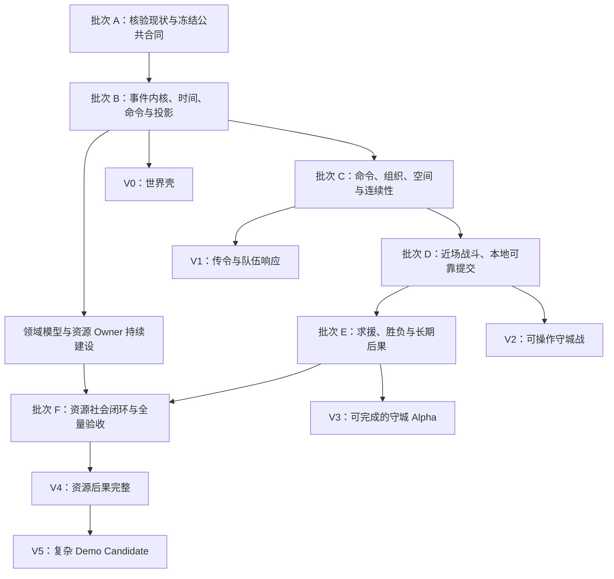

# 基础设施与 Owner 建设总计划

> **执行方式：** 实施时逐任务执行、验证和记录；使用 `superpowers:executing-plans`。本计划不自动授权启动实现、清理关卡或批量处理资产。
>
> **目标：** 第一阶段完成面向五阶段的正式基础设施与全量领域 Owner，以召陵县守城纵向切片持续验证，交付可玩的复杂 Demo。
> **架构：** 复用 Paralls 的领域授权与事件结算语义；按事实域划分唯一写权，以领域模型、统一 Command、Event/Receipt、三本账和 Workflow 组合玩法。近场获准 Owner 在 UE 内本地协作，远场群体模拟与角色智能体通过同一合同接入。
> **技术基线：** UE 5.8；本地 Paralls 现有运行时；版本化 Static Data 与领域模型。具体新增代码路径和接口签名在任务启动时依据两个项目的实际代码确定，不凭设计文档虚构已存在模块。
> **状态：** 建设计划 v1.1；2026-10-30。下列复选框表示待建设、待核验，均不代表现有实现已通过验收。

## 1. 本计划如何使用

这是基础设施与 Owner 建设的统一排程入口；玩法、接口和模型的详细设计仍引用原专题，不在这里复制第二套规格。

| 依据 | 用途 |
|---|---|
| [05-Demo 设计与执行路线](05-第一阶段县城守城Demo设计与执行路线.md) | 体验目标、V0—V5 切片、原阶段 0—12 能力门与整体验收 |
| [01-Paralls 现有 Owner 与接入分析](01-Paralls现有Owner与接入分析.md) | 复用候选与缺口；其中 current 不等于完成 Guoshang 接入 |
| [02-新 Owner 与统一 Command](02-Guoshang新Owner需求与统一Command规范.md) | 命令信封、领域契约、来源和权限 |
| [03-传统方案与 Paralls 兼容](03-基建Owner传统方案与Paralls兼容方案.md) | UE 高频执行、证据、预测与唯一写权 |
| [Owner 分类与注册](Owner体系/01-Owner分类与Paralls实现对照.md) | Owner Manifest、部署和事实边界 |
| [角色档案与心智对接](Owner体系/02-角色档案、权威状态与心智状态对接.md) | 静态档案、客观状态、私有心智、Agent 判断 |
| [数值规则与高频协作](Owner体系/03-数值规则、状态效果与跨Owner结算.md) | 跨域授权、近场协作、LifeState、本地可靠提交 |
| [领域模型架构](Owner体系/04-领域模型注册、绑定与Owner评估架构.md) | Numeric / Condition / Hybrid、Binding 与 Evaluation Context |
| [五阶段设计大纲](../国殇：汉末_五阶段战争世界设计大纲_v0.1.md) | 从县城到十三州的内容扩展方向 |
| [场景素材需求](06-召陵县第一阶段Demo场景素材需求.md)、[角色素材需求](07-召陵县第一阶段Demo角色素材需求.md) | 召陵县内容与资产范围 |

本文“建设批次 A—F”是交付顺序；“V0—V5”是可玩切片；“阶段 1—4”等沿用 05 的基础设施能力门；“五阶段”指游戏世界扩展。四种编号不可互相代替。

## 2. 总目标与硬约束

建设结果必须同时满足：

1. **可玩性：** 从合法军情开始，玩家求援并守城；约 30 个世界日援军抵达，或敌军提前崩溃、撤围则胜利。投降、死亡、逃跑按场景规则形成失败结局。出城反击或粮道行动是策略选项。
2. **正式基础设施：** 全量 Owner 有真实可执行规则、唯一写入口、提交、投影、回放和恢复；不以空类、恒成功 receipt 或剧本专用旁路交差。
3. **连续世界：** 同一角色身份、同一时间线、同一事实链和存档能从近场交接到远场，并由第一阶段进入第二阶段 fixture。
4. **有限知情：** 玩家和 Agent 只能使用世界中实际存在的观察、通信和报告；调试真相视图不得进入正式玩法读取路径。
5. **实时协作：** 命中、身体限制、体力、生命周期和战场士气能本地及时响应；不把后端或 LLM 往返放在强制反应的必经路径中。

五阶段基础设施完整，指身份/时间/作用域合同、领域能力、提交恢复和扩展验证完整；不声称已经制作全国内容，也不声称县城测试已经证明全国吞吐量。容量预算和后续扩展必须有各自的测量证据。

实施遵守项目 AGENTS：只运行一个 UE 实例；保护 `/Game/TopDown/Lvl_TopDown` 与 Saved 调试文件；资产操作先验证小样本。大型操作前重新测量内存/显存；可用内存低于 8GB 禁止大型导入，低于 4GB 停止构建并按项目规范处理；可用显存低于 3GB 禁止新增高模等高负载资产。

本计划不安排长时间构建、关卡清空或资产替换。后续这些任务需依既定需求与回退方案逐项执行。

## 3. 总体依赖与并行方式



并行指工作包可独立推进，不要求增加人员或启动多个 UE。每个新增 Owner 沿用已冻结的治理合同；接口依赖未就绪时可以做纯规则和合同测试，不能把临时假写入接进可玩版本。

资源建设自批次 B 起推进，V3 可以先使用受控的正式配置验证主线，但资源玩法完整验收在 V4；V3 不得标记为完整复杂 Demo。每轮只启用已通过相应能力门的规则与实体。

## 4. 基础设施建设清单

下表是共享基础设施和基础权威，不另计入第 5 节的 23 个领域 Owner。

| 工作包 | 必须建设的能力 | 首次交付与持续验收 |
|---|---|---|
| I01 身份、时间与权威登记 | 稳定实体/角色/组织/区域 ID；单调 world_tick；Owner/stream/作用域登记；控制权、authority epoch、lease、失效栅栏 | A 冻结合同，B/C 落地；交接不换角色身份，旧 epoch 不可写 |
| I02 Command 治理 | 统一信封；五类来源适配；权限、时效、读集和证据；路由、取消、幂等、未知结果查询 | B 可执行；V1 开始所有来源同路，近场允许受控本地调用 |
| I03 事实提交与持久化 | EventStore、revision/CAS、授权 fragment、AtomicEventBatch、receipt、可靠 outbox、稳定排序 | B 后端路径；D 本地权威路径；确认后崩溃不丢事件、不重复结算 |
| I04 WRK 与暂停屏障 | 窗口、预算、依赖、due、固定读集、重试、超时、开放义务；统一暂停/恢复与提交边界 | B 接 V0；暂停不推进时间、命令传递、Agent、动画和领域变化 |
| I05 Static Data 与领域模型 | schema、单位、版本、参数、公式、条件三值结果、状态机、Binding、Evaluation Context、确定性策略、模型升级迁移 | B 第一条正式模型链；F 全 Owner 覆盖，领域内复用、跨域拒绝 |
| I06 三本账与受限查询 | 真相、角色记忆、表现分离；event/known/presented 三种时间；来源、权限、感知与通信过滤 | B 正式合同；C/E 验证迟到报告、误报、未知与全知隔离 |
| I07 Workflow 与跨域恢复 | 步骤依赖、预留、授权片段、receipt、取消、部分完成、开放义务、补偿与恢复游标 | B 建执行合同；C—F 交付真实流程，不能代替 Owner 写领域事实 |
| I08 连续性与多精度推进 | B0/B1 与 Agent 激活、handoff、单一推进者、意图权、未决义务、记忆/事件游标 | C 首次接入，D/F 回归；视野内已激活角色能持续控制获准语义动画 |
| I09 UE/Paralls Bridge | 本地命令/执行证据、远场投影、游标同步、去重、预测校正、断线对账、动画反馈和近远场交接 | B 连接 V0；D 可靠本地提交；F 全链恢复和回放 |
| I10 保存、回放、观测与发布 | checkpoint、事件/投影重建、schema/模型版本迁移、因果追踪、失败注入、性能采样、可启动测试剧本 | B 起每轮交付；F/V5 汇总验收与试玩包 |

时间事实、实体身份和能力授权必须有明确基础权威及写入口。批次 A 将它们映射到 Paralls 实际模块；不能因为未列为独立玩法 Owner，就允许各域自行复制可写时钟或权限表。Organization 管岗位授权，Government 管行政许可，Gateway/Capability 校验这些依据，三者不得各自制造相互冲突的授权事实。

## 5. 最终领域 Owner 名单：23 个

以下是逻辑领域写权名单。别名不重复计数；一个模块可以承载多个 Owner，同一 Owner 也可以按区域/实体流分区。部署数量不改变逻辑名单。Equipment 在既有正文与能力门已存在，现补齐到总清单。

| # | Owner | 唯一事实范围与关键边界 | 首次建设批次 / 最迟正式验收 |
|---|---|---|---|
| 01 | Presence / Movement | 位置、占用、到达、阻挡、改道；NavMesh 和 Actor 连续轨迹是执行/证据，按语义边界承认事实 | B / C；D/F 扩展 |
| 02 | Command / Dispatch | 命令的传达、理解、接受、拒绝、过期与执行跟踪；实际执行结果引用目标 Owner receipt | C / V1 |
| 03 | Organization / Military | 岗位、层级、编制、指挥授权、预案、继任；战俘子域管理拘押/编入关系 | C / V1；F 覆盖 fixture |
| 04 | Government / Policy | 政令、许可、封锁、征发和配给规则；不直接改变产权或库存 | C 合同、E 规则 / V3；F 后果链 |
| 05 | Information / Intelligence | 报告、来源、可信度、传播与知情范围；不拥有角色私人理解 | C / E |
| 06 | Combat / Damage | 攻击、接触、命中、格挡、伤害评估；不写生命、耐久或死亡 | D / V2 |
| 07 | Body / Resource | 生命、体力、伤势、身体功能和能力限制；不拥有物资或死亡转换 | D / V2 |
| 08 | Equipment | 装备关系、防护状态、耐久与破损；装备物品的数量由 Inventory 管，产权由 Ownership 管 | D / V2 |
| 09 | Status / Effect | 效果实例、强度、来源、tick/退出生命周期；周期伤害请求 Body 结算 | D / V2 |
| 10 | LifeState | 存活、倒地、濒死、死亡等规则转换；health==0 是依据，不是自动死亡 | D / V2 |
| 11 | Morale / Formation | 个人/队伍士气、纪律、阵型状态、溃退和重整；不替代 Agent 的情绪、信念和决定 | D / V2 |
| 12 | Territory / Control | 地块、道路、设施与城池的控制、争夺和占领；位置、产权和政治承认各有自己的 Owner | D / E |
| 13 | Objective / Victory | 场景目标、胜负与摘要；只读取已确认控制、生命周期和援军等结果 | E / V3 |
| 14 | Campaign / Strategic State | 战役目标、阶段推进、继承与历史分岔；不让章节脚本重写下层事实 | E / F |
| 15 | Inventory / Resource | 批次、数量、质量、容器、预留、转移、消耗和存储状态；不写法律产权 | B 模型参考链 / F；D/V2 前交付弹药/药品即时子流 |
| 16 | Ownership / Property | 所有权、保管权、使用权、查封与转移；不把持有物品等同法律拥有 | B/C 合同 / F |
| 17 | Economy / Market | 账户、报价、订单、债务、税费、合同与结算义务；现金不能只靠库存字段代替 | B/C 合同 / F |
| 18 | Transport / Logistics | 承运批次、路线阶段、护送、交付和损失记录；位置归 Presence，货物增减归 Inventory | C 起 / F |
| 19 | Production / Facility | 登记设施/设备的物理完整度、机械开闭/闩锁、工作状态、工艺、工单、进度、故障与产出认证；不自写原料和成品数量 | B 模型合同 / F；D/V2 前交付城防设施子域 |
| 20 | Population / Work | 居民/家庭的公共登记、工种、班次、劳力可用和调派；档案技能不复制，身体与疲劳只读 | C 起 / F |
| 21 | Survival | 饥渴、长期疲劳等生存指标；生命/体力归 Body，物资消费归 Inventory | B/C 合同 / F |
| 22 | Social / Influence | 公开关系、个人/组织承诺、声望和影响力；私人印象在记忆账，派系公共政治承诺由 Politics 管 | C 起 / F |
| 23 | Politics / Legitimacy | 公开承认、合法性、政治授权、外交及派系公共政治承诺；不等同影响力数值 | E 起 / F |

名单之外的职责明确归位：

- **Character Core / Agent：** 复用角色档案与私有心智/记忆权威；不是新增的公共身体或社会事实 Owner。
- **Activation / Handoff / Continuity / Lease：** 推进权治理，不是角色的 LifeState；退出高精度不等于死亡。
- **World Clock / Identity / Capability：** 基础事实与授权权威，按 I01 实现，不与领域 Owner 重复计数。
- **Medical、城防、求援、生产线、征发、交易与进食：** 跨 Owner Workflow，不增加同名万能玩法 Owner。
- **Ability：** 核验已有能力声明、动作准入与授权合同；逐字段映射到基础授权、Body、Status、Equipment、Combat 与 Presence，不以旧模块名新增写权。
- **ESM / embodied：** 可选择复用已核验的结构化交互、执行许可、证据和结果合同，不是统一 Command 的必经入口，不新增万能 ESM Owner。Godot 执行器和桥接代码不能直接用于 UE，需由 UE 原生执行器实现获准合同；旧对象状态、生命/体力等写入口必须映射到相应领域后停用重叠写权。详见[现状盘点中的 ESM 复用边界](01-Paralls现有Owner与接入分析.md#9-esm-复用边界与迁移检查)。
- **精神与灵魂：** 沿用 Paralls 现有 LifeState、Character Core 等合同逐项核验；本计划不把这些名称擅自并入生命/体力，也不新增未经定义的 Spirit/Soul Owner。

## 6. 每个 Owner 都要交付的完整包

对 23 个 Owner 使用同一完成标准，而非同一套业务公式。展示与查询是领域边界的一部分，不表示 Owner 自己播放动画。

- [ ] **事实与不变量：** canonical facts、禁止写入的邻域事实、主体/地域/时间作用域、stream、唯一写入口。
- [ ] **七部分契约：** Static Data、Runtime State、Command、Rule/Resolver、Authority、Event/Result、Presentation/Query。
- [ ] **模型包：** 适用的 Numeric / Condition / Hybrid；输入输出 schema、单位、精度、阈值、状态机、确定性与随机种子策略。无数值计算的 Owner 可声明该类不适用并说明理由，不硬造公式。
- [ ] **适用绑定：** 模型归属、资源/实体标签、设施能力、条件、作用域、有效窗口、优先级与冲突策略；停用和更改也有版本/生效边界。
- [ ] **评估上下文：** 模型/公式/条件/Binding 版本、输入 revision vector、world_tick、时间窗、稳定顺序、来源与 evidence。
- [ ] **权威与部署：** execution_host/mode、canonical_writer、authority_scope/epoch、commit_store、触发/更新节奏、延迟预算、提交边界、预测和校正策略。
- [ ] **提交与结果：** 领域事件、revision/CAS、幂等、receipt、拒绝、取消、过期、部分完成、损失和恢复语义；不适用的结果明确拒绝，不制造假流程。
- [ ] **读取与连续性：** 给玩家、Agent、群体、UE 的受限投影；checkpoint/replay、未知结果查询、未决义务、交接与版本迁移。
- [ ] **证据：** 正常、拒绝、重复、旧 revision/epoch、无效 lease、暂停、断线、崩溃恢复和投影重建测试；适用的跨域流程至少有中断与恢复路径。

复用现有实现也必须通过同一标准。只有接口是“已定义”，规则能运行是“可执行”，连接 UE 是“已接入”，故障与回放证据齐全才是“已验收”。这四个状态分别记录。

## 7. 阶段 1—4 的具体建设方式

这里展开 05 中的基础设施能力门；不把四个能力门变成四段大串行。

### 阶段 1：冻结合同和完整写权地图

**输入：** 最新 PRD、Paralls 当前代码/测试、Guoshang 当前实现与 UE 状态。

- [ ] A1：逐项建立“文档目标—已有模块—已有测试—Guoshang 缺口—负责人—验收证据”矩阵。不得从旧分析直接判定 current；ESM 按合同可复用、需适配、Godot 执行需替换、旧写入口需迁移四类逐项登记。
- [ ] A2：冻结第 5 节 23 个领域 Owner 与基础权威的事实/读写矩阵，解决装备、岗位/班次、设施/设备、承诺、权限等交叉字段归属。城门政令归 Government，机械开闭/门闩/完整度归 Production / Facility，通行与占用归 Presence，控制归 Territory，产权归 Ownership。旧 ESM 对象/身体写入口逐字段迁移，重叠入口在启用前失效。
- [ ] A3：冻结统一 Command、Evidence、Event、Receipt、Projection、授权 fragment 与 Workflow 合同，含版本、原因码、revision、epoch、lease、因果 ID 和时间。
- [ ] A4：冻结 Model Registry、Static Data、Applicability Binding 和 Evaluation Context；约定单位、未知输入、冲突、版本迁移及历史版本保留。
- [ ] A5：按第 11.2 节逐 Owner 登记近场/远场执行与提交配置、时间窗/积分策略、延迟和性能预算；明确 Agent 意图权、本地执行器中断权限与动画反馈合同。登记 UE 执行器替代范围与直接本地路由，不能默认所有动作经 ESM 或 Python。

共享环境输入也须在 A2 登记：温湿度、降雨、火场/烟雾等注明事实字段、授权来源、作用域、版本、采样与推进责任。设施内部状态可在 Facility 已定义写集中登记；跨设施/区域环境不得擅自视作 Inventory 或 ESM 字段。未覆盖的环境事实须先评审扩展现有域或新增领域合同，更新本名单后才能启用；来源未定时该模型保持 unknown/拒绝，不得宣称已支持全部环境结算。

**验收：** 23 个条目无事实双写与无归属字段；schema 样本可验证，非法来源/类型/版本/绑定样本被拒绝；版本升级策略明确。此时只通过合同冻结，不宣称实际幂等、replay 或所有 Owner 已执行——这些由阶段 2—4 证明。

### 阶段 2：建设正式事件、时间与恢复内核

**输入：** A2—A5 的版本化合同；已核验可复用的 Paralls 结算组件。

- [ ] B1：接通真实 Owner 授权批次、revision/CAS、幂等 receipt、持久事件/outbox；以 Inventory 参考结算验证，不引入测试专用万能 Owner。
- [ ] B2：实现 WRK 时间、窗口、预算、依赖、due 与暂停屏障。暂停在一致性边界完成；屏障生效后不再推进世界。物理时间的网络返回可以到达，但只能隔离/入站缓存，不触发玩法、记忆暴露或表现推进。
- [ ] B3：实现 checkpoint、完整 replay、投影删除重建、未知提交结果查询、重试与恢复；记录开放义务和 confirmed cursor。
- [ ] B4：在 D/V2 前完成 UE 获准本地权威提交端及后端副本同步，含 epoch fencing、持久 outbox、崩溃恢复和校正；不能用内存状态加异步上传代替可靠提交。

**验收：** 重投同一命令返回原 receipt；旧 revision 不覆盖新事实；模拟“已提交、未收到 receipt”可查回原结果；checkpoint 恢复与完整 replay 一致；暂停时所有模拟推进冻结。

阶段 2 分成 B 可用的正式后端提交配置和 D 完成的正式本地配置；二者合同一致。V0/V1 不必等待战斗本地提交端，V2 正式通过则必须等待。

### 阶段 3：统一 Command 与三本账读取入口

**输入：** 公共合同与阶段 2 可用的真实提交链；具体领域权限来自其 Owner，不由 Gateway 编造。

- [ ] B5：完成五类来源适配、命令校验/路由/状态查询、时效/权限/证据、取消与幂等恢复。一次本地调用无需 RPC，但不能绕过治理合同。
- [ ] B6：建立 UE/UI、Agent、群体三类受限投影，携带三种时间、来源、知情范围与游标；命令受理 receipt 不等于目标已收到命令。
- [ ] C1：接入角色的合法感知、记忆写回、结构化意图；Agent 不得直接写公共 Runtime State。
- [ ] C2：验证报告迟到、传令失败、旧信息、unknown、投影延迟与重建；玩家通过问询或报告获知原因，不自动获得内部完整拒绝理由。

**验收：** 人类、智能体玩家、角色 Agent、群体、脚本的同类请求走同一规则；正常 UI 不泄漏调试真相；取消、过期、重复和未知结果可解释且不重复执行。

### 阶段 4：全量 Owner 与跨域流程

**输入：** 稳定的 I01—I10 合同及各批次需要的基础实现。

- [ ] C3：交付 Presence、Dispatch、Organization、Information 与连续性，形成 V1。
- [ ] D1：交付近场 Combat、Body、Equipment、Status、LifeState、Morale 和 Territory，并同步交付 Inventory 的弹药/药品即时子流与 Production / Facility 的城门机械、城防完整度子域，形成 V2。
- [ ] E1：交付 Government、Objective、Campaign 并连接 Information，形成 V3；Social/Politics 同步建设。
- [ ] F1：补齐 Inventory、Ownership、Economy、Transport、Production、Population、Survival、Social、Politics 正式规则和全量回归，形成 V4。
- [ ] F2：执行征发—运输—生产、医疗、采购欠款、控制转移、公开政治后果、跨阶段继承等正式 fixture。

**验收：** 23 个 Owner 均满足第 6 节；每个真实跨域流程可列出已提交/待提交步骤、各域 revision 与恢复动作。V4 结束前通过全量 Owner 能力门，不能拖到 V5 再补架构。

## 8. 批次交付、可玩结果与阶段门

| 批次 | 基础设施/Owner 交付 | UE 可观察结果 | 放行条件 |
|---|---|---|---|
| A 基线与合同 | A1—A5，事实矩阵、复用证据和任务边界 | 记录已有入口与硬件状态；不扩张资产 | 写权、合同、模型与部署配置冻结；每项有执行责任 |
| B 世界壳与参考结算 | B1—B3、B5—B6；I05 正式参考实现；Presence 基础 | V0：移动、三视角、暂停/恢复、保存/加载 | 时间/位置连续，真实事件可回放；V0 明确不是玩法 Demo |
| C 传令与组织响应 | C1—C3；I07/I08 首条正式流程 | V1：军情报告、下令、传令、三队响应；角色有判断 | 已下令/送达/接受/执行分开，远离现场仍推进，handoff 不双跑 |
| D 实时守城战 | B4、D1；近场可靠提交、授权批次和输入切窗；Inventory 即时子流与 Facility 城防子域 | V2：亲战、队伍协作、生命/体力/伤势、军旗/士气/城防变化 | 即时响应达到事先登记预算，断线/崩溃后不双算，LifeState 边界成立 |
| E 求援与主线收束 | E1；政策/情报、援军过程、控制、目标与阶段进度 | V3：约三十日守城可完成，两条胜利和三类失败 | 只由确认事实判胜负；这是 Alpha，不是完整资源社会 Demo |
| F 资源社会闭环与质量 | F1—F2；全量模型、流程、跨阶段 fixture 和失败注入 | V4：运输/生产/医疗/社会后果；V5：整合试玩包 | 先通过全量 Owner 能力门，再完成 V5 性能、稳定性和完整体验验收 |

所有批次按“可启动入口—真实 Command—Owner 结算—receipt—投影—观察/操作—失败注入—保存回放”工作。新切片不得破坏旧切片独立启动和回归。

## 9. 必须交付的跨 Owner 闭环

| 闭环 | 责任链 | 必测中断/边界 |
|---|---|---|
| 军情—求援—抵达 | Information → Dispatch/Organization → Presence 与所需补给流程 → Objective → Campaign | 信使被截/迟到、命令过期；不能从点击求援时无条件起算成功。约 30 日来自合法受理和行军过程的正式配置 |
| 命令—执行—回报 | Organization/Government 授权 → Dispatch → Agent/群体意图 → 目标 Owner → Information 回报 | 命令失效、拒绝/改策、传令未达；调试 receipt 可有原因，玩家须通过实际渠道知情 |
| 命中—身体—后果 | Combat → Equipment → Body → Status/LifeState → Morale 与 Agent 合法感知 | 重投命中、冲刺/攻击并发、流血/治疗并发、已死目标迟到治疗、Agent 变慢 |
| 征发/采购—调拨—运输 | Government/Ownership/Economy → Inventory 预留 → Transport/Presence → Inventory 入库 | 无权限、欠款、部分交付、玩家挡路、敌军拦截；失败不恢复已经发生的历史损失 |
| 原料—生产—产出 | Population/Organization 与 Body/Survival 投影 → Production → Inventory 授权投入/产出 | 缺设备/匠人/原料、停工、设备故障、工坊拆分合并、取消和重复产出 |
| 房屋/农具拆解—回收 | Ownership/Policy → Production 工单及设施变化 → Inventory 回收 → Population/Social 后果 | 原权利不足、回收规格/损耗、住房损失；不能无成本把整座城变成原料 |
| 进食/治疗 | Workflow → Inventory → Survival 或 Body/Status，治疗同时校验 LifeState | 药粮不足、排队/中断、已消费不能假回滚、已死亡不被普通回血覆盖 |
| 政令—社会—政治 | Government → 各执行 Owner → Information 合法暴露 → Social/Politics | 豪强例外、配给冲突、违约；公开承认与个人态度分别结算 |
| 控制—胜负—阶段继承 | Combat/Presence/组织与政治等正式依据 → Territory → Objective → Campaign | 争夺状态不得假报占领；载入第二阶段 fixture 不重写产权/账户/人口/政治等事实 |

同一受控提交端覆盖的事实可使用各 Owner 授权 fragment 原子批次。跨提交端按步骤 receipt 和开放义务恢复；本计划不要求也不假称跨所有 Owner 的全局原子事务。补偿产生新的合法事件，不擦除已经发生的损失和后果。

## 10. 领域模型与仓储参考实现

先用真实 Inventory 链验证模型基础设施，然后推广到其他 Owner：

- [ ] 注册粮食/木材 Static Data、食品仓/普通堆场设施能力与两种绑定；注册食品变质、木材腐朽两个领域内模型包。
- [ ] Numeric 计算质量/损耗，Condition 返回 true/false/unknown，Hybrid 维护本域状态机；输出先是评估结果，再由 Inventory 校验并提交。
- [ ] 固定环境、容器、设施输入及 revision；温湿度由实际存在的授权输入源提供，不引入凭空可写的环境全局变量。
- [ ] 食品仓绑定不能用于不匹配物资；同一库中可用不同 Binding 处理不同批次，不把整个仓库强行套一个通用损耗公式。
- [ ] 转仓、通风/设施条件改变、绑定启停、暂停、版本升级和近远场交接都按边界切窗；同一窗口不重复损耗。
- [ ] 使用旧模型/Binding 版本恢复历史，删除投影后重建一致；模型升级不得按新公式改写历史。

随后给 Production、Transport、Body、Morale 等提供各自领域模型，复用运行时和治理能力，不复用其他 Owner 的事实写权。不同公式不意味着新建 Owner；新事实领域也不能只靠换模型强行并入旧 Owner。

## 11. 高频协作与近远场交接的专门计划

### 11.1 部署与写权

近场实时链要求 Presence、Combat、Body、Equipment、Status、LifeState、战场 Morale 的获准实现支持 UE 本地协作；本地受控路由和领域调用完成动作准入与结算。Owner 分域不是进程分离，也不是每次扣血都请求 Python。

同一事实流/epoch 只有一个 canonical 提交权威。本地可靠持久化并取得 receipt 才确认；后端只同步该范围的副本/投影，不再次扣血。只有后端 store 的配置在 receipt 前保持 pending/predicted，断线不能自行升格本地权威。

### 11.2 全量 Owner 的 UE 协作与节奏矩阵

本表是 23 个逻辑 Owner 的执行分类基线。**实时必需**表示近场须支持 UE 本地低延迟协作；**事件及时**表示相关事件到达即结算，通常不需逐帧运行；**窗口为主**允许较低频推进，但遇到中断、交接和阈值仍须及时切窗。一个 Owner 可同时覆盖多种节奏，不能按 Owner 名称统一设成每帧 Tick。所有部署仍须显式注册唯一写入口与提交端，不因本表自动授予 UE 写权。

| # | Owner | UE 近场要求 | 结算触发与远场推进 |
|---|---|---|---|
| 01 | Presence / Movement | **实时必需**：移动、碰撞、避障与占用；本地获准实现 | 模拟步连续执行，语义点/轨迹窗口提交；远场按路线和交接边界推进，不逐帧写账 |
| 02 | Command / Dispatch | **事件及时**：发令、喊话、接收和取消；传令运动用 Presence | 传达节点、到期和执行回执触发；可在本地承载，不能将受理当成送达 |
| 03 | Organization / Military | **事件及时**：指挥资格、失能继任、预案准入 | 任免、授权、编制与已确认失能触发；队伍位置/阵型不在本域重复写 |
| 04 | Government / Policy | **事件及时**；通常不需逐帧 | 发布、送达、生效、撤销和许可触发；政令不等于机械执行完成 |
| 05 | Information / Intelligence | **事件及时**：近场观察与报告；UE 提供感官证据 | 感知、传播、核验、过期触发；投影与记忆暴露受限，远场有传播延迟 |
| 06 | Combat / Damage | **实时必需**：攻击、接触、命中、格挡与伤害评估 | 本地模拟步骤/接触事件；远场用本域低精度规则，交接时固定版本和未决攻击 |
| 07 | Body / Resource | **实时必需**：生命/伤势事件、体力准入与积分 | 动作成本、伤害、治疗、效果 tick 与恢复窗口；输入变化和阈值切窗 |
| 08 | Equipment | **实时必需**：防护、耐久与破损参与命中链 | 防护/装备/损坏事件触发；不需无变化时逐帧重算 |
| 09 | Status / Effect | **实时必需**：即时限制、效果增减与到期调度 | 每效果独立 tick/退出条件；伤害请求 Body，远场不重复补算已确认 tick |
| 10 | LifeState | **实时必需**：倒地/濒死/死亡转换及时限制执行 | 已授权依据触发；无变化不轮询全体，激活/卸载不是本域转换 |
| 11 | Morale / Formation | **实时必需**：战场事件反应、阵型执行协作 | 伤亡/旗鼓/指挥事件加压力窗口；阵位移动归 Presence，远场同域聚合 |
| 12 | Territory / Control | **事件及时**：突破、争夺、控制转换 | 已确认占用、军事/治理条件和持续控制窗口；不等待日结判定破城 |
| 13 | Objective / Victory | **事件及时**：终局依赖齐全立即评估 | 援军、敌退、控制、投降、LifeState 与逃跑等确认事件触发；无全局逐帧扫描 |
| 14 | Campaign / Strategic State | **窗口/里程碑为主** | 阶段推进、继承、历史分岔和战略事件；只消费下层确认结果 |
| 15 | Inventory / Resource | **事件及时**：弹药/药物等预留消费与战斗本地协作 | 消费/转移/损坏事件，变质/腐朽用模型窗口；关联实时链的子流须配置本地提交或预先已提交的额度，不能等后端又称最终确认 |
| 16 | Ownership / Property | **事件及时**；通常不需逐帧 | 使用许可、征用、查封、转让事件；近场可读取仍有效的固定版本授权，过期不得放行 |
| 17 | Economy / Market | **事件/窗口为主** | 报价、订单、成交、债务/税费到期；本地交易可显式部署，无默认实时战斗依赖 |
| 18 | Transport / Logistics | **事件及时 + 路段窗口**；运动复用 Presence | 装卸、到达、堵塞、受击、拦截和货损触发；载具实际运动不得由物流 Timer 代替 |
| 19 | Production / Facility | **局部实时必需，其余窗口为主**：城门机械、设施受击及时响应 | 门扇/闩锁/损坏事件及必要机械模拟；生产按工序窗口、条件改变与取消切窗。V2 前交付所用城防子域，完整生产链在 F 验收 |
| 20 | Population / Work | **事件/班次窗口为主** | 调派、征募、家庭/班次变化；即时失能、封路触发重新评估，B0/B1 只生成候选 |
| 21 | Survival | **窗口为主 + 阈值即时** | 饥渴/长期疲劳按活动与时间积分，阈值或输入变化及时切窗并通知 Body 模型 |
| 22 | Social / Influence | **事件/传播窗口为主** | 社交承诺、声望与影响事件；不能让传播后果瞬时全城知晓 |
| 23 | Politics / Legitimacy | **事件/政治窗口为主** | 承认、派系公共政治承诺、外交与违约触发；不承担个人每次情绪变化 |

实时必需的 Owner 及实时链依赖的 Inventory、Facility 等子流，须在 D/V2 前完成获准本地提交或明确的跨域预留方案；完整领域包仍按第 5 节验收。不能让弹药、门闩等隐藏后端往返破坏实时闭环，也不能为提速另建本地可写库存。远场宿主可为 Paralls 或获准本地服务；精度和宿主变化都须经过交接，不更换事实域。

### 11.3 数值与角色更新节奏

| 事实 | 推进方式 | 必须验证 |
|---|---|---|
| 生命/伤势 | 命中、治疗和持续效果事件/tick | 同一伤害不重复；反馈不等待 Agent |
| 体力 | 动作成本 + 连续活动积分 + 恢复窗口 | 原子准入/消费；输入变化、阈值、暂停和交接切窗，中途耗尽不能被聚合掩盖 |
| LifeState | 授权身体/效果依据触发合法状态转换 | 归零不自动死亡；死亡后普通治疗无效 |
| 战场士气 | 可用事件 + 周期压力评估 | 个人目睹、队伍报告和全局事实分开；同一士气允许不同自主判断 |
| 饥渴/长期疲劳 | 生存时间窗及阈值触发 | 影响体力模型输入，不与体力重复扣算 |
| Agent 与动画 | 合法感知/命令触发决策；当前计划持续执行并接受即时限制 | Agent 慢时强制反应及时；表现不会自行产生新自主策略或世界事实 |

具体模拟步长、提交窗口和响应耗时在 A5 登记，D 实测；不把渲染帧率当成领域结算频率，不在本计划虚构已测毫秒数。

### 11.4 交接顺序

1. 停止旧推进者接收新工作，固定交接边界与输入。
2. 结清连续积分/效果窗口，保存已确认事件、未决命令、开放义务与游标；未知结果先查清或显式带入恢复状态。
3. 通过 authority epoch/lease fencing 失效旧写入口，再启用新推进者；跨提交端交接按正式恢复协议执行。
4. 新推进者从同一角色身份和确认 revision 恢复；迟到旧命令拒绝，动画按当前语义计划续接或合法中断。

镜头离开不等于可无条件关闭角色：仍在视野、关键任务、战斗、交互或交接中的角色依注册矩阵保持需要的语义执行与表现。玩家暂停时这些路径同样服从时停。

## 12. 分工与集成规则

下表是责任分工，不是人数要求。人员少可兼任，任务仍保持单一负责人；共享 schema、写权和事件目录统一评审，避免各域自行更改。Paralls 与 Guoshang 的实际代码文件在 A1 核验后写入任务卡再开工。

| 工作线 | 负责范围 | 对外交付 | 不得承担的写权 |
|---|---|---|---|
| L1 核心基础设施 | I01—I04、I07、I10；权威拓扑、事件/恢复、WRK | 统一提交、调度和恢复合同，故障注入入口 | 不替代领域 Resolver |
| L2 模型与领域结算 | I05；23 个 Owner 的规则、状态机、模型和投影 schema；按 C/D/E/F 拆任务 | Owner 完整包、纯规则/事件回放测试、跨域授权结果 | 不写邻域状态，不把领域模型变万能模型 |
| L3 UE 实时与表现 | I09、Presence UE 执行、近场 Owner 承载、本地提交接入、寻路/碰撞/动画/UI | 各 V 切片入口、即时反馈、运行证据 | Actor/Ability/Timer 不另设事实写入口 |
| L4 Agent 与群体连续性 | I06 的私有感知/记忆面、I08、意图生成与执行语义 | 单一推进、合法知情、记忆/意图/动画交接证据 | Agent/B0/B1 不直接写公共领域事实 |
| L5 内容与验证 | 召陵县实体、配方/绑定/参数、场景与角色素材、剧本、回归、性能和打包 | 版本化数据、各切片场景、验收记录 | 不以剧本脚本直写伤害/资源/胜负 |

L2 决定某领域的合法结果，L3 承载其获准近场实现；两者不能各实现一套同名规则。L1 提供模型和提交机制时也必须依 L2 的写集授权。每条跨域流程指定一名集成负责人维护步骤和恢复证据。

## 13. 每张实施任务卡的固定内容

执行前从本计划拆出可独立检查的任务卡，写明：

```text
任务 ID / 所属 I 工作包或 Owner / 交付批次与 V 切片
唯一负责人 / 实际仓库与文件范围 / 读取依赖
消费的接口与版本 / 输出的准确类型与签名
事实写集 / 授权与提交端 / 模型及 Binding / 不变量
正常用例 / 拒绝与中断 / 重复与未知结果 / 恢复与回放
执行命令与预期结果 / UE 验证入口 / 资源预算
回退方法 / 证据位置 / 当前状态与未解决风险
```

工作步骤是：先确定要证明的不变量和失败案例，运行针对性的现有测试或补充必要测试，完成实现，再验证和接入切片。接口名、数值和运行命令必须来自当前代码及已冻结规格；不能把“自行处理各种边界”作为可执行任务。

依赖冻结的是共享合同，非全部实现。L2/L4/L5 可以在合同后并行推进；只运行一个 UE 实例，导入、着色器编译、烘焙及大规模扫描顺序执行。

## 14. 统一验收与停止扩张条件

| 门 | 必须取得的证据 |
|---|---|
| G1 合同门（A） | 23 Owner 与基础权威矩阵；schema/模型/Binding 样本验证；全量 UE 节奏/部署/提交图；ESM 合同与 Godot 执行器拆分、旧写权迁移表；环境来源无悬空项 |
| G2 内核门（B） | CAS、幂等、未知结果、暂停、checkpoint/replay、投影重建；V0 可启动 |
| G3 命令与连续性门（C） | 五类来源同路；传令成功/失败、旧命令与接管；三本账不泄漏；V1 可启动 |
| G4 实时门（D） | 本地提交崩溃恢复；并发体力、命中、治疗/LifeState、士气/Agent；延迟实测；V2 可启动 |
| G5 主线门（E） | 援军/敌退两条胜利，投降/死亡/逃跑三类失败；不强制出城；V3 可完成 |
| G6 全量 Owner 门（V4 结束前） | 23 Owner 完整包；资源社会链；未启用五阶段领域正式 fixture；跨阶段保存/回放一致 |
| G7 交付门（V5） | V0—V4 全回归、完整试玩、失败注入、稳定性/性能、证据包和已知问题 |

重点失败注入包括：提交前后崩溃、提交后回执丢失、Bridge 断线、投影落后、重复/乱序/旧 epoch 输入、模型输入过期、绑定冲突、暂停期间迟到回调、hand-off 中断、资源不足以及角色失能。

每个 V 切片保存固定场景/操作步骤、Command/事件/receipt 导出、三本账与激活记录、checkpoint/replay 差异、定向 PIE 截图、UE 日志、Actor 数量、帧率、加载时间、内存与显存。性能门限先登记再实测，不用未经测试的估计宣称达标。

如果出现双权威、确认事件丢失、恢复重复扣算、暂停继续推进、全知泄漏、模型跨域写入或 handoff 双跑，停止增加实体/资产/玩法，先修复基础设施并回归。基础设施未过门，不用内容脚本补洞。

## 15. 实际开工顺序

1. **先做 A1—A5：** 核验两项目现状、冻结 23 Owner/基础权威写权地图及公共合同，产出可执行任务卡。
2. **随后启动 B 与模型参考链：** 建设正式事件/时间/命令/投影内核，接 V0；资源 Owner、模型和内容数据同步推进。
3. **接 C/V1：** 让命令、组织、传令和角色判断先形成可观察结果；同时建设 D 的本地可靠提交。
4. **通过 D/V2 再接 E/V3：** 先证明实时守城协作，再形成可完成 Alpha；E 可提前做规则与 fixture，不依赖画面全部完工。
5. **F/V4 通过全量 Owner 门：** 把资源、社会和五阶段 fixture 接齐；最后 V5 做整合、性能、试玩和交付。

本计划完成的是排程、边界与验收定义。任何具体能力是否已完成，仍以当前代码、测试与 UE 运行证据为准。
