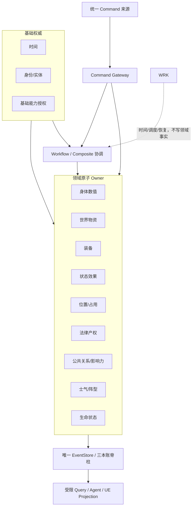
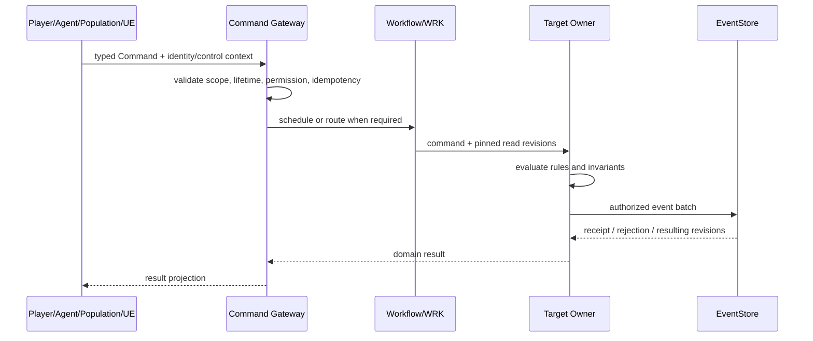
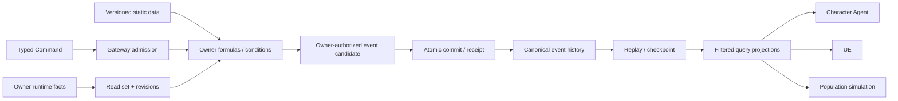

# Owner 分类与 Paralls 实现对照

状态：`设计基线；Paralls 现状以链接文档、代码和 Harness 证据核验`

## 1. Owner 和支撑组件

Owner 对一组 canonical facts 承担最终写权，负责定义事实、接受哪些 Command、使用什么公式和条件、校验不变量、提交事件并提供可回放结果。

| 组件 | 职责 | 不拥有的事实 |
| --- | --- | --- |
| EventStore / 三本账基础设施 | 原子提交、事件历史、revision、幂等、receipt、outbox、replay | 不决定领域规则是否合法 |
| Command Gateway | 来源身份、权限上下文、作用域、时效和路由 | 不修改生命、库存、位置或组织事实 |
| Projection / Query | 为 Agent、UE、群体模拟提供受限读取面 | 不拥有被投影的 canonical facts |
| Workflow / WRK | 排程、依赖、预算、交接、恢复和回执跟踪 | 不代替领域 Owner 结算事实 |
| Character Agent | 感知、主观解释、目标排序、意图和执行语义 | 不拥有世界真相，不直接写领域状态 |
| UE Adapter / 表现 | 玩家输入、局部物理/执行证据、动画和视觉反馈 | 不以动画或本地预测确认持久玩法结果 |

## 2. Owner 的分类轴

“基础”和“原子”不是互斥类别；“组合”是过程职责，与它们属于不同分类维度。下文 Composite Owner 是沿用的过程名称，不是第 24 个领域写权，注册时标为 Workflow/协调组件；只有持有明确事实写集的条目进入领域 Owner 名单。

- **基础权威（Foundation Authority）**：世界时间、实体身份与基础能力授权。空间/占用、法律产权、物资容器分别由 Presence、Ownership、Inventory 领域拥有；其基础依赖性质不意味着另建同名基础写权。
- **领域 Owner（Domain Owner）**：拥有业务领域事实，例如库存、身体、生存、装备、状态效果、关系、士气、建筑或生产。
- **原子 Owner（Atomic Owner）**：维护紧密不变量和最小独立写入边界，例如库存数量/预留、护甲耐久或身体生命值。
- **组合 Owner（Composite Owner）**：组织多个领域 Owner 完成过程，例如进食、战斗、生产、运输和城防；不取得下层事实写权。

Owner Registry 应使用独立字段表达：

```text
foundation_scope: foundational | domain
transaction_role: atomic | composite
```

例如 `Inventory` 是 `domain + atomic`，`World Clock` 可以是 `foundational + atomic`，`Survival` 是 `domain + atomic`；进食或医疗则由 Workflow 协调多个原子 Owner。

### 2.1 Owner 与领域模型的关系

Owner 可以复用同一领域内的数值模型、条件模型和混合模型，但模型不能跨领域取得事实写权。模型的泛化边界由 `domain_owner_id`、模型输入/输出 schema 和 Applicability Binding 共同约束。

例如 Inventory 可以使用 `food_spoilage`、`wood_decay` 和 `metal_corrosion` 三个不同模型处理相似的存储损耗问题；它们共享模型运行时、单位处理、版本固定和回放机制，但使用不同参数、条件、状态机和效果映射。模型结果仍必须由 Inventory Authority 校验并提交库存事件。

Owner Registry 不应只记录 `formula_refs / condition_refs`，还必须能定位：

```text
model_registry_scope
allowed_model_types
applicability_binding_scope
input_owner_refs
output_effect_mapping
evaluation_cadence
model_conflict_policy
model_version_pin_policy
model_migration_policy
```

完整模型注册、Binding 和 Evaluation Context 规范见[领域模型注册、绑定与 Owner 评估架构](04-领域模型注册、绑定与Owner评估架构.md)。

### 2.2 UE 兼容不是第二份 Owner

UE 传统兼容描述 Owner 如何接入本地帧循环、碰撞、动画、预测和即时反馈，不改变事实归属。每个 Owner 还需独立声明：

```text
execution_host: ue_runtime | paralls_runtime | service
execution_mode: authoritative | predicted | presentation_only
canonical_writer: owner_id
commit_store: canonical EventStore
commit_boundary: semantic event / transaction boundary
reconciliation_policy: accept | correct | reject-and-replay
```

本地预测只能临时驱动表现，不能成为提交；UE 运行时承载 Owner 时，该 Owner 可在获准的配置下成为唯一最终写入者，并仍须提交统一 Event/Receipt 到唯一 canonical store。不能同时存在 UE Actor 写一份、Paralls Owner 再写一份的双权威。

对高频战斗的推荐事实划分是：Combat Owner 结算攻击尝试、命中、格挡和伤害评估；Body Owner 结算生命、体力、伤势和身体功能；Equipment Owner 结算护甲耐久；Status Owner 结算流血等效果实例。Survival Owner 维护饥渴、疲劳等生存指标。它们可由 UE 高频流程驱动，并通过受授权的原子事件批次保持即时反馈，但不得互相越权写字段。治疗/恢复由医疗流程编排，库存、Body、Status 的变化分别由各自 Owner 提交。

LifeState 单独确认存活、倒地、濒死和死亡等生命周期转换，Body 提供身体数值与功能依据，不能以 `health == 0` 自动代替死亡。近场还应将战场 Morale 纳入实时协作：个人/队伍士气由其 Owner 维护，角色主观恐惧、解释和自主选择仍归 Character Agent。

近场推荐将 Combat、Body/Resource、Equipment、Status、LifeState 和战场 Morale 的获准实现共同部署在 UE，通过本地调用协作；规则分域不等于进程分离。生命按事件变化，体力按动作与时间积分，士气结合事件与周期评估；强制身体反应不等待 Agent 推理。更新节奏、本地 canonical 提交与后端同步的完整合同见[数值结算专题第 4.4—4.7 节](03-数值规则、状态效果与跨Owner结算.md#44-近场部署职责分域实时协作)。这些是目标要求，不代表现有 Python runtime 已完成 UE 接入。

全量 23 Owner 的部署与更新基线见[总计划第 11.2 节](../08-基础设施与Owner建设总计划.md#112-全量-owner-的-ue-协作与节奏矩阵)。Presence 与身体/战斗等实时链本地协作；Inventory 弹药和 Facility 机械等子域不得遗漏。ESM 是经审计后可选的交互合同/适配器，不是万能 Owner 或必经路由；Godot 执行器需替换，旧写权需迁移，见[现状复核](../01-Paralls现有Owner与接入分析.md#9-esm-复用边界与迁移检查)。

## 3. 与 Paralls 当前实现的关系

Paralls 已有 GameplayEventStore 与多类领域 authority、Owner fragments、revision/CAS、幂等、receipt、outbox、checkpoint 和 replay。这些是 Guoshang 可复用的实现基础，不代表 Guoshang 领域已经完成。

| Guoshang 目标 | Paralls 对照 | 判断 |
| --- | --- | --- |
| 结算基础设施 | `GameplayEventStore`、`AtomicEventBatch`、receipt、outbox、replay | 可复用语义；不建第二套事实账 |
| 基础 Owner | ownership、spatial、capability、identity 等局部能力；全域时间/空间仍有缺口 | 逐项核验事实覆盖，不能宣称完整基础层 |
| 原子 Owner | inventory、equipment、resource/body、status、ability 等窄纵切 | 复用合同和实现模式；逐项核验事件、revision、回放与业务覆盖 |
| 组合过程参考 | survival、construction/production 模块内的跨域流程片段 | 只复用过程合同；模块内真实领域写权分别保留给 Survival、Production 等 Owner，不将整个模块误归为无写权 Workflow |
| 协调能力 | caller-driven 调度、population cadence、部分 obligation/recovery | 不等于完整 WRK 或通用 Workflow 引擎 |

`resource_body_runtime.py` 把资源与身体代码放在同一模块，不代表角色身体指标和世界物资属于同一本账或同一 Owner。角色携带的刀、粮食、药品仍是物资事实，由 Inventory/Ownership 管；生命、体力、伤势由 Body 管，饥饿/饱腹、口渴和疲劳由 Survival 管。

## 4. Owner Registry 最低字段

```text
owner_id / owner_version
foundation_scope / transaction_role
canonical_facts / adjacent_facts_denied
stream_pattern / command_types / owned_events
formula_refs / condition_refs / invariant_refs
model_registry_scope / allowed_model_types / model_binding_scope
input_owner_refs / output_effect_mapping / evaluation_cadence
model_conflict_policy / model_version_pin_policy / model_migration_policy
read_set / input sources / revision pins / visibility
success, rejection, partial, cancel, expiry, compensation events
execution_host / execution_mode / canonical_writer / commit_store
authority_scope / authority_epoch / prediction / reconciliation
simulation_cadence / trigger_types / latency_budget / commit_boundary
commit_authority_scope / outbox_sync_policy / crash_recovery_policy
workflow capabilities / dependencies / open obligations / recovery
projection contracts and role-visible fields
```

Registry 负责发现、版本治理和接口校验，不是任意声明事实的万能入口。

上述字段是目标合同，不能据此宣称现有 Paralls 已实现。Owner 是逻辑写权边界，不要求一 Owner 一进程、一次本地函数调用一次网络往返。近场 Combat、Body、Equipment、Status 可在 UE 中共同部署，通过本地调用生成各自授权结果，再提交同一事件批次；持久化完成并取得 receipt 前只能称为 pending/predicted。UE C++、Blueprint、GAS/AttributeSet/GameplayEffect 可以承载经过改造的 Owner 规则及受控写入口，不能保留绕过该入口的另一条扣血/回血路径。

`commit_store` 是逻辑权威账的合同，不是固定部署到 Python 后端。本地可靠提交若被注册为该事实流的唯一权威，取得 receipt 后即可确认，后端接收副本不重新裁决；若只有后端 store，本地计算完成仍为 pending，不能以异步上传冒充已提交。

## 5. 架构图



图中仅列部分领域；Composite 向 Owner 请求授权结果，不能自行生成领域事件。基础权威与领域按总计划唯一名单登记。

## 6. 关键时序图



## 7. 数据流图



## 8. 落地判据

Owner 完成不能只以“类名里有 Authority”或“有一个接口”为准。至少要证明正常提交、拒绝、重复幂等、旧 revision 拒绝、事件回放、权限过滤和相邻 Owner 不变量未被破坏。
