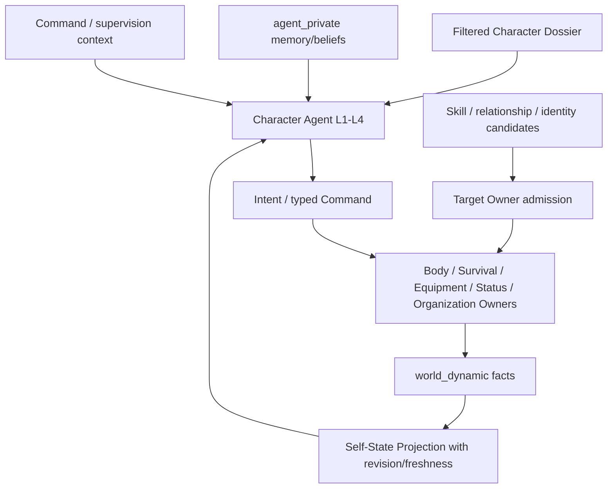
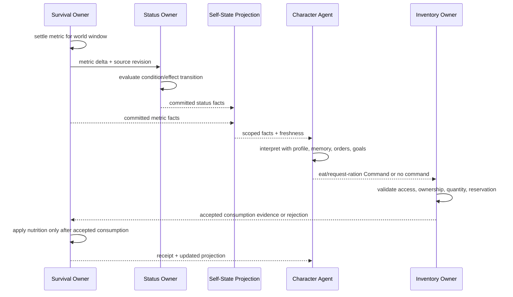
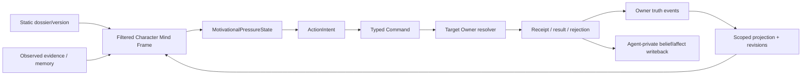

# 角色档案、权威状态与心智状态对接

状态：`目标边界；统一字段级投影与 Guoshang 接入仍待验证`

## 1. 角色数据分区

| 数据空间 | 内容示例 | 维护者 | Agent 权限 |
| --- | --- | --- | --- |
| `authored_static` | 身份、人格、价值观、动机优先级、身体基线、经历种子 | Character Dossier/内容配置；成为玩法事实时由对应 Owner 接纳 | 作为经过可见性过滤的决策输入 |
| `world_dynamic` | 生命、体力、生命周期、饥饿、疲劳、伤势、装备耐久、位置、职位、实时士气 | Body、LifeState、Survival、Equipment、Spatial、Organization、Morale 等 Owner | 读取有来源、revision、时间和 freshness 的投影 |
| `agent_private` | 记忆、信念、主观体感、解释、目标、动机张力、情绪 | Character Agent 私有认知运行时 | 按心智规则更新；不能冒充 world truth |

个人携带的刀、粮食、药品是世界物资，只是持有者/容器指向该角色；生命、饥饿、疼痛、恐惧不是库存物资。装备关系可由 Equipment Owner 管，物品本身仍属于 Inventory/Ownership 事实。

## 2. 静态档案如何影响 Owner

档案不会仅凭字段存在就改变权威世界状态：

- 人格、价值观、动机优先级影响角色解释和规划，不直接修改领域数值或公式。
- 年龄、体型、先天体质等身体基线，只有在 Body/Survival Owner 声明为合法公式输入时才参与结算，并固定 profile revision。
- 官职、组织身份、权限、职责由 Identity/Organization/Permission Owner 接纳；档案描述不能自行授予命令权。
- 技能和能力设定进入现有能力合同的候选或初始化路径；按字段映射到 Character Core、基础能力授权、Work/Organization、Body 等实际权威，经验证才影响 affordance；不因旧模块名新增 Ability/Skill 领域写权。
- 关系设定种子进入 Social/Relationship Owner 接纳流程，不自动成为 live relationship。
- 身体外观、姿态和动作基线影响 UE realization/物理可行性，不得覆盖权威伤势、疲劳或行动能力。

只影响“角色如何选择”的内容留在 Character Agent；影响身体/战斗/生产结算的设定必须进入对应 Owner 输入合同，不能由模型提示词隐式加权。

## 3. 动态事实和动态心智分开

`world_dynamic` 是角色实际上处于什么状态；`agent_private` 是角色知道、感到或相信什么。两者可能不同，例如角色受伤但尚未察觉，或误以为粮仓有粮。

```text
Owner commit
  -> scoped event/result projection
  -> source_owner + source_revision + event_time + captured_at + freshness
  -> Character Self-State Projection
  -> L1 perception -> L2 interpretation -> L3 intent -> L4 execution semantics
  -> typed Command to target Owner
  -> receipt/rejection/obligation returns to character
```

Character Agent 的 `dynamic_state_delta` 只能更新它拥有的心智状态，例如恐惧、压力、信任感、希望和动机冲突；不能直接修改生命、饥饿、库存、装备耐久、组织士气或关系账本。

### 3.1 本地即时执行与 Agent 自主判断

Owner 是逻辑职责，不等于远端服务。近场 Combat、Body/Resource、Equipment、Status、LifeState 和战场 Morale 可共同运行在 UE，经受控本地调用结算。生命、体力和士气不需要每次变化都请求一次 Agent 推理；命中后的身体限制、体力耗尽和已确认生命周期变化及时生效，新的自主判断仍归当前角色意图权持有者。

例如赵二正在坚守东门：

```text
Agent 提出“退到第二道掩体继续防守”
  -> UE 本地执行器按该意图移动
  -> Body/Resource 按奔跑时间窗口消耗体力
  -> 中途被砍中：Combat / Equipment / Body 本地协作
  -> Status / LifeState 按依赖确认效果或生命周期转换
  -> 已获准的受击、失能或体力耗尽限制及时中断当前动作
  -> receipt + 合法感知回传 Agent，触发继续、呼救或改道判断
```

角色智能体可以选择撤退，不能自行写“已经撤退”；可以感到害怕，不能自行写权威士气或生命值。本地执行器可以执行强制踉跄和身体中断，不能因此接管该角色全部自主判断。

### 3.2 战场士气与私有心智

Morale 维护注册作用域内的个人/队伍士气与纪律规则；Agent 维护主观恐惧、职责、信念和解释。伤亡、军旗和指挥等输入结合事件触发与周期评估更新士气，不能把士气简单等同于 Agent 的情绪，也不能令同一士气数值强制所有角色选择同一策略。

赵二亲眼看见同伴死亡，或经合法报告获知，才可作为其个人士气/认知模型的相应输入。Agent 可以结合谨慎、职责和命令决定坚守或请求轮换；若已确认恐慌等效果造成动作限制，则由 Status 和执行器及时应用。输入来源、模型绑定、revision、决策与强制限制分别记录；Owner 的全局读权限不自动赋予角色全知。

更新节奏、Static Data/模型配置、本地权威提交与后端投影同步见[数值结算专题第 4.4—4.7 节](03-数值规则、状态效果与跨Owner结算.md#44-近场部署职责分域实时协作)。只有 canonical receipt 确认的结果才能成为已完成事实；后端同步副本不再扣血或扣体力。

## 4. “需求”分域命名

| 命名 | 含义 | 例子 | 所属 |
| --- | --- | --- | --- |
| `SurvivalMetricState` | 客观生存指标 | 饱腹储备、含水、疲劳、体温 | Survival Owner |
| `SurvivalMetricDefinition` | 指标单位、边界、公式与阈值引用 | 饥饿衰减率、脱水曲线 | Survival Owner 配置 |
| `PhysiologicalCondition` | 指标与条件规则派生的身体状态 | 饥饿相关效果、虚弱、脱水相关效果 | Status/Effect Owner；濒死转换归 LifeState |
| `StatusEffectInstance` | 有来源、强度、层数、持续/解除规则的效果 | 流血、中毒、发热 | Status/Effect Owner |
| `MotivationalPriorityProfile` | 档案中的静态动机权重和敏感度 | 生理、职责、荣誉的重要程度 | Character Dossier |
| `MotivationalPressureState` | 角色当前主观动机压力 | 生理压力、安全压力、归属压力 | Character Agent 私有状态 |
| `ActionIntent` | 角色打算采取的行为 | 进食、请求配给、忍耐、偷取 | Character Agent |

`SurvivalMetricState` 回答“身体缺什么、缺到什么程度”；`Body` 数值回答生命、体力和身体功能；`PhysiologicalCondition` 是由 Survival/Body 数值派生并由 Status Owner 提交的身体条件；`MotivationalPressureState` 回答“角色有多在意、愿意为此付出什么”。相同身体指标可能因人格、记忆、关系、职责和认知差异产生不同动机压力。

## 5. 示例：饥饿与进食

生存指标由 Survival Owner、生命/体力/身体功能由 Body Owner 根据各自版本化公式结算；身体条件由 Status Owner 根据明确阈值提交。角色是否进食由角色智能体心智模型决定。系统不能因为数值低或库存有粮就自动扣粮。

```text
World Clock 提交时间窗口
  -> Survival Owner 按公式结算饱腹/饥饿指标
  -> Condition/Status Owner 评估 hunger、weakness 等状态
  -> 受限身体投影送入角色 L1
  -> Agent 结合档案、命令、关系、记忆和目标作判断
  -> Agent 产生 eat / request_ration / endure / seek_food 等 Intent
  -> Inventory/Organization/Survival Owner 校验取用、归属、配给与消费
  -> 成功消费后 Survival Owner 应用营养结果并重算生存指标
  -> Status Owner 根据新指标提交饥饿/虚弱等条件变化
  -> receipt 和新投影返回角色
```

自动进食只有在明确的组织政策或失能护理政策授权时允许；政策也必须产生有来源的 Command，由 Inventory/Survival Owner 结算。

## 6. 示例：受伤、护甲和流血

```text
UE 原生执行器提供带许可/时间/版本的命中证据；采用 ESM 交互合同是可选适配
  -> Combat Owner 确认命中并评估伤害包（攻击、命中、格挡、伤害类型/部位）
  -> Equipment Owner 根据固定装备 revision 结算防护和耐久
  -> Body Owner 将剩余伤害应用到生命、伤势和部位功能
  -> Body Owner 更新身体功能/能力限制；LifeState Owner 根据授权依据确认倒地、濒死或死亡等生命周期转换
  -> Status Owner 使用同批次已授权的 Body 结果和固定 Survival revision（或分阶段流程中已提交的 Body revision）评估身体条件，并创建带来源、严重度、层数、tick/exit policy 的效果实例
  -> Agent 读取权威投影和主观体感，决定继续、撤退、求医或违令
```

`health=62` 是 Body 数值事实；`status:bleeding` 可作为查询标签；流血本身必须是有生命周期的效果实例。Status 到期时生成带 `effect_id + scheduled_world_tick` 的 Body 结算请求，由 Body 按自身公式和 revision 应用周期损伤；Status 推进效果 tick/到期状态。标签不能直接改生命值。伤害、伤势与由其触发的效果可在同一批次提交，但批次内保留“Equipment 防护 -> Body 数值变化 -> Status 条件评估与效果”的因果顺序；若分阶段提交，Status 必须读取已提交的 Body revision。

UE 可以运行命中检测、局部战斗模拟和即时反馈。若战斗配置为 UE-local authoritative，UE 承载的是上述领域 Owner 的实现，并按统一 Command/Event/Receipt 提交；这不允许 Combat 直接改写 Body、Equipment 或 Status 事实。若配置为本地预测，则预测生命/命中只用于短暂表现，Owner 回执到达后必须确认或修正。Paralls/后端不得再为同一角色同一伤害事实重复结算。

### 治疗与补血

```text
角色 Agent / 玩家产生 treat 或 use_medicine Command
  -> Medical Workflow 校验医护、设施、目标、时长和治疗方案
  -> Inventory Owner 预留/扣除药材或消耗品
  -> Body Owner 根据治疗方案和身体条件提交生命/伤势变化
  -> Status Owner 提交流血、感染等效果的减轻/解除
  -> receipts 汇总为治疗结果，更新角色投影并驱动 UE 动画/反馈
```

`Medical Workflow` 是跨域流程，不是 Survival/Body/Status 的替代 Owner；它负责协调和跟踪，不拥有库存、生命或状态效果。UE 的治疗动作、进度条和即时提示可以传统实现；除非对应事实 Owner 被明确配置为 UE-local authoritative，治疗动画、Gameplay Effect 或 `ApplyHeal` 不得直接成为权威加血。任何 UE-local 配置仍必须调用对应 Owner 规则并提交同一 canonical store。

## 7. 架构图



## 8. 时序图



## 9. 数据流图



## 10. 对接验收

实现前逐项记录角色字段语义、数据空间、唯一事实来源、Owner、Agent 可见范围、公式输入资格、source revision/freshness、Agent 可写范围、冲突处理和回放证据。

全量 Owner 的 UE 更新分类以[建设总计划第 11.2 节](../08-基础设施与Owner建设总计划.md#112-全量-owner-的-ue-协作与节奏矩阵)为准。角色激活只交接意图推进权，不改变 Body/LifeState 等领域写权；本地强制反应不等待 Agent，但不能借此产生未经授权的新自主策略。
