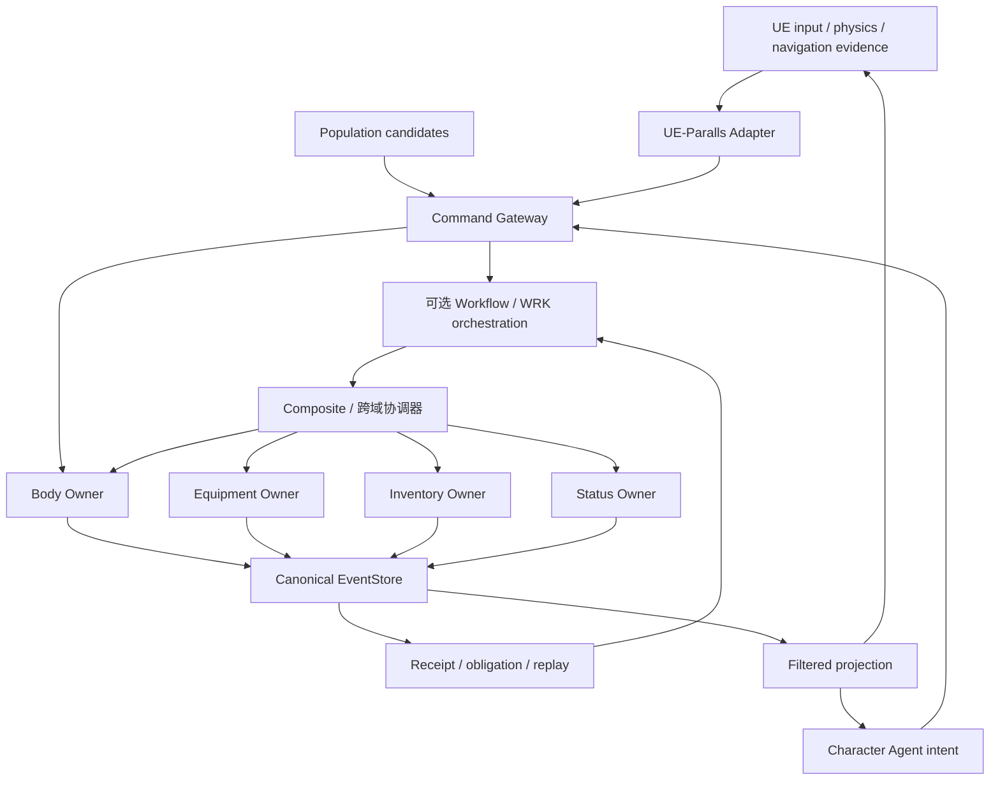
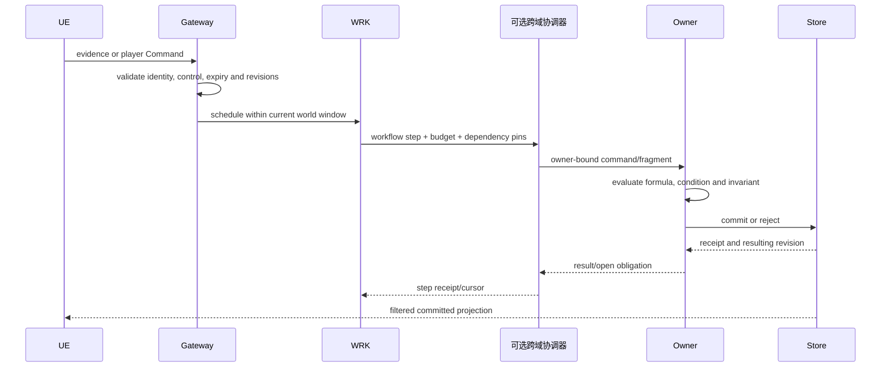
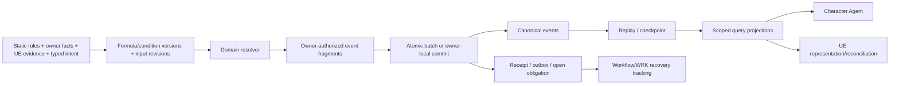

# 数值规则、状态效果与跨 Owner 结算

状态：`Guoshang 目标规则；具体公式参数和运行时代码另行评审`

本文件定义公式、条件、状态效果和跨 Owner 结算边界；模型注册、领域内模型泛化、适用绑定和评估上下文的规范见[领域模型注册、绑定与 Owner 评估架构](04-领域模型注册、绑定与Owner评估架构.md)。

## 1. 公式、条件和混合模型由领域 Owner 管理

数值变化必须来自明确、版本化的领域模型。模型归拥有该数值事实的 Owner 负责选择、固定输入、校验和提交；模型运行时可以在同一领域内复用，但不能跨领域写入事实。

模型分为三类：

- **Numeric Model**：计算数量、比例、进度、损耗、风险或评分；
- **Condition Model**：判断资格、门槛、风险、可用性和状态转移条件；
- **Hybrid Model**：组合条件、数值和状态机，输出候选状态转移和 Owner 效果。

例如食品变质和木材腐朽可以共享 Inventory 领域的模型运行时，但必须使用不同的模型定义、输入 schema、参数、阈值、状态机和效果映射。模型适用对象由 Applicability Binding 注册，不能由调用者自行指定。

数值变化归拥有该数值事实的 Owner 负责：

| 公式领域 | 示例 |
| --- | --- |
| Survival | 饥饿、脱水、疲劳、体温等生存指标 |
| Combat | 攻击、命中、格挡、伤害评估和战斗接触结果 |
| Body / Resource | 生命、体力、伤势、身体功能及其阈值证据；不提交生命周期状态 |
| LifeState | 基于身体和其他已确认依据，判断并提交存活、倒地、濒死、死亡等生命周期转换 |
| Medical Workflow | 治疗流程和方案选择；不拥有库存、生命或效果实例 |
| Equipment | 护甲吸收、耐久变化、破损条件 |
| Status / Effect | 流血、中毒、燃烧等效果强度、tick 和退出条件 |
| Inventory | 物资数量、预留、装载/入库与实际货损 |
| Transport / Logistics | 承运批次、运输阶段与损失评估/记录；请求 Inventory 确认实际增减 |
| Production | 原料转化、批次损耗、半成品/成品产出和工时 |
| Morale / Formation | 个人/队伍士气、纪律和阵型状态；个人士气不等于 Agent 的完整主观心智 |
| Organization / Military | 编制、岗位、指挥授权、预案归属与继任；不重复写士气/阵型 |

角色智能体、群体模拟、UE Blueprint 或 WRK 不应各自复制业务公式。调用端可以产生 proposal；只有拥有该数值的 Owner 能批准并提交变化。

结算事件至少固定：

```text
formula_ref + formula_revision
input_owner_refs + input_revision_vector
previous_value + delta + next_value
condition_refs + condition_revision
event_time + causation_id + correlation_id
model_ref + model_type + model_version
binding_ref + binding_revision
evaluation_id + evaluation_cadence
```

输入还应说明单位、范围、来源和时间语义。未知或过期输入必须显式拒绝、降级或标记不确定，不能默认为可信零值。

## 2. 数值、条件、标签与效果

| 概念 | 用途 | 示例 |
| --- | --- | --- |
| 数值事实 | Owner 结算的连续/离散事实 | `health=62`、`armor_durability=0`、`energy_reserve=18` |
| 条件（Condition） | 有版本的 Guard/Trigger 判断某状态是否进入 | `health_ratio <= 0.3`、开放锐器伤口、护甲耐久为零 |
| 状态效果实例 | 有来源、强度、层数、持续结算和退出条件 | 流血、中毒、燃烧、眩晕、恐慌 |
| 标签（Tag） | 稳定检索、过滤或投影的语义载体 | `status:bleeding`、`armor:broken`、`capability:can_attack` |

`流血`可以暴露为标签，但不能只存一个字符串。权威实例还要记录 effect id、来源事件/伤口、身体部位、severity、stacks、开始/到期时间、tick policy、解除条件、治疗证据和 revision。

```text
Condition/Trigger 成立
  -> 创建或叠加 StatusEffectInstance
  -> 按 tick 或外部 Command 产生领域变化
  -> 重新评估条件
  -> 维持 / 转化 / 解除 / 到期
```

阈值可使用滞回避免边缘反复切换，例如 `health_ratio <= 0.30` 进入 critical，`health_ratio >= 0.35` 解除；规则由相应 Owner 版本化。

## 3. 跨 Owner 事务

短事务若必须同时消耗体力、损耗护甲并产生伤势/流血，可由 Combat Workflow/Composite 固定各 Owner 输入 revision，分别请求 Combat、Equipment、Body、Status 生成各自授权 fragment，再走共同原子提交。未经 Owner 授权，Composite 不能伪造其事实事件。Combat 不拥有生命和护甲耐久；它提供伤害评估。因果顺序为 Equipment 防护与耐久、Body 剩余伤害及身体功能变化、Status 基于同批次已授权 Body 结果与固定 Survival revision 评估身体条件并创建效果；若采用分阶段提交，Status 读取已提交 Body revision。共同原子提交也必须保留这一因果顺序。

```text
Combat Workflow / Composite
  -> Combat fragment: attack / hit / damage assessment
  -> Equipment fragment: armor durability
  -> Body fragment: post-mitigation health / injury / body function
  -> Status fragment: bleeding effect
  -> single AtomicEventBatch / receipt
```

若当前技术无法保证共同原子提交，则拆成 owner-local commits 和开放义务；不把不同领域事实塞进可写总对象。

长期过程不能假设全局回滚：

```text
start process -> Owner A commits -> Owner B rejects/unknown
  -> preserve committed events
  -> record open obligation / compensation task
  -> Workflow/WRK schedules retry, query or reconciliation
  -> close only after required receipts are confirmed
```

补偿追加新事件，不删除已提交历史。外部执行结果未知时先对账，不盲目重发可能有副作用的动作。

## 4. UE、Workflow 与 WRK 边界

| 组件 | 可以承担 | 不得承担 |
| --- | --- | --- |
| UE Traditional Runtime | 高频移动、动画、碰撞、局部物理、寻路执行、命中接触证据、预测；按 Owner 配置也可承载获准的 UE-local authoritative resolver | Actor/Component/GameplayEffect 绕过 Owner 直接写 canonical facts；同一事实再由第二个 Owner 重复结算 |
| UE Adapter | 把输入/物理/观察转成带来源、时间和 revision 的证据/typed Command，或将 UE-local Owner 的结果提交到 canonical store；接收 authority projection | 把动画完成、Actor overlap 或预测缓存当作 canonical event |
| Workflow | 跨域过程步骤、依赖、补偿和完成条件 | 直接写 Owner facts 或绕过 Owner guard |
| WRK | 世界窗口、暂停屏障、预算、调度、唯一推进权、B0/B1 与 Agent handoff、receipt 和恢复 | 第二 EventStore、万能 scheduler 或超级事实 Owner |
| Character Agent | 根据合法可知状态形成意图、Command 和解释 | 直接写数值、条件、状态效果或表现结果 |

Owner Manifest 将执行位置、模拟模式和最终提交权分开声明：

```text
execution_host: ue_runtime | paralls_runtime | service
execution_mode: authoritative | predicted | presentation_only
canonical_writer: owner_id
commit_store: canonical EventStore
latency_budget
prediction_policy / reconciliation_policy
commit_boundary
pause/disconnect/recovery behavior
```

`execution_host=ue_runtime + execution_mode=authoritative` 表示 UE 进程承载指定 Owner 的唯一权威实现；其结果必须走统一事件账、revision、幂等和 receipt。若 Owner 在 Paralls runtime/service 运行，UE 提交命令/证据，由 `canonical_writer` 指定的 Owner 结算。`predicted` 和 `presentation_only` 不能提交事实。避免使用 `hybrid` 作为 authority 值；若 UE 高频模拟、Owner 在语义点结算，应分别标出执行位置、执行模式和唯一提交 Owner。

### 4.1 Combat、Body 与 Medical 的兼容判据

| 领域事实 | 可兼容的 UE 传统路径 | 唯一事实 Owner | 第一阶段原则 |
| --- | --- | --- | --- |
| 攻击/命中/格挡/伤害评估 | Trace、碰撞、Ability、近场实时 resolver | Combat | 支持 UE-local authoritative；Demo 近场战斗可由 UE 承载 Combat Owner，但要提交统一事件和 receipt |
| 生命/伤势/身体功能 | 即时本地数值计算、命中后同事务呈现 | Body | 必须支持与 Combat 同步的 UE 接入；是否 UE-local authoritative 由 Owner 配置显式选择，不能让 Combat/Actor 越权写 Body |
| 体力消耗/恢复 | 攻击成本、冲刺积分、格挡和恢复窗口 | Body / Resource | 与动作准入同步；体力检查与扣除/预留须避免并发超支，不逐次等待 Agent 推理或后端网络往返 |
| 生命周期转换 | 命中后及时失能/死亡反馈 | LifeState | 接收 Body 等域的授权依据，由自身规则确认转换；`health == 0` 不直接等于死亡 |
| 个人/队伍战场士气 | 伤亡、军旗、指挥及威胁的事件响应与周期评估 | Morale | 近场支持 UE-local authoritative，并与战斗事件协作；只使用该主体合法获得的输入，不直接替代角色自主判断 |
| 护甲耐久/防护 | 命中流程中的本地防护计算 | Equipment | 可由 UE 高频调用，Equipment Owner 持有耐久事实；与伤害批次固定 revision 并原子提交或记录开放义务 |
| 流血/中毒/持续伤害等 | UE VFX/动画/短期反馈 | Status / Effect + Body | Status 管理效果实例与 tick 生命周期；周期数值变化必须由 Body 提交，表现效果不能自己扣血 |
| 治疗/补血/药物消耗 | UE 输入、交互、治疗动画、进度表现 | Medical Workflow + Inventory + Body + Status | 医疗流程只编排；各事实 Owner 分别提交资源、身体和效果变化。UE-local authority 可作为显式配置能力，不默认授予医疗动画/恢复组件写权 |

### 4.2 结算位置、交接和失败边界

- UE-local 是正式权威实现的部署选择，并非只能做特效，也不需要先等远端重新算一遍伤害。Combat、Body、Equipment、Status 可共同部署在 UE 内，本地按各自规则产生授权 fragment，再向唯一 canonical EventStore 提交；确认提交前的反馈必须保留 pending/predicted 标记。
- 使用 GAS/AttributeSet/GameplayEffect、Blueprint 或 C++ 均可，但它们须实现指定 Owner 的受控规则/写入口或仅消费投影；不能一边由 GAS 改生命，一边由 Body 再扣同一次伤害。回放应用已提交事件，不重新执行命中检测、随机伤害或物资消耗。
- 执行租约与事实写权分别管理。角色 Agent 或群体模拟换执行方不自动更换 Body 写权；确需迁移 UE/后端权威时，须冻结旧写入口、排清已提交与未知结果、交接 revision/checkpoint/效果下一 tick 游标，再提升 `authority_epoch` 并启用新写入口。迁移失败则保持冻结或恢复旧方，不能两方同时推进。
- 攻击伤害、流血 tick、自然恢复和治疗对 Body 数值的写入共享 Body 的串行 revision/CAS 写入口。Status 先提交或授权对应效果 tick，再以 `effect_id + scheduled_world_tick` 向 Body 发起幂等结算请求；治疗步骤以 `treatment_id + step` 去重。相同时间点采用版本化的稳定结算顺序。死亡由 LifeState 根据 Body 等域依据提交，Body 对普通治疗的准入必须固定并验证 LifeState revision；同批次已有死亡授权时也必须拒绝普通治疗。复活若存在须独立规则，不能被延迟回血意外触发。
- 治疗瞬时生效可采用 Inventory/Body/Status 授权批次；长时包扎、服药和护理应先预留物资，在实际消耗节点提交，后续效果按方案推进。中断时只释放未消耗预留，保留已用药物和已发生效果；“止血”“恢复生命”“伤口愈合”是独立结果，不能用治疗动画完成一次性全改。
- 暂停屏障覆盖 UE Owner、Timer、效果 tick 和异步回调；恢复时验证 epoch、revision 和证据时效。提交结果未知时先查询幂等记录并对账，不能再次扣血/用药，也不能仅凭本地预测宣布死亡或胜利。

全量 23 Owner 的近场 UE 需求、事件与窗口分类以[总计划第 11.2 节](../08-基础设施与Owner建设总计划.md#112-全量-owner-的-ue-协作与节奏矩阵)为准。下表是部分领域接入示例，不是冻结名单。ESM 不作为统一路由；仅复用审计通过的交互合同，Godot 执行器需 UE 原生替换，旧写权须按域迁移。

### 4.3 其他 Owner 的 UE 兼容范围

| Owner / 能力 | UE 传统实现可保留 | 最终写权约束 |
| --- | --- | --- |
| Presence / Movement | CharacterMovement、NavMesh、EQS、局部避障和碰撞 | Presence 承认位置/占用等语义事实；不每帧写账；本地权威须显式注册 |
| Transport / Logistics | 车队移动、装卸动作、阻挡与拦截证据 | Logistics 写运输阶段，Inventory 写货物；到达动画不等于入库 |
| Production / Facility | 工坊交互、工序动画、进度表现、设备碰撞证据 | Production 认证工艺结果，Inventory 提交投入/产出；Timer 不直接生成成品 |
| Inventory / Equipment | 背包、拾取、装备交互和即时反馈 | 库存数量与装备耐久分别经各自 Owner；客户端物品缓存不可双写 |
| Morale | 战场威胁、伤亡、军旗、鼓舞的即时响应和周期压力评估 | 近场推荐显式配置 UE-local 权威实现；个人与队伍作用域分别注册，角色主观恐惧仍归 Agent，不能有第二套可写士气 |
| Organization / Policy / Objective | UI、队形执行、传令表现、战后展示 | 各域确认授权、政令与胜负；不因 Combat/Morale 在 UE 内运行而自动迁移写权 |
| Survival / Population | 身体提示、劳作和群体动作表现 | 指标窗口与个体/群体推进统一；本地 Timer 不与远场窗口重复结算 |

兼容范围逐域声明，不把 Combat 的 UE-local 许可自动授予所有领域。其他 Owner 是否迁移执行位置可按延时与部署需求配置，但都必须满足唯一写权、暂停、幂等、回放和交接合同。

### 4.4 近场部署：职责分域，实时协作

本节为已确认讨论的目标设计，不能据此宣称现有 Paralls Python runtime 已完成 UE 接入。Owner 是事实写权与规则边界，不要求一 Owner 一进程，也不要求每次调用经过网络。

单人 Demo 的近场推荐部署为：Combat、Body/Resource、Equipment、Status、LifeState 以及战场 Morale 的获准实现共同位于 UE runtime，通过本地调用协作。逻辑上分域，执行上可在同一模拟步骤内处理命中、防护、身体变化、效果和生命周期转换。作用范围及 `authority_epoch` 须登记，Paralls 对相同事实只读取结果，不能再结算一次。

```text
Static Data / Model Registry / Applicability Binding
  -> 固定模型、条件、参数、适用对象与版本
UE 接触证据 / 玩家输入 / Agent 意图 / 已授权持续效果
  -> 本地受控 Command 路由与动作准入
  -> Combat -> Equipment -> Body/Resource
  -> 按依赖生成 Status / LifeState 授权结果
  -> 统一提交与 receipt
  -> UE 身体反馈 / Morale 后续评估 / 受限 Agent 感知
```

箭头表达事实依赖，不意味着每一步是 RPC，也不要求无依赖的效果硬排成一条链。共同原子提交必须固定批次内依赖；做不到时记录开放义务，在相关回执确认前不得宣布终局。Gateway 和 WRK 可提供本地准入、时间与预算上下文，不要求每次接触重新经过远端调度。GAS、C++ 或 Blueprint 若承载 Owner，只能通过登记的受控写入口提交。

### 4.5 更新节奏与模型输入

高频协作是延迟要求，不等于所有数值每个画面帧全量重算。画面帧、模拟步长、模型评估、事实提交、投影同步和 Agent 决策是不同节奏，均须使用统一 `world_tick`；暂停不推进模拟时间。

| 内容 | 结算触发/节奏 | UE 与角色的即时约束 |
| --- | --- | --- |
| 生命、伤势、身体功能 | 命中、治疗、持续效果到期的事件或定时 tick | 命中后及时更新身体能力；表现插值不产生额外伤害 |
| 体力 | 攻击/格挡等动作成本；冲刺等连续动作按模拟时间积分；恢复按规则窗口推进 | 准入检查与消耗/预留受同一写入口保护；体力耗尽及时中断或降级动作 |
| LifeState | 经授权的身体/效果依据触发状态转换评估 | 倒地/死亡不等待 LLM 推理；禁止 Pawn 或动画自行宣布死亡 |
| 个人及队伍战场士气 | 伤亡、军旗、指挥、鼓舞等事件触发，加周期威胁/压力评估 | 及时更新纪律、阵型维持、溃退约束；保留角色自主判断与解释 |
| 饥渴、长期疲劳 | 生存时间窗口；剧烈活动或阈值变化可提前触发 | 向体力上限、恢复率和功能模型提供输入，不与体力重复扣算 |
| Agent 心智与计划 | 合法感知、命令和关键结果触发，受认知 cadence/预算约束 | 无需每次扣血都推理；正在执行的计划接受实时身体约束 |

Static Data/领域模型配置须声明 `evaluation_cadence`、`trigger_types`、模拟步长/积分策略、稳定顺序、阈值/滞回、单位/精度、输入 freshness 和 `model_version`；Owner Manifest 另记录执行位置、延迟预算、提交边界及恢复策略。适用绑定仍按主体、资源、状态和设施限制模型，部署到 UE 不赋予通用模型任意套用权。

连续体力变化可以用带起止 tick、模型版本和固定输入的窗口事件表达；命中、动作准入、阈值跨越、暂停和交接等边界须切分/结清窗口。不能先按每帧累计，再在窗口结束重复扣除；聚合不得掩盖中途体力不足。发生治疗、负重或疲劳等输入变化时按变化点切窗，保留重建所需依据。具体频率和耗时预算在实现前登记、在 PIE 中测量；本文不把假定帧率当作已测性能。

### 4.6 本地权威提交与后端同步

必须区分 Owner 计算完成、canonical 提交完成和后端投影同步完成：

| 提交配置 | 何时属于最终事实 | 后端职责 |
| --- | --- | --- |
| 本地权威提交路径（近场目标） | UE 所在部署中的获准提交端，将该权威范围的 Owner 事件可靠持久化到唯一逻辑 canonical 事件账，并产生 receipt 后 | 异步接收已提交事件、更新投影/Agent 输入；按事件标识去重，不重新计算同一伤害/体力变化 |
| 仅后端 canonical store（过渡配置） | 后端接受 Owner 授权批次并返回 receipt 后 | 负责正式提交；此前 UE 反馈为 pending/predicted，必须支持拒绝修正和未知结果对账 |

第一种配置是需要实现和验证的基础设施要求，不是把任意 UE 内存变量或缓存日志称作权威。一个事实流在同一 epoch 只有一个提交权威；若本地是获准权威，后端对应数据是同步副本/投影，不能另建一份可独立裁决的 canonical 账。跨域原子批次只能提交到覆盖其写集的共同提交边界；不同提交位置须用开放义务/恢复协议，不宣称全局原子。

本地提交路径必须具备 revision/CAS、幂等 receipt、可靠事件与 outbox、稳定排序、checkpoint/replay、崩溃恢复和 epoch fencing。确认提交前保持 pending；确认后即使后端桥接暂时断开，也可在既有授权范围内继续，恢复后按 cursor 补同步。提交失败/未知必须停止依赖该结果的确认并查询对账；不能通过无条件“异步上传”消除失败语义。仅有后端 store 时，断线不得擅自提升本地为权威。

### 4.7 即时反应、士气和 Agent 判断

受击踉跄、体力耗尽、已确认失能以及明确状态规则产生的动作限制，由本地受控执行器及时应用，不等待 Agent 推理。角色自主动作仍来自当前意图权持有者；本地控制器只能在获准的动作、反应和中断优先级内执行，不能借用“即时反应”接管全部角色判断。强制中断须回传原因和 receipt，Agent 随后重规划。

个人/队伍士气是 Morale 的权威事实；恐惧、责任感、信念和对命令的解释是 Agent 私有心智。士气模型可使用经过注册、版本固定且有授权来源的训练、纪律、身体和指挥输入；不得直接读取私有记忆或让 LLM 返回一个数就覆盖士气。主观反馈若需影响士气，必须经显式输入合同与 Owner 校验。

例如赵二目睹同伴死亡：经角色可知性过滤的伤亡事实触发其 Morale 评估；Agent 根据该感知、主观状态、人格和当前命令选择坚守、呼救或退到第二道掩体；执行 Owner 再校验体力、伤势和路线。相同士气数值不必产生相同行为。若规则已确认惊恐失控等效果，则由 Status 管实例、执行器及时施加限制；Agent 可以解释和重规划，不能靠等待推理延迟失能。

权威模拟可读取合法领域依赖，提供给 Agent/玩家的投影仍按感知与通信过滤。队伍伤亡统计、个人目睹和传令获知分别记录来源，不能把后端拥有的全局伤亡自动变成每个士卒的所知事实。

## 5. 示例：运输被玩家干扰

```text
UE：提交玩家接近、阻挡、碰撞或武器接触证据
Spatial/Presence Owner：校验位置、路径、占用和阻挡
Combat Owner：判定攻击/命中/伤害评估，形成有来源的威胁输入；Body/LifeState 确认身体伤害和生命周期转换
Logistics Owner：计算继续、改道、延误、失败或劫掠
Inventory Owner：提交货物抵达、损耗、转移或损失
Workflow/WRK：跟踪 receipts、开放义务、重试和恢复
UE：按已提交投影播放动画、图标和 UI
```

若玩家停在路上，局部避障由 UE/Nav 执行；实际运输阶段、延误或改道由 Presence 与 Logistics 结算。寻路库产生路径候选，不拥有运输成功事实。

## 6. 架构图



## 7. 时序图



## 8. 数据流图



## 9. 第一阶段验收补充

第一阶段高影响闭环至少证明公式版本和输入 revision 固定、Owner 接受/拒绝有明确原因、幂等重试不重复消费、receipt 可追踪、projection 可回放。接入 UE 还要验证本地预测在拒绝/冲突后收敛。完整五阶段基础设施要求以[第一阶段县城守城 Demo 设计与执行路线](../05-第一阶段县城守城Demo设计与执行路线.md)为准。

专项验收场景：同一命中重投不重复扣血/扣耐久；流血与治疗并发不覆盖彼此数值；已死亡角色拒绝迟到治疗；药材不足不产生治疗收益；长时治疗中断按实际消费阶段结算；暂停期间不扣血/回血/消耗药物；近远场与 UE/后端交接后效果不中断、不重放 tick；提交结果未知经查询恢复；checkpoint/replay 重建生命、伤势、效果和库存一致。这些是设计要求，不代表本轮已通过运行时测试。

高频协作专项还须验收：

- 攻击、奔跑并发时体力检查与扣除不超支；连续消耗切窗后与回放一致，中途耗尽能及时影响动作。
- 在登记的延迟预算内完成命中到身体反馈、体力耗尽到动作限制、战场事件到士气/阵型反应；分别记录模拟、提交、投影和 Agent 决策耗时，不把后端或 LLM 往返放进本地反应的必经路径。
- 生命归零只产生规则依据，倒地/濒死/死亡由 LifeState 的合法转换确认；普通治疗不能覆盖已确认死亡。
- 同一次目睹伤亡在重试后只影响士气一次；未目睹且未收到报告的角色不能凭全局事件自动得知；相同士气允许不同角色判断。
- 本地权威路径在后端桥接断开后继续产生唯一 receipt，恢复后去重补同步；仅后端提交配置在断线时保持 pending，不出现第二权威。
- 在本地提交后、后端同步前模拟崩溃，恢复 checkpoint/事件/outbox 后不丢已确认结果、不重复扣血；旧 epoch 的迟到提交被拒绝。
- Agent 推理变慢或不可用时，获准动作和强制身体反应仍执行，新的自主策略按已登记降级策略处理；暂停期间这些路径全部服从时停。

上述含 Workflow/Composite 的图只展示需要跨域过程的路径；单域命令和已注册实时链可经受控本地路由直接调用 Owner，不强制每次碰撞走远端 WRK、ESM 或通用协调器。
