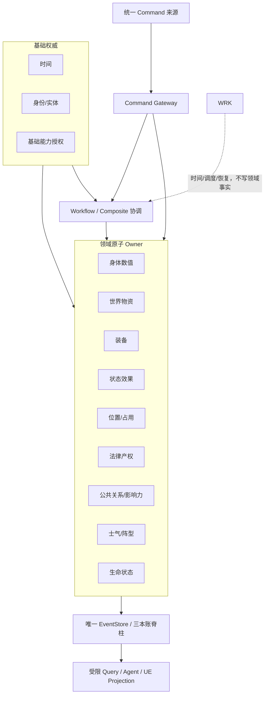
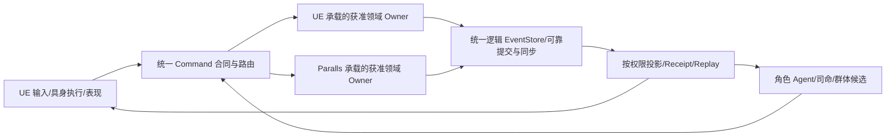

# 01-系统边界与权威写入

> 版本：1.0（职责拆分版）
> 更新日期：2026-10-30
> 评审状态：职责归位与静态一致性核对；不替代产品待决项裁决或实现评审。
> 实现状态：本篇为目标合同；已有实现仅按原始证据日期记录，不代表全量实现或运行验收完成。
> 验证范围：本轮仅重组文档，未执行代码、UE、PIE 或性能验证。原始设计、实现盘点和证据日期分别保留。

[技术架构入口](../README.md) · [唯一 Owner 注册表](../03-Owner领域/01-Owner注册表.md#owner-registry)

<a id="system-boundaries"></a>

## 系统边界与唯一最终写权

Owner 是对某类事实的唯一最终写权，不是模块、宿主、模型、Actor 或工作流的别名。逻辑领域以唯一注册表为准；运行宿主与领域写权分离。UE 可以承载获准 Owner 的本地实现，Actor、动画、Ability、Timer 和 Gateway 不因此自动取得事实写权。

以下原始架构图保留的是因果链与分工语义；其中 Godot 是 Paralls 历史表现端，Guoshang 的运行宿主为 UE。任何“UE Owner”均按具体领域、作用域和 authority epoch 解释，不存在覆盖所有事实的引擎通用写权。

<a id="paralls-spine"></a>

## 已有结算脊柱与接入原则

### 结论

Paralls 已经提供了 Guoshang 可以复用的底层结算脊柱，但没有提供完整的县城战争玩法。可复用的核心是：

```text
决策主体
  -> 结构化意图/命令
  -> 领域 Owner 准入与结算
  -> AtomicEventBatch
  -> GameplayEventStore
  -> receipt / revision / outbox / replay
  -> 受限投影
  -> 角色记忆与 Godot 表现
```

Paralls 的 Owner 判据是“对某一类事实拥有唯一最终写权”，不是“某个模块能产生一段数据”。角色智能体、群体模拟、司命、WRK 和引擎表现层都不能替代领域 Owner。逻辑写权与宿主分开：获准 Owner 可以由 UE 原生运行时承载，Godot/UE 的动画或 Actor 本身不因此取得写权。上图是 Paralls 现有链路，不代表 Guoshang 必须保留 Godot 执行器。

Guoshang 应在这条脊柱上增加统一 Command 层，让人类玩家、智能体玩家、角色智能体和群体模拟使用相同的请求合同；Command Gateway 负责治理和路由，具体事实仍由领域 Owner 结算。

<a id="source-neutral-command"></a>

## 统一行动来源与事实边界

### 总体结构

Guoshang 的所有行动来源共用一个 Command 合同：

```text
人类玩家
智能体玩家
角色智能体
群体模拟
现场行为脚本
        ↓
Command Adapter
        ↓
Command Gateway
        ↓
权限 / 控制权 / 作用范围 / 时效 / revision / 幂等
        ↓
领域 Owner
        ↓
EventStore：world truth event + receipt
        ↓
角色记忆投影 + UE 表现投影 + 查询投影
```

### Command 不是事实

必须区分三个对象：

```text
Intent   角色主观上想做什么
Command  请求系统执行什么
Event    Owner 已确认世界发生了什么
```

例如：

```text
“我想把命令送到东队”       = Intent
“向东队发送守城命令”         = Command
“东队已收到并接受命令”       = Event
```

动画播放、角色说出一句话或群体模拟生成候选，都不能直接产生 Event。

### Command 来源

所有来源使用同一套领域命令，只由 `source_kind` 和授权上下文区分：

```text
human
player_agent
character_agent
population_sim
scene_script
```

来源中立、权限与失败规则只维护于[Command 公共合同](../02-公共契约/02-Command事件与Receipt.md#command-event-receipt)。

<a id="long-world-boundary"></a>

## 连续战争世界与传统能力边界

### 目的与判断

本文件回答一个基础问题：县城战争需要哪些长期 Owner，传统 Unreal 方案怎样实现，接入 Paralls 后哪些可以直接复用、哪些必须改造、哪些必须保留传统 UE 的即时能力。

项目最终要支持连续的战争世界、角色智能体、群体模拟、资源网络、政令和历史后果。第一阶段可以减少地图规模和内容数量，但不能把事实直接塞进 Actor 字段，不能建立一套以后必须推倒重来的临时世界真相。

最终边界如下：

```text
UE 传统层：输入、相机、角色、动画、局部移动、碰撞和即时反馈
Guoshang 战场 Owner：位置、战斗、军令、士气、阵型、运输、守城目标
Paralls：角色身份、记忆、人格、知识、判断、自主意图和群体连续性
GameplayEventStore：事件、revision、幂等、回放、投影检查点
WRK：世界时间、暂停、窗口、预算、唯一推进权、交接、回执和恢复
组合 Workflow：拆解跨域流程，等待各 Owner 回执，不拥有第二份事实
```

“兼容 Paralls”不是把传统系统和 Paralls 各做一套。传统方案保留交互手感和局部执行能力，Paralls 提供可复用的事实合同、角色认知和群体连续性，WRK 将两者放进同一个时间与回执模型。

<a id="integration-principles"></a>

## 接入原则

### 对 Guoshang 的接入原则

1. 保留 Paralls 的 EventStore、revision、幂等、receipt、outbox、replay 语义；
2. UE 输入/表现适配层发送结构化命令与证据；获准的 UE-hosted 领域 Owner 可按统一提交合同确认本域事实，Actor/动画不可旁路写入；
3. 新玩法 Owner 各自拥有事实流和规则，不向 WRK 或 Command Gateway 转移领域写权；
4. 人类玩家、智能体玩家、角色智能体和群体模拟全部通过统一 Command 层；
5. 角色记忆和表现投影必须在世界事件提交后按权限生成；
6. 所有新 Owner 先做成功、拒绝、幂等、revision 冲突、回放和投影验证，再接入第一阶段县城玩法。

<a id="architecture-map"></a>

## 组件架构与写权图

### 架构图



图中仅列部分领域；Composite 向 Owner 请求授权结果，不能自行生成领域事件。基础权威与领域按总计划唯一名单登记。

<a id="non-goals"></a>

## 技术非目标

### 非目标

- 不建立一个拥有所有事实的 `UniversalOwner`；
- 不让 Command Gateway 计算领域结果；
- 不让群体模拟直接改居民、库存、战斗或城池控制；
- 不让角色智能体读取全局真相；
- 不把 UI、动画或自由文本当作权威事件；
- 不因为第一阶段需要演示，就提前实现完整全国战争、完整经济或全量 LLM 居民。

<a id="demo-causal-chain"></a>

## 组件分类与唯一因果链

### 基础设施总架构（五阶段正式基线）

### 组件类别与宿主边界

文档中统一使用以下分类，避免把基础设施误称为玩法 Owner：

| 分类 | 组件 | 责任 | 是否拥有玩法事实 |
|---|---|---|---|
| Domain Owner | [唯一逻辑领域 Owner 注册表](../03-Owner领域/01-Owner注册表.md#owner-registry) 中登记的领域 | 对本领域事实做准入、结算和唯一写入 | 是，且只写自己的事实流 |
| Lifecycle Authority | Activation、Handoff、Continuity、Lease | 保证同一角色/群体在同一窗口只有一个推进者 | 否 |
| Infrastructure | Command Gateway、EventStore、Revision、Idempotency、Replay、Checkpoint | 治理命令、存储事件、回放和恢复 | 否 |
| Workflow | 守城流程、求援流程、进食/医疗流程、生产流程、运输流程 | 编排多个 Owner，等待各自 receipt；只维护流程进度，不拥有被编排领域事实 | 否 |
| Projection Consumer | UE 表现/UI、Character Memory、Population Reader | 消费受限投影、表现和认知结果 | 否 |
| UE Domain Runtime（宿主） | UE 原生获准的领域实现 | 按 Owner Manifest 承载既定领域，不增加第二份 Owner | 仅对应 Owner 的已授权写集，经 canonical 提交 |

`World Truth Layer` 不是万能数据库或万能 Owner，而是各领域 Owner 已提交的事件、EventStore 历史、revision、receipt、回放投影和当前确认状态的组合。

### 唯一因果链

所有玩家、智能体、角色和群体行为都走同一链路：

```text
Intent
  -> Command
  -> Command Gateway
  -> Evidence
  -> Domain Owner Resolver
  -> Event
  -> Receipt
  -> Projection
  -> Character Memory / UE Presentation
```

- `Intent`：主体主观上想做什么；
- `Command`：请求系统执行什么；
- `Evidence`：UE、场景、Agent 或群体模拟提供的观察/执行证据；
- `Event`：Owner 已确认世界发生的事实；
- `Receipt`：结算结果、revision、原因和下一步；
- `Projection`：给特定消费者的受限读取视图。

<a id="technical-success"></a>

## 正式基础设施、连续性、有限知情和实时约束

2. **正式基础设施：** 全量 Owner 有真实可执行规则、唯一写入口、提交、投影、回放和恢复；不以空类、恒成功 receipt 或剧本专用旁路交差。
3. **连续世界：** 同一角色身份、同一时间线、同一事实链和存档能从近场交接到远场，并由第一阶段进入第二阶段 fixture。
4. **有限知情：** 玩家和 Agent 只能使用世界中实际存在的观察、通信和报告；调试真相视图不得进入正式玩法读取路径。
5. **实时协作：** 命中、身体限制、体力、生命周期和战场士气能本地及时响应；不把后端或 LLM 往返放在强制反应的必经路径中。

五阶段基础设施完整，指身份/时间/作用域合同、领域能力、提交恢复和扩展验证完整；不声称已经制作全国内容，也不声称县城测试已经证明全国吞吐量。容量预算和后续扩展必须有各自的测量证据。

<a id="shared-infrastructure"></a>

## 共享基础设施能力与基础权威

以下 I01—I10 是共享基础设施能力，不计入领域 Owner 数量；批次、首次交付和持续验收的排程由生产计划维护。

| 工作包 | 必须建设的能力 |
|---|---|
| I01 身份、时间与权威登记 | 稳定实体/角色/组织/区域 ID；单调 world_tick；Owner/stream/作用域登记；控制权、authority epoch、lease、失效栅栏 |
| I02 Command 治理 | 统一信封；五类来源适配；权限、时效、读集和证据；路由、取消、幂等、未知结果查询 |
| I03 事实提交与持久化 | EventStore、revision/CAS、授权 fragment、AtomicEventBatch、receipt、可靠 outbox、稳定排序 |
| I04 WRK 与暂停屏障 | 窗口、预算、依赖、due、固定读集、重试、超时、开放义务；统一暂停/恢复与提交边界 |
| I05 Static Data 与领域模型 | schema、单位、版本、参数、公式、条件三值结果、状态机、Binding、Evaluation Context、确定性策略、模型升级迁移 |
| I06 三本账与受限查询 | 真相、角色记忆、表现分离；event/known/presented 三种时间；来源、权限、感知与通信过滤 |
| I07 Workflow 与跨域恢复 | 步骤依赖、预留、授权片段、receipt、取消、部分完成、开放义务、补偿与恢复游标 |
| I08 连续性与多精度推进 | B0/B1 与 Agent 激活、handoff、单一推进者、意图权、未决义务、记忆/事件游标 |
| I09 UE/Paralls Bridge | 本地命令/执行证据、远场投影、游标同步、去重、预测校正、断线对账、动画反馈和近远场交接 |
| I10 保存、回放、观测与发布 | checkpoint、事件/投影重建、schema/模型版本迁移、因果追踪、失败注入、性能采样、可启动测试剧本 |

<a id="shared-infrastructure-acceptance"></a>

## 共享能力的持续验收语义

I01—I10 的验证检查唯一维护于[技术契约验证用例](../../validation/技术契约验证用例.md#shared-infrastructure-acceptance)，本页只维护能力定义。

<a id="foundation-authority"></a>

## 身份、时间和能力授权的基础权威

时间事实、实体身份和能力授权必须有明确基础权威及写入口。批次 A 将它们映射到 Paralls 实际模块；不能因为未列为独立玩法 Owner，就允许各域自行复制可写时钟或权限表。Organization 管岗位授权，Government 管行政许可，Gateway/Capability 校验这些依据，三者不得各自制造相互冲突的授权事实。

<a id="integration-ownership"></a>

## 技术责任分工与集成

建设工作线 L1—L5、人员兼任、唯一集成负责人和交付责任只维护于[建设计划：分工与集成规则](../../production/基础设施与Owner建设总计划.md#source-plan-responsibilities)。领域写权仍以[唯一 Owner 注册表](../03-Owner领域/01-Owner注册表.md#owner-registry)及公共合同为准；工作线不能另设写权。

<a id="product-responsibility-matrix"></a>

## 产品技术责任矩阵：有限底座与增量领域

### Paralls 底座接合与责任矩阵

| 游戏域 | 现有可复用边界 | 本案新增/组合责任 | 禁止 |
|---|---|---|---|
| 世界事实、回放、幂等 | GameplayEventStore、AtomicEventBatch、revision、outbox、receipt、replay | 为资源网络、军事组织和经济战注册新 Owner 或组合结算器 | 新建第二账本或直接写状态 |
| 身体与资源状态 | ResourceBodyRuntime、Status Tags、Effective Stats、Inventory、Ownership、Economy 原语 | 盐/粮/铁/马料需求、库存和身体反馈的跨域适配 | Survival 直接扣款或写产权 |
| 生存需求 | Survival profiles、need/consumption proposal、部分状态与义务 | 周期需求、群体消费、缺盐到劳动/军队反馈 | 把 NeedTension 当完整生存事实 |
| 市场与生产 | EconomyMarketPlatform 的报价、订单、撮合基础；Production/Construction 片段 | 资源网络、运输、仓储、现货政策、市场信息与经济战组合层 | 现代金融做空、无凭据库存全知 |
| 组织与社会 | Organization/Government/Social 平台片段、关系和隐私投影 | 商贾、官府、军队、居民的组织反应和政策后果 | 用单一混乱值代替社会因果 |
| 战斗与军事 | UE 战场事实、士气/阵型/军旗/继任边界；Paralls 语义意图 | 战略代理与战术战场的同钟投影、补给和命令链 | 未获领域写权的 Agent、规划器或脚本直接写位置、伤害或最终胜负；不按编程语言禁止合法 Owner |
| 角色智能体 | L1-L4、Laya、记忆、activation lock、execution contract | 关键角色的复杂决策、情报和政治承接 | 司命跳过角色直接命令 |
| 司命 | 全局态势、候选、政策、审计、高层事件 | 历史压力点、经济危机机会、叙事公平和可见性 | 司命充当历史 Owner |
| 群体模拟 | PopulationPlanner、B0-B3 交接、cadence、continuity | 远场市场/人口/运输推进和近场升级 | 群体输出直接成为世界真相 |

<a id="five-stage-integration"></a>

## 五阶段共用责任架构与唯一 canonical writer

### Paralls 与 UE 的统一责任边界

第一阶段即完整接入 Paralls，不采用先做本地小游戏、后续再替换的路线。



同一 scope/epoch 只有一个 canonical writer。UE 本地权威事件可靠落地后异步同步，后端不重算同一伤害；逻辑账本统一不等于每次命中必须跨进程等待。全量节奏与宿主登记见[UE 协作与节奏矩阵](../05-运行时接入/01-UE本地提交与Paralls同步.md#ue-cadence-matrix)，ESM 选择性复用见[ESM 复用与迁移](../05-运行时接入/03-ESM复用与迁移.md#esm-migration)。

<a id="no-authority-bypass"></a>

## 跨层越权禁止

### 越权禁止

角色智能体、司命和群体规划器不能直接写入 UE 位置、骨骼、动画、伤害、库存、生命、城池控制或最终胜负。所有最终事实必须经过相应 Authority。
