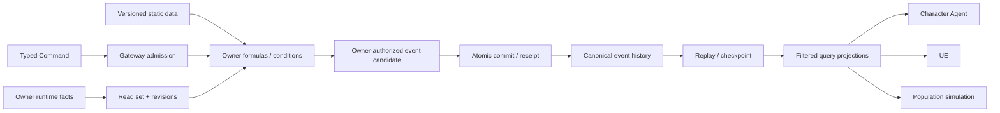

# 03-三本账与WRK

> 版本：1.0（职责拆分版）
> 更新日期：2026-10-30
> 评审状态：职责归位与静态一致性核对；不替代产品待决项裁决或实现评审。
> 实现状态：本篇为目标合同；已有实现仅按原始证据日期记录，不代表全量实现或运行验收完成。
> 验证范围：本轮仅重组文档，未执行代码、UE、PIE 或性能验证。原始设计、实现盘点和证据日期分别保留。

[技术架构入口](../README.md) · [唯一 Owner 注册表](../03-Owner领域/01-Owner注册表.md#owner-registry)

<a id="three-ledgers"></a>

## 真相、记忆与表现三本账

### 三本账与 Paralls Owner

### 世界真相账

记录世界正式承认的事实、事件、当前状态、`world_revision`、来源、作用范围和 receipt。

主要承担者：

- 各领域 Authority：判断请求是否合法并生成领域事件；
- `GameplayEventStore`：保存提交后的事件历史、流版本、幂等结果、committed outbox 和回放基础；
- Projection/Replay：从已提交事件重建受限查询视图。

它不记录角色“应该知道什么”。Godot/UE 动画完成本身不能确认世界事实；带许可、时间、revision 和来源的执行证据可交对应 Owner 校验，再决定是否提交。

### 角色记忆账

由 Character Core 和角色运行时维护，记录某个角色实际观察、收到、推断、相信、误解和记住的内容。

角色记忆有五个池：Event、Observation、Knowledge、Social、Higher-Order。世界事实只有经过实际暴露、合法传播或角色自身推理，才可进入相应记忆池。

### 世界表现账

Paralls 现有 Godot/BackendBridge、Guoshang 目标 UE 表现适配层分别维护局部场景、Actor、物理、音频、UI 和动画的可重建投影。表现层可以延迟、降精度或局部缺席，但不能反写真相。

三本账还必须分开记录：

```text
event_time      世界事实发生时间
known_time      角色得到信息的时间
presented_time  玩家看到表现的时间
```

<a id="writeback"></a>

## 世界确认后的三本账回写

### 三本账回写

```text
Owner receipt
  -> 世界真相账：确认事件和 revision
  -> 角色记忆账：按实际暴露/合法传播写入记忆
  -> UE 表现账：生成带版本的局部投影
```

角色设定参与权限、感知、解释和候选排序；角色状态参与前置条件和行动效果；二者都不能直接写入世界真相。

<a id="dataflow"></a>

## Owner 数据流与投影

### 数据流图



<a id="demo-ledgers"></a>

## 三本账在县城场景中的边界

### 三本账

| 账本 | 内容 | 写入条件 | 消费者 |
|---|---|---|---|
| 世界真相账 | Owner 已承认的资源、产权、账户、位置、伤害、组织、运输、生产、人口、政治、辖域、目标和胜负事实 | 领域结算成功并提交 EventStore | 所有合法投影和 Owner |
| 角色记忆账 | 角色实际看到、听到、收到、推断、相信和记住的内容 | 感知、合法传播或自身推理成立 | Character Agent、角色对话和判断 |
| 世界表现账 | UE Actor、动画、音频、UI、镜头和局部物理状态 | 根据真相/行为投影生成，可延迟或降精度 | 玩家和表现层 |

三种时间必须同时记录：`event_time`、`known_time`、`presented_time`。表现出现得晚，不会改变事实发生时间；角色知道得晚，不会获得追溯全知。

<a id="wrk"></a>

## WRK 的完整职责与禁区

### WRK 基建要求

WRK 是世界运行核心，但不是领域 Owner。它负责：

```text
World Timeline
→ bounded window
→ fixed read set
→ population processors
→ agent handoff
→ domain owner settlement
→ receipts
→ confirmed cursor
→ projection / replay / recovery
```

### 必须具备

- 唯一世界推进权和 `world_tick`。
- 游戏暂停/恢复屏障。
- 多时钟映射和有界时间窗口。
- 每窗口的读集、预算、依赖和确定性 seed。
- 群体模拟与 Character Agent 的唯一推进租约。
- Owner receipt、cursor、checkpoint、backlog 和开放义务。
- 超时、重试、未知结果查询和补偿事件。
- 旧 revision、旧 handoff、旧 epoch 的拒绝。

### 明确不能做

- 不能直接写库存、位置、生命、伤害、士气、生产产出或角色记忆。
- 不能新建第二套逻辑事实账或重复 authority；显式注册的 UE 本地可靠提交端属于同一事实体系，不能因这条约束而禁止本地权威持久化。
- 不能用表现层坐标替代 Presence 事实。
- 不能因为某个 Owner 成功就宣称所有跨域流程全局完成。
- 不能以自然语言或 Agent 输出绕过命令、权限和 Owner admission。

<a id="wrk-demo-contract"></a>

## WRK 窗口、暂停和恢复补充

### P0 基础设施和 Owner

### World Runtime Kernel（WRK）

WRK 负责唯一推进权，不负责计算战斗、库存或生产结果。

必须提供：

- 唯一 `world_tick` 和可暂停的世界时钟；
- 窗口、预算、固定读集、依赖和确定性 seed；
- B0/B1 批次推进和 C2/C3 Agent 激活交接；
- Owner 提交顺序、receipt、confirmed cursor 和 checkpoint；
- control epoch、lease、超时、重试、未知结果查询和恢复任务；
- 暂停/恢复屏障。

暂停规则：切换镜头、地图、工作层和关注对象不暂停；玩家主动暂停时，`world_tick`、Owner 提交、Agent、群体模拟、运输、生产、动画、物理和 handoff 全部冻结。恢复后重新验证 epoch、revision、lease 和证据时效。

<a id="pause-ledger-link"></a>

## 三本账和暂停的共同边界

### 三本账和暂停

```text
世界真相账：Owner 已确认的资源、位置、伤害、组织、军令和胜负事实
角色记忆账：角色实际观察、听闻、理解和记住的内容
世界表现账：UE Actor、动画、旗帜、HUD 和镜头的可见投影
```

暂停是时停：`world_tick`、Owner 提交、角色写回、运输、生产、动画推进和 handoff 都冻结。暂停期间只编辑尚未发出的命令；恢复时重新校验 control epoch、revision 和 lease。旧的异步结果不能绕过 WRK 改变世界。UE-local Owner 也必须服从暂停屏障，不得由 Tick、AnimNotify、Timer 或延迟回调在暂停期间继续提交。

<a id="wrk-authority"></a>

## WRK 不接管领域写权

WRK 管理时间、窗口、预算、固定读集、依赖、重试、超时、开放义务和恢复；不能把调度结果自行变成领域事实。统一暂停的控制 epoch、回调隔离与提交屏障见 [暂停合同](../02-公共契约/01-时间身份与控制权.md#pause)；工作流的部分完成与补偿见 [跨 Owner 结算](../04-模型与结算/02-数值状态效果与跨Owner结算.md#numeric-settlement)。
