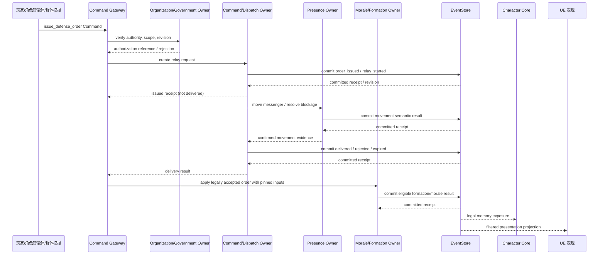
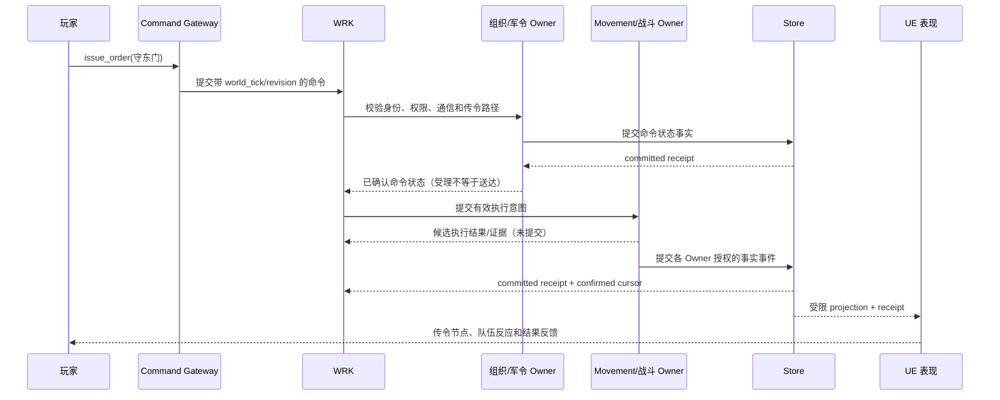
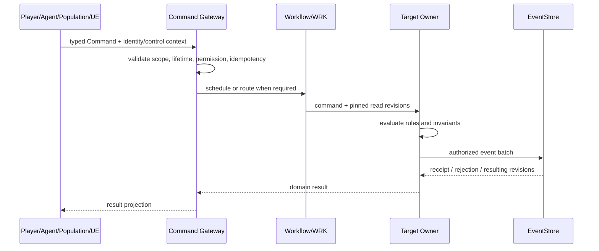

# 02-Command事件与Receipt

> 版本：1.0（职责拆分版）
> 更新日期：2026-10-30
> 评审状态：职责归位与静态一致性核对；不替代产品待决项裁决或实现评审。
> 实现状态：本篇为目标合同；已有实现仅按原始证据日期记录，不代表全量实现或运行验收完成。
> 验证范围：本轮仅重组文档，未执行代码、UE、PIE 或性能验证。原始设计、实现盘点和证据日期分别保留。

[技术架构入口](../README.md) · [唯一 Owner 注册表](../03-Owner领域/01-Owner注册表.md#owner-registry)

<a id="command-event-receipt"></a>

## Intent、Command、Event 与来源中立性

### Command 不是事实

必须区分三个对象：

```text
Intent   角色主观上想做什么
Command  请求系统执行什么
Event    Owner 已确认世界发生了什么
```

例如：

```text
“我想把命令送到东队”       = Intent
“向东队发送守城命令”         = Command
“东队已收到并接受命令”       = Event
```

动画播放、角色说出一句话或群体模拟生成候选，都不能直接产生 Event。

### Command 来源

所有来源使用同一套领域命令，只由 `source_kind` 和授权上下文区分：

```text
human
player_agent
character_agent
population_sim
scene_script
```

任何来源都必须通过相同的 Owner 规则、revision、幂等和失败反馈。AI 不能因为是 AI 而获得绕过权限、视野、通信或资源的能力。

<a id="gateway"></a>

## Command Gateway 完整信封、生命周期与职责

### Command Gateway 需求

`CommandGateway` 是公共命令治理和路由层，不是万能事实 Owner。

### 统一命令信封

```text
command_id
command_type
command_version
source_kind
principal_ref
actor_ref
subject_ref
target_refs
control_mode
payload
expected_revisions
read_set_revisions
evidence_refs
priority
issued_at
expires_at
causation_id
correlation_id
```

### 生命周期

```text
received
  -> normalized
  -> admitted
  -> queued
  -> executing
  -> committed
```

失败路径必须显式记录：

```text
rejected / requeued / partial / cancelled / expired / superseded
```

### Gateway 必须做什么

- 验证来源身份和控制模式；
- 校验命令结构、目标、作用范围、时效和优先级；
- 固定读集和预期 revision；
- 检查控制权是否仍属于该主体；
- 生成或复用幂等键；
- 路由到一个或多个指定 Owner；
- 保存命令审计和状态，不把命令本身伪装成世界事件；
- 接收 Owner receipt 并返回统一结果；
- 支持取消、过期、重排、恢复和查询。

### Gateway 不得做什么

- 修改生命、库存、位置、士气、生产或关系事实；
- 替领域 Owner 计算业务结果；
- 保存第二份角色、人口或资源状态；
- 把玩家 UI 操作直接变成远方世界事实；
- 在一个 Owner 拒绝后静默改写另一个 Owner。

<a id="receipt"></a>

## EventStore 与 Receipt 的最小完整合同

### EventStore、Receipt 和 Replay

EventStore 是唯一事件脊柱，必须支持：

- 原子事件批次和 stream revision；
- 幂等键重复提交返回原 receipt，不产生第二次事实事件；
- outbox 和投影重试；
- 从事件流重建领域状态；
- checkpoint、replay、confirmed cursor 和恢复；
- 事件的 `causation_id`、`correlation_id`、来源、时间和 evidence 引用。

每个 receipt 至少包含：

```text
command_id
result_status
owner_kind
committed_events
before_revision / after_revision
reason_code
evidence_refs
event_time
known_time_by_recipient
next_action / recovery_action
```

<a id="military-command-sequence"></a>

## 发布守城命令的完整协作时序

### Owner 协作与组合规则

### 典型“发布守城命令”流程



<a id="legacy-local-sequence"></a>

## 传统 UE 与正式提交链时序

### 典型命令流程



<a id="owner-sequence"></a>

## 领域模型和事实提交时序图

### 关键时序图



<a id="failure-recovery"></a>

## 失败、未知结果与恢复的共同语义

拒绝、取消、超时、部分完成、执行失败和提交结果未知必须可区分；不能把超时等同未提交。未知结果优先按 `command_id` / 幂等键查询原 receipt，不能重新生成事实或先补偿再查询。重复请求返回原确认结果；retry 不重复结算。

短事务在同一受控提交端通过各 Owner 授权 fragment 组成 AtomicEventBatch；跨端流程由步骤 receipt、开放义务、恢复游标和新事件补偿恢复，不假称全局原子提交。详见 [跨域事务](../04-模型与结算/02-数值状态效果与跨Owner结算.md#cross-owner-transactions) 与 [恢复合同](../06-存档与可观测性/01-存档回放与故障恢复.md#save-replay-recovery)。
