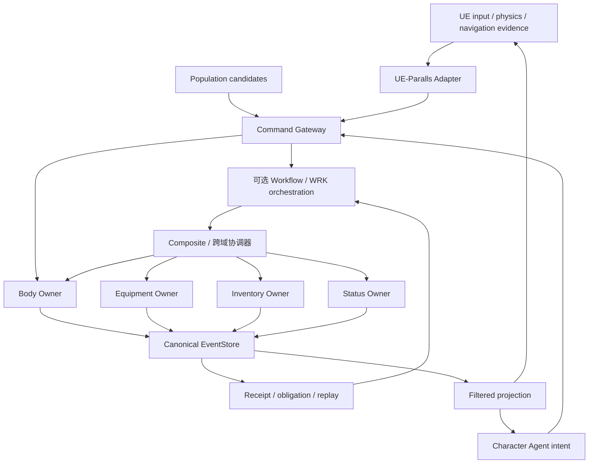
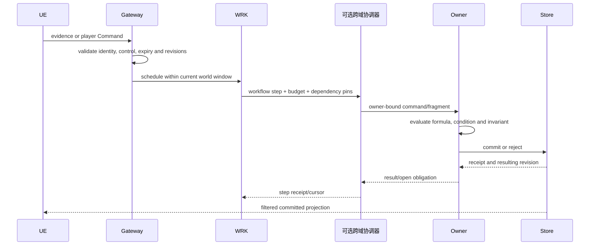
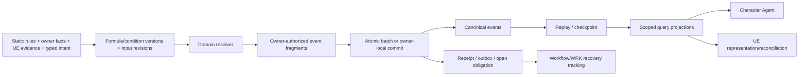

# 02-数值状态效果与跨Owner结算

> 版本：1.0（职责拆分版）
> 更新日期：2026-10-30
> 评审状态：职责归位与静态一致性核对；不替代产品待决项裁决或实现评审。
> 实现状态：本篇为目标合同；已有实现仅按原始证据日期记录，不代表全量实现或运行验收完成。
> 验证范围：本轮仅重组文档，未执行代码、UE、PIE 或性能验证。原始设计、实现盘点和证据日期分别保留。

[技术架构入口](../README.md) · [唯一 Owner 注册表](../03-Owner领域/01-Owner注册表.md#owner-registry)

<a id="numeric-settlement"></a>

## Numeric、Condition、Hybrid 与状态效果

### 公式、条件和混合模型由领域 Owner 管理

数值变化必须来自明确、版本化的领域模型。模型归拥有该数值事实的 Owner 负责选择、固定输入、校验和提交；模型运行时可以在同一领域内复用，但不能跨领域写入事实。

模型分为三类：

- **Numeric Model**：计算数量、比例、进度、损耗、风险或评分；
- **Condition Model**：判断资格、门槛、风险、可用性和状态转移条件；
- **Hybrid Model**：组合条件、数值和状态机，输出候选状态转移和 Owner 效果。

例如食品变质和木材腐朽可以共享 Inventory 领域的模型运行时，但必须使用不同的模型定义、输入 schema、参数、阈值、状态机和效果映射。模型适用对象由 Applicability Binding 注册，不能由调用者自行指定。

数值变化归拥有该数值事实的 Owner 负责：

| 公式领域 | 示例 |
| --- | --- |
| Survival | 饥饿、脱水、疲劳、体温等生存指标 |
| Combat | 攻击、命中、格挡、伤害评估和战斗接触结果 |
| Body / Resource | 生命、体力、伤势、身体功能及其阈值证据；不提交生命周期状态 |
| LifeState | 基于身体和其他已确认依据，判断并提交存活、倒地、濒死、死亡等生命周期转换 |
| Medical Workflow | 治疗流程和方案选择；不拥有库存、生命或效果实例 |
| Equipment | 护甲吸收、耐久变化、破损条件 |
| Status / Effect | 流血、中毒、燃烧等效果强度、tick 和退出条件 |
| Inventory | 物资数量、预留、装载/入库与实际货损 |
| Transport / Logistics | 承运批次、运输阶段与损失评估/记录；请求 Inventory 确认实际增减 |
| Production | 原料转化、批次损耗、半成品/成品产出和工时 |
| Morale / Formation | 个人/队伍士气、纪律和阵型状态；个人士气不等于 Agent 的完整主观心智 |
| Organization / Military | 编制、岗位、指挥授权、预案归属与继任；不重复写士气/阵型 |

角色智能体、群体模拟、UE Blueprint 或 WRK 不应各自复制业务公式。调用端可以产生 proposal；只有拥有该数值的 Owner 能批准并提交变化。

结算事件至少固定：

```text
formula_ref + formula_revision
input_owner_refs + input_revision_vector
previous_value + delta + next_value
condition_refs + condition_revision
event_time + causation_id + correlation_id
model_ref + model_type + model_version
binding_ref + binding_revision
evaluation_id + evaluation_cadence
```

输入还应说明单位、范围、来源和时间语义。未知或过期输入必须显式拒绝、降级或标记不确定，不能默认为可信零值。

### 数值、条件、标签与效果

| 概念 | 用途 | 示例 |
| --- | --- | --- |
| 数值事实 | Owner 结算的连续/离散事实 | `health=62`、`armor_durability=0`、`energy_reserve=18` |
| 条件（Condition） | 有版本的 Guard/Trigger 判断某状态是否进入 | `health_ratio <= 0.3`、开放锐器伤口、护甲耐久为零 |
| 状态效果实例 | 有来源、强度、层数、持续结算和退出条件 | 流血、中毒、燃烧、眩晕、恐慌 |
| 标签（Tag） | 稳定检索、过滤或投影的语义载体 | `status:bleeding`、`armor:broken`、`capability:can_attack` |

`流血`可以暴露为标签，但不能只存一个字符串。权威实例还要记录 effect id、来源事件/伤口、身体部位、severity、stacks、开始/到期时间、tick policy、解除条件、治疗证据和 revision。

```text
Condition/Trigger 成立
  -> 创建或叠加 StatusEffectInstance
  -> 按 tick 或外部 Command 产生领域变化
  -> 重新评估条件
  -> 维持 / 转化 / 解除 / 到期
```

阈值可使用滞回避免边缘反复切换，例如 `health_ratio <= 0.30` 进入 critical，`health_ratio >= 0.35` 解除；规则由相应 Owner 版本化。

<a id="cross-owner-transactions"></a>

## 短事务、长流程、开放义务与补偿

### 跨 Owner 事务

短事务若必须同时消耗体力、损耗护甲并产生伤势/流血，可由 Combat Workflow/Composite 固定各 Owner 输入 revision，分别请求 Combat、Equipment、Body、Status 生成各自授权 fragment，再走共同原子提交。未经 Owner 授权，Composite 不能伪造其事实事件。Combat 不拥有生命和护甲耐久；它提供伤害评估。因果顺序为 Equipment 防护与耐久、Body 剩余伤害及身体功能变化、Status 基于同批次已授权 Body 结果与固定 Survival revision 评估身体条件并创建效果；若采用分阶段提交，Status 读取已提交 Body revision。共同原子提交也必须保留这一因果顺序。

```text
Combat Workflow / Composite
  -> Combat fragment: attack / hit / damage assessment
  -> Equipment fragment: armor durability
  -> Body fragment: post-mitigation health / injury / body function
  -> Status fragment: bleeding effect
  -> single AtomicEventBatch / receipt
```

若当前技术无法保证共同原子提交，则拆成 owner-local commits 和开放义务；不把不同领域事实塞进可写总对象。

长期过程不能假设全局回滚：

```text
start process -> Owner A commits -> Owner B rejects/unknown
  -> preserve committed events
  -> record open obligation / compensation task
  -> Workflow/WRK schedules retry, query or reconciliation
  -> close only after required receipts are confirmed
```

补偿追加新事件，不删除已提交历史。外部执行结果未知时先对账，不盲目重发可能有副作用的动作。

<a id="atomicity-scope"></a>

## 跨 Owner 原子性的提交端边界

### 跨 Owner 原子性

- 如果多个 Owner 能在一次冻结 revision 下提交互不重叠的授权片段，可以合并为一个 `AtomicEventBatch`；
- 如果 Owner 需要按时间、空间或传达过程逐步执行，必须保留中间状态和每个 receipt；
- 一个 Owner 失败时，不得伪造全局回滚；后续进入 `partial / recovery / compensation / requeue`；
- 任何跨域流程都必须能指出：哪个 Owner 已提交、哪个 Owner 拒绝、当前 revision 和下一步恢复动作。

<a id="medical-workflow"></a>

## 受伤、防护、流血和治疗完整因果

### 示例：受伤、护甲和流血

```text
UE 原生执行器提供带许可/时间/版本的命中证据；采用 ESM 交互合同是可选适配
  -> Combat Owner 确认命中并评估伤害包（攻击、命中、格挡、伤害类型/部位）
  -> Equipment Owner 根据固定装备 revision 结算防护和耐久
  -> Body Owner 将剩余伤害应用到生命、伤势和部位功能
  -> Body Owner 更新身体功能/能力限制；LifeState Owner 根据授权依据确认倒地、濒死或死亡等生命周期转换
  -> Status Owner 使用同批次已授权的 Body 结果和固定 Survival revision（或分阶段流程中已提交的 Body revision）评估身体条件，并创建带来源、严重度、层数、tick/exit policy 的效果实例
  -> Agent 读取权威投影和主观体感，决定继续、撤退、求医或违令
```

`health=62` 是 Body 数值事实；`status:bleeding` 可作为查询标签；流血本身必须是有生命周期的效果实例。Status 到期时生成带 `effect_id + scheduled_world_tick` 的 Body 结算请求，由 Body 按自身公式和 revision 应用周期损伤；Status 推进效果 tick/到期状态。标签不能直接改生命值。伤害、伤势与由其触发的效果可在同一批次提交，但批次内保留“Equipment 防护 -> Body 数值变化 -> Status 条件评估与效果”的因果顺序；若分阶段提交，Status 必须读取已提交的 Body revision。

UE 可以运行命中检测、局部战斗模拟和即时反馈。若战斗配置为 UE-local authoritative，UE 承载的是上述领域 Owner 的实现，并按统一 Command/Event/Receipt 提交；这不允许 Combat 直接改写 Body、Equipment 或 Status 事实。若配置为本地预测，则预测生命/命中只用于短暂表现，Owner 回执到达后必须确认或修正。Paralls/后端不得再为同一角色同一伤害事实重复结算。

### 治疗与补血

```text
角色 Agent / 玩家产生 treat 或 use_medicine Command
  -> Medical Workflow 校验医护、设施、目标、时长和治疗方案
  -> Inventory Owner 预留/扣除药材或消耗品
  -> Body Owner 根据治疗方案和身体条件提交生命/伤势变化
  -> Status Owner 提交流血、感染等效果的减轻/解除
  -> receipts 汇总为治疗结果，更新角色投影并驱动 UE 动画/反馈
```

`Medical Workflow` 是跨域流程，不是 Survival/Body/Status 的替代 Owner；它负责协调和跟踪，不拥有库存、生命或状态效果。UE 的治疗动作、进度条和即时提示可以传统实现；除非对应事实 Owner 被明确配置为 UE-local authoritative，治疗动画、Gameplay Effect 或 `ApplyHeal` 不得直接成为权威加血。任何 UE-local 配置仍必须调用对应 Owner 规则并提交同一 canonical store。

<a id="body-serialization"></a>

## Body 串行化、幂等和终局保护

Body 对伤害、持续效果 tick、恢复与治疗实行同一事实流的 revision/CAS 串行化；并发准入不能让体力变成负数或重复消耗。效果 tick 的幂等键至少包含 `effect_id + scheduled_world_tick`，治疗步骤至少包含 `treatment_id + step`。

生命值归零是 Body 输入，不等于自动死亡；倒地、濒死、死亡由 LifeState 按合法依据转移。死亡后的普通迟到治疗不能覆盖终局；治疗中断保留已消费物资和已发生步骤，下一步依 receipt / 开放义务恢复。医疗流程不获得 Inventory、Body、Status 或 LifeState 写权。

<a id="transport-interruption"></a>

## 运输被玩家干扰的完整结算

### 示例：运输被玩家干扰

```text
UE：提交玩家接近、阻挡、碰撞或武器接触证据
Spatial/Presence Owner：校验位置、路径、占用和阻挡
Combat Owner：判定攻击/命中/伤害评估，形成有来源的威胁输入；Body/LifeState 确认身体伤害和生命周期转换
Logistics Owner：计算继续、改道、延误、失败或劫掠
Inventory Owner：提交货物抵达、损耗、转移或损失
Workflow/WRK：跟踪 receipts、开放义务、重试和恢复
UE：按已提交投影播放动画、图标和 UI
```

若玩家停在路上，局部避障由 UE/Nav 执行；实际运输阶段、延误或改道由 Presence 与 Logistics 结算。寻路库产生路径候选，不拥有运输成功事实。

<a id="settlement-diagrams"></a>

## 结算架构、时序与数据流图

### 架构图



### 时序图



### 数据流图



<a id="required-cross-owner-workflows"></a>

## 九条跨 Owner 因果闭环与中断边界

### 必须交付的跨 Owner 闭环

| 闭环 | 责任链 | 必测中断/边界 |
|---|---|---|
| 军情—求援—抵达 | Information → Dispatch/Organization → Presence 与所需补给流程 → Objective → Campaign | 信使被截/迟到、命令过期；不能从点击求援时无条件起算成功。约 30 日来自合法受理和行军过程的正式配置 |
| 命令—执行—回报 | Organization/Government 授权 → Dispatch → Agent/群体意图 → 目标 Owner → Information 回报 | 命令失效、拒绝/改策、传令未达；调试 receipt 可有原因，玩家须通过实际渠道知情 |
| 命中—身体—后果 | Combat → Equipment → Body → Status/LifeState → Morale 与 Agent 合法感知 | 重投命中、冲刺/攻击并发、流血/治疗并发、已死目标迟到治疗、Agent 变慢 |
| 征发/采购—调拨—运输 | Government/Ownership/Economy → Inventory 预留 → Transport/Presence → Inventory 入库 | 无权限、欠款、部分交付、玩家挡路、敌军拦截；失败不恢复已经发生的历史损失 |
| 原料—生产—产出 | Population/Organization 与 Body/Survival 投影 → Production → Inventory 授权投入/产出 | 缺设备/匠人/原料、停工、设备故障、工坊拆分合并、取消和重复产出 |
| 房屋/农具拆解—回收 | Ownership/Policy → Production 工单及设施变化 → Inventory 回收 → Population/Social 后果 | 原权利不足、回收规格/损耗、住房损失；不能无成本把整座城变成原料 |
| 进食/治疗 | Workflow → Inventory → Survival 或 Body/Status，治疗同时校验 LifeState | 药粮不足、排队/中断、已消费不能假回滚、已死亡不被普通回血覆盖 |
| 政令—社会—政治 | Government → 各执行 Owner → Information 合法暴露 → Social/Politics | 豪强例外、配给冲突、违约；公开承认与个人态度分别结算 |
| 控制—胜负—阶段继承 | Combat/Presence/组织与政治等正式依据 → Territory → Objective → Campaign | 争夺状态不得假报占领；载入第二阶段 fixture 不重写产权/账户/人口/政治等事实 |

同一受控提交端覆盖的事实可使用各 Owner 授权 fragment 原子批次。跨提交端按步骤 receipt 和开放义务恢复；本计划不要求也不假称跨所有 Owner 的全局原子事务。补偿产生新的合法事件，不擦除已经发生的损失和后果。

<a id="continuous-integration"></a>

## 连续积分、切窗与跨域边界

体力、损耗、效果和生存指标各按本域模型和固定输入切窗；输入改变、阈值、暂停、转仓、设施/通风变化、绑定启停、版本升级与 handoff 都结束当前窗口，不能新旧推进者重复积分。效果、治疗与死亡竞态的迁移规则见 [领域交接](../02-公共契约/04-多精度与Handoff.md#authority-migration)。未知提交结果先查原 receipt；补偿产生新的合法事件，不擦去真实损失。

<a id="composite-resolver"></a>

## 组合结算器与 receipt-driven recovery

### 组合结算器

跨域行动可由二级组合结算器编排，但它不拥有第二份事实。它拆解玩家或角色意图，调用生产、库存、市场、运输、组织、身体和军事 Owner，收集各自 receipt，形成组合结果和补偿/重试状态。跨域失败采用部分结算加 receipt-driven recovery，不承诺全局回滚。

例如“秘密放盐并定向赈济”可拆为：生产完成 → 库存入库 → 运输通过 → 市场报价/公仓发放 → 家庭或军队消费 → 身体和组织投影更新。每一步由对应 Owner 决定，任何一步拒绝都必须留下可追溯原因。
