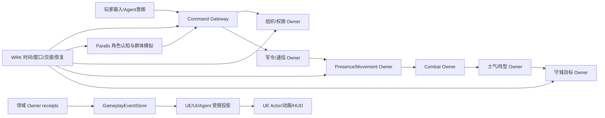

# 01-UE本地提交与Paralls同步

> 版本：1.0（职责拆分版）
> 更新日期：2026-10-30
> 评审状态：职责归位与静态一致性核对；不替代产品待决项裁决或实现评审。
> 实现状态：本篇为目标合同；已有实现仅按原始证据日期记录，不代表全量实现或运行验收完成。
> 验证范围：本轮仅重组文档，未执行代码、UE、PIE 或性能验证。原始设计、实现盘点和证据日期分别保留。

[技术架构入口](../README.md) · [唯一 Owner 注册表](../03-Owner领域/01-Owner注册表.md#owner-registry)

<a id="ue-paralls"></a>

## UE 承载、Paralls 协作与唯一逻辑提交权威

本篇是近场/远场执行、可靠本地提交和同步的唯一技术入口。UE 是执行宿主，不是通用领域 Owner；每个范围显式登记 authority_mode、owner_host、writer、store、scope 和 epoch。近场实时协作不要求每一步跨 Python RPC，分域不等于分进程。

唯一 canonical EventStore 是逻辑权威约束。获准本地可靠持久化并产生 receipt 的提交可以是最终事实；后端只接副本/投影，不再次结算。只配置后端提交端时，UE 在 receipt 前保持 pending/predicted；断线不能把本地预测自动升格为权威。

<a id="reusable-primitives"></a>

## Paralls 可复用基础原语

### Paralls 可直接复用的基础

以下能力应优先复用，不重新发明平行实现：

1. `GameplayEventStore`：事件账、stream revision、幂等、outbox、projection checkpoint 和回放。
2. `AtomicEventBatch`、`GameplayCommandEnvelope`、`SettlementReceipt`：命令、事件批次和结果回执合同。
3. `SettlementPlan`：组合已授权 Owner fragment 的预提交计划；它不拥有事实，也不应变成万能写入器。
4. Inventory、Ownership、Economy：容器、负重、产权、账户、购买、赠与和债务原语。
5. Construction/Production：设施、配方、生产运行、产出认证和失败结果基础。
6. Body、Survival、Status、Effective Stats：身体、需求、状态和有效能力基础。
7. Character Core、Character Agent、Activation、Handoff、requeue：身份连续性、私有记忆、L1-L4、自主判断和转层交接。
8. Population B0/B1 cadence：远场群体按窗口推进、候选升级和关键角色激活入口。
9. Projection、checkpoint、replay 和 recovery：查询投影、恢复游标和历史重放基础。

“直接复用”指复用原语、schema 和边界，不表示 Paralls 已有完整县城战争规则。军事组织、县城军令、攻守目标和 UE 空间接入仍需 Guoshang 领域实现。

<a id="host-authority-boundaries"></a>

## 传统 UE 与 Paralls 的责任与提交边界

### 责任边界



UE 不因为动画播放就宣布事实完成。Paralls 中的角色、司命和规划器不得绕过相应 Owner 直接设置 UE 位置、骨骼、伤害、库存或军旗；获准的 Paralls Owner 仍可提交本域事实，由 UE 消费其结果。Owner receipt 才是结果确认。UE 进程可以承载获准的 UE-local authoritative Owner；此时必须通过相同 Command/Event/Receipt、revision、幂等和 canonical EventStore 提交，UE Actor/动画/Buff 本身仍不是 Owner。

近场推荐将 Combat、Body/Resource、Equipment、Status、LifeState、战场 Morale 共同部署在 UE，按领域分别持有写权，通过本地调用协作。生命按事件、体力按动作与时间积分、士气按事件加周期窗口更新；角色智能体负责自主判断，受击、体力耗尽和已确认失能等即时约束不等待其推理。后端同步投影不重新结算本地已确认结果。要使正式战斗闭环不依赖后端往返，必须实现获准的本地可靠 canonical 提交路径；若提交端仍仅在后端，receipt 前就仍是 pending/predicted。部署、提交、断线与恢复详见[近场领域实时协作](01-UE本地提交与Paralls同步.md#local-domain-collaboration)。

<a id="host-manifest"></a>

## 宿主、模式、写入口、存储和范围登记

### UE 兼容不是第二份 Owner

UE 传统兼容描述 Owner 如何接入本地帧循环、碰撞、动画、预测和即时反馈，不改变事实归属。每个 Owner 还需独立声明：

```text
execution_host: ue_runtime | paralls_runtime | service
execution_mode: authoritative | predicted | presentation_only
canonical_writer: owner_id
commit_store: canonical EventStore
commit_boundary: semantic event / transaction boundary
reconciliation_policy: accept | correct | reject-and-replay
```

本地预测只能临时驱动表现，不能成为提交；UE 运行时承载 Owner 时，该 Owner 可在获准的配置下成为唯一最终写入者，并仍须提交统一 Event/Receipt 到唯一 canonical store。不能同时存在 UE Actor 写一份、Paralls Owner 再写一份的双权威。

对高频战斗的推荐事实划分是：Combat Owner 结算攻击尝试、命中、格挡和伤害评估；Body Owner 结算生命、体力、伤势和身体功能；Equipment Owner 结算护甲耐久；Status Owner 结算流血等效果实例。Survival Owner 维护饥渴、疲劳等生存指标。它们可由 UE 高频流程驱动，并通过受授权的原子事件批次保持即时反馈，但不得互相越权写字段。治疗/恢复由医疗流程编排，库存、Body、Status 的变化分别由各自 Owner 提交。

LifeState 单独确认存活、倒地、濒死和死亡等生命周期转换，Body 提供身体数值与功能依据，不能以 `health == 0` 自动代替死亡。近场还应将战场 Morale 纳入实时协作：个人/队伍士气由其 Owner 维护，角色主观恐惧、解释和自主选择仍归 Character Agent。

近场推荐将 Combat、Body/Resource、Equipment、Status、LifeState 和战场 Morale 的获准实现共同部署在 UE，通过本地调用协作；规则分域不等于进程分离。生命按事件变化，体力按动作与时间积分，士气结合事件与周期评估；强制身体反应不等待 Agent 推理。更新节奏、本地 canonical 提交与后端同步的完整合同见[近场领域实时协作](01-UE本地提交与Paralls同步.md#local-domain-collaboration)。这些是目标要求，不代表现有 Python runtime 已完成 UE 接入。

全量 23 Owner 的部署与更新基线见[UE 协作与节奏矩阵](01-UE本地提交与Paralls同步.md#ue-cadence-matrix)。Presence 与身体/战斗等实时链本地协作；Inventory 弹药和 Facility 机械等子域不得遗漏。ESM 是经审计后可选的交互合同/适配器，不是万能 Owner 或必经路由；Godot 执行器需替换，旧写权需迁移，见[ESM 复用与迁移](03-ESM复用与迁移.md#esm-migration)。

<a id="mirror-adapter"></a>

## UE Presentation / Mirror Adapter 不新增领域

### UE Presentation / Mirror Adapter

这不是世界事实 Owner，而是 Guoshang 的表现账适配器：

- 消费世界真相投影、角色执行计划和现场证据；
- 负责 Actor 激活、动画、音频、特效、UI 和局部回滚；
- 携带 `truth_revision`、`memory_revision`、`presented_time`；
- 绝不以动画完成、UI 显示或本地预测替代 Owner receipt。

<a id="workflow-wrk-boundary"></a>

## UE、Workflow、WRK 与 Manifest 分工

### UE、Workflow 与 WRK 边界

| 组件 | 可以承担 | 不得承担 |
| --- | --- | --- |
| UE Traditional Runtime | 高频移动、动画、碰撞、局部物理、寻路执行、命中接触证据、预测；按 Owner 配置也可承载获准的 UE-local authoritative resolver | Actor/Component/GameplayEffect 绕过 Owner 直接写 canonical facts；同一事实再由第二个 Owner 重复结算 |
| UE Adapter | 把输入/物理/观察转成带来源、时间和 revision 的证据/typed Command，或将 UE-local Owner 的结果提交到 canonical store；接收 authority projection | 把动画完成、Actor overlap 或预测缓存当作 canonical event |
| Workflow | 跨域过程步骤、依赖、补偿和完成条件 | 直接写 Owner facts 或绕过 Owner guard |
| WRK | 世界窗口、暂停屏障、预算、调度、唯一推进权、B0/B1 与 Agent handoff、receipt 和恢复 | 第二 EventStore、万能 scheduler 或超级事实 Owner |
| Character Agent | 根据合法可知状态形成意图、Command 和解释 | 直接写数值、条件、状态效果或表现结果 |

Owner Manifest 将执行位置、模拟模式和最终提交权分开声明：

```text
execution_host: ue_runtime | paralls_runtime | service
execution_mode: authoritative | predicted | presentation_only
canonical_writer: owner_id
commit_store: canonical EventStore
latency_budget
prediction_policy / reconciliation_policy
commit_boundary
pause/disconnect/recovery behavior
```

`execution_host=ue_runtime + execution_mode=authoritative` 表示 UE 进程承载指定 Owner 的唯一权威实现；其结果必须走统一事件账、revision、幂等和 receipt。若 Owner 在 Paralls runtime/service 运行，UE 提交命令/证据，由 `canonical_writer` 指定的 Owner 结算。`predicted` 和 `presentation_only` 不能提交事实。避免使用 `hybrid` 作为 authority 值；若 UE 高频模拟、Owner 在语义点结算，应分别标出执行位置、执行模式和唯一提交 Owner。

<a id="combat-compatibility"></a>

## Combat、Body、Medical 的七项兼容判据

### Combat、Body 与 Medical 的兼容判据

| 领域事实 | 可兼容的 UE 传统路径 | 唯一事实 Owner | 第一阶段原则 |
| --- | --- | --- | --- |
| 攻击/命中/格挡/伤害评估 | Trace、碰撞、Ability、近场实时 resolver | Combat | 支持 UE-local authoritative；Demo 近场战斗可由 UE 承载 Combat Owner，但要提交统一事件和 receipt |
| 生命/伤势/身体功能 | 即时本地数值计算、命中后同事务呈现 | Body | 必须支持与 Combat 同步的 UE 接入；是否 UE-local authoritative 由 Owner 配置显式选择，不能让 Combat/Actor 越权写 Body |
| 体力消耗/恢复 | 攻击成本、冲刺积分、格挡和恢复窗口 | Body / Resource | 与动作准入同步；体力检查与扣除/预留须避免并发超支，不逐次等待 Agent 推理或后端网络往返 |
| 生命周期转换 | 命中后及时失能/死亡反馈 | LifeState | 接收 Body 等域的授权依据，由自身规则确认转换；`health == 0` 不直接等于死亡 |
| 个人/队伍战场士气 | 伤亡、军旗、指挥及威胁的事件响应与周期评估 | Morale | 近场支持 UE-local authoritative，并与战斗事件协作；只使用该主体合法获得的输入，不直接替代角色自主判断 |
| 护甲耐久/防护 | 命中流程中的本地防护计算 | Equipment | 可由 UE 高频调用，Equipment Owner 持有耐久事实；与伤害批次固定 revision 并原子提交或记录开放义务 |
| 流血/中毒/持续伤害等 | UE VFX/动画/短期反馈 | Status / Effect + Body | Status 管理效果实例与 tick 生命周期；周期数值变化必须由 Body 提交，表现效果不能自己扣血 |
| 治疗/补血/药物消耗 | UE 输入、交互、治疗动画、进度表现 | Medical Workflow + Inventory + Body + Status | 医疗流程只编排；各事实 Owner 分别提交资源、身体和效果变化。UE-local authority 可作为显式配置能力，不默认授予医疗动画/恢复组件写权 |

<a id="local-domain-collaboration"></a>

## 各域本地协作和实时调用链

### 其他 Owner 的 UE 兼容范围

| Owner / 能力 | UE 传统实现可保留 | 最终写权约束 |
| --- | --- | --- |
| Presence / Movement | CharacterMovement、NavMesh、EQS、局部避障和碰撞 | Presence 承认位置/占用等语义事实；不每帧写账；本地权威须显式注册 |
| Transport / Logistics | 车队移动、装卸动作、阻挡与拦截证据 | Logistics 写运输阶段，Inventory 写货物；到达动画不等于入库 |
| Production / Facility | 工坊交互、工序动画、进度表现、设备碰撞证据 | Production 认证工艺结果，Inventory 提交投入/产出；Timer 不直接生成成品 |
| Inventory / Equipment | 背包、拾取、装备交互和即时反馈 | 库存数量与装备耐久分别经各自 Owner；客户端物品缓存不可双写 |
| Morale | 战场威胁、伤亡、军旗、鼓舞的即时响应和周期压力评估 | 近场推荐显式配置 UE-local 权威实现；个人与队伍作用域分别注册，角色主观恐惧仍归 Agent，不能有第二套可写士气 |
| Organization / Policy / Objective | UI、队形执行、传令表现、战后展示 | 各域确认授权、政令与胜负；不因 Combat/Morale 在 UE 内运行而自动迁移写权 |
| Survival / Population | 身体提示、劳作和群体动作表现 | 指标窗口与个体/群体推进统一；本地 Timer 不与远场窗口重复结算 |

兼容范围逐域声明，不把 Combat 的 UE-local 许可自动授予所有领域。其他 Owner 是否迁移执行位置可按延时与部署需求配置，但都必须满足唯一写权、暂停、幂等、回放和交接合同。

### 近场部署：职责分域，实时协作

本节为已确认讨论的目标设计，不能据此宣称现有 Paralls Python runtime 已完成 UE 接入。Owner 是事实写权与规则边界，不要求一 Owner 一进程，也不要求每次调用经过网络。

单人 Demo 的近场推荐部署为：Combat、Body/Resource、Equipment、Status、LifeState 以及战场 Morale 的获准实现共同位于 UE runtime，通过本地调用协作。逻辑上分域，执行上可在同一模拟步骤内处理命中、防护、身体变化、效果和生命周期转换。作用范围及 `authority_epoch` 须登记，Paralls 对相同事实只读取结果，不能再结算一次。

```text
Static Data / Model Registry / Applicability Binding
  -> 固定模型、条件、参数、适用对象与版本
UE 接触证据 / 玩家输入 / Agent 意图 / 已授权持续效果
  -> 本地受控 Command 路由与动作准入
  -> Combat -> Equipment -> Body/Resource
  -> 按依赖生成 Status / LifeState 授权结果
  -> 统一提交与 receipt
  -> UE 身体反馈 / Morale 后续评估 / 受限 Agent 感知
```

箭头表达事实依赖，不意味着每一步是 RPC，也不要求无依赖的效果硬排成一条链。共同原子提交必须固定批次内依赖；做不到时记录开放义务，在相关回执确认前不得宣布终局。Gateway 和 WRK 可提供本地准入、时间与预算上下文，不要求每次接触重新经过远端调度。GAS、C++ 或 Blueprint 若承载 Owner，只能通过登记的受控写入口提交。

<a id="local-commit"></a>

## 本地可靠提交与后端同步的完整条件

### 本地权威提交与后端同步

必须区分 Owner 计算完成、canonical 提交完成和后端投影同步完成：

| 提交配置 | 何时属于最终事实 | 后端职责 |
| --- | --- | --- |
| 本地权威提交路径（近场目标） | UE 所在部署中的获准提交端，将该权威范围的 Owner 事件可靠持久化到唯一逻辑 canonical 事件账，并产生 receipt 后 | 异步接收已提交事件、更新投影/Agent 输入；按事件标识去重，不重新计算同一伤害/体力变化 |
| 仅后端 canonical store（过渡配置） | 后端接受 Owner 授权批次并返回 receipt 后 | 负责正式提交；此前 UE 反馈为 pending/predicted，必须支持拒绝修正和未知结果对账 |

第一种配置是需要实现和验证的基础设施要求，不是把任意 UE 内存变量或缓存日志称作权威。一个事实流在同一 epoch 只有一个提交权威；若本地是获准权威，后端对应数据是同步副本/投影，不能另建一份可独立裁决的 canonical 账。跨域原子批次只能提交到覆盖其写集的共同提交边界；不同提交位置须用开放义务/恢复协议，不宣称全局原子。

本地提交路径必须具备 revision/CAS、幂等 receipt、可靠事件与 outbox、稳定排序、checkpoint/replay、崩溃恢复和 epoch fencing。确认提交前保持 pending；确认后即使后端桥接暂时断开，也可在既有授权范围内继续，恢复后按 cursor 补同步。提交失败/未知必须停止依赖该结果的确认并查询对账；不能通过无条件“异步上传”消除失败语义。仅有后端 store 时，断线不得擅自提升本地为权威。

<a id="high-frequency-execution"></a>

## 帧循环、语义提交点、ESM 和断线边界

### UE 高频桥接和表现对齐

23 个 Owner 的近场 UE 要求、事件/窗口分类与远场推进，以[UE 协作与节奏矩阵](01-UE本地提交与Paralls同步.md#ue-cadence-matrix)为统一基线。实时链也包含弹药/药物库存与城门设施等依赖子域；D/V2 前必须就绪，不能将它们隐藏在每次攻击都要等待的后端调用中。其余领域完整包仍按建设批次验收。

ESM 不是本节桥接或所有动作的必经入口。复用范围限于经审核的结构化交互、许可与证据合同；Godot 执行器由 UE 原生实现替换，旧身体/对象写入口按领域映射迁移并失效。详见[ESM 复用与迁移](03-ESM复用与迁移.md#esm-migration)。

### 帧循环和语义提交点

```text
UE 帧循环：
输入 / 移动 / 动画 / 物理 / 局部碰撞

语义提交点：
攻击尝试 / 命中候选 / 到达 / 被阻挡 /
运输装载 / 运输拦截 / 命令送达 / 目标状态变化

Owner 结算：
验证证据、权限、revision、成本
  -> Event + Receipt
  -> Projection / Reconciliation
```

约束：

- 不把每帧移动、骨骼和动画状态写入 EventStore；
- 本地预测只能标记为 predicted，不能冒充 committed；
- Owner 拒绝时必须回滚或修正 UE 表现；
- Bridge 断开时仅在有效本地权威范围内继续确认结果；仅后端提交配置不得离线提升为权威，恢复时按 revision/cursor 对账与补同步；
- 表现账可以缺席、延迟或降精度，不能反写世界真相。

本地高频路径必须同时接入生命、体力、伤势、持续效果、生命周期与战场士气，不能只让 Combat 在 UE 中运行，再为每次扣血/扣体力等待一次后端或 Agent 往返。Owner 职责分域不要求独立进程；Gateway/WRK 可以提供本地准入与调度上下文。受击、体力耗尽和已确认失能等强制约束即时应用，角色自主意图仍由当前意图权持有者决定。

更新节奏按模型分别声明：生命按命中/治疗/效果事件；体力按动作成本与模拟时间积分；士气按伤亡/军旗/指挥等事件加周期压力窗口；长期疲劳/饥渴按生存窗口。画面帧、模型评估、事件提交、投影同步和 Agent 决策不是同一节奏。Static Data/模型/适用绑定固定参数、条件、版本与合法输入，Manifest 登记各链路延迟预算和提交位置，PIE 实测后验收。

近场目标为获准的本地可靠 canonical 提交路径：各 Owner 在唯一逻辑事件账中提交并取得 receipt 后即时确认，后端异步接收已提交事件、更新投影和 Agent 输入，不重新计算。必须实现 revision/CAS、幂等、可靠事件/outbox、崩溃恢复、checkpoint/replay 和 epoch fencing；它不等于缓存一份 UE 数值后无条件上传。若现阶段 canonical store 只在后端，明确作为过渡配置，本地反馈在回执前仍为 pending/predicted，不能据此验收“完整闭环无需后端往返”。不同提交端的跨域结果以开放义务与恢复协调，不假称全局原子。

完整更新节奏、连续体力切窗、角色即时反应、士气可知性、提交/同步和断线合同以[近场领域实时协作](01-UE本地提交与Paralls同步.md#local-domain-collaboration)为准，专项验收见 [结算与实时协作验收](../06-存档与可观测性/02-可观测性与验收证据.md#settlement-checks)。

<a id="deployment-authority"></a>

## 高频近场部署与最终确认

### 高频协作与近远场交接的专门计划

### 部署与写权

近场实时链要求 Presence、Combat、Body、Equipment、Status、LifeState、战场 Morale 的获准实现支持 UE 本地协作；本地受控路由和领域调用完成动作准入与结算。Owner 分域不是进程分离，也不是每次扣血都请求 Python。

同一事实流/epoch 只有一个 canonical 提交权威。本地可靠持久化并取得 receipt 才确认；后端只同步该范围的副本/投影，不再次扣血。只有后端 store 的配置在 receipt 前保持 pending/predicted，断线不能自行升格本地权威。

<a id="ue-cadence-matrix"></a>

## 全量 UE 协作与节奏矩阵（唯一完整矩阵）

### 全量 Owner 的 UE 协作与节奏矩阵

本表是 23 个逻辑 Owner 的执行分类基线。**实时必需**表示近场须支持 UE 本地低延迟协作；**事件及时**表示相关事件到达即结算，通常不需逐帧运行；**窗口为主**允许较低频推进，但遇到中断、交接和阈值仍须及时切窗。一个 Owner 可同时覆盖多种节奏，不能按 Owner 名称统一设成每帧 Tick。所有部署仍须显式注册唯一写入口与提交端，不因本表自动授予 UE 写权。

| # | Owner | UE 近场要求 | 结算触发与远场推进 |
|---|---|---|---|
| 01 | Presence / Movement | **实时必需**：移动、碰撞、避障与占用；本地获准实现 | 模拟步连续执行，语义点/轨迹窗口提交；远场按路线和交接边界推进，不逐帧写账 |
| 02 | Command / Dispatch | **事件及时**：发令、喊话、接收和取消；传令运动用 Presence | 传达节点、到期和执行回执触发；可在本地承载，不能将受理当成送达 |
| 03 | Organization / Military | **事件及时**：指挥资格、失能继任、预案准入 | 任免、授权、编制与已确认失能触发；队伍位置/阵型不在本域重复写 |
| 04 | Government / Policy | **事件及时**；通常不需逐帧 | 发布、送达、生效、撤销和许可触发；政令不等于机械执行完成 |
| 05 | Information / Intelligence | **事件及时**：近场观察与报告；UE 提供感官证据 | 感知、传播、核验、过期触发；投影与记忆暴露受限，远场有传播延迟 |
| 06 | Combat / Damage | **实时必需**：攻击、接触、命中、格挡与伤害评估 | 本地模拟步骤/接触事件；远场用本域低精度规则，交接时固定版本和未决攻击 |
| 07 | Body / Resource | **实时必需**：生命/伤势事件、体力准入与积分 | 动作成本、伤害、治疗、效果 tick 与恢复窗口；输入变化和阈值切窗 |
| 08 | Equipment | **实时必需**：防护、耐久与破损参与命中链 | 防护/装备/损坏事件触发；不需无变化时逐帧重算 |
| 09 | Status / Effect | **实时必需**：即时限制、效果增减与到期调度 | 每效果独立 tick/退出条件；伤害请求 Body，远场不重复补算已确认 tick |
| 10 | LifeState | **实时必需**：倒地/濒死/死亡转换及时限制执行 | 已授权依据触发；无变化不轮询全体，激活/卸载不是本域转换 |
| 11 | Morale / Formation | **实时必需**：战场事件反应、阵型执行协作 | 伤亡/旗鼓/指挥事件加压力窗口；阵位移动归 Presence，远场同域聚合 |
| 12 | Territory / Control | **事件及时**：突破、争夺、控制转换 | 已确认占用、军事/治理条件和持续控制窗口；不等待日结判定破城 |
| 13 | Objective / Victory | **事件及时**：终局依赖齐全立即评估 | 援军、敌退、控制、投降、LifeState 与逃跑等确认事件触发；无全局逐帧扫描 |
| 14 | Campaign / Strategic State | **窗口/里程碑为主** | 阶段推进、继承、历史分岔和战略事件；只消费下层确认结果 |
| 15 | Inventory / Resource | **事件及时**：弹药/药物等预留消费与战斗本地协作 | 消费/转移/损坏事件，变质/腐朽用模型窗口；关联实时链的子流须配置本地提交或预先已提交的额度，不能等后端又称最终确认 |
| 16 | Ownership / Property | **事件及时**；通常不需逐帧 | 使用许可、征用、查封、转让事件；近场可读取仍有效的固定版本授权，过期不得放行 |
| 17 | Economy / Market | **事件/窗口为主** | 报价、订单、成交、债务/税费到期；本地交易可显式部署，无默认实时战斗依赖 |
| 18 | Transport / Logistics | **事件及时 + 路段窗口**；运动复用 Presence | 装卸、到达、堵塞、受击、拦截和货损触发；载具实际运动不得由物流 Timer 代替 |
| 19 | Production / Facility | **局部实时必需，其余窗口为主**：城门机械、设施受击及时响应 | 门扇/闩锁/损坏事件及必要机械模拟；生产按工序窗口、条件改变与取消切窗。V2 前交付所用城防子域，完整生产链在 F 验收 |
| 20 | Population / Work | **事件/班次窗口为主** | 调派、征募、家庭/班次变化；即时失能、封路触发重新评估，B0/B1 只生成候选 |
| 21 | Survival | **窗口为主 + 阈值即时** | 饥渴/长期疲劳按活动与时间积分，阈值或输入变化及时切窗并通知 Body 模型 |
| 22 | Social / Influence | **事件/传播窗口为主** | 社交承诺、声望与影响事件；不能让传播后果瞬时全城知晓 |
| 23 | Politics / Legitimacy | **事件/政治窗口为主** | 承认、派系公共政治承诺、外交与违约触发；不承担个人每次情绪变化 |

实时必需的 Owner 及实时链依赖的 Inventory、Facility 等子流，须在 D/V2 前完成获准本地提交或明确的跨域预留方案；完整领域包仍按 [Owner 完整交付包](../03-Owner领域/01-Owner注册表.md#owner-delivery) 验收。不能让弹药、门闩等隐藏后端往返破坏实时闭环，也不能为提速另建本地可写库存。远场宿主可为 Paralls 或获准本地服务；精度和宿主变化都须经过交接，不更换事实域。

<a id="model-equivalence"></a>

## UE 与 Paralls 模型执行一致性

### UE 与 Paralls 的模型执行一致性

模型合同独立于宿主。UE 原生与 Paralls 实现必须共享模型/Binding/Static Data 版本、单位/精度、随机算法/seed、稳定顺序及输入 revision，使用固定输入向量验证等价；不默许 C++ 和 Python 各自维护可漂移的同名公式。迁移按时间边界与 authority epoch 交接，历史回放应用已确认事件或固定旧版本恢复，不能用新公式重算旧损耗。

模型评估频率与画面帧率、提交窗口、投影同步和 Agent 决策分别登记，逐域基线见[UE 协作与节奏矩阵](01-UE本地提交与Paralls同步.md#ue-cadence-matrix)。温湿度、火场/烟雾等共享输入先明确权威来源；未知输入按模型策略返回 unknown/拒绝，不能以“环境模型”绕过领域归属。ESM 适配与否不改变这些规则。

<a id="fidelity-role-boundaries"></a>

## 历史 Fidelity 设计中的三方职责

**关键判断：** 认知和表现的级别可以不同，但共享的 `character_id`、`world_tick`、`state_revision`、`action_ref` 和 `handoff_id` 必须一致。任何需要表现真实接触的行动，都由 UE 近场 Owner 执行并结算；任何需要角色判断的行动，都保留 Paralls 的认知上下文和动作意图权。

### Owner 分工

### UE Owner

UE/Guoshang 负责：

- 县城战场时钟、暂停/恢复和可观察的世界时间投影；
- 空间位置、局部寻路、碰撞、堵塞、近场避让和运输路线执行；
- 战斗接触、命中、伤害、死亡/失能、军旗、器械、资源货损等战场事实；
- 命令是否仍有效、目标是否可达、能力与通信条件是否满足；
- 将语义意图转成可执行战术动作，并产生唯一 settlement receipt；
- 近场 `AActor`、动画状态机、蒙太奇、IK、道具挂点和玩家可见反馈；
- 远场和中场表现的生成、释放、插值和回收。

### Paralls Owner

Paralls 负责：

- 角色身份的私有认知、人格、记忆、动态状态和所知信息；
- L1 感知解释、L2 解释、L3 规划和 L4 执行语义；
- 自主判断、命令接受/拒绝/改写为可行意图的候选，以及解释性反馈；
- 在收到 UE 事实后更新角色私有时间线和记忆；
- 对角色的 `semantic_intent_id`、`constraints`、置信度和证据 provenance 负责。

Paralls 不负责写入 UE 世界真相，不直接设置位置、速度、骨骼、动画、碰撞、伤害、资源数量、军旗控制权或运输结果。

这里的“不直接设置动画”指 Paralls 不发送 UE 动画资产名、不操作 AnimInstance、不写骨骼或物理参数；它不表示 Agent 对角色动画没有控制权。对于玩家视野内已激活的角色，Paralls 必须通过语义动作和 presentation channel 决定角色“现在要做什么、朝向/姿态意图是什么、何时开始/停止或切换动作”。

### 共同桥接 Owner

Guoshang 中的 `UParallsBridgeSubsystem`（名称为实现建议）负责协议适配，但不取得领域事实 Owner：

- 传输结构化 envelope；
- 校验 `event_id`、`causation_id`、`correlation_id`、`revision`、privacy scope 和幂等键；
- 维护发送/接收 cursor、重连、重复消息去重和待确认 handoff；
- 将 Paralls 输出路由给对应 UE 领域 Owner；

<a id="disconnect-recovery"></a>

## 断线、重连与权限边界

断线不允许扩大本地 authority_scope、epoch、intent lease 或库存额度。已登记本地权威可按有效授权可靠提交并积累 outbox；后端恢复后按事件身份、稳定序、revision 和 confirmed cursor 对账去重。后端专属提交范围保持 pending/predicted 或明确失败，不伪造最终 receipt。

Agent/执行通道 TTL 到期按 capability manifest 的安全状态处理；仅有 fallback 许可时才可继续已准入计划或受限恢复。旧 control_epoch、乱序 sequence、旧输入 revision、旧 authority epoch 和过期动作均必须被拒绝/隔离。UI 显示 pending、unavailable 或 degraded 的真实状态，不能显示“已完成”掩盖未知提交。

<a id="canonical-runtime-links"></a>

## 部署与排程

逐域事实权威见 [唯一注册表](../03-Owner领域/01-Owner注册表.md#owner-registry)；数值和 Agent 的独立更新合同见 [节奏与窗口](../02-公共契约/01-时间身份与控制权.md#cadence-contract)；真实本地提交/故障证据见 [验收规范](../06-存档与可观测性/02-可观测性与验收证据.md#acceptance-evidence)。矩阵原 D/V2/F 和 A5 等是原生产基线的放行要求，正式排程只由建设总计划维护，不能据此声称已交付。

<a id="product-technical-boundary"></a>

## 产品层共用的执行与断线技术合同

### 技术架构建议

UE 负责输入、具身执行与表现，并承载 Manifest 获准的领域 Owner；各域按 08 的全量节奏矩阵分别结算，不因宿主相同合并写权。Paralls 提供角色意图、司命候选、群体候选/投影及获准 Owner 与提交服务。Bridge 断开时仅在有效意图/执行许可和本地领域权威范围内继续获准计划；意图过期、revision 冲突或权限失败须拒绝/重校验，未授权范围保持 pending/安全中断，不自动接管决策或写权。

事实事件携带稳定 ID、`event_time`、因果/相关 ID、revision、幂等键和来源；认知投影另记 `known_time`/可见性元数据。命令请求记录下达与过期时间，不能提前标成已发生事实。远端角色、司命、群体规划器和意图调用方不能绕过权威接口直接写位置、骨骼、伤害、库存、城池控制、生命或最终战果；UE 战场 Owner 负责本地战斗事实，资源、产权等 Owner 无论部署在 UE 或 Paralls，均只在各自权限内可靠提交并生成 receipt。新增组合层只编排请求、收集 receipt 和处理部分失败，不建立第二世界真相或万能调度器。

<a id="five-stage-ue-contract"></a>

## UE 执行、上报与受限降级职责

### UE 负责

- 玩家输入、角色控制、骑乘、移动、碰撞和导航；
- 近场战斗、空间交互和战场表现；
- 动画、声音、镜头、UI 和人口可视化；
- 接收结构化意图并进行能力、距离、权限、目标、导航和时效校验；
- 把执行事实、观察事实和本地预测结果上报；
- Paralls 不可用时，仅在仍有效的意图/执行许可和已登记本地事实权威范围内继续当前计划或获准预案；过期/冲突请求须拒绝或重校验，未授权范围保持 pending/安全中断，不自动接管意图或写权。
