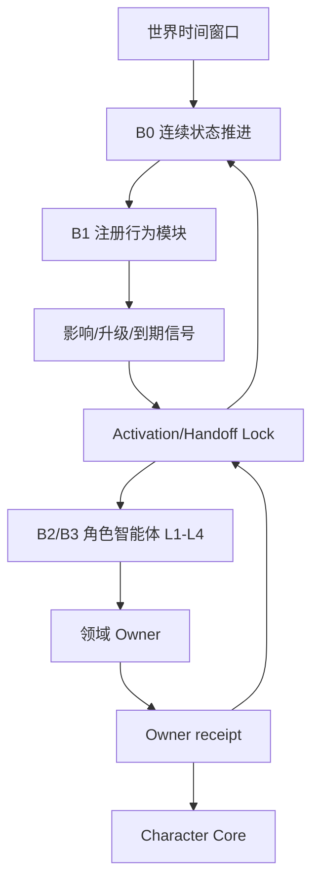

# 02-Agent群体与动画接入

> 版本：1.0（职责拆分版）
> 更新日期：2026-10-30
> 评审状态：职责归位与静态一致性核对；不替代产品待决项裁决或实现评审。
> 实现状态：本篇为目标合同；已有实现仅按原始证据日期记录，不代表全量实现或运行验收完成。
> 验证范围：本轮仅重组文档，未执行代码、UE、PIE 或性能验证。原始设计、实现盘点和证据日期分别保留。

[技术架构入口](../README.md) · [唯一 Owner 注册表](../03-Owner领域/01-Owner注册表.md#owner-registry)

<a id="agent-population"></a>

## 角色智能体接入和群体单一推进者

### 与角色智能体的连接

角色智能体不是 Owner 调度器，也不是物理执行器。Paralls 的完整连接是：


<a id="population-continuity"></a>

## B0/B1/B2/B3 与群体升级

### 与群体模拟的连接

群体模拟与角色智能体是同一角色的不同精度推进者，不是两套居民事实系统。



规则如下：

1. B0 只能推进注册的低精度字段，不直接制造个人重大事实、私人记忆或交易结果；
2. B1 可以产生结构化候选、影响信号和表现种子，但不能声明世界事实已经成立；
3. 高影响或需要主观判断的事件升级到 B2/B3；
4. 同一角色同一时间窗口只能有一个推进者；
5. 激活前固定来源 revision 和连续性游标，过期则 requeue；
6. 角色退出高精度后保留已确认结果、未决意图、义务、失败原因和记忆游标。

<a id="fidelity-presentation"></a>

## Agent 激活与动画激活矩阵

### Agent 激活和动画激活矩阵

| 情况 | Agent 推进 | UE Actor | 动画/表现 |
|---|---|---|---|
| 远处普通居民 | B0/B1 | 不生成或低频代理 | 只显示群体投影 |
| 远处运输队 | B1/运输批次代理 | 简化载荷和路线代理 | 低频位置更新 |
| 接近玩家且承担重要任务 | C2/C3 | 激活实体 | 根据命令、状态和环境实时选择动作 |
| 玩家视野内关键角色 | 当前激活的 Agent 持有自主意图权；本地执行器持续执行获准语义 | 持续激活 | 转向、阻挡、交互和反馈实时运行；执行器不自行替代 Agent 选新策略 |
| 战斗中的关键单位 | Agent/群体意图权与 Combat 等领域写权分开登记 | 持续激活 | 本地执行当前计划与强制约束；动作与语义提交点对齐 |
| 玩家主动暂停 | 世界推进全部冻结 | 保留当前状态 | 动画、物理、世界音频和世界时间冻结；UI 可思考/编辑命令草稿，不传达或刷新未知情报 |
| 离开关注范围 | 降级或交接 | 降级或卸载 | 根据投影恢复，不重置身份 |

玩家视野内被激活的角色必须能够依据自己的状态、命令、环境和失败原因控制动画；不能只有一个与 Agent 无关的播放列表。

<a id="semantic-execution"></a>

## 命令、意图、执行生命周期与语义动画完整合同

| 玩家位于运输路线 | 由 UE 空间 Owner 产生阻挡事实；运输队等待/改道/请求护送，动画表现服从新路线 |

### 命令、意图与表现对齐

命令链仍为：

```text
玩家县令
  -> 亲卫/传令兵
  -> 营指挥头目
  -> 队/运输队/工坊负责人
  -> UE 领域 Owner 结算
  -> Paralls 角色解释与记忆回写
  -> UE 表现反馈
```

Paralls 输出沿用 `character_agent_execution` 的语义边界：

- 允许：`semantic_intent_id`、`semantic_action_id`、目标引用、约束、置信度、证据、因果和相关 ID；
- 不允许：位置、旋转、骨骼、动画名、速度、伤害、物理冲量、资源扣除和最终结果。

UE 收到意图后必须校验：

1. 命令是否仍在有效期内；
2. 目标是否仍可观测/可达；
3. 角色是否有执行能力、装备和通信条件；
4. 领域 revision 是否匹配；
5. 当前租约是否属于该执行者；
6. 当前战场事实是否允许执行。

通过后由 UE 产生 `accepted` receipt 和实际行动状态；不通过则产生 `rejected`、`stale`、`expired` 或 `owner_rejected` receipt，并将原因以角色可理解的事实回传。`accepted` 只表示请求被接纳，后续仍需 `started`、`progress`、`completed`、`interrupted` 或 `failed`；接纳回执不能释放任务、增加库存或把行动写成成功记忆。动画只显示已确认状态，例如“传令兵正在奔跑”“队伍正在转向”，不显示“命令一定成功”。

### Agent-to-Animation 控制通道

玩家视野内、认知级别为 C3 的角色必须保持 `agent_animation_control = enabled`。Agent 是角色自主动作意图和表达选择的 Owner；UE 是动画资产映射、播放、物理约束和实际行动结算的 Owner。该保证也适用于可辨识的远处 P1 角色：可使用低精度姿态/动作类别表现，但必须独立绑定其 Agent，不能混入无法表达该角色意图的群体循环；P0 地图旗标不是身体动画。可见性不能让角色获得玩家相机看到的信息。

C3 激活与进入可见近场前必须通过 `animation_capability_manifest` 准入检查，确认该角色 capability 覆盖第一阶段允许的 locomotion、facing、posture、gesture、combat interrupt 和 safe-hold 语义，并绑定可用 UE 表现。缺少映射时不能宣称该 Agent 已在视野内获得动画控制：角色保持原 fidelity/代理形式，Agent 激活请求等待能力可用；若角色已经在场，则只允许显示最后一个安全状态和 unavailable 提示，不接纳新的自主动作意图。manifest 版本进入 handoff 和 receipt。

这一准入保证角色进入可见 C3 状态后，其有效动作一定存在可执行的表现映射；运行中遇到特定失败仍按中断/安全保持处理。控制链为：

```text
Paralls L3/L4 selected intent + actor_control_frames + presentation_plan
  -> UE AgentAnimationAdapter
  -> capability / state / revision validation
  -> UE AnimInstance / Motion Warping / locomotion / action montage
  -> movement/combat owner settlement
  -> actual state + receipt back to Paralls
```

Agent 的动画控制输出使用稳定语义字段，不绑定具体 UE 资产：

```json
{
  "character_id": "char:county:captain-03",
  "world_tick": 18420,
  "expected_revisions": {"body": 9, "action": 31, "location": 44},
  "action_ref": "action:withdraw-to-east-gate-04",
  "semantic_action_id": "battle.withdraw_to_fallback_line",
  "body_intent": {
    "locomotion": "run_cautious",
    "facing_target_ref": "space:east-gate",
    "posture": "guarded",
    "gesture": "signal_fall_back",
    "interrupt_policy": "interruptible_by_immediate_threat"
  },
  "intent_ttl_world_ticks": 30,
  "presentation_plan": {
    "phase": "begin",
    "priority": "commanded_action",
    "hold_until": "owner_receipt_or_interrupt"
  }
}
```

UE 的 `AgentAnimationAdapter` 按已注册映射把语义动作落到项目动画状态、蒙太奇、Motion Warping 和道具表现；缺失映射时返回 `presentation_unavailable`，不能静默改成与 Agent 意图相反的动作。UE 可以因碰撞、路径不可达、被击中、身体能力不足或动作被打断而约束/拒绝请求，并必须把实际状态和原因回传。UE 不得仅因队伍默认动画或脚本方便而覆盖 Agent 已接受的角色级动作意图。

对 C3 角色，语义意图有效且 UE 执行条件成立时，UE 必须按 Agent 意图驱动动画和动作表现；只有以下有明确事实依据的中断可以暂时覆盖它：

| 优先级 | 驱动来源 | 例子 | 恢复规则 |
|---:|---|---|---|
| 1 | UE 强制身体事实 | 被击中、倒地、失能、死亡、碰撞阻挡、身体能力不足 | UE 产生中断事实与 receipt，回传 Agent；Agent 基于新状态重新选择动作 |
| 2 | 玩家直接控制 | 玩家接管角色移动或攻击 | 玩家取得身体控制 lease；Agent 保留观察/建议，不继续驱动身体动画；释放后重新请求 intent lease |
| 3 | Agent 当前有效意图 | 奔跑到目标、转身、保持戒备、挥手传令、攻击或撤退 | UE 按该意图持续表现，直到更新、完成或发生更高优先级中断 |
| 4 | 被动环境表现 | 呼吸、轻微站姿变化、衣物/马匹 idle | 仅填补无动作意图的空档，不能改变角色行动方向 |

命中、死亡等 UE 强制动画只覆盖被中断的身体通道，不取得角色的认知/意图 Owner；事实回传后 Agent 可选择继续、撤退、求援或其他符合角色状态的行动。多个意图同时到达时按 `action_revision` 和 `expected_revisions` 判定新旧，不能用消息抵达顺序决定胜负。

动画通道按 world tick 消费带 revision 的增量，支持 `begin`、`update`、`hold`、`interrupt`、`complete`。每个动作必须能由当前共享状态重建，避免网络延迟后播放过期蒙太奇。Agent 改变行动时应提交新 `action_ref` 和增量；UE 只在验证通过后切换。动画到达结束帧只产生表现事件，不代表领域动作成功。

对玩家视野内 C3 角色的明确规则：

- C3 角色进入视野时必须先通过 animation capability manifest 并准备好 AgentAnimationAdapter 或兼容的 P1 语义表现通道，再展示可控角色；不能展示后再等待下一次 0.5 秒普通轮询。近场表现不能继续只由队伍循环动画驱动。
- 普通成员若没有独立 C3 Agent，可以由队伍/编队控制；但任何已激活且在视野内的 C3 成员，其个体动画和动作状态必须服从自己的 Agent 意图。
- C3 Agent 不需要每帧输出。未变化时 UE 保持最后一个已确认的 `hold` 状态，并按 UE 本地移动/动画时钟连续播放；暂停时动画时钟冻结。
- `hold` 不是无限期许可：每个 Agent 控制增量带 `intent_ttl_world_ticks`，收到更新、完成或中断回执后刷新/终止；到期后进入明确的安全保持状态并请求 Agent 刷新，不能无限重播旧动作。
- 角色正在移动时，Agent 的朝向、移动/姿态语义必须驱动 UE 动画选择；UE 可求解路径与速度，不可把语义目标替换成另一个行为。
- Agent 通道暂时断开时，保持最后一个安全且已确认的动作直到 intent TTL 到期，停止接纳新的角色自主动作；到期后切到明确的本地安全保持动作，并给该 Agent 返回降级原因。不可继续播放看似新决策的循环动画。

<a id="activation-budgets"></a>

## 转层触发、预算、持续条件与锁

本表是本设计的最低反例集。`accepted`/`started`/`progress`/`completed`/`interrupted`/`failed`、双 lease、`control_epoch` 和空间 reservation 都是本设计要求的对齐合同；它们不能仅因 Paralls 当前存在类似字段/机制就宣称已经被 UE 生产调用。

### 转层触发与预算

第一阶段采用确定性规则，不使用每帧距离判断：

- 每 0.25 秒更新 UE 表现候选，但只在 0.5 秒决策窗口申请转层；
- `near_enter_radius`：玩家、敌对攻击者、可交互目标和当前镜头焦点的最大值；
- `near_exit_radius`：进入半径的 1.5 倍，避免边界抖动；
- `combat_lock`：近场战斗、命中确认、运输拦截和对话进行中禁止表现降级；
- `cognitive_interest`：Paralls 的角色重要性、未解决意图和玩家关注度可提高认知等级，但不能越过预算和 privacy gate；
- 远场批次按固定 world cadence 运行，不能使用进程调度顺序或 wall-clock 作为事实推进依据。

所有阈值应在 Data Asset/配置中版本化，并随 `policy_revision` 进入 handoff 审计。

### 激活后的持续条件

激活不是一次性事件，也不是“距离进入就永久保持”。系统分别计算认知保持锁和表现保持锁。只要保持锁仍有效，对应层级就不能释放；距离离开只会创建降级候选。

**Agent C3 持续条件，满足任一项即可保持：**

- 角色仍拥有未完成的语义行动、待结算意图或有效 execution lease；
- 角色正在被玩家追问、谈话、审讯、下达命令或作为当前战报来源；
- 角色是当前命令链的关键节点（县令、营指挥、队长、传令兵、工坊负责人或敌方重要将领）；
- 角色的私有认知仍影响一个尚未结算的行动，例如敌军主将已决定夜袭但还未进入执行阶段；
- 角色处于需要连续判断的战斗、撤退、护旗、护送、拦截或继任过程中；
- handoff 尚未完成、`pending_merge` 尚未提交或桥接断线仍在短时降级窗口内。

**Agent C3 释放条件，必须同时满足：**

- 没有未完成的语义行动、待结算 receipt 或有效 lease；
- 没有玩家交互、关键命令链职责或连续判断需求；
- 角色已提交最新共享状态、私有记忆回写和 `pending_merge` 结果；
- 经过 `agent_exit_grace_ticks` 的稳定窗口，期间没有重新触发保持锁；
- 新的认知层级已取得合法 activation/presence receipt。

**P2/P3 动画表现持续条件，满足任一项即可保持：**

- 角色在玩家视野、镜头焦点、交互半径或可攻击半径内；
- 角色正在播放不可瞬间截断的动作尾段，例如传递物件、上马、翻越、装填、受击硬直或倒地确认；
- 角色参与近场碰撞、战斗接触、运输拦截、道路堵塞、火灾或器械操作；
- 角色的空间占用会影响玩家或其他近场 Actor 的寻路；
- 对应的 `combat_lock`、`interaction_lock`、`physics_lock` 或 `presentation_tail` 尚未释放；
- 玩家刚离开范围但仍处于 `presentation_exit_grace_ticks`，用于避免边界抖动和画面跳变。

**P2/P3 释放条件，必须同时满足：**

- 离开观察/交互/攻击半径并超过退出滞后窗口；
- 没有近场战斗、碰撞、交互、动作尾段或空间占用责任；
- 当前动作已经提交 UE 领域 Owner 的结果，或已明确标记为中断并写入恢复策略；
- 共享状态快照和最后一帧表现状态已经写入 handoff；
- 新的 P1/P0 表现代理已创建并确认接管位置、行动阶段和旗标状态。

**双锁同时持续的情况：**

- 玩家正在和传令兵/队长/重要将领交互；
- 角色处于玩家可见的近场战斗，并且其自主判断会改变下一步行动；
- 运输队正在被玩家阻挡或遭敌袭，领队需要实时决策且车队需要真实碰撞；
- 角色动作尚未结算，例如命令已接受但队伍尚未完成转向或护旗；
- 角色正在完成继任、撤退或其他不可拆分的指挥交接。

**只有一侧持续的情况：**

- C3/P1：敌方主将距离很远，仍在根据斥候情报思考，但不需要生成完整人形；
- C1/P2：玩家近旁的普通守军有完整站立、行走和受击动画，但由队伍状态机驱动，不运行独立 Agent；
- C2/P1：即将进入视野的传令兵已预热公开上下文，但还没有取得 C3 lease，也不接受玩家语义互动。

<a id="fidelity-authority-normalization"></a>

## 旧设计措辞和预算的适用范围

本篇保留 2026-10-27 draft 的 schema、优先级、TTL、动画 manifest 和执行生命周期。文内“UE 决定/产生事实”仅指获准领域实现；碰撞/寻路/动画证据经具体 Owner 确认，Actor 自身不写世界事实。旧“本地战术脑”只在获准 fallback 合同内继续计划，不在断线时产生无限新自主意图。

0.25 秒表现候选、0.5 秒 Agent 候选、1.5 倍退出半径等均为设计候选，不是本轮实测。已激活 C3 控制和即时强制限制不能被这些轮询周期延迟；渲染、模拟、评估、提交、投影同步和 Agent 决策分别登记。关键任务、可见性、交互、动作尾段和 handoff 锁决定持续激活；镜头转开不能无条件撤销角色。

<a id="five-stage-paralls-contract"></a>

## Paralls 角色、司命与群体职责

### Paralls 负责

- 角色感知、记忆、目标、计划和语义行动意图；
- 司命对公开世界态势的判断和高层催化；
- 人口、家庭、职业、生产、消费、迁移、劳动和群体趋势候选；公共事实由对应领域 Owner 结算；
- 已登记领域的权威结算、事件历史、回执、投影、回放和恢复；
- 跨域事件的因果、相关、版本、幂等和来源信息。
