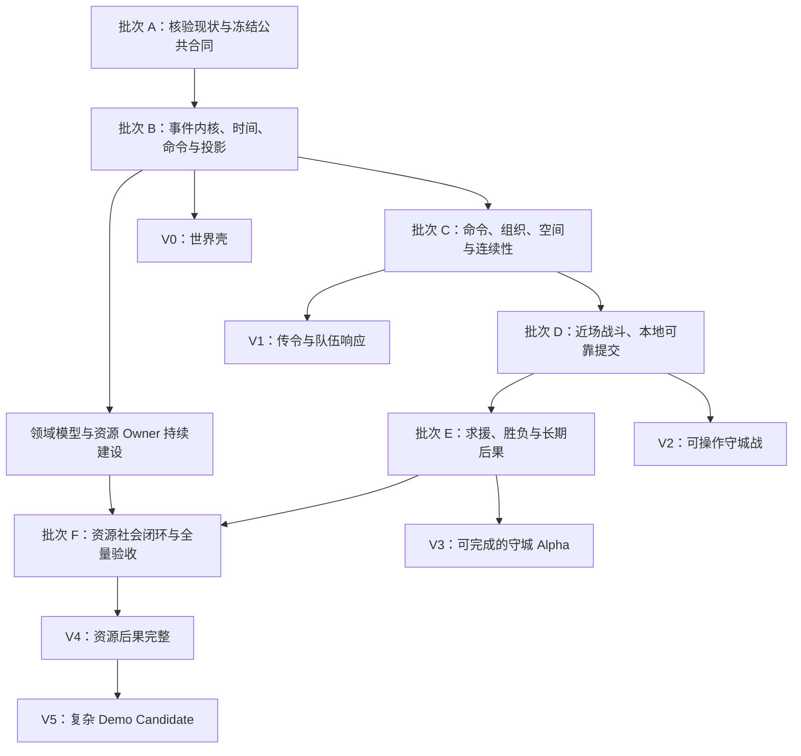

# 基础设施与 Owner 建设总计划

- 版本：1.0（职责拆分版）
- 更新日期：2026-10-30
- 评审状态：整理版；继承原文评审状态，非新增产品批准
- 实现状态：设计/计划；本次未核验代码或UE运行，不代表已实现
- 来源：原08 §§2–4、7–8、12–15；重复技术规格合并进architecture

## 范围与依赖

本计划维护工作包、任务和依赖；规则/字段/Owner清单以[README](../architecture/README.md)为准，23领域只在[01-Owner注册表](../architecture/03-Owner领域/01-Owner注册表.md)注册，完整交付包及事实边界不在计划重复维护。县城内容排程见[县城守城Demo执行计划](县城守城Demo执行计划.md)。全部复选框是原计划待办，不是完成证据。


<a id="source-plan-goals-packages"></a>

## 2. 总目标与硬约束

建设目标引用[县城体验与范围](../PRD/05-阶段与可玩切片/县城守城Demo/体验目标与范围.md)和[正式基础设施、连续性、有限知情与实时约束](../architecture/01-系统边界/01-系统边界与权威写入.md#technical-success)。本计划按这些正式规格安排交付；容量与实现结论仍需各自测量证据。

实施遵守项目 AGENTS：只运行一个 UE 实例；保护 `/Game/TopDown/Lvl_TopDown` 与 Saved 调试文件；资产操作先验证小样本。大型操作前重新测量内存/显存；可用内存低于 8GB 禁止大型导入，低于 4GB 停止构建并按项目规范处理；可用显存低于 3GB 禁止新增高模等高负载资产。

本计划不安排长时间构建、关卡清空或资产替换。后续这些任务需依既定需求与回退方案逐项执行。

## 3. 总体依赖与并行方式



并行指工作包可独立推进，不要求增加人员或启动多个 UE。每个新增 Owner 沿用已冻结的治理合同；接口依赖未就绪时可以做纯规则和合同测试，不能把临时假写入接进可玩版本。

资源建设自批次 B 起推进，V3 可以先使用受控的正式配置验证主线，但资源玩法完整验收在 V4；V3 不得标记为完整复杂 Demo。每轮只启用已通过相应能力门的规则与实体。

## 4. 基础设施建设清单

下表是共享基础设施和基础权威，不另计入[正式合同](../architecture/03-Owner领域/01-Owner注册表.md)的 23 个领域 Owner。

能力定义只维护于[共享基础设施 I01—I10](../architecture/01-系统边界/01-系统边界与权威写入.md#shared-infrastructure)，技术检查只维护于[持续验收语义](../validation/技术契约验证用例.md#shared-infrastructure-acceptance)。本表仅维护首次交付和后续排程。

| 工作包 | 首次交付与后续排程 |
|---|---|
| I01 | A 冻结合同；B/C 落地 |
| I02 | B 可执行；V1 开始持续验证 |
| I03 | B 后端路径；D 本地权威路径 |
| I04 | B 接 V0；各切片持续回归 |
| I05 | B 第一条正式模型链；F 全 Owner 覆盖 |
| I06 | B 正式合同；C/E 验证信息边界 |
| I07 | B 建执行合同；C—F 交付真实流程 |
| I08 | C 首次接入；D/F 回归 |
| I09 | B 连接 V0；D 可靠本地提交；F 全链恢复和回放 |
| I10 | B 起每轮交付；F/V5 汇总验收与试玩包 |

身份、时间和能力授权引用[基础权威](../architecture/01-系统边界/01-系统边界与权威写入.md#foundation-authority)；批次 A 负责映射到实际模块。

<a id="source-plan-tasks-batches"></a>

## 7. 阶段 1—4 的具体建设方式

这里展开 [阶段对照中的基础设施能力门](../PRD/05-阶段与可玩切片/阶段与切片对照表.md)；不把四个能力门变成四段大串行。

### 阶段 1：冻结合同和完整写权地图

**输入：** 最新 PRD、Paralls 当前代码/测试、Guoshang 当前实现与 UE 状态。

- [ ] A1：逐项建立“文档目标—已有模块—已有测试—Guoshang 缺口—负责人—验收证据”矩阵。不得从旧分析直接判定 current；ESM 按合同可复用、需适配、Godot 执行需替换、旧写入口需迁移四类逐项登记。
- [ ] A2：冻结[正式合同](../architecture/03-Owner领域/01-Owner注册表.md) 23 个领域 Owner 与基础权威的事实/读写矩阵，解决装备、岗位/班次、设施/设备、承诺、权限等交叉字段归属。城门政令归 Government，机械开闭/门闩/完整度归 Production / Facility，通行与占用归 Presence，控制归 Territory，产权归 Ownership。旧 ESM 对象/身体写入口逐字段迁移，重叠入口在启用前失效。
- [ ] A3：冻结统一 Command、Evidence、Event、Receipt、Projection、授权 fragment 与 Workflow 合同，含版本、原因码、revision、epoch、lease、因果 ID 和时间。
- [ ] A4：冻结 Model Registry、Static Data、Applicability Binding 和 Evaluation Context；约定单位、未知输入、冲突、版本迁移及历史版本保留。
- [ ] A5：按[正式合同](../architecture/05-运行时接入/01-UE本地提交与Paralls同步.md)逐 Owner 登记近场/远场执行与提交配置、时间窗/积分策略、延迟和性能预算；明确 Agent 意图权、本地执行器中断权限与动画反馈合同。登记 UE 执行器替代范围与直接本地路由，不能默认所有动作经 ESM 或 Python。

共享环境输入也须在 A2 登记：温湿度、降雨、火场/烟雾等注明事实字段、授权来源、作用域、版本、采样与推进责任。设施内部状态可在 Facility 已定义写集中登记；跨设施/区域环境不得擅自视作 Inventory 或 ESM 字段。未覆盖的环境事实须先评审扩展现有域或新增领域合同，更新本名单后才能启用；来源未定时该模型保持 unknown/拒绝，不得宣称已支持全部环境结算。

**验收：** 23 个条目无事实双写与无归属字段；schema 样本可验证，非法来源/类型/版本/绑定样本被拒绝；版本升级策略明确。此时只通过合同冻结，不宣称实际幂等、replay 或所有 Owner 已执行——这些由阶段 2—4 证明。

### 阶段 2：建设正式事件、时间与恢复内核

**输入：** A2—A5 的版本化合同；已核验可复用的 Paralls 结算组件。

- [ ] B1：接通真实 Owner 授权批次、revision/CAS、幂等 receipt、持久事件/outbox；以 Inventory 参考结算验证，不引入测试专用万能 Owner。
- [ ] B2：实现 WRK 时间、窗口、预算、依赖、due 与暂停屏障。暂停在一致性边界完成；屏障生效后不再推进世界。物理时间的网络返回可以到达，但只能隔离/入站缓存，不触发玩法、记忆暴露或表现推进。
- [ ] B3：实现 checkpoint、完整 replay、投影删除重建、未知提交结果查询、重试与恢复；记录开放义务和 confirmed cursor。
- [ ] B4：在 D/V2 前完成 UE 获准本地权威提交端及后端副本同步，含 epoch fencing、持久 outbox、崩溃恢复和校正；不能用内存状态加异步上传代替可靠提交。

**验收：** 重投同一命令返回原 receipt；旧 revision 不覆盖新事实；模拟“已提交、未收到 receipt”可查回原结果；checkpoint 恢复与完整 replay 一致；暂停时所有模拟推进冻结。

阶段 2 分成 B 可用的正式后端提交配置和 D 完成的正式本地配置；二者合同一致。V0/V1 不必等待战斗本地提交端，V2 正式通过则必须等待。

### 阶段 3：统一 Command 与三本账读取入口

**输入：** 公共合同与阶段 2 可用的真实提交链；具体领域权限来自其 Owner，不由 Gateway 编造。

- [ ] B5：完成五类来源适配、命令校验/路由/状态查询、时效/权限/证据、取消与幂等恢复。一次本地调用无需 RPC，但不能绕过治理合同。
- [ ] B6：建立 UE/UI、Agent、群体三类受限投影，携带三种时间、来源、知情范围与游标；命令受理 receipt 不等于目标已收到命令。
- [ ] C1：接入角色的合法感知、记忆写回、结构化意图；Agent 不得直接写公共 Runtime State。
- [ ] C2：验证报告迟到、传令失败、旧信息、unknown、投影延迟与重建；玩家通过问询或报告获知原因，不自动获得内部完整拒绝理由。

**验收：** 人类、智能体玩家、角色 Agent、群体、脚本的同类请求走同一规则；正常 UI 不泄漏调试真相；取消、过期、重复和未知结果可解释且不重复执行。

### 阶段 4：全量 Owner 与跨域流程

**输入：** 稳定的 I01—I10 合同及各批次需要的基础实现。

- [ ] C3：交付 Presence、Dispatch、Organization、Information 与连续性，形成 V1。
- [ ] D1：交付近场 Combat、Body、Equipment、Status、LifeState、Morale 和 Territory，并同步交付 Inventory 的弹药/药品即时子流与 Production / Facility 的城门机械、城防完整度子域，形成 V2。
- [ ] E1：交付 Government、Objective、Campaign 并连接 Information，形成 V3；Social/Politics 同步建设。
- [ ] F1：补齐 Inventory、Ownership、Economy、Transport、Production、Population、Survival、Social、Politics 正式规则和全量回归，形成 V4。
- [ ] F2：执行征发—运输—生产、医疗、采购欠款、控制转移、公开政治后果、跨阶段继承等正式 fixture。

**验收：** 23 个 Owner 均满足[正式合同](../architecture/03-Owner领域/01-Owner注册表.md)；每个真实跨域流程可列出已提交/待提交步骤、各域 revision 与恢复动作。V4 结束前通过全量 Owner 能力门，不能拖到 V5 再补架构。

## 8. 批次交付、可玩结果与阶段门

| 批次 | 基础设施/Owner 交付 | UE 可观察结果 | 放行条件 |
|---|---|---|---|
| A 基线与合同 | A1—A5，事实矩阵、复用证据和任务边界 | 记录已有入口与硬件状态；不扩张资产 | 写权、合同、模型与部署配置冻结；每项有执行责任 |
| B 世界壳与参考结算 | B1—B3、B5—B6；I05 正式参考实现；Presence 基础 | V0：移动、三视角、暂停/恢复、保存/加载 | 时间/位置连续，真实事件可回放；V0 明确不是玩法 Demo |
| C 传令与组织响应 | C1—C3；I07/I08 首条正式流程 | V1：军情报告、下令、传令、队伍响应（原三队数量待D03确认）；角色有判断 | 已下令/送达/接受/执行分开，远离现场仍推进，handoff 不双跑 |
| D 实时守城战 | B4、D1；近场可靠提交、授权批次和输入切窗；Inventory 即时子流与 Facility 城防子域 | V2：亲战、队伍协作、生命/体力/伤势、军旗/士气/城防变化 | 即时响应达到事先登记预算，断线/崩溃后不双算，LifeState 边界成立 |
| E 求援与主线收束 | E1；政策/情报、援军过程、控制、目标与阶段进度 | V3：约三十日守城可完成，两条胜利和三类失败 | 只由确认事实判胜负；这是 Alpha，不是完整资源社会 Demo |
| F 资源社会闭环与质量 | F1—F2；全量模型、流程、跨阶段 fixture 和失败注入 | V4：运输/生产/医疗/社会后果；V5：整合试玩包 | 先通过全量 Owner 能力门，再完成 V5 性能、稳定性和完整体验验收 |

所有批次按“可启动入口—真实 Command—Owner 结算—receipt—投影—观察/操作—失败注入—保存回放”工作。新切片不得破坏旧切片独立启动和回归。

<a id="source-plan-responsibilities"></a>

## 12. 分工与集成规则

下表是责任分工，不是人数要求。人员少可兼任，任务仍保持单一负责人；共享 schema、写权和事件目录统一评审，避免各域自行更改。Paralls 与 Guoshang 的实际代码文件在 A1 核验后写入任务卡再开工。

| 工作线 | 负责范围 | 对外交付 | 不得承担的写权 |
|---|---|---|---|
| L1 核心基础设施 | I01—I04、I07、I10；权威拓扑、事件/恢复、WRK | 统一提交、调度和恢复合同，故障注入入口 | 不替代领域 Resolver |
| L2 模型与领域结算 | I05；23 个 Owner 的规则、状态机、模型和投影 schema；按 C/D/E/F 拆任务 | Owner 完整包、纯规则/事件回放测试、跨域授权结果 | 不写邻域状态，不把领域模型变万能模型 |
| L3 UE 实时与表现 | I09、Presence UE 执行、近场 Owner 承载、本地提交接入、寻路/碰撞/动画/UI | 各 V 切片入口、即时反馈、运行证据 | Actor/Ability/Timer 不另设事实写入口 |
| L4 Agent 与群体连续性 | I06 的私有感知/记忆面、I08、意图生成与执行语义 | 单一推进、合法知情、记忆/意图/动画交接证据 | Agent/B0/B1 不直接写公共领域事实 |
| L5 内容与验证 | 召陵县实体、配方/绑定/参数、场景与角色素材、剧本、回归、性能和打包 | 版本化数据、各切片场景、验收记录 | 不以剧本脚本直写伤害/资源/胜负 |

L2 决定某领域的合法结果，L3 承载其获准近场实现；两者不能各实现一套同名规则。L1 提供模型和提交机制时也必须依 L2 的写集授权。每条跨域流程指定一名集成负责人维护步骤和恢复证据。

## 13. 每张实施任务卡的固定内容

执行前从本计划拆出可独立检查的任务卡，写明：

```text
任务 ID / 所属 I 工作包或 Owner / 交付批次与 V 切片
唯一负责人 / 实际仓库与文件范围 / 读取依赖
消费的接口与版本 / 输出的准确类型与签名
事实写集 / 授权与提交端 / 模型及 Binding / 不变量
正常用例 / 拒绝与中断 / 重复与未知结果 / 恢复与回放
执行命令与预期结果 / UE 验证入口 / 资源预算
回退方法 / 证据位置 / 当前状态与未解决风险
```

工作步骤是：先确定要证明的不变量和失败案例，运行针对性的现有测试或补充必要测试，完成实现，再验证和接入切片。接口名、数值和运行命令必须来自当前代码及已冻结规格；不能把“自行处理各种边界”作为可执行任务。

依赖冻结的是共享合同，非全部实现。L2/L4/L5 可以在合同后并行推进；只运行一个 UE 实例，导入、着色器编译、烘焙及大规模扫描顺序执行。

<a id="source-plan-start-order"></a>

## 15. 实际开工顺序

1. **先做 A1—A5：** 核验两项目现状、冻结 23 Owner/基础权威写权地图及公共合同，产出可执行任务卡。
2. **随后启动 B 与模型参考链：** 建设正式事件/时间/命令/投影内核，接 V0；资源 Owner、模型和内容数据同步推进。
3. **接 C/V1：** 让命令、组织、传令和角色判断先形成可观察结果；同时建设 D 的本地可靠提交。
4. **通过 D/V2 再接 E/V3：** 先证明实时守城协作，再形成可完成 Alpha；E 可提前做规则与 fixture，不依赖画面全部完工。
5. **F/V4 通过全量 Owner 门：** 把资源、社会和五阶段 fixture 接齐；最后 V5 做整合、性能、试玩和交付。

本计划完成的是排程、边界与验收定义。任何具体能力是否已完成，仍以当前代码、测试与 UE 运行证据为准。

## 正式规格与验证依赖

- 写权地图、基础权威与Owner完整包：[01-Owner注册表](../architecture/03-Owner领域/01-Owner注册表.md)；细合同与部署节奏见[01-UE本地提交与Paralls同步](../architecture/05-运行时接入/01-UE本地提交与Paralls同步.md)。
- 三本账、模型/Binding/评估、跨Owner结算及三本账查询：[README](../architecture/README.md)按职责导航。
- 征发运输生产、医疗、采购欠款、控制转移和政治后果：[02-数值状态效果与跨Owner结算](../architecture/04-模型与结算/02-数值状态效果与跨Owner结算.md)及PRD跨模块流程。
- G1–G7为证据门，见[验证与证据规范](../validation/验证与证据规范.md#g1-g7)；不是另一份已完成进度表。

本次未运行A1代码扫描、UE检查或任一建设任务；现状分析必须按当前代码/测试重新核验。
