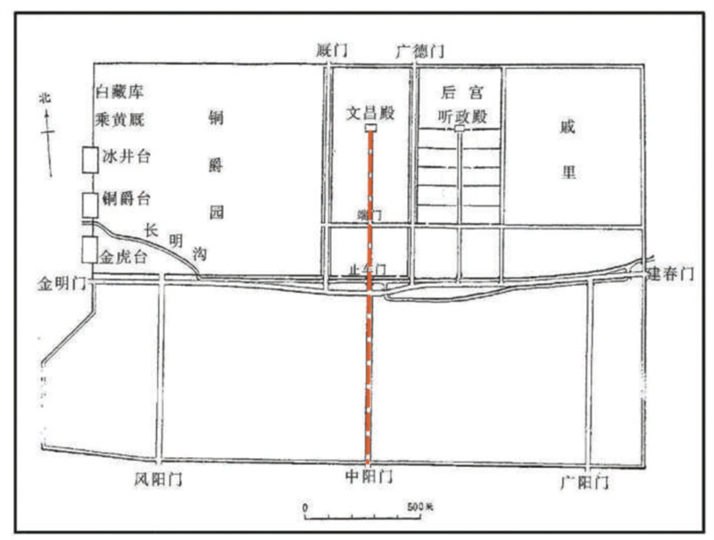
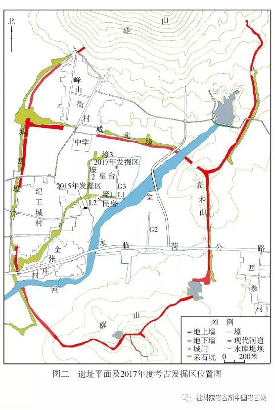

# 汉末城池平面参考核查

日期：2026-10-30。目的：回应召陵 v001 建筑过少、排列不合理的问题，先查图版，不启动新一轮生成。本轮资料为研究候选，未导入 UE。

## 可以优先看的两张图

### 1. 汉末营建、曹魏时期的邺北城复原示意图

- 来源：[河北省文物考古研究院《曹操营建的邺城，埋藏了中国都城的千年秘密》](http://www.hbswwkg.com/2023-12/12/content_9113769.html)，页面说明文中图片均由邺城考古队提供。
- 图版性质：复原示意，综合考古与文献；不是汉末某一年的完整实测平面。
- 时段：曹操汉末经营的邺北城，图题标为“曹魏邺城”。不能把其每个建筑都断定为公元 220 年以前。
- 等级：王都，不能照搬其宫殿、铜雀三台和城市规模作为县城。
- 图上可见：南部三座城门与道路、北部集中布置的宫室官署、苑园及仓储；城门不是每边中央各一个。图中南部大片空白没有逐户绘出住宅，不能当作历史空地。
- 同文公布的尺寸：东西约 2620 米，南北 1700 多米；仅作为邺北城尺度，不能移植给召陵。

### 2. 邾国故城／秦汉邹县遗址平面图

- 来源：山东大学历史文化学院、山东大学文化遗产研究院、邹城市文物局《山东邹城市邾国故城遗址2017年J3发掘简报》，原刊《考古》2018 年第 8 期；本轮读取[社科院考古所中国考古网在搜狐的转载](https://www.sohu.com/a/254808416_199807)，图二。
- 图版性质：遗址轮廓、现存／地下城墙、现代河道道路及发掘区位置图，**不是古代全城街巷与住宅复原图**。不能把图中公路或现代村落当作秦汉街巷。
- 等级：东周诸侯国都城，后来成为秦汉邹县县治，是县治功能比较资料。
- 年代限制：报告所述 J3 主体使用年代为西汉晚期，西汉末至新莽废弃；不能说成汉末东汉县衙。
- [山东大学 2023 年报道](https://www.media.sdu.edu.cn/info/1002/32972.htm)介绍遗址中北部“皇台”为东周宫室／秦汉官署，南部为居民生活区，西南部有冶铸、制陶等作坊。报道包含多个时期的功能概括，不能保证各区同时存在。
- 借鉴价值：县治中的官署、居住、生产等功能及其相互位置值得研究；地形、河流和历代沿用会影响城市轮廓，不能只靠等距大院落填充。

## 补充资料与证据等级

| 图版 | 来源与时段 | 使用限制 |
|---|---|---|
| `eastern-han-luoyang-commons.png`，东汉洛阳城示意 | [Commons 文件页](https://commons.wikimedia.org/wiki/File:%E4%B8%9C%E6%B1%89%E6%B4%9B%E9%98%B3%E5%9F%8E.png)，标注 CC BY-SA 4.0 | 能看到南北宫、城门、市场等示意关系，但文件的作者和来源字段没有有效书目信息；原始学术出处未核，证据等级较低，仅作检索线索。 |
| `han-changan-02.png`，汉长安城历年考古工作情况示意图 | [徐龙国《汉长安城考古的收获、进展与思考》](https://theory.dahe.cn/2022/09-09/1093924.html)，《南方文物》文章转载 | 图一展示考古工作范围，不是汉末全城复原；都城等级，包含多时期信息。文章明确指出：现有遗址总平面是不同历史时期遗迹叠加，部分空白受现代村落占压影响，居民闾里尚未完整揭露。 |
| `han-changan-03.png`，汉长安城霸城门遗址平面复原图 | 同上，图二 | 可研究城门门道／隔墙构造；文章指出汉以后有减少启用门道的变化，不能照搬都城门道宽度给县城。 |
| `ye-site-layout.jpg`，邺城遗址平面布局图 | [中新网 2023-12-08 报道](https://www.chinanews.com/cul/2023/12-08/10124656.shtml)，邺城考古队供图 | 同时标出邺北城、邺南城和外郭；后两者不能归入汉末。 |
| `ye-axis-layout.jpg`，邺城平面布局与中轴线示意图 | 同上，邺城考古队供图 | 同时画北城与南城，不能把南城中轴、宫城及外郭误当曹操时期全城。 |

`han-changan-01.png` 是遗址照片，`zou-county-01.jpg` 是现代区位图，均不作为古城布局图。

## 对召陵 v001 的纠正

1. 四边中点各一门、十字主街、少量等距大院落，目前没有召陵本地证据支持，不能继续当作历史底图。
2. 县城需要在米制比例下讨论主街、支巷、住宅、院落和非居住用地的尺度；不能简单把县衙级院落缩小后复制，也不能凭空指定几千幢住宅。
3. “建筑太少”可以判断为现有表现不足，但本轮参考图没有提供汉末召陵人口、户数或逐栋建筑清单，尚不能据此给出真实建筑数量。考古图留白也不等于空地。
4. 都城的规整轴线有历史依据；这不能推出县城必须完全规整，也不能推出县城必须杂乱。具体道路与分区应依据本地遗址、地形、沿用过程和明确标注的设计假设。

## 召陵自身资料仍须补足

[CHGIS 召陵县记录 hvd_83032](https://chgis.hudci.org/tgaz/placename/hvd_83032)引述《中国文物地图集·河南分册》（1991）第 333 页：“现存内外二城，外城周围6公里呈正方形；内城位于外城西北隅。”本轮复核了项目内原始记录，但尚未取得该书原页和召陵城墙、道路的分期发掘图。

若暂按“6 公里周长的正方形”估算，是边长约 1.5 公里、面积约 2.25 平方公里；这是条件计算，不能代替测绘，也不能断言整个内外城形制均属东汉末年。

下一版应先建立尺度明确的布局草案，区分本地证据、同类城址参照和设计推定，再生成概念图。仍待查：召陵实测总平面、城门及城墙分期、汉末水系、街道走向、居住与作坊遗迹。**本轮尚未找到可直接使用的“汉末召陵完整县城平面图”。**

## 保存和授权

全部下载图的网页来源、原图 URL、尺寸、文件大小、SHA-256 与使用限制登记于 `sources.json` 和资源 manifest。Commons 许可是文件页自述，原始权属仍需核实；其他网页未见明确再利用许可。本批仅用于内部历史研究与来源展示，不登记为已获游戏商用授权的素材。
